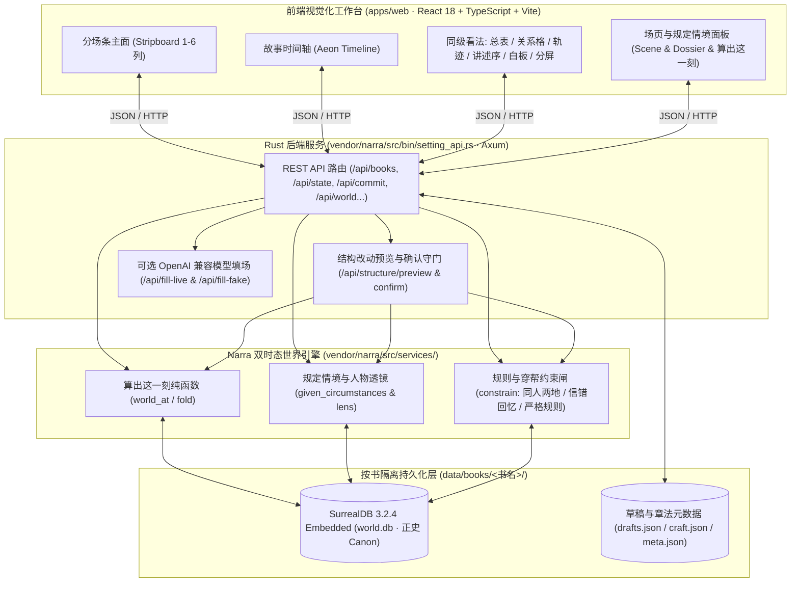

# 设定图 (She-Ding-Tu)

**面向长篇小说、影视剧本与复杂世界观构建的视觉化设定图谱与双时态排戏工作台**  
*A Visual Story-Bible Graph & Bitemporal Scene-Blocking Workbench for Long-Form Fiction, Screenplays, and Worldbuilding.*

[](./LICENSE)
[](./.github/workflows/ci.yml)
[](./vendor/narra)
[](./apps/web)

---

## 目录 (Table of Contents)

- [项目定位与设计哲学 (Project Positioning)](#-项目定位与设计哲学-project-positioning)
- [核心功能 (Core Features)](#-核心功能-core-features)
- [技术栈与架构图 (Architecture & Tech Stack)](#-技术栈与架构图-architecture--tech-stack)
- [环境要求 (Prerequisites)](#-环境要求-prerequisites)
- [快速启动指南 (Quickstart)](#-快速启动指南-quickstart)
- [环境变量说明 (Environment Variables)](#-环境变量说明-environment-variables)
- [测试运行指南 (Unit & Playwright E2E Testing)](#-测试运行指南-unit--playwright-e2e-testing)
- [English Overview & Quickstart](#-english-overview--quickstart)
- [文档导航与开源协议 (Documentation & License)](#-文档导航与开源协议-documentation--license)

---

## 🎯 项目定位与设计哲学 (Project Positioning)

在长篇小说、群像剧本与多线叙事的世界观创作中，传统文档工具（大纲笔记、静态维基、普通白板）面临三大痛点：
1. **静态设定与动态演进脱节**：人物卡里只写着最终状态，无法回答「故事第 3 天夜里，阿莲知不知道刀在抽屉里？此时刀在谁手上？」。
2. **灵感的推演草稿与既定正史混杂**：随手记下的脑洞一旦改乱，就会破坏后续几十场戏的因果链条。
3. **故事时间、讲述顺序与写入历史混淆**：倒叙、插叙或修改过往场次时，缺乏对后续「穿帮」与「因果缺口」的自动推演与守门。

**设定图 (She-Ding-Tu)** 以 **「按故事时间排戏 + 双时态/三时钟世界引擎」** 为核心：
- **打开即分场条 (Stripboard)**：一列一段故事时间，一张卡一场戏；顶栏一根全书细条标尺，点击任意时间列即可 **「算出这一刻」**（`world_at` 纯函数确定性折叠：谁在哪、持有物、人物知情与信错、待兑现伏笔）。
- **草稿与正史严格分离 (Draft vs. Canon)**：白板灵感、丢草稿拆场、AI 辅助填场均只停留在草稿态（虚线/草稿齿）；唯有作者显式点击 **「写入正史」**，事实才进入嵌入式 SurrealDB 世界库并成为后续场次的 **「规定情境」**。
- **结构变更守门 (Impact-Checked Structural Edits)**：拖拽改钟、侵入邻列、修改或删除已正史场次时，系统自动计算故事时间空洞、因果缺口与知情断层，确认变更后方可落库。

---

## ✨ 核心功能 (Core Features)

### 1. 分场条与故事时间轴排戏 (Stripboard & Story Timeline)
- **分场条主工作面 (`Stripboard`)**：支持 `1–6` 列自适应视窗（疏 2 列 / 中 4 列 / 密 6 列）、全书细条缩略窗拖拽平移、同行多场并列戏、省略场（Ellipsis）与倒叙标注。
- **Aeon 风格故事时间轴 (`Timeline`)**：与分场条共享同一份故事时底座，支持无级缩放平移、From–To 时间尺校准、拖拽条改钟、依赖场级联平移与一键撤销（`⌘Z` / `Ctrl+Z`）、按人物/地点/逻辑线分组泳道。
- **纯函数「算出这一刻」(`world_at`)**：点击任一时间列或正史场，右侧即时呈现该故事时刻的在场分布、器物归属、人物知情账（含目击、听闻与**信错/误信**拦截）以及未兑现伏笔。

### 2. 人物/关系图谱与出场矩阵 (Character Graph & Relationship Matrix)
- **双边设定关系图谱**：在人物档案或关系格（`人 × 人`）中建立设定关系，正反向关系自动双边同步；连线图按选中焦点人物动态呈现关系边。
- **出场与年龄矩阵 (`场 × 人`)**：全高出场表与飞出层矩阵，支持一键点格增删草稿在场人物、查看角色在当场故事时刻的只读年龄与轨迹连续性。

### 3. 百科设定集与十项人物档案 (Encyclopedia Codex & Dossier)
- **多类型世界实体**：统一管理人物（Person）、地点（Place）、器物（Item）、组织（Faction）、世界规则（Rule，支持严格守门拦截违例戏，如「渡口夜间不得开船」）。
- **F10 深度档案与规定情境联动**：涵盖基本设定、外貌/标志、渴望（Desire，自动作為旁注投射至本场任务栏）、秘密、弱点等十项创作维度；动态经历与知情时间线由正史自动汇总，只读防篡改。

### 4. 白板灵感推演折进正史 (Whiteboard Brainstorming to Canon)
- **自由白板便笺 (`Whiteboard`)**：提供不受时间轴约束的自由画布，随意记录灵感便笺、引用既有场次卡片；白板上的推演绝不污染正史。
- **灵感折入草稿与正史闭环**：支持「丢一段草稿」自动拆解或通过「讨论 / 模型填场」生成候选动作、对白、内心与状态变化，经「写入此框」落为草稿，最终由作者审核后「写入正史」。
- **多维同级看法 (`Views`)**：除分场条、时间轴、白板外，内置 **总表 (`Spreadsheet`)** 批量编修、**轨迹 (`Tracks`)** 角色动线、**讲述序 (`Telling Order`)** 幕/回编排（阅读顺序与故事时间正交）及双画布 **分屏 (`Split View`)**。

### 5. 多格式导入导出与全键盘流 (Import/Export & Keyboard-First Workflow)
- **草稿拆场导入与章法导出**：支持粘贴自然语言大纲/草稿自动拆解；支持按书级章法（主脑 Premise、分章结构）导出结构化 Markdown 设定与分场剧本（自动标清 `[正史]` 与 `[草稿]`）。
- **命令面板 (`⌘K` / `Ctrl+K`) 与全键盘流**：内置命令面板、新手交互引导（G0–G9）及无鼠标全键盘排戏快捷键。

---

## 🏗️ 技术栈与架构图 (Architecture & Tech Stack)

| 层级 (Layer) | 技术选型 (Technology) | 核心职责与代码路径 |
| :--- | :--- | :--- |
| **前端工作台 (Web UI)** | React 18 + TypeScript 5.7 + Vite 6 | 分场条、时间轴、总表、关系格、轨迹、讲述序、白板、命令面板 (`apps/web/src/`) |
| **后端网关与服务 (API)** | Rust + Axum + Tokio | RESTful 设定与排戏接口、静态产物托管、LLM 填场代理 (`vendor/narra/src/bin/setting_api.rs`) |
| **双时态世界引擎 (Engine)** | Narra + SurrealDB 3.2.4 (RocksDB) | 三时钟（故事时 `t_story` / 讲述序 `t_tell` / 写入序 `seq`）、`world_at` 折叠、规则约束检查 (`vendor/narra/src/services/`) |
| **端到端验证 (E2E Suite)** | Playwright 1.62 (`workers: 1`) | 22 个测试套件、121 条真实业务闭环测试与《渡口》基准书回归 (`e2e/playwright/`) |



---

## 🔧 环境要求 (Prerequisites)

- **操作系统**: Linux (Ubuntu 22.04/24.04 推荐) 或 macOS
- **Rust 工具链**: `1.80+`（含 `cargo`）
- **Node.js**: `20.0+`（推荐 `22+`，含 `npm`）
- **系统构建依赖**（编译嵌入式 SurrealDB / RocksDB 所需）：
  - Ubuntu/Debian: `sudo apt-get install -y build-essential pkg-config libssl-dev protobuf-compiler clang libclang-dev cmake ripgrep python3`
  - macOS: `brew install protobuf cmake ripgrep`

---

## 🚀 快速启动指南 (Quickstart)

### 1. 克隆仓库与配置环境变量

```bash
git clone git@github.com:liuwenpinghaher-commits/she-ding-tu.git
cd she-ding-tu
cp .env.example .env
```

### 2. 构建前端生产包

```bash
cd apps/web
npm ci
npm test
npm run build
cd ../..
```

### 3. 编译并启动后端 `setting-api`

`setting-api` 会自动托管 `apps/web/dist` 构建产物并提供 `/api/*` 与 `/health` 接口：

```bash
cd vendor/narra
cargo build --release --bin setting-api
cd ../..

SETTING_BIND=127.0.0.1:8787 \
SETTING_DATA=./data/books \
SETTING_WEB_DIR=./apps/web/dist \
./vendor/narra/target/release/setting-api
```

### 4. （可选）载入官方示范书《渡口》

打开新终端，运行幂等种子脚本一键生成包含 6 场正史、1 场草稿、9 个实体与伏笔的示范书《渡口》：

```bash
SETTING_URL=http://127.0.0.1:8787 python3 scripts/rebuild_ferry.py
```

随后在浏览器访问 **`http://127.0.0.1:8787`** 即可开始体验！

---

## ⚙️ 环境变量说明 (Environment Variables)

所有配置均可通过环境变量或项目根目录 `.env` 文件注入（详见 [`.env.example`](./.env.example)）：

| 变量名 (Variable) | 默认值 (Default) | 必填 | 说明 (Description) |
| :--- | :--- | :---: | :--- |
| `SETTING_BIND` | `127.0.0.1:8787` | 否 | `setting-api` 后端 HTTP 监听地址与端口 |
| `SETTING_DATA` | `./data/books` | 否 | 多书目正史数据库（`world.db`）与草稿文件存储根目录 |
| `SETTING_WEB_DIR` | `apps/web/dist` | 否 | 前端静态产物目录路径 |
| `SETTING_WEB_DEV` | *(未设置)* | 否 | 设置为 `http://127.0.0.1:5173` 时，未命中 API 的请求将代理至 Vite 开发服务 |
| `VITE_PORT` | `5173` | 否 | 前端 `npm run dev` 开发服务器端口 |
| `SETTING_API_URL` | `http://127.0.0.1:8787` | 否 | 前端 Vite 开发服务器反向代理后端 API 的目标地址 |
| `SETTING_URL` | `http://127.0.0.1:8787` | 否 | Playwright E2E 与 `scripts/rebuild_ferry.py` 访问的服务地址 |
| `SETTING_LLM_BASE_URL` | *(空)* | 否 | OpenAI 兼容的模型接口 Base URL（用于真实「模型填下一场 / 讨论」） |
| `SETTING_LLM_MODEL` | `qwen3.8-flash` | 否 | 模型名称标识符 |
| `SETTING_LLM_API_KEY` | *(空)* | 否 | 模型接口密钥（未配置时确定性假模型填场与核心排戏功能仍全部可用） |

---

## 🧪 测试运行指南 (Unit & Playwright E2E Testing)

### 1. 前端单元测试与类型检查
```bash
cd apps/web
npm test
npm run build
```

### 2. 后端世界引擎单元测试
```bash
cd vendor/narra
cargo check --bin setting-api
cargo test --lib
```

### 3. 隔离环境全量 Playwright E2E 测试（22 个文件 / 121 条真实业务用例）

为避免影响本机正在使用的书目数据或端口，建议在独立端口（如 `:18787`）与临时数据目录下运行 E2E：

```bash
# 1) 启动隔离测试实例并构建《渡口》基准数据
rm -rf /tmp/she-ding-tu-e2e-data && mkdir -p /tmp/she-ding-tu-e2e-data/books
SETTING_BIND=127.0.0.1:18787 \
SETTING_DATA=/tmp/she-ding-tu-e2e-data/books \
SETTING_WEB_DIR="$(pwd)/apps/web/dist" \
./vendor/narra/target/release/setting-api > /tmp/she-ding-tu-e2e-data/api.log 2>&1 &
E2E_PID=$!

SETTING_URL=http://127.0.0.1:18787 python3 scripts/rebuild_ferry.py

# 2) 运行全量 Playwright E2E 测试
cd e2e
SETTING_URL=http://127.0.0.1:18787 npx playwright test --workers=1

# 3) 清理临时测试进程与目录
kill $E2E_PID 2>/dev/null || true
rm -rf /tmp/she-ding-tu-e2e-data
```

---

## 🌐 English Overview & Quickstart

**She-Ding-Tu (设定图)** is an open-source visual story-bible graph and bitemporal scene-blocking workbench tailored for novelists, screenwriters, and narrative designers.

### Key Highlights
- **Story-Time Stripboard & Aeon Timeline**: Organize scenes along story time (`t_story`) independently of narrative reading order (`t_tell`) and commit history (`seq`).
- **Pure-Function World State Folding (`world_at`)**: Click any point in story time to deterministically compute who is where, who holds what, what each character knows (including **false beliefs / dramatic irony**), and which foreshadowing promises remain unfulfilled.
- **Strict Draft-to-Canon Gatekeeping**: Brainstorm freely on the **Whiteboard** or draft cards; facts only enter the embedded **SurrealDB** world graph when you explicitly click **Commit to Canon (写入正史)**. Structural edits that affect downstream scenes require impact preview & confirmation.
- **Multi-Perspective Views**: Seamlessly switch between Stripboard (`1–6` columns), Timeline, Master Spreadsheet, Character/Presence Matrix, Character Tracks, Telling Order, and Split Screen without mutating story truth.

### Quickstart (English)

```bash
# 1. Build the React + TypeScript frontend
cd apps/web && npm ci && npm run build && cd ../..

# 2. Build and run the Rust Axum + SurrealDB server (listens on 127.0.0.1:8787)
cd vendor/narra && cargo build --release --bin setting-api && cd ../..
SETTING_BIND=127.0.0.1:8787 SETTING_DATA=./data/books ./vendor/narra/target/release/setting-api &

# 3. Seed the demo book ("渡口" / The Ferry) and run E2E tests
SETTING_URL=http://127.0.0.1:8787 python3 scripts/rebuild_ferry.py
cd e2e && SETTING_URL=http://127.0.0.1:8787 npx playwright test --workers=1
```

---

## 📚 文档导航与开源协议 (Documentation & License)

- 产品定位与核心原则：[`docs/设定图-v1.md`](docs/设定图-v1.md)
- 双时态世界引擎架构：[`docs/世界引擎.md`](docs/世界引擎.md)
- 前端完整交互方案：[`docs/plans/2026-09-01-设定图-前端完整方案.md`](docs/plans/2026-09-01-设定图-前端完整方案.md)
- 贡献指南：[CONTRIBUTING.md](./CONTRIBUTING.md)
- 安全策略：[SECURITY.md](./SECURITY.md)
- 开源协议：本项目基于 [MIT License](./LICENSE) 开源，Copyright (c) 2026 Liu Wenping。
