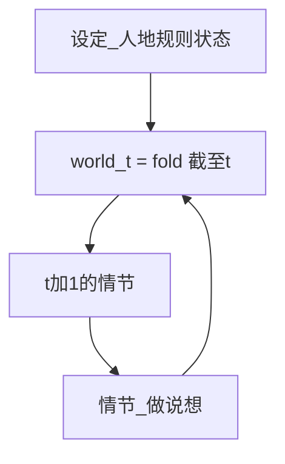
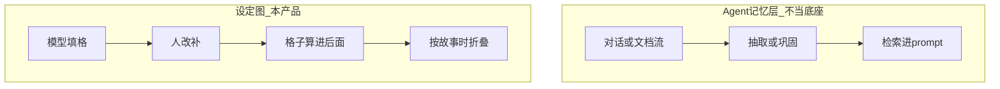
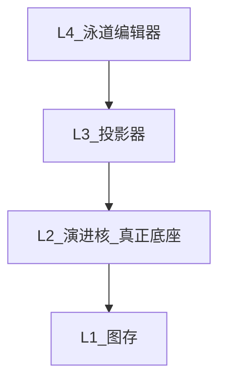
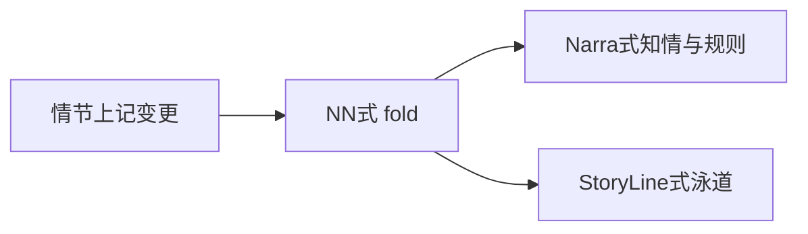

# 设定图：一张时间表写设定

工作名 **设定图**，代码放 [`worldgraph/`](worldgraph/)，和铜炉分开。本轮不改铜炉。

对用户说话只用大白话。不要缩写、不要层号、不要拿工具名当主语。先说打开看到什么、点哪、模型干什么、他干什么。

## 判断（不盲从原话）

总评：**大方向对。有三处按原话做会做砸。**

站得住的：

- 小说的骨头就是「什么时间、什么地方、谁在做什么」。用时间表当主画面，比人物卡+分类夹对。
- 下一格必须吃**到这一刻为止的全部历史**，不能只接着上一个人。
- 模型填、人改补，对长篇才活得下去。手填每一格会弃用。
- 「算进后面」必须你点。模型写完就自动进历史，一格写坏会污染后面所有格。
- 和铜炉分开做是对的。铜炉是写章、喂提示词；这是世界那张表。合成会再拆成五六个页。

会做错的三处：

1. **格子不能是每一句做/说/想。** 一格必须是**一场戏**。做、说、想写在格子里面，允许只填其中一样。每句都占一格，长篇会炸，模型也会硬编内心独白。
2. **「写小说就是演进这张表」不能理解成没有戏就不许写设定。** 人、地点、规矩是表头，没有格子时也要能写、能问。否则这不是写设定的系统，只是剧本分镜。检验：一本还没有一场戏的书，打开仍然有用。
3. **模型的正经工作是「根据已经算进后面的历史，写下一场戏」。** 丢整章进去让它猜格子，会猜错、会漏、会把秘密写进不该知道的人嘴里。那段只能当辅助，不能当主路。三种看法里，先只做时间表；「戏和连线」好看但和表抢「我该点哪里改」。问答「他知道什么」值得做，因为能揭穿模型瞎写。

竖轴先只做**地点**和**人**。按知情、按线索分道，等表真的有戏再加。读者阅读顺序（倒叙）也后做，先把故事里的时间做对。

## 人话：你打开会看到什么

就是你说的那张表。**格子默认是模型填的，你负责改和补。**

- 从左到右是故事里的时间。
- 从上到下先按地点或按人。别的排法后加。
- 每个格子是**一场戏**。做、说、想写在格子里面，可以只填一样。

用你的例子：

1. 你先可以只写：有酒楼、有人1、有哪些规矩。这时一张戏都没有，表仍然有用。
2. 你点「写下一场」。模型看着已经算进后面的历史，填这一场里谁在做、说、想。
3. 你改、你补。点「算进后面」，这场才变成历史。
4. 再写人2的下一场时，模型吃的是全部历史，不是只吃人1那一场。

侧栏能问「这人现在知道什么」。戏和连线那种画布后做。文件能导出，Obsidian 能打开看，v1 不在那边改再写回。

## 第一性（只认这五条）

1. **设定是表头和规矩。** 人、地、势力、规则没有戏也能写。格子是戏，不是设定的替代。
2. **模型填下一场戏，人改补。** 改完你点「算进后面」才算历史。
3. **一格一场戏。** 做、说、想在格内，可空，不能每句话一格。
4. **主面只有时间表。** 问答在侧栏。连线图后做。
5. **下一场戏吃全部历史。** 不是只接着上一个人。

## 铜炉只借鉴、不搬家

铜炉 store 里其实已有「实体 + 命题 + 知情 + 事件因果」，但产品面是设定库文档 + 知情读图 + 时间工艺 + 章流水线四轨并行。新项目要避开的债：

- 本体宣称四类公民，实际 `faction` / `item` / `term` / `world_rule` 是平行宽表；`place` 退化成名字（[`docs/系统文档/01-本体与数据模型.md`](docs/系统文档/01-本体与数据模型.md)）。
- 三套关系：`character_relation` / `entity_relation` / `knows` 各写各的。
- `proposition` 混装手写设定、ingest 抽取、codex 桥。
- Atlas 只画「到第 N 章谁知道什么」，事件/地点/规则不在图上（[`scribe3/store/structure.py`](scribe3/store/structure.py) 的 `graph()`）。
- 默认力导向容易变成毛团（铜炉已改成列表+抽屉，见 SESSION「图谱先可读再助写」）。

要留下的思想：持续体 vs 发生体；状态必须带故事时间；知情是显式边、无逻辑闭包；读路径一律 `_at(time)`。

## 本体（Day-1 就统一，禁止再裂表）

**持续体**（泳道头 / 检查器里的设定，不是格子里的主节点）：`person` / `place` / `thing` / `faction` / `rule`

**发生体 = 情节**（泳道格子里的唯一主节点）：`event`。必须带 `[t_from, t_to)`、至少一条 `at`（地点）、至少一条 `involves`（人）。时间不是一种名词节点，是横轴。

**情节内三轨（举例的完整化，v1 一等公民）**

每个 `involves` 的人在该情节上有一条 **Tracks**：

- **做 `do`**：公开动作。在场者默认可看见。
- **说 `say`**：出口的话。听见的人默认可知道「他说了这话」（不等于相信内容）。
- **想 `think`**：私密。只有本人（+作者勾选的读者帧）能用。写进别人的 想/说 当已知 = 穿帮，v1 软标、可升级硬闸。

可选轨（v1 字段留空即可，不当主 UI）：`decide`（改目标/立场）、`sense`（他接收到什么，是 想 的输入）。

**边 kind（v1 封闭）**：`related` / `member` / `holds` / `contains` / `at` / `involves` / `causes` / `knows`。`knows` 可手写，也可由「看见做 / 听见说」推导；推导可关，手写优先。无逻辑闭包。

**状态**：能力、秘密、立场、所在地都是 `State{entity, attr, value, t_from, t_to}`。人所在地由最近情节的 `at` 继承，换地必须有情节（旅行/瞬移也是情节），禁止同一 t 占两条地点泳道。

**座标是泳道座标，不是自由拖拽脑图。** 情节的位置 = `(故事时, 当前纵轴上的泳道)`。换纵轴只是重新入格，不改数据。禁止默认力导向。



## 写模型：情节是唯一增量

```
Beat {
  id
  t_from, t_to          // 故事时，落在横轴
  narrative_order       // 叙事序；倒叙不改 t，只改讲述序
  lanes                 // 按当前纵轴解析出的入格（地/人/势力/线）
  tracks[]              // 每人：do / say / think
  delta                 // 状态开窗/关窗、新设定、知情边
  causes[]              // 显式因果，不只是「时间上后一格」
  prose?                // 这一格的叙述
  title?
}
```

**演进律（比「人1 → 人2」完整的那一层）**

```
world(T)      = fold(设定初值 ∪ 所有 t_to <= T 的 Beat)
person(P, T)  = P 的身份 + 在 T 有效的 State + knows + 所在地
Beat at T+1   必须能从 world(T) 投影：
  - 想/说不得把 P 不知道的事实当成已知（知情）
  - 人不能同时出现在两条地点泳道（空间）
  - rule 在 T 有效则约束做（规则）
  - 状态延续：伤、立场、持有物不写就不丢（惯性）
  - 因果：标了 causes 的前置必须已 fold 进 world(T)
```

用户举例是这条律的一个切片：A 时人1的做说想 ∈ `world(A)`；A+1 人2能做什么，吃的是 **整份** `world(A)`，不是只吃人1那一张卡。

两条入口，同一落点（模型填，人改补）：

- **写下一格**：指定时间/人/地，LLM 按 `world(T)` 填做/说/想和世界变化；草稿出现在格子里，你改补。
- **丢一段草稿**：LLM 把这段话落成一格或多格，你改补。

点「算进后面」才 fold。没点过的草稿不进下一格记忆。已算进后面的戏仍可改，改完重算后面，冲突标出来。

v1 **硬规则**：落库必须有做/说/想或世界变化，不能只存没拆开的散文。模型必须吐出格子。

同列 = 同时。空格 = 没戏。换地必须另有一格。

## 产品面：三种看法，一份库

**时间表（主面，StoryLine）**：网格 + 检查器 + 时间缩放。纵轴切换地点/人物/势力/线索/知情。点一列看「这一刻」。格子上改做/说/想。按钮「写下一格」让模型填。

**戏和连线（NarrativeNode）**：一场戏一个块；线上是谁走到下场；块上是这人此刻状态。和表同一份戏，不是第二套故事。

**问答账本（Narra）**：侧栏问「他知道什么」「规矩破了没」。查 fold 后的库，不另编一套答案。

明文展示：导出 Markdown（人/地/每场戏一篇），可放到 Obsidian 里看。v1 只出不进。StoryLine 插件里改再写回 = 以后可选，不好整就不做。

空态：「点写下一格，或先建一个人和一个地点。」不要铜炉五问门厅。

不做（v1）：铜炉章流水线五层、技法标尺、质量仪表盘、多书、Obsidian 双向同步、把 Graphiti 当库。

## 和铜炉的边界

| 现在 | 以后 |
|------|------|
| [`worldgraph/`](worldgraph/) 独立进程与 schema | 导出 `worldgraph.v1.json`（节点/边/状态/节拍） |
| 不读铜炉 Surreal `db=<work>` | 铜炉另开适配器消费；不把设定图表塞进现有 165 个 migration |
| 模型填格 + 人在表上改补 | 铜炉若接入，设定图是上游；限知仍由铜炉投影，不要倒灌 |

## 为什么不用 EverOS / Semantica / Graphiti·HyperMem / TiMem 当底座

这四套解决的是另一件事：**给 Agent 记对话、再检索**。设定图要的是：**作者写世界，图即作品**。层不同，当底座会把写模型写反。



**EverOS**（EverMind）：本机记忆运行时。真源是 Markdown，旁路 SQLite + LanceDB；消息攒一段再抽 MemCell，读索引是最终一致。适合跨助手的个人/Agent 记忆，可 diff、可手改 md。它没有封闭的人/地/事 kind、没有故事时 vs 叙事序、没有作者座标画布。把设定图建在「对话抽记忆」上，等于再走一遍铜炉 ingest。

**Semantica**：四套里技术上最像「时态知识图」——双时态、因果边、冲突、PROV 溯源、SHACL/SPARQL。产品主路仍是「吞企业文档 → 抽实体 → 给 Agent 做可追责决策」。画布、节拍叙述、知情无闭包、叙事序都不是一等公民。OWL/Rete/Datalog 会变成产品本身。v1 只借思想：双时态、因果显式、冲突不当成覆盖。

**Graphiti**（Zep）：自己的时态图 + 从文章抽实体。模型填**我们的格子**可以；用 Graphiti 当那张图的家不行——改补发生在我们的表上，不在它的库里。只借「旧状态关掉、新的另开一条」。

**HyperMem**（现挂在 EverOS methods 下）：超图 `topic → episode → fact`，优化长对话高阶联想检索（LoCoMo）。这里的 event 是会话片段，不是故事里的发生体。检索层，不是世界模型。

**TiMem**：时间记忆树 `片段→场→日→周→画像`，把对话巩固成更抽象的人设摘要。时间是现实会话时，不是故事时。巩固方向与设定图相反：我们要具体事实钉死，不要周级画像把人融掉。

**结论：不当底座。可借、可后挂。**

- 现在就借：Graphiti/Semantica 的「失效不删、开新窗口」；因果显式；冲突显式。EverOS 的「人能读的真源」→ 导出节拍为可 diff 文本，不当运行时主存。
- 以后可挂（在图已经是 SSOT 之后）：用其中一套做「主编/助手跨长会话回想」，只召回，不写世界。HyperMem/TiMem 只允许出现在这一层。
- 禁止：`add_episode` / MemCell / TMT 巩固 / 企业文档抽 KG 当设定主写路径。

## 底座应该长什么样（四层，只有中间两层是产品）

没有现成开源能整仓当底座。能开源的是**第 1 层存储**和**第 4 层泳道控件**；**第 2 层演进核**和**第 3 层投影**必须自写，否则又会变成「时间线查看器」或「Agent 记忆库」。



**L2 演进核（真正底座，自写，禁依赖大框架）**

纯函数，无 UI、无 LLM：

- `fold(beats, T) -> world(T)`：状态开窗/关窗、所在地惯性、知情边。
- `apply_beat(world, beat) -> world | violations`：吃三轨（做/说/想）和 delta。
- `constrain(world, beat)`：知情穿帮、同 t 两地、规则、因果前置。
- 输入输出都是结构化图，不是 embedding、不是 Markdown 片段。

铜炉 [`scribe3/ontology.py`](scribe3/ontology.py) + `project_frame` 是思想近亲，但绑在章号/限知渲染上，**只借鉴不 import**。

**L3 投影器（自写）**

- `project_swimlane(world, t_window, y_axis) -> {lanes, cells}`。换纵轴 = 换投影，不换库。
- `project_person(world, P, T)`：他此刻的做/说/想许可集（他已知、他所在、他能用的规则）。
- 点一列时间 = `world(T)` 摘要，不是另查一张表。

**L1 图存**

SurrealDB 3.x：`node` / `edge` / `state` / `beat`。Beat 是唯一增量。不要每种设定一张宽表。不要 Neo4j「只为 Graphiti」。

**L4 泳道编辑器**

独立 Vite/React。主控件：时间列 × 可换 `groups`。格子是情节卡（三轨摘要），点开检查器。关系网次透镜以后再挂。

API 仍薄：`PUT /nodes|edges` `POST /beats` `GET /graph?t=` `GET /swimlane?y=&from=&to=`。单用户。Agent 记忆库 v1 不引入。

## 全网开源对照（借什么 / 不当底座）

**最接近「演进」的（L2 思想）**

- [NarrativeNode](https://github.com/netzkontrast/NarrativeNode)：场景节点上记变更，向后 fold 出每一刻的人/物状态；画布=故事时，POV 路径=叙事序。缺泳道、缺做/说/想三轨、仓库极新。**借 fold + 双时序，不当宿主。**
- [florinutz/narra](https://github.com/florinutz/narra)：Rust + 嵌入式 Surreal；知情账本（knows/误信/听来/看见）+ 戏剧反讽 + 宇宙规则闸。无泳道 UI，是给 AI 的 CLI/MCP，星少且年轻。**借知情枚举和规则闸分级，不 fork 当后端。**
- [monty-builds/yggsii](https://github.com/monty-builds/yggsii)：揭示账 + 同场（谁和谁同时在）。定位是「结构体检」不是写作。**借同场/揭示，不当主面。**
- 铜炉本体：持续体/发生体/命题/知识边。产品面拆成设定库+知情图+只读时间线。**借模型，不搬家。**

**最接近「泳道主面」的（L4 交互）**

- [obsidian-storyline](https://github.com/spv2008/obsidian-storyline)：时间线可按 POV/地点/线索分泳道，故事时 ↔ 阅读序切换。真源是 Obsidian Markdown，无 fold、无三轨。**借纵轴切换和双序，不把产品建成 Obsidian 插件。**
- [Fonte](https://www.ricolandia.com/en/free-screenplay-editor/)：幕 × 线索网格。是剧本结构板，不是世界演进。**借「一格一条线」的疏密度。**
- [Novalist](https://github.com/Drommedhar/novalist-official)：情节网格 + 年代时间线。设定与时间线仍是分面。**借本地文件夹项目形态，不整仓。**
- 铜炉 [`TimelineView.jsx`](scribe3/web/src/views/TimelineView.jsx)：已用 `vis-timeline` + 可切换 groups（kind/角色/类型）。只读、横轴是章号、格子不是做/说/想。**借控件经验，禁止 import scribe3。**

**L4 控件（可直接用库，不是产品）**

- [vis-timeline](https://github.com/visjs/vis-timeline)（MIT/Apache，铜炉已验证）：`items` + `groups` = 泳道；可自定义卡片模板、窗口化缩放。故事时用整数映射（铜炉把章号映射成假 Date，我们映射故事时）。**v1 默认控件。**
- 资源时间线类（ilamy-calendar / zenith Swimlane）：日历/排班语义，故事时要自己改轴。备选，不优先。

**不当底座（层错或闭源）**

- EverOS / Graphiti / HyperMem / TiMem / Semantica：Agent 记忆，见上节。
- Articy:draft：商业设定库+流程图，无开源、无故事时 fold。
- Twine / Ink / Yarn Spinner：分支选择，不是时间×泳道。
- OpenDraft / Beat：剧本排版+索引卡，无世界演进。
- Manuskript / bibisco / oStorybook：设定夹 + 章节，不是泳道真源。
- narrative-canon：LLM 从正文抽时间线，写模型反了。

**结论**

- 底座 = **自写 L2 fold/constrain + L3 泳道投影**。
- 开源只进两处：L1 Surreal 3.x；L4 vis-timeline。
- 对照清单写进设计文：NarrativeNode（fold）、Narra（知情账）、StoryLine（纵轴/双序）、铜炉时间线（控件坑）。
- 禁止：fork 上述整仓、Obsidian 当宿主、把 vis-timeline 当数据模型。

## 三神作怎么合成（契约，不是拼运行时）

NarrativeNode + Narra 对上的是内核，StoryLine 对上的是主面。要合的是**三份合同进一个自写内核**，不是三个进程、三份真源并排。并排 = 铜炉设定库 / 图谱 / 时间线再裂一次。



**NarrativeNode → L2 写模型**

- 情节是变更发生地，不是人物卡。
- `world(T)` 由 Setup（设定初值）+ 沿故事时 walk 各格 delta 算出。
- 画布横轴 = 故事时；并行情节同列。
- 讲述序另挂：NN 的 POV 路径 = 我们的 `narrative_order`。导出/朗读跟讲述序，泳道默认跟故事时。
- 冲突向后标出来，不静默覆盖。
- 我们补 NN 没有的：格子里的做/说/想；纵轴泳道；知情边从三轨长出。

**Narra → L2 账本与闸，不当后端**

- 知情枚举：`knows / suspects / believes_wrongly / …` + 来源 `saw / heard / told / inferred / given`。
- 规则闸分级：`info` 只提示 / `warn` 标黄 / `strict` 挡 `apply_beat`。
- 戏剧反讽 = 同一 T 上知情差，是 fold 的查询，不是单独一张图。
- 不采用：embedding 漂移当弧光、MCP 当主写、第二套 Surreal schema。弧光以后用 State 开窗，不用向量。

**StoryLine → L4 投影，不当宿主**

- 纵轴 chip：地点 / 人物(POV) / 线索 / 势力 / 知情。换轴 = `setGroups`，底下仍是同一份 fold。
- 工具条：**故事时 ↔ 讲述序**。讲述序只重排列，不改 `t_from`。
- 明文导出 Markdown，可在 Obsidian 里看。v1 不同步写回。StoryLine 插件双向以后再说，不好整就只保留导出。

合成后的一条写路径：

1. 点「写下一格」或丢草稿，模型按到此刻的全世界填格子。
2. 你在时间表或连线图上改、补。
3. 点「算进后面」：往后推算、知情记账、规矩响不响。
4. 换看法（表 / 连线 / 问答）不换库。

## Graphiti 不当这张表的家

模型可以填格子（这是你要的）。Graphiti 是另一张图：文章进去，它自己抽出实体。不把我们的格子存进 Graphiti。只学：状态变了，旧的记下「到此为止」，新的另开一条。

## 落地顺序（确认后才写代码）

先落设计真源 [`docs/plans/2026-08-29-world-graph-setting.md`](docs/plans/2026-08-29-world-graph-setting.md)（短名 `worldgraph`），再按切片开工。每刀必须能单独打开画布用，禁止巨型搬家。

## 明确不做

- 把铜炉 Codex/Atlas/Timeline 合成一页冒充「一张图」。
- 给乱世铜炉 214 节灌进 Surreal 或设定图。
- 在 Grok 机跑全量 pytest / 本机起铜炉那套 Surreal。
- 复用 `SCRIBE3_*`、MCP `s3_*`、决策乙当本产品写路径。
- 以 EverOS / Semantica / Graphiti / HyperMem / TiMem 为世界真源或主写路径。
- 把 Graphiti 当格子的数据库。
- 并行安装 NarrativeNode + Narra + Obsidian 当三份库。
- v1 做 Obsidian 双向改库。
- 把主画面做成自由拖拽关系网，时间表只当附属。
