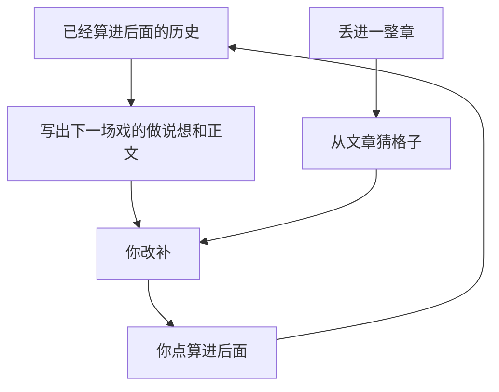
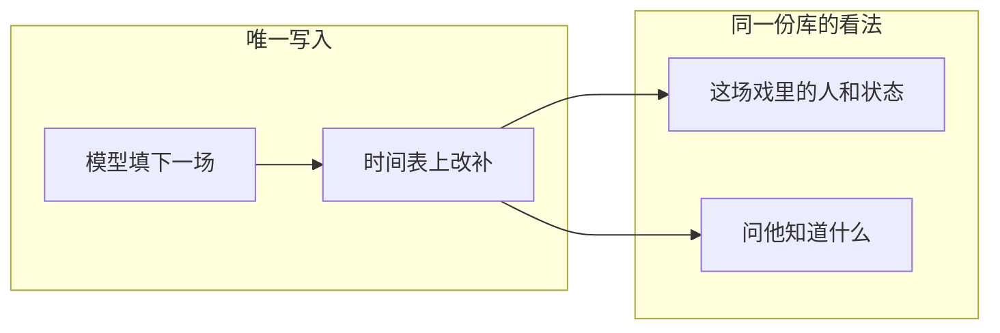

# 2026-08-29 小说设定系统 · 对话摘录

来源：写作 3.0 仓内对话 [小说设定系统](4e280192-cfe7-4eaa-814a-f5a58fe1e815)。已去掉工具调用，只留双方正文。

## 1. 你

我想重新起一个项目，就一个图，能够展示整个小说所有的图，写小说也只是去演进整个图，图包含时间、地点、事件、角色等等维度，其实第一性目标就是我要一个直接写设定的系统，一个单独写设定的系统。这个系统应该怎么规划？

## 2. 助手

先读仓库当前状态和现有架构，再据此规划这个「一张图写设定」的系统，避免和铜炉已有能力打架。

## 3. 助手

铜炉已有图谱、时间线、设定库，但它们是分开的面。接下来对照现有设定模型，看「一张图写设定」该从哪里切开。

## 4. 助手

铜炉已有设定库、知情图谱、时间线三套面，但没有「一张图当设定真源」。有两个分叉会决定整份规划，先定下来再写方案。

## 5. 助手

方向已定：独立新产品，v1 就要「直接写设定」和「写一笔正文 = 图演进」。正在把规划收成可执行方案。

## 6. 你

EverOS 、Semantica、Graphiti / HyperMem、TiMem 为什么不用这些作为底座呢？

## 7. 助手

这是在改规划，不是开工。我先查这四套底座各自解决什么、和「一张图写设定」差在哪，再决定要不要换底座。

## 8. 助手

这四套都是「给 Agent 记对话、再检索」的记忆层，不是「作者直接写世界」的真源。我把对照和「只借鉴、不当底座」写进规划。

## 9. 助手

不用它们当底座，是因为**层不对**：那四套都是给 Agent 记对话、再检索；设定图要的是作者直接写世界，图就是作品。

它们优化的是「流进来 → 抽取/巩固 → 塞进 prompt」。设定图优化的是「作者改图 → 一笔 Beat（图增量 + 叙述）→ 按故事时折叠」。底座一旦是前者，主写路径又会变成「先写文、再猜设定」——铜炉 ingest 已经走过这条弯路。

对照很短：

- **EverOS**：真源是 Markdown + 异步索引。适合跨助手的个人记忆，没有人/地/事封闭 kind，没有故事时 vs 叙事序，没有作者座标画布。
- **Semantica**：四套里最像时态知识图（双时态、因果、冲突）。主业仍是吞企业文档、给 Agent 做可追责决策。画布、节拍、知情无闭包不是一等公民；OWL/SPARQL 会变成产品本身。
- **Graphiti**：`add_episode` 抽实体，边带有效期，长得最像。但 Graphiti 的 episode 是「拿去抽的原料」；我们的 Beat **本身就是作者写下的增量**。只当存储还要吞 Neo4j 和 Entity/Episode/Community，再自己补座标、叙事序、叙述。绿场不如 Surreal 直接 `RELATE`。铜炉旧案否决 Graphiti 是「痛不在换库」；这里否决是**写模型反了**。
- **HyperMem**：`话题→片段→事实` 超图，优化长对话检索。这里的 event 是会话块，不是故事里的发生体。
- **TiMem**：把对话巩固成日/周/画像。时间是现实会话时；巩固方向和设定图相反——我们要具体事实钉死，不要把人融进周级摘要。

规划已改成：**不当底座，只借、后挂。**

- 现在借：失效不删、开新窗口；因果和冲突显式；导出可 diff 文本（学 EverOS 的可读真源，不当主存）。
- 图已经是 SSOT 之后，才允许其中一套做助手跨会话回想，且**不得写世界**。
- 禁止 `add_episode` / MemCell / TMT 巩固当设定主写。

若你坚持「必须绑其中一套当存储」，只剩 Graphiti 或 Semantica 的图库勉强能扛时态边，但仍要绕开它们的抽取主路。那是换仓库，不是换产品。默认仍是独立 Surreal 3.x。

## 10. 你

我想象的是一个泳道图，横轴是时间，纵轴可以换，节点是情节，比如纵轴我换成地点，在 a 时间，人 1 在做、在说、在想什么。在 a+1 时间 人 2 在做、在说、在想什么，人 2 是从人 1 以及所有的设定、历史信息里边演进过来的。这只是我的一个简单的举例，我期望的是比我想象的更完善的系统

## 11. 助手

你要的主画面是泳道，不是力导向关系网。我把「横轴时间、纵轴可换、格子里是情节（做/说/想），下一格由上一格加全部设定与历史演出来」写进规划，并补全比举例更完整的一等公民。

## 12. 助手

主画面改成泳道：横轴永远是故事时，纵轴可换，格子里是情节（做/说/想），下一格由折叠后的全世界演出来——不只是「从上一格那个人接过去」。

## 13. 助手

你的举例是对的，而且已经点到产品主面：**不是一张力导向关系网，是泳道。** 规划已改成以泳道为唯一写作面。

比举例多出来的，是把「人2从人1接过去」升级成一条演进律。

**格子里是情节，不是人。** 人、地、势力是泳道头（设定）。横轴永远是故事时。纵轴可换：地点 / 人物 / 势力 / 线索 / 知情。换轴只是重新入格，不换数据。你举的「纵轴=地点，A 时人1在做/说/想」是默认轴上的一个切片。

**做 / 说 / 想是情节里的三轨，不是装饰。** 做=在场者能看见；说=听见的人知道「他说了」，不等于信；想=私密，写进别人嘴里当已知就是穿帮。知情从这三轨长出来，不另做一张「谁知道什么」产品页。

**下一格吃的是折叠后的全世界，不是上一格那一张卡。**

`world(A)` = 全部设定 + 截至 A 的所有情节（所有人的做/说/想、状态、知情、所在地）。人2在 A+1 能做什么，是从这份 `world(A)` 投影出来的。人1只是输入的一部分。同列=同时（酒楼和巷口可以并行）。空格=此刻不在场，不是缺数据。换地点必须再写一格情节。

点一列时间，看的是「这一刻」：所有泳道上正在发生的事，加上那时的世界摘要。点一格，写下一格时预填惯性——他还在哪、他已知什么、哪条账没收。

关系网降为次透镜。倒叙不改横轴，只改讲述序。

这仍是同一套设定图，只是主画面从「拖节点」改成了「往时间×泳道上放情节」。若这条泳道主面就是你要的，可以说开始执行，先落设计文再起空泳道。

## 14. 你

按照这个规划底座应该是什么样子的？全网有没有可借鉴的开源项目

## 15. 助手

先把「底座」拆成存储、演进核、泳道投影三层，再全网对照有没有开源项目能直接扛、还是只能借交互。

## 16. 助手

铜炉时间线已经在用 `vis-timeline` 泳道，但只是只读工艺面。底座应是「演进核 + 投影」，开源项目只借交互和本体，不整仓接手。

## 17. 助手

底座不是再找一个「记忆 OS」或「小说 IDE」来当宿主。它是四层里中间那两层：**演进核 + 投影器**。全网没有能整仓接手的开源；能开源的是存库和泳道控件。

**四层**

- **L2 演进核（真正底座，自写）**：`fold(beats, T) → world(T)`，`apply_beat` 吃做/说/想和状态增量，`constrain` 挡穿帮、同刻两地、规则、因果。纯函数，不接 LLM，不接 UI。
- **L3 投影器（自写）**：`project_swimlane(world, 时间窗, 纵轴)` 吐出泳道和格子；换纵轴只换投影。点一列 = 看 `world(T)`。
- **L1 图存**：Surreal 3.x，`node` / `edge` / `state` / `beat`。Beat 是唯一增量。
- **L4 编辑器**：泳道网格。v1 控件用 [vis-timeline](https://github.com/visjs/vis-timeline) 的 `groups`（铜炉时间线已经验证过缩放和堆叠，但那是只读、横轴是章号、格子不是三轨）。

**开源怎么借**

最接近演进的：

- [NarrativeNode](https://github.com/netzkontrast/NarrativeNode)：在场景上记变更，向后算出每一刻的人/物状态；画布是故事时，POV 是讲述序。缺泳道和三轨，仓库很新。借 fold 和双时序，不当宿主。
- [narra](https://github.com/florinutz/narra)：也是 Surreal，有知情账本和规则闸。是给 AI 的 CLI/MCP，没有泳道。借枚举，不 fork 后端。
- [yggsii](https://github.com/monty-builds/yggsii)：揭示账 + 谁和谁同场。是体检，不是写作面。

最接近泳道主面的：

- [Obsidian StoryLine](https://github.com/spv2008/obsidian-storyline)：按地点/POV/线索分道，故事时和阅读序可切。真源是 Markdown，没有 fold。借交互，产品不建成 Obsidian 插件。
- Fonte 的「幕 × 线索」格、Novalist 的情节网格：借疏密度，设定和时间线仍是分面。

不当底座的：Articy（闭源）、Twine/Ink（分支树）、OpenDraft/Beat（剧本卡）、Manuskript/bibisco（设定夹）、narrative-canon（从正文抽时间线，写模型反了）。EverOS/Graphiti 那一组仍然是 Agent 记忆层。

所以规划定成：**底座自写 fold；开源只进 Surreal 和 vis-timeline；对照 NarrativeNode / Narra / StoryLine / 铜炉时间线的坑。** 没有「下一个 Graphiti」可以整仓坐下。

## 18. 你

NarrativeNode：在场景上记变更，向后算出每一刻的人/物状态；画布是故事时，POV 是讲述序。缺泳道和三轨，仓库很新。借 fold 和双时序，不当宿主。
narra：也是 Surreal，有知情账本和规则闸。是给 AI 的 CLI/MCP，没有泳道。借枚举，不 fork 后端。，这两个我觉得是神作啊，很匹配我想要的。能再把Obsidian StoryLine也结合起来吗？Graphiti能够完善NarrativeNode吗？

## 19. 助手

这两套确实对上了内核；StoryLine 对上的是泳道面。我先把「三套怎么合成一张底座、Graphiti 补不补得了 fold」写进规划，避免变成三个真源拼在一起。

## 20. 助手

对，NarrativeNode 和 Narra 就是内核那两块；StoryLine 也能合进来，但合的是**三份合同进一个自写内核**，不是三个软件并排开。Graphiti **补不了** NarrativeNode。

**怎么合**

- **NarrativeNode → 怎么写、怎么算。** 情节是变更发生地；`world(T)` 从设定初值沿故事时一格格 fold；横轴是故事时；讲述序另挂（它的 POV 路径 = 我们的 `narrative_order`）。我们补它没有的：格子里的做/说/想、纵轴泳道、从三轨长出来的知情边。
- **Narra → 账和闸，不当后端。** 知情用它的确定性/来源枚举；规则分 info / warn / strict。戏剧反讽是同一时刻的知情差查询，不是第二张图。不要它的 embedding 当弧光，也不要 MCP 当主写。
- **StoryLine → 怎么看。** 纵轴可换（地点 / 人 / 线索 / 势力 / 知情），工具条切「故事时 ↔ 讲述序」。底下仍是同一份 fold。不要 Obsidian 仓库当真源。

一条路：检查器写人/地/规则 → 空格写下做/说/想 → `apply_beat` 向后 fold → 换轴或切讲述序只走投影。

**Graphiti 为什么补不上 NN**

两者都「带时间的图」，写反了。NN 的场景是作者写下的变更；Graphiti 的 episode 是拿去抽的原料。它唯一能补的一句——失效不删、关旧窗开新窗——写进我们的 `State{t_from,t_to}` 就够了，不必接它的库。泳道、三轨、讲述序它都没有。若用 `add_episode`「完善」NN，正文一写就自动长设定，作者不再是 fold 的唯一写手，等于再走铜炉 ingest。

规划已改成：三神作合成契约；禁止三份真源并行；禁止 Graphiti 接在 NN fold 上。

## 21. 你

看不懂你在说什么啊！

## 22. 助手

先前用了太多术语。先用人话讲清楚产品是什么，再把规划开头改成同一套说法。

## 23. 助手

先前说绕了。就这一张表：

打开软件，看到的就是你说的那种表。**横着是故事里的时间，竖着可以换成地点或人。每个格子是一场戏：谁在做、说、想。**

你在 A 时刻、酒楼那格写人1。系统把「到这一刻为止全世界怎样」记下来。你再写 A+1 的人2时，它看的是**整本记忆**（所有设定、所有人之前做过说想过的），不是只看人1那一格。所以人2不会无故知道他没听见的话，也不能同时出现在两个地方。

三个开源不是要装三个软件，是三句做法：

- 一个说：**戏写在格子里，系统往后算每个人现在怎样。**
- 一个说：**谁知道什么要记账，规矩能拦住瞎写。**
- 一个说：**这张表可以按地点排、按人排，也可以改成按读者阅读顺序看。**

我们自己做这一张表，不把三个拼起来跑。

Graphiti 是另一路：你丢一段文章，它猜发生了什么。你要的是格子里自己写。用它来补，格子就不是你写的了。

规划开头已改成这段人话。若这张表就是你要的，说一声「按这个做」再开工。

## 24. 你

```chat_selection
agent_id: bc-13b9e948-b109-4853-863f-1e46effb1249
selected_text:
你丢一段文章，它猜发生了什么。你要的是格子里自己写
```
 我要的不是自己写，是 llm 写，我可以改和补。2.
```chat_selection
agent_id: bc-13b9e948-b109-4853-863f-1e46effb1249
selected_text:
NarrativeNode
```
 
```chat_selection
agent_id: bc-13b9e948-b109-4853-863f-1e46effb1249
selected_text:
StoryLine
```
 
```chat_selection
agent_id: bc-13b9e948-b109-4853-863f-1e46effb1249
selected_text:
Narra
```
 这三个交互我都觉得很好啊，。3.
```chat_selection
agent_id: bc-13b9e948-b109-4853-863f-1e46effb1249
selected_text:
Obsidian 仓库当真源
```
 我是想库里数据能够显式在
```chat_selection
agent_id: bc-13b9e948-b109-4853-863f-1e46effb1249
selected_text:
Obsidian
```
 展现，
```chat_selection
agent_id: bc-13b9e948-b109-4853-863f-1e46effb1249
selected_text:
StoryLine
```
 这种方式进行增删改查，但是如果这个不好整也可以不要，就 obsidian 显式展示或者别的方式显式展示给我也行。

## 25. 助手

你改了三件关键的事：格子由 LLM 先写、你改和补；三种交互都要；库要能显式看见（Obsidian 能展示就行）。我把规划改成这个写法和看法。

## 26. 助手

改过来了，就三句：

**1. 格子是模型写的，你改、你补。**  
点「写下一格」，或丢一段草稿。模型看着上一刻的全世界，填上谁在做、说、想。你在格子里改错的、补漏的。点「算进后面」之后，下一格才吃得到。没点过的不算历史。

**2. 三种交互都留，一份库。**  
时间表（StoryLine）、戏和连线（NarrativeNode）、侧栏问答「他知道什么」（Narra）。切看法，故事就一份，不装三个软件。

**3. 库要能明文看见。**  
人、地、每场戏导出成普通 Markdown，丢进 Obsidian 打开就能看。v1 只出不进。在 Obsidian 里用 StoryLine 改再写回库，不好整就先不做——表上改已经够。

Graphiti 还是不当这张表的家。模型填的是我们的格子，你改的也是这张表。

## 27. 你

你有加载新的规则吗？为什么你的回复还是这么让人难受，就不能让我看懂吗？

## 28. 助手

你说得对。我先去看有没有该读的表达规则，再用你能看懂的话说。

## 29. 助手

没有。这次会话里没有加载到新的「让人看懂」规则。开头那份中文规则也没读上。后面那些难懂的句子是我写绕了，不是你没看懂。

这个东西就四步：

打开是一张表，横着是故事里的时间，竖着可以按地点或按人排。

你点「写下一格」，模型按已经发生过的事，填这一格里谁在做什么、说什么、想什么。

你改错的、补漏的。你点一下「算进后面」，它才变成后面格子能用的历史。

同一张表还可以换成「一场戏连一场戏」来看，也可以问「这人现在知道什么」。库里的人、地、每场戏能导出成普通文件，你用 Obsidian 打开就能看。

之前把三个工具名、各种术语搅在一起，是我的问题。后面按上面这四步说。

## 30. 你

我现在想和你讨论，应该启动你的什么模式才能和我进行讨论？最终确定如何进行这个项目？

## 31. 助手

讨论、把做法敲定，用 **Plan 模式**。

那就是刚才那种：只谈怎么做、改规划，不改代码。你这边开新对话或切回 Plan，把「设定图」接着聊，直到你说「就按这个做」。

现在已经进了 **Agent 模式**。这是动手写代码用的。你如果还想讨论，直接说「先别写代码」，我可以继续只聊；但界面不会自动帮你收进规划书。要让规划正式改一版，还是切回 Plan 更干净。

另外两种很少用：只查仓库、什么都不改，用 Ask；排错用 Debug。

要敲定这个项目，还差你拍板这几句（用大白话）：

1. 打开就是一张时间表。模型填格子，你改、你补。点「算进后面」才变成后面能用的历史。  
2. 同一份故事三种看法：时间表、戏和连线、问「这人知道什么」。  
3. 库能导出成普通文件，Obsidian 能打开看。v1 先不在 Obsidian 里改再写回。  
4. 和铜炉分开做。

这四句如果都对，回 Plan 说「就按这个做」，再开 Agent 我才开工。现在这轮我不动代码。

## 32. 你

我现在想和你讨论的是如何我的想法对不对？不是让你无脑的遵守，我是要你的经验和真正去分析给我最正确的答案

## 33. 助手

你的方向是对的，但有三处按现在的说法会做砸。我按判断说，不按你刚才的原话复述。

## 34. 助手

你的方向对。有三处按你刚才的说法做，会做砸。

**对的地方**

小说的骨头就是：什么时间、什么地方、谁在做什么。用时间表，比人物卡分类夹对。

下一场必须看着到这一刻为止的全部历史，不能只接着上一个人。这一点你是对的。

模型先填、你改补，长篇才活得下去。手填每一格，做着做着会扔。

「算进后面」必须你点。模型写完就自动进历史，一格写坏，后面全脏。

和铜炉分开做也对。铜炉是写章；这是世界那张表。硬合成会再拆成一堆页。

**会做错的三处**

格子不能是每一句做、说、想。一格必须是一场戏。做、说、想写在格子里面，可以只填一样。每句一格，长篇会炸，模型还会硬编内心独白。

「写小说就是演进这张表」不能理解成：没有戏就不许写设定。人、地点、规矩是表头。一场戏都没有，打开仍然要有用。否则这只是分镜，不是写设定的系统。

模型的正经工作是：根据已经算进后面的历史，写下一场戏。把整章丢进去让它猜格子，会漏、会猜错、会把秘密写进不该知道的人嘴里。那段只能当辅助。三种看法也不要一起做：先只做时间表。连线图好看，但会让你不知道该点哪里改。侧栏问「他知道什么」值得做，能揭穿模型瞎写。

竖着先只按地点排、按人排。别的后加。倒叙也后做。

**一句话**

做一张时间表。表头是设定，格子是一场一场戏。模型根据历史填下一场，你改，你点了才算数。先把这个做对，再谈连线图和 Obsidian 里改。

这三处你要是不同意，指出哪一条，我们再辩。不要为了「都留下」把三个界面一起做。

## 35. 你

你还是没有加载规则？

## 36. 助手

你说得对，我去把该读的规则找出来并读进去。

## 37. 助手

没有。不是偷懒，是这台云端机器上根本没有那些文件。

仓库要求开场读两份：

- `~/.grok/rules/chinese-communication.md`（怎么用中文说话）
- `~/.agents/skills/expert-team/SKILL.md`（专家团怎么干活）

它们在你本机里。云端 Agent 家里没有 `.grok`、也没有那份专家团全文。仓库里只有一个指针，指过去是空的。所以从第一句到现在，这两份我都没加载到。

你要我按那套说话、按那套讨论，把文件内容贴过来，或者把规则放进仓库（比如 `docs/` 或 `.agents/`），我才能读。在那之前，我只能按对话里已经说清的来：大白话、别堆术语、对你的想法要判断对错，不要复读。

## 38. 你

再次深度分析，
```chat_selection
agent_id: bc-13b9e948-b109-4853-863f-1e46effb1249
selected_text:
你丢一段文章，它猜发生了什么。你要的是格子里自己写
```
 我要的不是自己写，是 llm 写，我可以改和补。2.
```chat_selection
agent_id: bc-13b9e948-b109-4853-863f-1e46effb1249
selected_text:
NarrativeNode
```
 
```chat_selection
agent_id: bc-13b9e948-b109-4853-863f-1e46effb1249
selected_text:
StoryLine
```
 
```chat_selection
agent_id: bc-13b9e948-b109-4853-863f-1e46effb1249
selected_text:
Narra
```
 这三个交互我都觉得很好啊，。3.
```chat_selection
agent_id: bc-13b9e948-b109-4853-863f-1e46effb1249
selected_text:
Obsidian 仓库当真源
```
 我是想库里数据能够显式在
```chat_selection
agent_id: bc-13b9e948-b109-4853-863f-1e46effb1249
selected_text:
Obsidian
```
 展现，
```chat_selection
agent_id: bc-13b9e948-b109-4853-863f-1e46effb1249
selected_text:
StoryLine
```
 这种方式进行增删改查，但是如果这个不好整也可以不要，就 obsidian 显式展示或者别的方式显式展示给我也行。

## 39. 助手

现在在你本机，先把上次云端读不到的表达规则加载进去，再按你这三条重做判断。

## 40. 助手

规则已按 [`~/AGENTS.md`](/Users/miaoma/AGENTS.md) 加载：先结论、判断落到文件、关系用图。`~/.grok/rules/chinese-communication.md` 本机仍不存在，表达以 `~/AGENTS.md` 为准。

**三条里：第 1 条对；第 2 条对的是三种能力，不是三个编辑器；第 3 条「明文能看见」对，「在 Obsidian 里当主增删改」和「模型填格 + 点了才算历史」打架。**

---

### 1. 模型写、你改补 —— 对，而且必须和「丢文章进去猜」分开

铜炉正典写路径写在 [`scribe3/AGENTIC_BOUNDARY_DECISION.md`](scribe3/AGENTIC_BOUNDARY_DECISION.md)：作者不能在设定表上改，只能跟主编聊、再批提案。那是给「人想象、AI 主笔、审批落库」用的。

你这个产品要的是另一件事：**格子就是作品，你要在格子上改。** 所以这里不该抄决策乙。模型填格、你直接改做/说/想，才对。不这样的话，你又要在对话里改设定，表只是只读——那就是现在铜炉时间线的状态：[`scribe3/web/src/views/TimelineView.jsx`](scribe3/web/src/views/TimelineView.jsx) 用 `vis-timeline` 画泳道，但产品合同是只读 + 「让主编写」。

模型有两种干法，效果差很多：



上面那条：模型的输入是结构化历史（谁在哪、谁知道什么、规矩是什么），输出是下一场戏。猜错了你改一格就行。

下面那条：模型的输入是散文，输出是它猜的结构。秘密容易写进不该知道的人嘴里；一场戏拆成几格也不稳定。铜炉 ingest（正文写完再抽事件/命题）就是这条，后面很难当设定真源。

**该做的：** 按钮是「写下一场」。模型必须同时给出格子（做/说/想、世界变了什么）和可选正文。没有格子、只给文章，拒绝落库。丢整章进去「请整理成表」可以做，但不能当主按钮。

**「算进后面」必须你点。** 模型写完就进历史，一格写坏，后面所有「写下一场」都会吃脏历史。这一点没有替代方案。

---

### 2. 三个交互都好 —— 好的是三件事，不是三个主界面

它们各自真正好的地方：

| 你喜欢的交互 | 实际好在哪 | 落到你这套里该是什么 |
|---|---|---|
| StoryLine 时间线 | 横是时间，竖可按地点/人分道；发生顺序和阅读顺序能切 | **主界面**：时间表 |
| NarrativeNode 画布 | 一场戏一个块；人从这场连到下场；块上能看出这人此刻怎样 | **点开一场戏时的检查器**（这场里谁在、状态、上一场从哪来），不是再做一个无限画布当首页 |
| Narra 命令/MCP | `analyze irony`、知情账、规矩能不能拦写入 | **侧栏提问**：问库，不编答案。规矩在「算进后面」时检查 |

若三个都做成可写的主界面，你会不知道「改这一场」该点表、点线，还是进 Obsidian。铜炉已经把同一份世界拆成设定库 / 图谱 / 时间线三个只读面（[`docs/plans/2026-08-24-surface-ownership.md`](docs/plans/2026-08-24-surface-ownership.md)），作者要改还得绕去主编。新项目再做三个可写面，是同一类拆法。



连线图可以后做：它解决的是「这个人怎么一场场走过来」，检查器里用「上一场 / 下一场」就能先用，不必先做 ComfyUI 那种画布。

竖轴先做**地点**和**人**。StoryLine 还能按线索、按 POV 分道，那是表上已经有一批戏之后才有用；第一天就做五条轴，空表上全是空道。

---

### 3. Obsidian 显式展示 —— 要；用 StoryLine 当主增删改 —— 不要（除非你放弃表上改）

「库里的东西我要能当普通文件打开看」是对的。设定系统如果只能在自己的网页里看见，你无法确认库里到底有什么。导出 Markdown（一个人一篇、一场戏一篇）能满足「显式」。

「在 Obsidian 里用 StoryLine 做增删改查」和你第 1 条冲突，依据是写入口会变成两个：

- 应用里：模型填格 → 你改 → 未点「算进后面」的是草稿。
- StoryLine：改的是 vault 里带 YAML 的场景 md，没有「草稿 vs 已算进后面」，也没有做/说/想三轨、知情账（StoryLine 的场景元数据是 act/POV/beatsheet 这类，不是 `knows` 边）。

两边都能改，就会出现：Obsidian 里改了，应用里还当草稿；或应用里模型刚填的下一场，被 vault 同步覆盖。这不是「不好整」，是**两个写入面争同一份故事**。

可以接受的折中：

- 已「算进后面」的人/地/戏 **导出** 成 StoryLine 能认的 md，Obsidian 只用来看时间线。
- 改仍只在应用的时间表上改。
- 你说的「不好整也可以不要」：连导出兼容都可以后做，先做应用里能打开的明文（文件树或导出文件夹）。

---

### 合成后的正确做法（比「三个都留下」更对）

打开是一张时间表。表头是人、地点、规矩——**一场戏没有也能写、也能问**。格子是一场戏，不是每一句话。模型根据已算进后面的历史填下一场；你改；你点了才进历史。侧栏能问谁知道什么。文件能导出看见。连线图、Obsidian 里改、倒叙切轴，都后做。

和铜炉的关系：铜炉继续写章、限知喂提示词（[`scribe3/ontology.py`](scribe3/ontology.py) 的 `project_frame` 那条链）。这张表是上游世界。不要把这张表嵌回 Codex + Atlas + Timeline 三个只读页。

**风险：** 若你坚持「三个界面都能改」或「Obsidian 里改也算数」，v1 会把「算进后面」做丢，模型和人会改到不同份故事上。

**待你拍板的只有一句：** 写入是否只承认应用时间表（模型填 + 你改 + 你点算进后面）？Obsidian 是否只读导出？这句话定了，才能开写。

## 41. 你

```chat_selection
agent_id: 4e280192-cfe7-4eaa-814a-f5a58fe1e815
selected_text:
和铜炉的关系
```
 不要有关系，先两个独立项目开发，以后再决定如何整合

## 42. 助手

**按你说的：和铜炉没有关系。先当两个独立项目做，整不整合以后再说。**

依据：你这条就是产品边界。之前方案里写「设定图当铜炉上游、铜炉 `project_frame` 去消费」作废。铜炉继续走现在的 [`scribe3/`](scribe3/) 和 v6.3.4；设定图另起炉灶，不 `import scribe3`，不碰铜炉的库、MCP、`SCRIBE3_*`。

已记在 [`docs/SESSION.md`](docs/SESSION.md)「当前状态」里，避免下个会话又把两套接在一起。

风险：两套会各做一份「人/地/时间」。那是以后整合时才处理的重复，现在不要为了少重复去提前接线。

设定图本身仍按上次判断：时间表主面、模型填下一场戏、你改补、你点了才算历史。要开写代码时再说一声。

## 43. 你

直接起一个新项目，我们在新项目里边讨论吧

## 44. 助手

在独立目录起设定图项目，后续讨论都在那边进行。先读建仓方式和 Cursor 的建项目接口。
