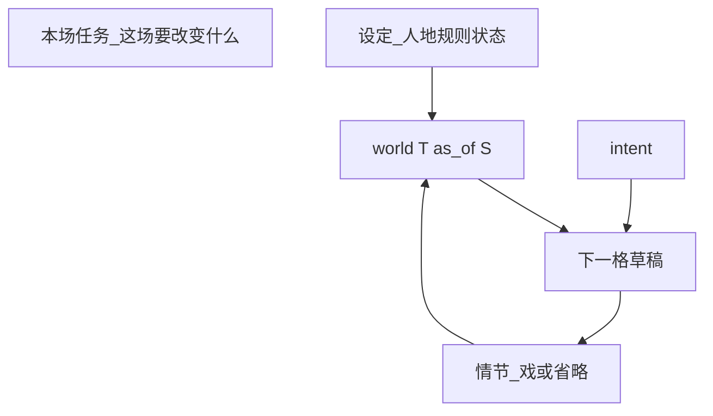
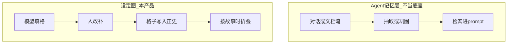

# 设定图：一张时间表写设定

> **讨论稿。实现只认 [`../设定图-v1.md`](../设定图-v1.md)。** 分层编号等说法作废；对人说话用 v1「用语」。

工作名 **设定图**。代码与讨论都在本仓 `/Users/miaoma/Downloads/写作设定项目`，和铜炉（`/Users/miaoma/Downloads/写作 3.0`）完全分开。本轮不改铜炉。不要 `import scribe3`。

对用户说话只用大白话。不要缩写、不要层号、不要拿工具名当主语。先说打开看到什么、点哪、模型干什么、他干什么。

## 判断（不盲从原话）

总评：**大方向对。有三处按原话做会做砸。**

站得住的：

- 小说的骨头就是「什么时间、什么地方、谁在做什么」。用时间表当主画面，比人物卡+分类夹对。
- 下一格必须吃**到这一刻为止的全部历史**，不能只接着上一个人。
- 模型填、人改补，对长篇才活得下去。手填每一格会弃用。
- 「写入正史」必须你点。模型写完就自动进历史，一格写坏会污染后面所有格。
- 和铜炉分开做是对的。铜炉是写章、喂提示词；这是世界那张表。合成会再拆成五六个页。

会做错的三处：

1. **格子不能是每一句动作/对白/内心。** 一格必须是**一场戏**。做、说、想写在格子里面，允许只填其中一样。每句都占一格，长篇会炸，模型也会硬编内心独白。
2. **「写小说就是演进这张表」不能理解成没有戏就不许写设定。** 人、地点、规矩是表头，没有格子时也要能写、能问。否则这不是写设定的系统，只是剧本分镜。检验：一本还没有一场戏的书，打开仍然有用。
3. **模型的正经工作是「根据已经写入正史的历史，写下一场戏」。** 丢整章进去让它猜格子，会猜错、会漏、会把秘密写进不该知道的人嘴里。那段只能当辅助，不能当主路。三种看法里，先只做时间表；「戏和连线」好看但和表抢「我该点哪里改」。问答「他知道什么」值得做，因为能揭穿模型瞎写。

后补（2026-08-30）：历史只做禁令，写下一场必须另有本场任务；允许省略格；故事时与写入时分开；伏笔是对读者的欠账；正史只在应用里改。组 3 不当第几次写入正史。实现只认 [`../设定图-v1.md`](../设定图-v1.md)。

后补（2026-08-30 夜）：v1 主面是分场条（一行一场），**不是 vis-timeline，也不默认实体泳道**。文内「v1 默认 vis-timeline」作废。

竖轴先只做**地点**和**人**。按知情、按线索分道，等表真的有戏再加。读者阅读顺序（倒叙）也后做，先把故事里的时间做对。

## 人话：你打开会看到什么

就是你说的那张表。**格子默认是模型填的，你负责改和补。**

- 从左到右是故事里的时间。
- 从上到下先按地点或按人。别的排法后加。
- 每个格子是**一场戏**。做、说、想写在格子里面，可以只填一样。

用你的例子：

1. 你先可以只写：有酒楼、有人1、有哪些规矩。这时一张戏都没有，表仍然有用。
2. 你点「写下一场」，先写一行本场任务（这场要改变什么），或选「省略一段时间」。模型看着已经写入正史的历史**加上这行本场任务**，填做、说、想（省略格不填动作、对白、内心）。
3. 你改、你补。点「写入正史」，这场才变成历史。点下去的时刻是**写入时**，格子在横轴上的位置是**故事时**，两回事。
4. 再写人2的下一场时，模型吃的是全部已提交历史，不是只吃人1那一场。穿帮检查用历史；写什么仍看你的本场任务。

侧栏能问「这人现在知道什么」。写下一场时侧栏还列出和这场人/地有关的未收伏笔。戏和连线那种画布后做。需要给人看文件时导出普通 Markdown；不把 Obsidian 当产品面。

## 第一性（只认这九条）

1. **设定是表头和规矩。** 人、地、势力、规则没有戏也能写。格子是戏，不是设定的替代。
2. **模型填下一场，人改补。** 改完你点「写入正史」才算历史。
3. **一格一场戏，或一格一段省略。** 做、说、想在戏格内，可空，不能每句话一格。省略格有故事时长、不演做说想。
4. **主面只有时间表。** 问答在侧栏。连线图后做。
5. **下一场吃全部已提交历史。** 不是只接着上一个人。这是不许穿帮。
6. **不许穿帮，不等于指定写哪一场。** 写下一场必须有一行本场任务（这场要改变什么 / 省略要跨过多长）。历史禁止瞎写，不指定写哪场。
7. **三个时钟分开。** 故事时（何时为真）、知情时（谁何时知道）、写入时（何时点的「写入正史」）。晚到的事实指回故事时间，不靠改旧格子冒充「一直如此」。
8. **主题、人物弧疗程、文句、情绪分数不进设定图主面。** 那是作者或铜炉的事。设定图不靠组 3 的库来充当写入时。
9. **正史只在时间表上改。** 导出文件不能写回正史。Obsidian 不当产品面。

## 铜炉只借鉴、不搬家

铜炉 store 里其实已有「实体 + 命题 + 知情 + 事件因果」，但产品面是设定库文档 + 知情读图 + 时间工艺 + 章流水线四轨并行。新项目要避开的债：

- 本体宣称四类公民，实际 `faction` / `item` / `term` / `world_rule` 是平行宽表；`place` 退化成名字（对照快照 [`docs/references/tonglu/01-本体与数据模型.md`](../references/tonglu/01-本体与数据模型.md)）。
- 三套关系：`character_relation` / `entity_relation` / `knows` 各写各的。
- `proposition` 混装手写设定、ingest 抽取、codex 桥。
- Atlas 只画「到第 N 章谁知道什么」，事件/地点/规则不在图上（铜炉 `scribe3/store/structure.py` 的 `graph()`，原件仍在写作 3.0）。
- 默认力导向容易变成毛团（铜炉已改成列表+抽屉，见 SESSION「图谱先可读再助写」）。

要留下的思想：持续体 vs 发生体；状态必须带故事时间；知情是显式边、无逻辑闭包；读路径一律 `_at(time)`。

## 本体（Day-1 就统一，禁止再裂表）

**持续体**（泳道头 / 本场里的设定，不是格子里的主节点）：`person` / `place` / `thing` / `faction` / `rule`

**发生体 = 格子 `Beat`**（时间表上的唯一主格子）。不要再单开一张叫 `event` 的表。戏格必须有地点 `at`、至少一个人 `involves`。省略格必须有 `at`（换到哪），`involves` 可空。时间不是一种名词节点，是横轴上的整数列号。

**场内动作、对白、内心（举例的完整化，v1 一等公民）**

每个 `involves` 的人在该情节上有一条 **Tracks**：

- **做 `do`**：公开动作。在场者默认可看见。
- **说 `say`**：出口的话。听见的人默认可知道「他说了这话」（不等于相信内容）。
- **想 `think`**：私密。只有本人能用。写进别人的 想/说 当已知 = 穿帮，v1 软标（warn）。v1 不做读者知情账；「作者勾选读者帧」后做。

可选轨（v1 字段留空即可，不当主 UI）：`decide`（改目标/立场）、`sense`（他接收到什么，是 想 的输入）。

**边 kind（v1 封闭）**：`related` / `member` / `holds` / `contains` / `at` / `involves` / `causes` / `knows`。`knows` 可手写，也可由「看见做 / 听见说」推导；推导可关，手写优先。无逻辑闭包。

**伏笔 `Promise`（对读者的欠账，不是世界状态）**

世界上「枪在抽屉」是 `State`。故事欠读者「这把枪必须响或有意不响」是 `Promise`。算出这一刻时吃情状 / knows；`propose` 吃未收的 Promise。两条不要合成一张表。

```
Promise {
  id
  text                  // 欠读者什么
  kind                  // gun / mystery / character / clock / red_herring
  plant_beat            // 第一次埋下的格子
  echo_beats[]          // 强化过的格子
  payoff_beat?          // 收到哪一格
  status                // open / paid / discarded
  links[]               // 人/地/物
}
```

格子上可标这次是埋 / 强化 / 收（写在该格的 `promise_ops`）。写下一场侧栏只列出**和这场人/地有关、仍 open** 的几条，每条动作只能是：埋、推进一步、收。障眼法（red_herring）不要求收。全量台账不当主面（铜炉 [`docs/references/tonglu/2026-06-21-伏笔与设定模块彻底优化文档.md`](../references/tonglu/2026-06-21-伏笔与设定模块彻底优化文档.md) 已写：开着的全塞等于没用）。

纵轴切到「线索」时，泳道是 Promise 的投影，不是第二份库。

**状态**：能力、秘密、立场、所在地都是 `State{entity, attr, value, t_from, t_to, commit_seq}`。`t_from/t_to` 是故事时有效窗口；`commit_seq` 是写入时（哪一次「写入正史」写下这条）。人所在地由最近已提交情节的 `at` 继承。换地必须有一格（戏格或省略格），禁止同一故事时占两条地点泳道。旅行可以是省略格，不必演成一场假戏。

**座标是泳道座标，不是自由拖拽脑图。** 情节的位置 = `(故事时, 当前纵轴上的泳道)`。换纵轴只是重新入格，不改数据。禁止默认力导向。



## 写模型：情节是唯一增量

```
Beat {
  id
  status                // draft | committed
  kind                  // scene | ellipsis
  intent                // 这场要改变什么；省略格写「跨过多长/为何不演」
  value_shift?          // 戏格一行：这场结束时什么价值翻了，例如 信任→破裂
  t_from, t_to          // 故事时列号，半开区间 [from, to)；同列=同时
  t_label?              // 给人看的：「第三日黄昏」；算出这一刻时不读这列
  narrative_order       // 叙事序；倒叙不改 t，只改讲述序；v1 可等于列号
  commit_seq            // 写入时：第几次「写入正史」；草稿为 null
  committed_at          // 墙钟，仅审计；算出这一刻不按墙钟切
  at                    // 地点 id；戏格、省略格都必填
  involves[]            // 人 id；戏格至少 1；省略格可空
  tracks[]              // 戏格：每人 do / say / think；省略格为空
  delta                 // 状态开窗/关窗、新设定、知情边；窗口按故事时，可早于本格 t_from
  promise_ops[]         // {promise_id?, op: plant|advance|payoff|discard, text?}
  causes[]              // 显式因果，前置必须是已提交格子
  prose?                // 这一格的叙述
  title?
}
```

两种格子：

- **戏格 `scene`**：要演。落库必须有动作/对白/内心或世界变化，不能只存没拆开的散文。
- **省略格 `ellipsis`**：时间在走、不当场演。必须有 `[t_from, t_to)` 和本场任务（例如「三年后到京」）。可以带 delta（换地、季节、伤势愈合），动作、对白、内心为空。空单元格仍表示「这里没格」，不等于省略。

**穿帮检查和填下一场不要合成**

穿帮检查和模型填下一场不要合成一个函数。实现签名认 [`../设定图-v1.md`](../设定图-v1.md) 附录：`constrain(world, beat)`；`propose` 吃 `given_circumstances` 列出的本场规定情境。没有本场任务不准点「写下一场」。讨论稿里曾经写过的 `propose(world, intent, open_promises)` **作废**。

**三个时钟**

```
故事时 T     = Beat/State 的 t_from, t_to
知情时       = knows 边挂在哪一场（谁在那场学会）
写入时 S     = commit_seq（点「写入正史」的单调序号）
```

```
某一刻的世界 = 算出（
  基本设定 ∪
  所有 commit_seq <= S 的 Beat 里、故事时窗口覆盖到 T 的 delta
)
person(P, T, as_of=S) = 身份 + 该次算出下有效的 State + knows + 所在地
```

主写路径只用最新 `S`。v1 不必做「回到当时那一次写入」的 UI。字段必须先有，否则晚到事实无处挂。

**晚到的事实 ≠ 改旧格子**

例：第 20 次写入才确定「她从故事时 3 起就是内应」。

- 新 Beat 落在你现在写的那一列（通常是揭示或作者补账的时刻）。
- `delta` 打开一条 `State`：`t_from=3`，`commit_seq=20`。
- 知情边仍按「谁何时知道」另挂；在学会之前，说/想把此事当已知 = 穿帮。
- **不改**第 3 场的动作/对白/内心。第 3 场可以完全没演这件事。

改已提交的戏（修订）是另一条路：改完重算后面，冲突标出来。两按钮不要合成一个。

**穿帮检查（禁令，不是指定写哪一场）**

```
Beat at T+1 必须能通过 constrain(world(T, 最新S), beat)：
  - 想/说不得把 P 不知道的事实当成已知（知情）
  - 人不能同时出现在两条地点泳道（空间）
  - rule 在 T 有效则约束做（规则）
  - 状态延续：伤、立场、持有物不写就不丢（惯性）
  - 因果：标了 causes 的前置必须已算进 world(T)
```

用户举例是禁令的一个例子：A 时人1的做说想 ∈ `world(A)`；A+1 人2能做什么，吃的是 **整份** `world(A)`，不是只吃人1那一张卡。写哪场仍由本场任务决定。

两条入口，同一落点（先有本场任务，模型填，人改补）：

- **写下一格**：指定时间/人/地 + 本场任务，LLM 按 `world(T)` 与本场任务填动作/对白/内心和世界变化；草稿出现在格子里，你改补。
- **省略一段时间**：指定跨度 + 本场任务，可带换地等本场变化，不演动作、对白、内心。
- **丢一段草稿**：LLM 把这段话落成一格或多格，你改补；仍要能标出本场任务。

点「写入正史」才得到 `commit_seq`，才进入算出这一刻。没点过的草稿不进下一格记忆。

同列 = 同时。空格 = 没格。换地必须另有一格（戏或省略）。

## 写下一场时看见什么（侧栏，不是第四个主面）

主面仍是时间表。点「写下一场」时，侧栏列出本场规定情境，喂给 `propose`（吃规定情境，不另塞整份世界）。铜炉把伏笔拆到总纲名单 / 旅程 blocker / 仪表盘全页台账三处（[`docs/references/tonglu/2026-08-24-surface-ownership.md`](../references/tonglu/2026-08-24-surface-ownership.md)），设定图不搬这套。

**必须看见**

- **本场任务**（已有）：这场要改变什么。v1 不建议本场必须埋/推/收哪一件；侧栏只列相关未收。
- **在场**：这些人此刻所在、知情、伤、持有（已有 `project_person`）。
- **相关未收伏笔**：`links` 命中本格的人或地，status=open，最多几条，不灌全库。
- **上场价值变化**：上一场格子一行，例如「信任→破裂」。连续两场同向空转要能看见。这是 McKee 的价值翻转，不是情绪分数。

**本场里有、不当泳道**

- 在场两人关系此刻怎样（`related` 边的当前窗口）。
- 人卡上可选一行误信；仅当这场会压到它时，侧栏带一句。不做人弧疗程页。

**张力从哪来（不另存一个分数）**

张力 = 这场戏剧问题未答 + 在场筹码（秘密、伤、期限、未收的债）+ 知情差（读者/A 知道而 B 不知道）。希区柯克桌下炸弹 = 知情差 + 一条 clock/gun 类 Promise，不必 `tension=0.7`。

**v1 不做**

- 情绪曲线、打分雷达、主题课、质量仪表盘当写戏的检查。
- 伏笔独立全页台账、按「章数超期」挡写入。
- 把弧光做成时间表上的第四纵轴（铜炉 TimelineView 的「弧光道」只借鉴标记，不当主面）。

## 产品面：三种看法，一份库

**时间表（主面）**：网格 + 本场 + 时间缩放。v1 纵轴只有地点、人。线索 / 势力 / 知情后做；线索是 伏笔换个看法。点一列看「这一刻」。格子上改动作/对白/内心。按钮「写下一格」先问本场任务再让模型填；另有「省略一段时间」。

**戏和连线（NarrativeNode）**：一场戏一个块；线上是谁走到下场；块上是这人此刻状态。和表同一份戏，不是第二套故事。

**侧栏问答（Narra）**：侧栏问「他知道什么」「规矩破了没」。查算出这一刻之后的库，不另编一套答案。

明文展示：可导出普通 Markdown（人/地/每场戏一篇）。不把 Obsidian 当产品面，不在外部文件里改再写回。

空态：「点写下一格，或先建一个人和一个地点。」不要铜炉五问门厅。

不做（v1）：铜炉章流水线五层、技法标尺、质量仪表盘、情绪分数、伏笔全页台账、多书、Obsidian 当宿主、把 Graphiti 当库。

## 和铜炉的边界

**现在完全无关。** 两套独立开发，以后再决定要不要整合。不要提前接线。

| 现在 | 禁止 |
|------|------|
| 本仓独立进程与 schema | `import scribe3`、读铜炉 Surreal、复用 `SCRIBE3_*` / `s3_*` |
| 模型填格 + 人在表上改补 | 把这张表嵌回铜炉 Codex / Atlas / Timeline |
| 不读铜炉 `db=<work>` | 为了少重复而提前共享人/地/时间 |

## 为什么不用 EverOS / Semantica / Graphiti·HyperMem / TiMem 当底座

这四套解决的是另一件事：**给 Agent 记对话、再检索**。设定图要的是：**作者写世界，图即作品**。层不同，当底座会把写模型写反。



**EverOS**（EverMind）：本机记忆运行时。真源是 Markdown，旁路 SQLite + LanceDB；消息攒一段再抽 MemCell，读索引是最终一致。适合跨助手的个人/Agent 记忆，可 diff、可手改 md。它没有封闭的人/地/事 kind、没有故事时 vs 叙事序、没有作者座标画布。把设定图建在「对话抽记忆」上，等于再走一遍铜炉 ingest。

**Semantica**：四套里技术上最像「时态知识图」——双时态、因果边、冲突、PROV 溯源、SHACL/SPARQL。产品主路仍是「吞企业文档 → 抽实体 → 给 Agent 做可追责决策」。画布、节拍叙述、知情无闭包、叙事序都不是一等公民。OWL/Rete/Datalog 会变成产品本身。v1 只借思想：双时态、因果显式、冲突不当成覆盖。

**Graphiti**（Zep）：自己的时态图 + 从文章抽实体。模型填**我们的格子**可以；用 Graphiti 当那张图的家不行——改补发生在我们的表上，不在它的库里。只借「旧状态关掉、新的另开一条」。

**HyperMem**（现挂在 EverOS methods 下）：超图 `topic → episode → fact`，优化长对话高阶联想检索（LoCoMo）。这里的 event 是会话片段，不是故事里的发生体。检索层，不是世界模型。

**TiMem**：时间记忆树 `片段→场→日→周→画像`，把对话巩固成更抽象的人设摘要。时间是现实会话时，不是故事时。巩固方向与设定图相反：我们要具体事实钉死，不要周级画像把人融掉。

**结论：不当底座。可借、可后挂。**

- 现在就借：Graphiti/Semantica 的「失效不删、开新窗口」；因果显式；冲突显式。EverOS 的「人能读的真源」→ 导出节拍为可 diff 文本，不当运行时主存。
- 以后可挂（在图已经是 SSOT 之后）：用其中一套做「主编/助手跨长会话回想」，只召回，不写世界。HyperMem/TiMem 只允许出现在这一层。
- 禁止：`add_episode` / MemCell / TMT 巩固 / 企业文档抽 KG 当设定主写路径。

### 「已发生」和「此刻才写入」是不是组 3 的能力？

**不是。** 组 3 最像的只是**双时态字段的形状**，不是设定图要的三个时钟，也不能接来当算出这一刻。

数据库文献里的双时态 = 有效时（世上何时为真）+ 事务时（系统何时记录）。Graphiti 的 `EntityEdge`（`vendor/graphiti/graphiti_core/edges.py`）有 `valid_at` / `invalid_at`（事实何时为真、何时停止）和 `created_at` / `expired_at`（何时进图、何时作废）。Semantica README 写明：`valid_time` 是世上为真，`recorded_at` 是你得知。这和「故事时 vs 写入时」**同构**，所以思想要借：失效不删、开新窗、晚到的记录可以回指更早的有效窗口。

同构不等于能提供能力：

| 设定图要的 | 组 3 实际是 |
|---|---|
| 故事时 = 时间表横轴上的格子坐标 | `valid_at` 常是 episode 的墙钟，或抽取器填的 `utc_now()` |
| 写入时 = 作者点「写入正史」的 `commit_seq` | `created_at` / `recorded_at` = 抽取进库的墙钟 |
| 知情时 = 角色何时学会（第三条轴） | 没有；边是「图里有这条事实」，不是「谁知道」 |
| 读：算出这一刻 截至 T 的**全部**已提交 Beat | `search()` 近似检索，默认短列表；Semantica 是 `state_at` / 查询，主路仍是文档抽取 |
| 写：格子上改补再提交 | `add_episode` 把文本当原料再抽 |

EverOS / HyperMem / TiMem 连这两列都没有：时间是会话墙钟，读是索引/巩固/联想，方向与「具体事实钉死」相反。

因此：v1 在自己的 `State` / `Beat` 上写下 `t_from/t_to` 与 `commit_seq`。禁止把 Graphiti/Semantica 当第几次写入正史的存储。以后组 3 仍只许挂在「聊设定的会话记忆」，只召回，不写 `commit_seq`。

## 底座应该长什么样

讨论时曾按「存储 / 演算 / 换看法 / 界面」四层写。那套分层编号等说法**作废**。实现认 [`../设定图-v1.md`](../设定图-v1.md) 与 [`../世界引擎.md`](../世界引擎.md)。

世界引擎做两件事：算出某一故事时间世界上为真什么；写下一场时列出本场规定情境。不替人决定写哪一场。存什么用五类记录（Surreal）。界面是分场条，不绑 vis-timeline。

开源只借看法，不当宿主。NarrativeNode 借一场一块和在场标记，不借按人物一条线。Narra 借知情枚举和穿帮检查怎么分级。StoryLine 借纵轴可换，不当真源。

合成后的一条写路径：点「写下一场」先写本场任务；侧栏带上本场规定情境；模型填；人改补；点「写入正史」才进入算出这一刻。晚到事实走本场变化的窗口起点更早，不改旧场动作对白内心。

## Graphiti 不当这张表的家

模型可以填格子（这是你要的）。Graphiti 是另一张图：文章进去，它自己抽出实体。不把我们的格子存进 Graphiti。只学：状态变了，旧的记下「到此为止」，新的另开一条。

## v1（按这个实现）

实现只认 [`../设定图-v1.md`](../设定图-v1.md)。世界引擎怎么拆见 [`../世界引擎.md`](../世界引擎.md)。

本节原先展开过整数列号、`propose(world, intent, open_promises)`、默认 vis-timeline 时间表、开工切片——**全部作废**。写下一场吃本场规定情境。开工顺序见 v1。不要按本节旧稿写代码。

## 明确不做

- 把铜炉 Codex/Atlas/Timeline 合成一页冒充「一张图」。
- 给乱世铜炉 214 节灌进 Surreal 或设定图。
- 在 Grok 机跑全量 pytest / 本机起铜炉那套 Surreal。
- 复用 `SCRIBE3_*`、MCP `s3_*`、决策乙当本产品写路径。
- 以 EverOS / Semantica / Graphiti / HyperMem / TiMem 为世界真源或主写路径。
- 把 Graphiti / Semantica 的 `created_at` / `recorded_at` 当 `commit_seq`，或把它们的库当三个时间的记录。
- 没有本场任务就让模型只按历史「续下一件合理的事」。
- 把晚到的事实实现成「去改旧格子的动作、对白、内心」而不开新的故事时窗口。
- v1 做读者知情账、主题课、人物弧仪表盘（后做或不做；不进主面）。
- 把 Graphiti 当格子的数据库。
- 并行安装 NarrativeNode + Narra + Obsidian 当三份库。
- v1 做 Obsidian 双向改库。
- 把主画面做成自由拖拽关系网，时间表只当附属。
- fork 或复制 NarrativeNode 源码进产品（许可证禁止用进另一个产品）。
- 把 `event` 和 `Beat` 做成两张情节表。
- 按人物一条线往下算，丢掉同列其他泳道。
