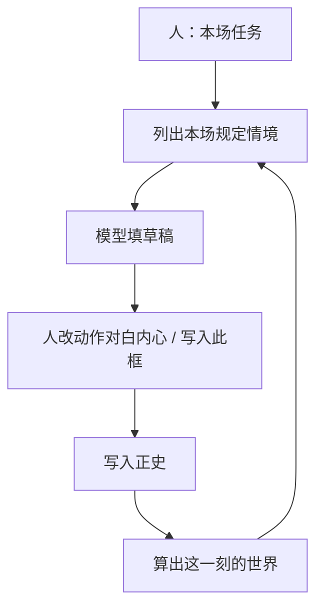
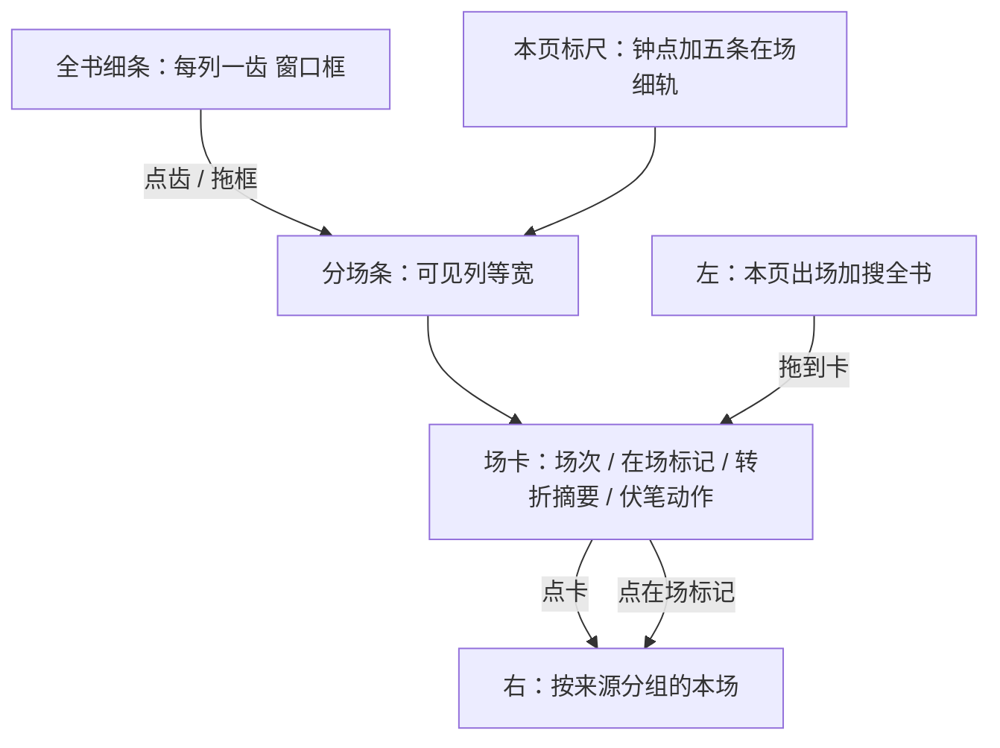

# 文学主面改造规划（2026-08-30）

> **状态：** 本场规定情境已写入 [`设定图-v1.md`](../设定图-v1.md) 与 [`世界引擎.md`](../世界引擎.md)。全书细条、出场飞出层、讲述序透镜、本页列数档位、以及「建议本场对伏笔做哪一件」**已于 2026-08-30 拍板上 v1**（用户编号 1–5）。实现合同以 [`设定图-v1.md`](../设定图-v1.md) 与 [`设定图-完整方案.md`](../设定图-完整方案.md) 第 11 节为准。全高出场表、连线图已于 2026-08-31 文学教授第 9 节升为作法必有、打开仍不是默认主面。
>
> 目标：最适合在故事时上写设定、写出有转折的下一场。算出这一刻的世界怎么算，不动。主面可以再补；不替人决定写哪一场。

---

## 结论

设定图要做成的东西：作者在**故事时**上一场一场写世界；人决定这场改变什么；模型填场；点「写入正史」才进入算出这一刻。界面必须让人看见三件事——**这场转了什么、谁知道谁不知道、读者还欠哪一响**——而不是一张不穿帮的空表。

v1 作为**设定仪器**是对的。作为**小说作法**不够：能算清世界，并不能替你写出下一场好戏。写下一场吃本场规定情境，不把整份世界塞进模型。

最优改造不是改成 NarrativeNode 画布，也不是改成剪辑软件。主面仍是分场条。

**已写入 v1 的：** 本场规定情境；全书细条 + 本页窗口；疏/中/密档 + − / +；出场飞出层（全高出场表后做）；建议本场对伏笔做哪一件（侧栏附加，不进模型输入）；讲述序透镜升格 + 细条第二道色。

**提案已收口：** 见完整方案第 11 节。本文下列「打开看到什么」与 v1 对齐处不再标未拍板。

NN 只继续借交互（一场一块、在场标记、点标记看这一刻），不借按人物一条线、不借一改即历史。影视只借「一行一场」和双时间线手势，不借拍摄序。

---

## 目标（用来判断每一条改不改）

| 目标 | 依据 | 界面必须能干什么 |
|---|---|---|
| 单独写设定，不是铜炉再加一页 | [`讨论纪要-2026-08-29.md`](../讨论纪要-2026-08-29.md) | 没戏也能建人物/地点/规则 |
| 骨头是何时何地谁在做什么 | 同上 | 打开就是按故事时排的场 |
| 下一场吃全部已写入正史的历史 | v1 九条第 5 | 同一列全部在场都算进去，不沿一个人 |
| 模型填、人改补；人点才进历史 | v1 九条第 2、9 | 讨论 → 写入此框 → 写入正史 |
| 人定写哪一场，历史只挡穿帮 | v1 九条第 6 | 没有本场任务不准写下一场 |
| 写哪一场用全知 + 知情差；嘴巴脑子用各人已知 | v1 九条后「阿莲找刀」 | 规定情境里同时有知情差和全知对照 |
| 不靠分数写小说 | v1「张力不另存分数」 | 明文列出当场利害，不打 0–1 |

**验收（文学，不是像素）：** 作者能在一屏内回答「下一场我该让谁、为了什么、对读者做什么」；模型填出来的草稿至少带一个价值转折或一次伏笔动作或一处知情差，而不是复述这一刻的世界。

---

## 不动与已拍板

### 不动

这些改了产品就不再是设定图：

- 五类记录、场不另开情节表、伏笔 ≠ 情状
- 算出这一刻时同一列全部在场都算进去；禁止按人物一条线
- 草稿不算正史；人点「写入正史」才有第几次写入
- 故事时间 / 谁在哪一场学会 / 第几次写入正史，三件分开；晚到事实改窗口、不改旧场动作对白内心
- 算出这一刻不调模型；禁止 `import scribe3`、禁止 Graphiti 等当世界真源
- 禁止复制 NN 源码；Obsidian 不当产品面
- 正史只在应用里改
- 不做情绪分、弧仪表盘、伏笔全页台账、主题课主面
- 不绑 vis-timeline 当数据模型；实体泳道不当打开默认主面
- 不按拍摄日重排（只借「一行一场」）
- 本场规定情境只列出条件，不指定写哪一场

### 已拍板（原待拍板，2026-08-30 用户 1–5）

| 现 v1 | 收口 |
|---|---|
| 全书细条 + 本页窗口 | 主面必有全书细条（列齿，点/拖跳窗口）；− / +、‹ › 仍保留 |
| 出场飞出层 | 出场一览飞出层 v1 必有；全高出场表作法必有、打开不是默认主面 |
| 相关未收最多 5 | 仍最多 5；附加本场伏笔动作建议一件；不挡写入正史；不进模型输入 |
| 讲述序可按读序排 | 讲述序升为主面透镜；细条第二道色 |
| 卡上密度 | 疏/中/密把列数设为 2/4/6；− / + 仍每次 ±1；卡上只看当前列数 |
| 连线图 | 作法必有；选中人才画、只读；不是默认主面 |

九条第 8「主题、弧疗程、文句、情绪分数不进主面」**保持**。规定情境不是主题课。

---

## 打开看到什么

三栏不动：左设定、中分场条、右本场。改的是中栏的时间和卡上信息。

### 1. 全书细条

- 位置：顶栏品牌行下方，或标尺上方一条，高度约 24px。
- 每一故事列一齿；本页窗口画成框；拖框或点齿 = 改窗口起点（现 ‹ › 仍保留，一次一列）。
- 齿的颜色只编码**有没有正史场 / 只有草稿 / 空场次 / 省略场**，不编码情绪。
- 闪回场（讲述序不等于列序）齿上加第二道色。
- 不做成 vis-timeline，不显示真实分钟宽度。细条是**列索引**，不是时间轴缩放。

### 2. 分场条

- 一场一块。拖场卡换列 = 改这场的故事时间窗口（默认跟列钟），**在场标记跟着走**。
- 删一场，缺口合上（空场次仍须人明确插入，避免误删变省略）。
- 同列两场 = 同时。

### 3. 场卡上必须看见的（默认 4 列）

| 块 | 来自哪 | 空时 |
|---|---|---|
| 场次 | 场次 | 占位「未名场」 |
| 在场标记 | 地点、出场人物、道具组织、伏笔操作 | 可拖入 |
| 价值转折 | 价值转折 | 标黄一行「未写转折」（仍不挡写入正史） |
| 本场变化 | 本场变化摘要，最多 3 条 | 无则不占行 |
| 伏笔动作 | 本场伏笔操作一个动词 | 无则不占行 |
| 讲述序 | 若不等于列序 | 徽章「读序 n · 闪回」 |

密（5 列以上）只留场次 + 在场标记 + 黄点。疏（2 列及以下）展开动作/对白/内心。中（3–4 列，默认 4）必须看见价值转折和本场变化摘要。顶栏疏/中/密把本页列数设为 2/4/6；− / + 仍可用。卡上跟列数，不跟「刚才点的是档还是 ±」。

学 NN「相对上一站变了什么挂在块上」这个形状，组件自写。

### 4. 本场侧栏：按来源分组

点卡 = 这场汇总；点在场标记 = 这个实体在这场。分组：在场；本场任务 / 价值转折；动作 / 对白 / 内心；本场变化；他知道什么（点人时默认打开）。

左栏设定**不被本场顶掉**。讨论仍钉在字段上：「讨论」→「写入此框」→ 仍是草稿。

### 5. 出场飞出层（仍非默认主面）

- 标尺旁按钮「出场」或快捷键。
- 行 = 当前搜/滤后的实体；列 = 故事列；格 = 有/无在场；点格 = 跳到该列。
- 只读。改在场仍拖标记。不是第二份库。全高出场表作法必有，打开仍不是默认主面。

### 6. 讲述序

- 默认：读序 = 故事列序。
- 切「按读序排」：中栏按讲述序排，钟点仍显示故事时间。**读序不改怎么算出这一刻。**
- 导出 Markdown 用读序。不做按人物一条线导出。

---

## 本场规定情境（已写入 v1）

算出这一刻、穿帮检查、写入正史 **不改语义**。列出本场规定情境，模型填下一场吃这一份（**不含**伏笔建议）。字段见 [`世界引擎.md`](../世界引擎.md)。侧栏可附加「建议本场对伏笔做哪一件」：人可改掉，不挡写入正史，不指定写哪一场。期限到了建议兑现；没有本场任务仍不准点写下一场。相关未收仍最多 5，不做「建议一件就改成最多 4」。

模型填动作对白内心时：每人的对白/内心只允许用该人已经知道的；全知对照只进本场任务和作者可见侧栏。默认同地动作→看见保持；规定情境里列出本场默认谁会看见。

---

## 分期

产品代码未开工时，**先改合同再动 demo**。禁止先嵌铜炉。细条 / 飞出 / 伏笔建议已拍板，实现时按完整方案第 11 节，不要当可选项丢掉。

第 0 期（本轮）：规定情境与五项已写入 v1 / AGENTS / 世界引擎 / 完整方案。

第 1 期：无界面检验。算出这一刻原检验一条不能坏。规定情境检验见世界引擎附录（伏笔建议不进 ScenePacket）。

第 2 期：接口 + 真分场条 + 接模型。prompt 只吃规定情境 + 本场任务，不把整份世界塞进去，不把伏笔建议当命令。细条 / 飞出 / 档位进界面。

明确后做：连线图当可编辑主面；情节线当默认行；读者知情总账、主题课、弧仪表盘；拍摄序；vis-timeline。

---

## 学谁、不学谁

| 来源 | 学 | 不学 |
|---|---|---|
| NarrativeNode | 一场一块、在场标记、点标记看这一刻、出场矩阵飞出、选中人才连线 | 画布当主面、按人一条线、一改即历史、本场顶掉设定栏 |
| Plottr | 场卡网格的密度感 | 情节线当打开默认纵轴 |
| Aeon Timeline | 钟点是一等公民 | 把主面做成可缩放真实时间轴 |
| StudioBinder | 一行一场、颜色编码场类 | 按拍摄日/场地重排 |
| 剪辑软件的双时间线 | 上面全书、下面工作区 | 帧、轨道当产品概念 |
| Frame.io | 批注钉在「这一场这一框」 | 全局评论流 |

---

## 风险

- **细条做成真实时间宽度** 会推翻列透镜（等宽列、钟不同长）。细条必须是列齿。
- **出场矩阵一开就当主面** 会退回已否决的「默认泳道」。必须是飞出层。
- **若把伏笔建议写成挡写入正史** 人会被逼每场收伏笔。建议进侧栏，不挡写入。
- **讲述序若写进算出这一刻** 会和「按故事时间叠场」打架。读序只影响排列和导出。
- **demo 先做** 时，规定情境规则会在页面里写死一份；接口必须搬同一份，禁止前端第二份。
