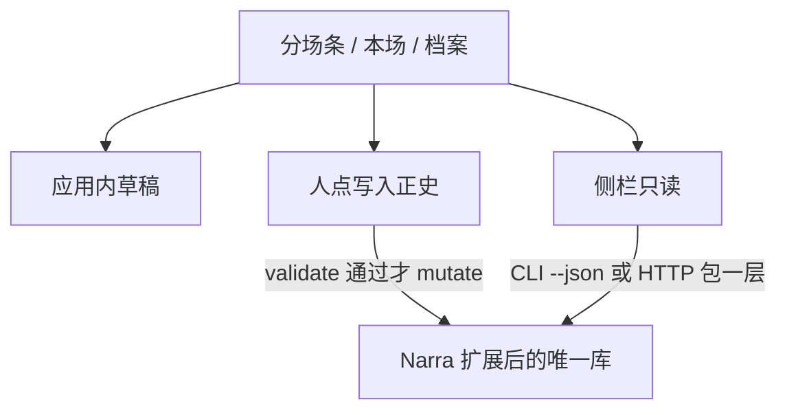
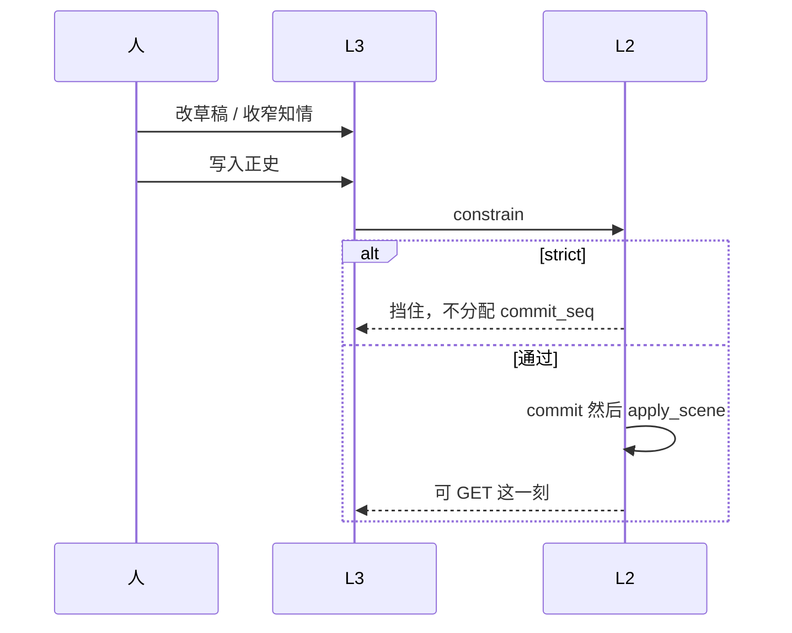
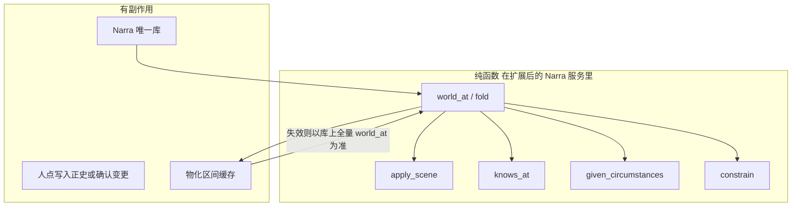

# 设定图 × Narra 底座（2026-08-30）

产品面、九条、用语仍认 [`../设定图-v1.md`](../设定图-v1.md)。算出这一刻、本场规定情境仍认 [`../世界引擎.md`](../世界引擎.md)。**世界存在哪、演算跑在哪，认本文。** 与旧规划「只抄枚举、自写 Python 内核、Narra 不当后端」冲突时，以本文为准。

---

## 结论

Narra 是**唯一世界库**。设定图是**写戏面**（分场条、本场、档案、侧栏）。改 `vendor/narra` 来达到 v1，不是砍 v1 去迁就官方 Narra，也不是再开一份五表 + `fold.py`。

点「写入正史」之后，账在 Narra 里。没点之前，草稿只在设定图应用里。查询「他知道什么 / 规矩破了没 / 知情差」打 Narra；正史不经 MCP mutate 落库。



NarrativeNode 仍只借交互（一场一块、在场标记、本场），源码不进产品。StoryLine 不当宿主。铜炉不碰。组 3 不当世界真源。

---

## 为什么这样收口

| 事实 | 依据 |
|---|---|
| 设定图要的系统没变 | v1 九条：分场条、本场任务、三时钟、草稿/正史、动作对白内心、情状开窗、伏笔、规定情境 |
| Narra 已发布且本机可跑 | MIT；Release 二进制；CI；`demos/narra-preview/narra.sh`。crate `0.1.0`，vendor 提交止于 2026-02-12 |
| Narra 验证过的 | 知情枚举与只追加边、规则三级闸、反讽查询、scene 挂 event、`world validate` |
| Narra 没验证过的 | 故事时间窗口、第几次写入正史、晚到事实、省略场、三轨、情状开窗、伏笔、规定情境 |
| 尽量用 ≠ 不改 | 缺的往 Narra 里加。官方能力与 v1 主面打架的，引擎可留、产品不接 |

「三个开源不当三份库」仍然有效：不是三个进程三份真源。Narra 是那一份库；NN / StoryLine 不进运行时。

---

## 层怎么分


| 层 | 做什么 | 不做什么 |
|---|---|---|
| L4 | 一行一场、标尺、本场、档案、侧栏中文 | 不算「这一刻」；不复制 NarrativeNode |
| L3 | 草稿态；每个框讨论→写入此框；列的展示序号与本页窗口 | 草稿不进 Narra 正史查询 |
| L2 | 写入正史、穿帮、默认知情、情状开窗、规定情境 | 不调模型；不把 embedding 当情状 |
| L1 | 人物/地点/场/知情/规则/伏笔的存 | 不是铜炉库 |

接口：设定图 HTTP 薄包一层（v1 附录那组路径可保留）。内部打 Narra 库函数或 CLI `--json`。**MCP mutate 不当写入正史。** MCP 只读查询可选，不作为产品主路径。

---

## 表怎么对（能对上的不另造）

官方 Narra 表继续用。一场戏 = 一个 `event`（同时点）+ 一个 `scene`（这场）。同列平行戏 = 同一 `event`、多个 `scene`。

| v1 说法 | 落到 Narra |
|---|---|
| 人物 / 地点 / 道具 / 组织 / 规则 / 伏笔档案 | 通用 `entity`+`kind`；官方 `character` / `location` 收成 kind=person / place |
| 规则 | 通用实体 kind=rule；`enforcement` / `scope` 进 `constrain`（官方 `universe_fact`+`enforcement_level`+`scope` 收进来，不当第二真源） |
| 已写入正史的场 | `event` + `scene`（`status=committed`）。过渡：写入正史双写官方表与 `setting_*`；`world_at` 切真源前可读 `setting_*`，切完以官方表 + 必要扩表为准 |
| 出场 | `participates_in`（`role` 区分在场 / 被提及） |
| 地点 | `scene.primary_location`；跨地用 `secondary_locations` |
| 他知道什么 | `knowledge` + `knows` 边（`KnowledgeState`） |
| 穿帮检查 | 扩展 `consistency` / `world validate` |
| 侧栏知情 | `list knowledge`；知情差用 `analyze asymmetries` **的列表，不用分数** |
| 结构关系 | `relates_to`；对人的看法用 `perceives`（不要 `tension_level` 进界面） |

---

## 必须改 Narra 才能达到 v1（你有、它没有）

这些加在 fork 里，不是另写 Python 真源。

### 场（`scene` / `event` 加栏）

| v1 栏 | 加在哪 |
|---|---|
| `status` draft \| committed \| superseded | `scene`。查询这一刻只吃 committed |
| `commit_seq` | `scene`。草稿无。基本设定不占序号 |
| `kind` scene \| ellipsis | `scene`。省略场：三轨空、可换地、必有本场任务 |
| `intent` / `value_shift` | `scene` |
| `clock_from, clock_to` | `event`：半开分钟窗口。`sequence` 可等于列序，**不当分钟** |
| `col` | 展示序号，插入空场次会变；演算用钟，不用列号当时长 |
| `t_label` / `narrative_order` | `scene`。讲述序不参与算出这一刻 |
| `tracks[]` do / say / think | `scene`，按人。省略场为空 |
| `delta` | 见下「情状」 |
| `promise_ops[]` | 见下「伏笔」 |
| `causes[]` | 前置必须是已 committed 的 scene |
| `title` / `prose` | 已有 title；prose 可选，场面不能只靠没拆开的散文提交 |

### 新表 / 新实体

| v1 | 做法 |
|---|---|
| 道具、组织、以及人物/地点/规则/伏笔 | 通用 `entity` + `kind`（person / place / thing / faction / rule / promise）。官方 `character` / `location` 收成同一套，按 kind 过滤。不另开 `thing` / `faction` 死表。左栏五类加伏笔必须能建。专用列仅当查询或约束真需要（地点树 `parent`、规则检查分级、伏笔未收列表） |
| 情状 `State` | 新表：`entity, attr, value, t_from, t_to, commit_seq`。真源是这场的 `delta`；表是按人可查的缓存，改场后按该列起重放 |
| 伏笔 `promise` | 新表。枪在抽屉是情状；读者欠一响才是伏笔。Narra 没有，必须加 |
| 空场次 | 只有 `event` 钟窗口、没有 `scene`。≠ 省略场 |

### 三个时间（不能砍）

Narra 现成：`event.sequence` + 知情挂 `event` + 墙钟 `learned_at`。不够。

| 时间 | v1 问什么 | 落点 |
|---|---|---|
| 故事时间 | 世界上何时为真 | `event.clock_from/to`；情状窗口用同一套钟 |
| 知情时间 | 谁在哪一场学会 | `KnowledgeState` 挂 `scene_id`（可保留 event 作同时点） |
| 写入时间 | 第几次点写入正史 | `scene.commit_seq` |

晚到事实：新场 `delta` 的 `t_from` 早于本场钟；旧场动作/对白/内心不改。查询先按 `commit_seq` 把该算的场全部叠进去，再按所问的故事时间切开——算法见世界引擎「怎么算」，实现进 Narra 服务，前端不许再算一遍。

v1 界面主写只用最新一次写入；`as_of` 先可只给检验用。

---

## 设定图要补上的 Narra 栏（你缺、它有）

v1 知情边现在只有 `{person, fact_ref, certainty, method, beat_id}`。下列不补会比 Narra 薄，反讽和「谁告诉谁」写不清。

| 栏 | 来源 | 不补的后果 |
|---|---|---|
| `source_character` | `KnowledgeState` | `told` 无法记下是谁说的 |
| `premises[]` | 同上 | `deduced` 无法追溯 |
| `truth_value` | 同上 | `believes_wrongly` 没有「实际是什么」 |
| 知情只追加 | `knowledge.rs` | 「后来忘了」没有历史 |
| `participates_in.role` | `scene.rs` | 被提及 vs 在场分不开，默认知情会算错 |
| `secondary_locations` | `scene.rs` | 一场跨两地写不出 |
| `location.parent` / `loc_type` | `location.rs` | 地点树只能全靠 `contains` 边 |
| `character.aliases` | `character.rs` | 左栏搜不到别名 |
| 规则 `scope` | `TemporalScope` / `PovScope` | 规矩不能「从哪场起、对谁生效」 |
| `protect` | impact 服务 | 与「已出场不能从设定里删」同类，可直接用 |

档案：每种实体按完整方案 F10 键表填 `profile`（键可空）+ 一段自由小传（对应 v1 `setup` / Narra `description`）。不进分场条，不打分。出场与情状窗口只读。

`perceives` 的 feelings / history_notes 可进档案或侧栏「对某人的看法」。`tension_level` 不进界面。

独立 `note` 表：讨论未确认稿可挂，不当正史。

---

## 语义对齐（两边都有、以 v1 为准）

| 主题 | 官方 Narra | 改成 |
|---|---|---|
| 事实是什么 | `knowledge.fact: String` | 知情指向一条情状或一句手写；不要第二份字符串真源 |
| 穿帮 | 对照 universe_fact，带 confidence | 闸级沿用 `info/warn/strict`；**同人同列两地**是新规则，写进 validate |
| 反讽 | `dramatic_weight` | 只返回谁知谁不知；侧栏列表，不打分 |
| 一改即历史 | create 当时生效 | 草稿在 L3；committed 才进算出这一刻 |
| 知情怎么来 | 全靠人手 create | 先手写覆盖，再按同场同地补默认：动作→看见、对白→听见、内心→本人 |

确定性 / 来源枚举 v1 已封闭，与 Narra 一致，保持。无逻辑闭包。

---

## 要补的运算（进 Narra 服务）

世界引擎列出的函数，实现改名可以，合同不变：

```
fold(T, as_of=S) -> world
world_at(canon, T, as_of=S) -> world
apply_scene(world, scene) -> world
knows_at(canon, T, person, as_of=S)
constrain(world, scene) -> {info, warn, strict}
select_open_promises(world, draft) -> Promise[≤5]
given_circumstances(world, draft) -> ScenePacket
commit(draft) -> scene
revise(scene, patch) -> scene + 冲突[]
supersede(scene) -> scene
confirm_structure(op, chosen)
lookup_interval / put_interval / invalidate_interval
```

`fold` 与 `world_at` 同一函数。纯函数 vs 有副作用边界见下节。

`apply_scene` 顺序（世界引擎已定，不得调换）：在场 → 所在地惯性 → delta 开窗（重叠必须显式收口）→ 手写知情再补默认 → 伏笔操作 → 校验因果。

`constrain` 必须覆盖：无本场任务（写下一场入口也拦）；同人同列两地 = 挡；知情穿帮 = 标黄；价值转折空 = 标黄；因果指向草稿或已作废写入 = 挡；场面既无三轨也无变化 = 挡；信错的人「想起」实际真值 = 挡；规则 `enforcement=挡` 且违反 `scope` = 挡。两列钟重叠不当正式状态。

`given_circumstances`：本场任务原样带回；上场价值转折；当场利害；知情差（不知 / 信错）；读者账（沿讲述序投影，不算进 `world_at`）；本场默认谁会看见；相关未收伏笔 ≤5（先排期限到/过期，再排埋点近）。地点或出场未定则利害/知情差/伏笔/读者账为空。不打分。侧栏伏笔建议一件只给界面，不进 `ScenePacket`，不指定写哪一场。结构建议清单只给确认变更对话框，不进 `ScenePacket`。人物透镜只滤看法，不进 fold。

本页列数（− / +、疏中密）是应用内展示，钳在 1–6，不改 `clock_*`，不写正史。拖列改钟、加列 / 减列 / 合并 / 换位、删已正史：人点「确认变更」之后才改 `clock_*` / 场落点 / `status=superseded`。未确认只预览。不允许两列 `clock_*` 重叠当正式状态。



---

## 引擎是纯函数、库是 Narra

**不改「Narra 是唯一世界库」结论。** 演算合同以 [`../世界引擎.md`](../世界引擎.md) 为准；代码在本 fork 的 `vendor/narra` 里加，禁止仓外再写 Python `fold` 当真源。

算出这一刻（`world_at` / `fold`）、把一场算进世界（`apply_scene`）、他知道什么（`knows_at`）、本场规定情境（`given_circumstances`）、穿帮检查（`constrain`）**必须是纯函数**：同一份已正史历史 + 同一故事时间 → 同一输出。没有隐藏可变「当前世界」。删已正史 / 确认变更后重算 = 换一份历史再跑同一函数。

整个世界引擎**不能只有内存里的函数**。有副作用的边界仅此：

| 边界 | 做什么 | 不做什么 |
|---|---|---|
| Narra 嵌入式 Surreal | 正史事实唯一存放（含 superseded、情状窗口、知情、`commit_seq`） | 不是第二份算出这一刻 |
| `commit` / `revise` / `supersede` / `confirm_structure` | 人点「写入正史」「确认变更」才 mutate | MCP mutate 不当写入正史；未确认不写 |
| `materialize.rs`：`lookup_interval` / `put` / `invalidate_interval` | 缓存 `world_at` 结果，点列先查这里 | 不是第二真源；与全量 `world_at` 不一致则丢掉重折 |

拟新增（官方没有）：`services/world.rs`、`services/circumstances.rs`、`services/constrain.rs`（或只在 `consistency.rs` 加 v1 规则、不把分数当真源）、`services/canon.rs`、`services/materialize.rs`。**不要**把 `world_at` 塞进现成 `services/temporal.rs`（弧 / 阶段聚类，产品不接）。

`world_at` 的历史以当前打开的这本书为界。每书一份 Narra 世界（完整方案 F51）。函数合同按书隔离，不串书。

三时钟是对同一份正史的三个问法，不是三套库：`world_at`（故事时间）、`knows_at`（谁在哪一场学会）、`as_of` / `commit_seq`（第几次写入正史，不代替故事时间）。增量折必须与全量 `world_at` 观察等价。流程图 F54–F59 见世界引擎。



---

## 产品面不接（引擎可留代码）

九条第 8 条、v1「张力不另存分数」「不做」仪表盘：下列**不进分场条、不算进这一刻、不指挥写哪一场**。

| 能力 | 为什么 | 允许的用法 |
|---|---|---|
| annotation 情绪/主题分 | 主面不靠分数写小说 | 不读 |
| embedding 漂移当弧 | 弧用情状开窗 + 价值转折 | 左栏语义搜人名可选；问这一刻不用向量 |
| arc_snapshot / phase | 不当纵轴、不当疗程页 | 不读 |
| `dramatic_weight` / `tension_level` | 张力列利害和知情差 | `analyze asymmetries` 只要事实列表 |
| MCP mutate | 正史只在分场条人点 | MCP 只读可选；主路径 HTTP 或 CLI 查询 |

不是从仓库删这些模块；产品契约是不把它们当真源。

---

## 许可证与目录

- Narra：MIT，保留 `vendor/narra` 版权声明。fork 在本仓改，不把官方当运行时并排再开一份库。
- NarrativeNode：source-available，**禁止复制源码进产品**。对照仍是 [`../references/narrative-node.md`](../references/narrative-node.md)。
- 演示：`demos/narra-preview/` 继续当官方能力对照，不是设定图正史。`demos/stripboard-v1.html` 演进为打扩展后的 Narra。

旧规划「语言：Python `worldgraph/kernel`」作废。检验用 Narra 的测试（Rust）覆盖世界引擎那张表；HTTP / 界面可用 Python 或 TypeScript 薄包。禁止前端再写一套算出这一刻。

---

## 开工顺序（每步结束能打开分场条）

禁止嵌铜炉、禁止复制 NN。**要改 `vendor/narra`。** 不绑 vis-timeline。

1. **Narra 加场合同 + 检验（无 UI）**  
   `status` / `commit_seq` / 三轨 / `delta` 开窗 / 省略场 / 默认知情 / 同人两地 / 晚到窗口 / 草稿不进 fold。对上世界引擎检验表。
2. **设定五类 + 薄接口**  
   通用 `entity`+`kind`（人物地点规则道具组织伏笔）；浏览器打开空分场条（可仍是 HTML 表），读 committed。每书打开对应 Narra 世界文件。
3. **分场条可写**  
   改动作对白内心 → 写入正史 → 标尺色点 → 点一列看这一刻。
4. **写下一场**  
   本场任务 + 规定情境 + 讨论确认进框 + 模型填整场（吃规定情境，不吃整份世界）。草稿不算正史。
5. **侧栏知情**（去分的 asymmetries）+ 可选导出 Markdown（默认含草稿、标清正史/草稿）。出场飞出层（只读矩阵）、全高出场表、连线图（选中人才画、只读）作法必有，打开不是默认主面。丢一段草稿辅助入口可与写下一场同批，不得绕过写入此框 / 写入正史。

---

## 作废的旧句

| 旧句 | 现在 |
|---|---|
| 借知情枚举和闸，不 fork 当后端 | fork Narra 当唯一库 |
| 自写 `worldgraph/kernel`（Python）当 fold | 演算在扩展后的 Narra |
| v1 先不做三时钟、跟 `event.sequence` 走 | 三时钟要做，加在 Narra 上 |
| 禁止先嵌 vendor 整仓 | 禁止 NN 与铜炉；Narra 是底座 |
| Narra / StoryLine 当第二份库 | Narra 是第一份世界库；StoryLine 仍不当库 |

[`../设定图-v1.md`](../设定图-v1.md) 的场上栏位、穿帮分级、规定情境、不做仪表盘，仍然有效。附录「五表」是逻辑模型；物理表是 Narra 扩展后的表。

---

## 每书一份世界（不改唯一库结论）

Narra 仍是**唯一世界库**（fork 一份代码）。多书 = 单用户本机上**多份世界文件**，一书一世界，互不读写。

| | 做法 |
|---|---|
| 书 | 应用内本地列表：书名、对应 Narra 嵌入式 Surreal 路径（或等价隔离：独立 DB 文件）。无登录 |
| 创建书 | 新建空世界文件 + 进分场条（本页列数 N=1）。不写正史 |
| 打开 / 切换书 | 关掉当前书的草稿会话（未写入正史的草稿随该书文件旁的应用草稿走，不串书）→ 打开目标书的世界 |
| 算出这一刻 | 只读当前打开的那一份世界 |
| 不是 | 多用户、权限、协作、账号；也不是官方 Narra 与设定图各开一份库 |

官方 Narra 一次打开一份 DB 路径（`NarraDb` / `path`）。设定图按书切换路径，不在同一 Surreal 里用 `work_id` 混多书——避免铜炉「一书一 DB 注册表」那套账号式横切。

---

## Surreal 必须用上的能力（不改唯一库结论）

**Narra 仍是唯一世界库。** 吸收铜炉的是机制，不是第二套 Surreal、不是 `import scribe3`。完整对照、文学教授闸、流程图 F60–F64 见 [`../设定图-完整方案.md`](../设定图-完整方案.md) §8.13。机制路径见 [`../references/铜炉-Surreal与工程教训.md`](../references/铜炉-Surreal与工程教训.md)。

官方能力以铜炉仓副本 `docs/external/surrealdb-docs/` 为准（`transactions-and-isolation.md`、`define/indexes.md`）。不为用而用：进下表「必须」的，都挂得上分场条上的一场戏；进「故意不用」的，文学教授能指出写错。

| 必须用上（改 fork） | 落点 | 不做会写错什么 |
|---|---|---|
| `BEGIN` / `COMMIT` 包住写入正史与确认变更 | 拟 `services/canon.rs`；SurQL 一条多语句（嵌入式无跨 `query()` 会话事务） | 半截 supersede：库上已正史、在场边没有；或库已改、物化当旧世界 |
| 多语句**逐条**看 status | 所有 `db.query` 包装；禁止只 `take(0)` | 穿帮检查过了、后面 RELATE 失败被吞，下一场规定情境当他在场 |
| 在场 / 知情 / 所属 = `TYPE RELATION` RELATE，不是数组冒充图 | 扩 `participates_in` / `knows`；组织成员、持有走带钟的边或情状窗口 | 当众/私下混；拖走标记后算出这一刻仍当他在 |
| `participates_in.role` 区分在场 / 被提及 | 已有边，写入正史必须写 role | 被点名的人算成看见了动作 |
| 知情只追加；挂 `scene_id`；`learned_at` 不当故事时 | 扩 `knows`；三时钟见上文 | 闪回场用插入墙钟当「学会那场」 |
| 3.x `FULLTEXT ANALYZER` + 中文 token（名/别名）；**只**左栏搜全书 | 改 `004_phase4_search.surql`；分析器不要 `snowball(english)` | 搜「阿禾」打不中；或搜到另一本书 |
| 索引：`event.clock_from/to`、`scene.commit_seq`+`status`、边的 in/out/`scene_id` | 新 migration | 点列 / 删在场全表扫；删正史后边残留 |
| SCHEMAFULL 正史表；可查询的文学事实不当 JSON 串 | 场 / 边 / 情状 / 伏笔状态 | 问「谁在 10:00 在渡口」只能 Python 扫袋 |
| 身份稳定：UNIQUE `name` + 按名查 id 再 MERGE；禁止 `UPSERT record(表, name)` | 通用 `entity` | 改名变两个人；档案只改领袖清掉其余键 |
| 作废 = `status=superseded` 保留 id；补洞 = **新**场新 id。禁止同一事务 DELETE 后 CREATE 同 id | `canon.rs` `supersede` | 3.x 同事务同 id 重建失败或半删；后面的场仍当那件事发生过 |
| 物化可放 Surreal，真源仍是正史记录；不一致则丢掉物化、全量 `world_at` | `materialize.rs`；失效写进同一笔确认/写入事务 | 删正史后点列仍显示已删的在场 |
| 一书一嵌入式文件；`REFERENCE … ON DELETE REJECT` 护已出场 | `connection.rs` 按书切 path；已有 008 REJECT | 搜全书串书；设定里删了还在场上的人 |
| `commit_seq` 分配撞写–写冲突则整笔重试 | 官方快照隔离 | 两人连点写入正史丢一场、序号重复 |

| 故意不用（引擎代码可留，产品不当真源） | 文学上会错成什么样 |
|---|---|
| HNSW / embedding / `search::rrf` 排规定情境或未收伏笔 | 期限将到的枪被「语义更像」的旧枪挤出最多 5 |
| `LIVE` / `CHANGEFEED` / `DEFINE EVENT` 自动 mutate 正史 | 人没点写入正史，世界上自己变了 |
| Surreal 原生 `VERSION` / 墙钟代替三时钟 | 省略场、闪回、晚到窗口与「第几次写入」搅成一列时间 |
| `DEFINE TABLE AS SELECT` 或 `fn::world_at` 当算出这一刻 | 第二份 fold，与 Rust 纯函数分叉；检验预言机失效 |
| 同一库 `work_id` 混多书、PERMISSIONS / JWT | 单用户无账号；搜全书搜到别的书 |
| Graph RAG 喂模型填下一场 | 历史指定写哪一场 |
| MCP mutate | 绕过分场条人点 |

**不改：** fork 一份 Narra；正史只在人点「写入正史」「确认变更」后 mutate；算出这一刻仍是纯函数，读库上的 committed，不读物化当历史。


---

## 未拍板（本文不改唯一世界库结论）

原见 AGENTS.md 的四项（全书总览条、出场飞出层、本页列数档位、侧栏伏笔建议）加讲述序升格，已于 2026-08-30 拍板上 v1。同日夜结构编辑（拖列侵入、下一场默认最后、已正史可删须补洞）已拍板。**「列数无上下限」已被同日更正覆盖：本页可见列数 1–6。** 导出含草稿、多书单用户、丢一段草稿、档案键、通用 `entity`+`kind` 已拍板。**本文「Narra 是唯一世界库」结论不变。** 2026-08-31 文学教授第 9 节已拍板：全高出场表与连线图作法必有、仍非默认主面；知情含信错与出处；读者账进规定情境、不算进 fold；人物透镜允许、禁止当 fold；规则 `enforcement`/`scope` 进 `constrain`；官方表加栏融合，双写再切真源；九条第 8 条保持，章法主脑只在书页。

档案 profile 键：以 [`../设定图-完整方案.md`](../设定图-完整方案.md) F10 键表为准；键可空。若只要一段小传，键留空即可。
