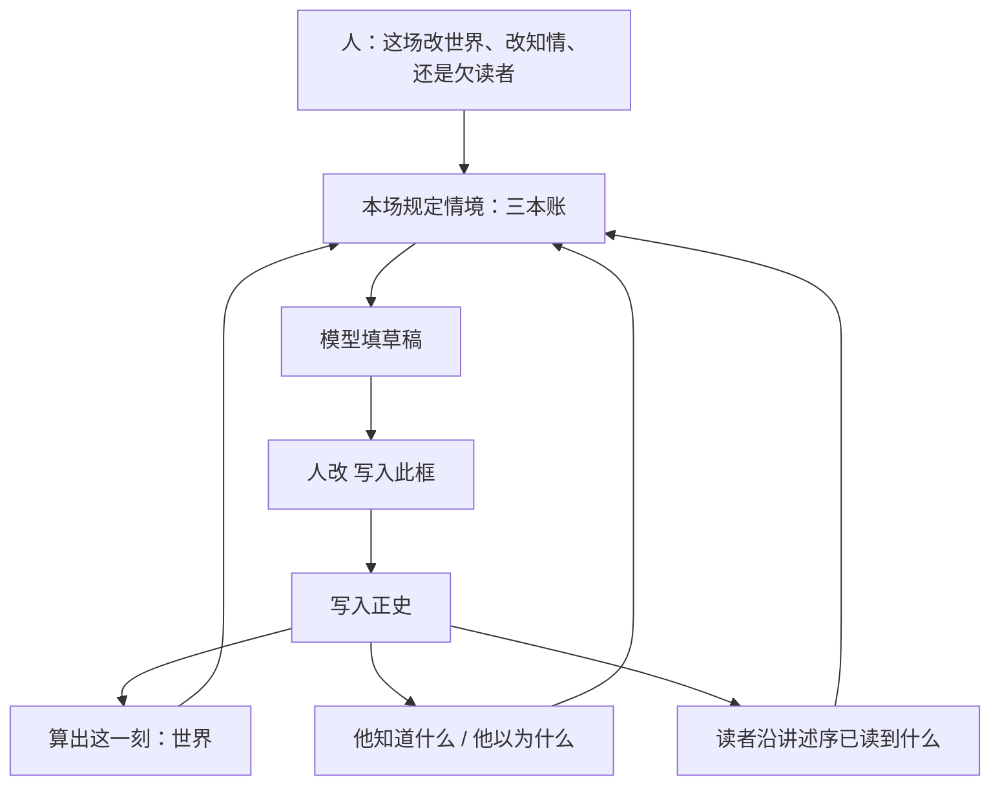
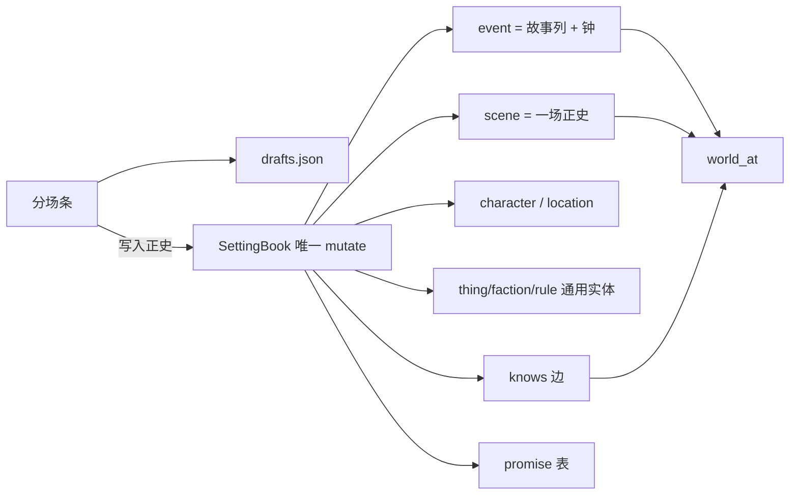

# 设定图 · 文学教授目标改造（2026-08-31）

> **效力：** 本文是目标规划，按「你要写成什么样的书」倒推产品与世界库。第 9 节已于 **2026-08-31 拍板**，冲突条已写入 [`设定图-v1.md`](../设定图-v1.md)、[`Narra底座`](./2026-08-30-设定图-Narra底座.md)、[`世界引擎.md`](../世界引擎.md)。未列入第 9 节的条目仍不自动推翻这三份。
>
> **身份：** 按小说作法审仪器。v1 把设定图做成了能算清世界的分场条；本文要把它做成**能写出下一场好戏的作法台**。算出这一刻的算法合同可以加深，不能换成模型或分数。
>
> **现状锚点（2026-08-31）：** 分场条可写；《渡口》已正史五场 + 一场草稿，留在 `data/books/渡口/`。Narra 是唯一库路径，但正史走平行 `setting_*` 表，官方 `event`/`scene`/`knows` 空着。档案已从窄浮框改成近全屏页。

对人说话用 v1「用语」右列：场、本场任务、写入正史、算出这一刻、规定情境、知情差、价值转折、省略场、伏笔（读者欠一响）。

---

## 1. 结论

设定图的目标不是「不穿帮的世界表」，是：**作者在故事时上，一场一块地改变世界，并且每一场都对读者欠账或还账。** 仪器必须让人同时看见三本账——世界上为真什么、谁以为什么、读者已经知道什么——然后人定这场改哪一本。

v1 做成了第一本账（世界）和第二本账的一半（人物知情，且没有「信错了」）。第三本账（读者沿讲述序已经读到什么）没有。Narra 官方那套知情出处、谁告诉谁、地点树、别名，也没有接到正史上。所以现在能写出《渡口》的骨架，写不出「阿莲以为铜牌在柜面、读者知道刀在抽屉、阿福知道两件事」这种戏。

改造原则：

1. **主面仍是分场条。** 不改成画布、不改成剪辑时间线、不改成 Save the Cat 十五拍模板。
2. **作法进透镜和规定情境，不进算出这一刻的真源。** 限知、读序、连线、出场总表是看法；世界上为真仍只来自已正史场。
3. **Narra 融合成正史本体，不当第二写入口。** 官方表加栏承接场与知情；MCP/CLI 不得 `create_scene` 冒充写入正史。
4. **各家写作方法只借操作，不借教条。** 能映射到「改世界 / 改知情 / 欠读者」的才进产品；要把下一场写成固定节拍的，全部拒绝。

**文学验收（全书，不限一屏）：** 作者能回答「下一场让谁行动、他不知道什么、读者已经知道什么、这场结束后世界上少了或多了哪一笔欠账」。模型填的草稿至少命中价值转折、知情变动、伏笔动作三者之一，禁止复述这一刻清单。

---

## 2. 你的目标（用来筛每一条改造）

从讨论、v1、文学主面改造、以及你要「Narra 完整融合」合在一起。目标比 v1 仪器更大，筛法不变：改了必须让下一场更好写。

| 目标 | 现在 | 改造后必须能干什么 |
|---|---|---|
| 没戏也能写人物、地点、规则 | 能 | 保持。档案是一页，不是浮框 |
| 按故事时一场一块写世界 | 能 | 保持分场条。列可以很多，本页窗口仍要跟手 |
| 下一场吃全部已正史，不沿一个人 | 能折 | 同一列全部在场；道具、组织算进去 |
| 人点才是历史 | 能 | 保持。Narra 融合后仍如此 |
| 历史只挡穿帮，不指定写哪一场 | 能 | 保持。规定情境加厚，不加「你应该写复仇」 |
| 看见这场转了什么 | 有价值转折栏，卡上弱 | 卡上、侧栏、细条都能看见上场转折与本场拟转 |
| 看见谁知道谁不知道 | 有默认看见/听见，无知情出处 | 知情差含「不知」和「信错」；能问谁告诉谁 |
| 看见读者还欠哪一响 | 有伏笔建议一件，账薄 | 未收、将到期、本场可还的一笔，标在卡和细条上 |
| 写出圈套、反讽、发现 | 半套 | 作者全知 × 人物知情 × 读者已读，三列对照 |
| 世界库是 Narra，不是平行袋 | 平行 `setting_*` | 正史在官方表 + 必要扩表；情状/知情是行和边 |
| 多书、单用户、本机 | 能 | 保持一书一文件 |

不是目标（写进产品就会毁作法）：

- 替人决定下一场写什么（节拍表、主题课、情绪分、Graph RAG 指定格子）
- 按人物一条线当真源（限知可以是透镜，不能是 fold）
- 一改即历史（Narra CLI create、NN 画布）
- 铜炉主编 / 丢整章猜格子
- 把「用满 Narra」理解成弧仪表盘和向量检索排伏笔

---

## 3. 作法地图：各家方法落到哪一层

写作方法很多。产品只认三层。**进世界** = 写入正史后进入算出这一刻。**进透镜** = 改看法和导出，不改世界上为真。**永不进** = 会替人写或把小说收成分数。

### 3.1 进世界（正史事实）

| 作法 | 出处（只在这里，不进界面） | 落到设定图 |
|---|---|---|
| 一场改变一个价值 | 麦克基：价值电荷；亚里士多德：突转 | 本场任务 + 价值转折。空则标黄，不挡写入正史 |
| 发现 / 认出 | 亚里士多德：发现 | 知情写入：某人此刻知道了以前不知道的。可同时兑现伏笔 |
| 暗场 | 戏曲暗场；热奈特：概述 | 省略场：钟走、不演、知情不默认 |
| 明场同时 | 戏曲同场；影视平行剪 | 同列多场。穿帮：同人两地挡 |
| 枪在墙上 | 契诃夫 | **情状**（刀在抽屉）≠ **伏笔**（读者还欠看见它响） |
| 草蛇灰线 | 金圣叹 | 伏笔跨场：埋设 / 推进 / 兑现 / 作废。细条上可看见这条线，线不是第二份库 |
| 密针线 | 李渔 | 因果指向已正史场；删正史必须列出缺口 |
| 当众 / 私下 | 话剧调度 | `visible_to`；动作默认看见、对白默认听见、内心仅本人 |
| 限知说话 | 詹姆斯、热奈特 | 嘴巴和脑子只用该人已知；全知留给本场任务 |
| 信错了 | 戏剧反讽的一半 | 知情状态：知道 / 怀疑 / 信错 / 否认 / 忘了。信错必须带「实际是什么」 |
| 谁告诉谁 | 叙事学：信息来源 | `learning_method` + `source_character`。官方 Narra 已有，现产品没有 |
| 换地必有场 | 剧作基本 | 旅行用省略场，带本场变化 |

### 3.2 进透镜（看法，不算进算出这一刻）

| 作法 | 出处 | 落到设定图 |
|---|---|---|
| 讲述序 ≠ 故事时 | 热奈特：时序 | 已有「按读序排」。加深：读者知情只沿讲述序累加 |
| 读者比人物多知道 | 希区柯克炸弹；戏剧反讽 | **读者账**：沿讲述序已正史场，读者应当已经看见的事实。不是分数 |
| 只看某一个人知道的 | 限知叙事 | **人物透镜**：中栏和侧栏可滤成「阿莲所知」。fold 仍是全知。禁止透镜写回正史 |
| 只看有某实体的场 | 出场表 | 档案「场」+ 全高出场表。改在场仍拖标记 |
| 关系怎么织 | 结构主义行动元；连线 | 连线图：选中人才画线；边来自已正史的在场/所属/知情，可看不可当第二写入口 |
| 起承转合 / 章回 | 章法 | **书级**主脑、章界、回目。挂在书上，不指挥每一场必须对应哪一拍 |
| 场面与反应 | 斯温 / 比克汉：scene-sequel | 建议，不强制交替。省略场或内心场可标「反应」，不算新状态机 |

### 3.3 永不进产品真源

| 作法 | 为什么拒绝 |
|---|---|
| Save the Cat 十五拍、英雄之旅强制格 | 指定写哪一场，违反九条第 6 条 |
| 情绪分、张力雷达、弧疗程仪表盘 | 九条第 8 条；把利害收成 0–1 |
| 主题课、母题打分 | 主题从场上长出来，不在主面开课 |
| 按人物泳道 fold | 下一场会看不见刀在抽屉而阿莲不知道 |
| 一贴即正史、丢整章 ingest | 铜炉弯路 |
| embedding 排未收伏笔 | 期限将到的枪被语义近的旧枪挤出 |
| MCP `create_scene` | 一改即历史 |

---

## 4. 现在差在哪（文学，不是像素）

用《渡口》已有正史对照。

已能写的：

- 阿福发现刀（世界变了：刀.holder=阿福；阿福知道刀在抽屉）
- 阿莲来找（知情差：阿莲不知道刀；上场转折「无知→把柄」）
- 阿禾同时在城里（同列多场）
- 阿莲省略回城（钟走、不学会刀）
- 阿福把刀藏进仓（本场变化覆盖所在地惯性）

还写不成的：

1. **阿莲以为铜牌在柜面。** 没有「信错了」状态，知情差只能说「不知道」。
2. **读者已经从第一场知道刀在，阿莲还不知道。** 没有读者账。作者靠自己记。
3. **阿福对阿莲说「没看见」，这是撒谎。** 对白进了听见，没有「说话人知情 vs 说出的事实」。
4. **铜牌三日将到期。** 伏笔有行，卡上、细条上几乎看不见欠账。
5. **谁把刀放进抽屉。** 没有因果指向、没有「告诉」。
6. **渡口夜间不得开船。** 档案有小传，写入正史不检查这条规矩。
7. **点铜牌档案。** 曾是窄浮框（已改成近全屏页）；情状窗口仍弱，出场的场可点回分场条。

工程上对应的缺口（判断落到文件）：

| 缺口 | 文件 |
|---|---|
| 正史不在官方 `scene`/`event`/`knows` | `canon.rs` 只写 `setting_*` |
| 情状/知情是 JSON 袋 | `setting_beat.deltas_json` / `knowledge_json`；`setting_window`/`setting_knows` 建了不写 |
| 知情无出处 | `world.rs` 只生成「看见:/听见:/心想:」字符串 |
| 规则不算闸 | `constrain.rs` 不读 `kind=rule` 的 enforcement/scope |
| 搜全书无别名、无中文全文 | `search_entities` 内存 `contains` |
| 读者账不存在 | 无模块 |
| 连线、全高出场表 | v1 后做，本文升为作法必需，仍不是打开默认主面 |

---

## 5. 目标形态（不限于 v1 的打开样子）

三栏保持：左设定、中分场条、右本场。加深的是账，不是再加第四个主面。

### 5.1 中栏：分场条仍是骨头

- 一行一场或一段省略场。同列 = 同时。
- 卡上三行必须能看见（密度随本页列数减，但不能减没）：本场任务、价值转折、本场对三本账的动作（世界变了 / 有人知道了或信错了 / 伏笔埋推进兑现）。
- 细条齿色仍只编码正史/草稿/空/省略；**另加可开关的「欠账齿」**：该列有未收伏笔期限落在此窗，或有未还的枪。欠账齿是透镜，不改钟。
- 全高出场表、连线图从「后做」升为**作法必有、打开仍不是默认主面**。入口：标尺旁「出场」、选中人后「关系」。改世界仍回分场条。

### 5.2 右栏：规定情境变成三本账

写下一场时侧栏固定六块，顺序不得乱（先任务，再账，再建议）：

1. 本场任务（人写的，空则不准写下一场）
2. 上场价值转折
3. **世界账**：当场利害（仍开着的情状，和这场人/地相交）
4. **人物账**：知情差（不知 / 信错，最多列出与本场相关的）
5. **读者账**：沿讲述序，读者已知道而本场某在场者还不知道的（反讽材料）。没有讲述序则读者账 = 已正史全知里「会在读序中被看见的」
6. 未收伏笔最多 5 + 建议本场做哪一件（人可忽略，不进模型）

本场默认谁会看见，附在人物账下，不当独立仪表。

点在场标记：本场按来源分组（已有），并显示该人此刻知道什么、信错什么。

### 5.3 左栏与档案

- 左栏默认本页出场；搜全书必须打中别名。
- 档案是一页（已改近全屏）：基本设定可填；出场的场、情状窗口、他知道什么、相关伏笔只读。
- 点档案里的场：跳到该列，不在档案里改世界。

### 5.4 透镜（顶栏，可关）

| 透镜 | 改什么 | 不改什么 |
|---|---|---|
| 按读序排 | 中栏顺序、导出、读者账 | 算出这一刻 |
| 人物透镜 | 卡上灰掉该人不可能知道的摘要；侧栏人物账为主 | 世界上刀还在不在 |
| 欠账透镜 | 细条/卡上强调未收伏笔 | 不自动写兑现 |
| 关系 | 打开连线飞出层 | 不是第二份库 |

人物透镜**禁止**成为写入正史的过滤器：你仍然用全知定本场任务，用该人已知写他的对白内心。

---

## 6. 世界库：把 Narra 融进正史（不是整包当主面）

目标：正史存在官方本体能认的表上；写戏合同仍是草稿 / 人点 / 三时钟 / 纯函数。

### 6.1 融合合同

| 设定图 | 融进 Narra | 必须加的栏 / 扩 |
|---|---|---|
| 故事列 | `event` | `clock_from/to`；`sequence`=展示序 |
| 一场 | `scene` | `status, commit_seq, kind, intent, value_shift, do/say/think, telling_ord, visible_to` |
| 人物 | `character` | F10 进 `profile`；aliases 要搜 |
| 地点 | `location` | `parent`、`loc_type` 启用 |
| 道具/组织/规则 | 官方无对应表 | 保留通用 `entity`+`kind`，或扩表 |
| 在场 | `participates_in` | **IN 必须扩到人物以外**（刀、渡口帮）。角色：在场 / 被提及 |
| 知情 | `knows` | 加 `scene` 引用；`learned_at` 不当故事时；certainty / method / source / truth_value 启用 |
| 规则 | `universe_fact` 可存条文 | 闸仍是 `constrain` 读 enforcement/scope，不用 confidence |
| 伏笔 | 官方无 | `setting_promise` 或新表，属于正史 |
| 情状 | 官方无 State | 必须有行：`entity, attr, value, clock_from/to, commit_seq, source_scene`。真源是这场的本场变化，行是可查询投影 |

`world_at` 继续是 Rust 纯函数。禁止 `fn::world_at` 第二份 fold。禁止 MCP mutate。官方 CLI 只读已正史。

### 6.2 分三步（不能一次切真源）

1. **官方表加栏 + SettingBook 双写。** 写入正史同时写 `event`/`scene`/`character`/`location` 与现有 `setting_*`。`world_at` 仍读 `setting_*`。《渡口》行为不变，但 `SELECT scene` 能看见「阿福发现刀」。
2. **知情与情状落行/边。** commit 展开 `knows` 与情状窗口；停用 JSON 袋当真源。`load_canon` 可从官方表拼。搜全书走 aliases + 中文全文，一书一文件。
3. **只读接官方服务。** 知情差可从 `knows` 边列事实（去掉 dramatic_weight）。规则行进 `universe_fact` 给 constrain。然后迁移并停止 `setting_beat` 作为真源。

《渡口》必须有迁移脚本，禁止空库冒充融合成功。

### 6.3 官方能力哪些永远不进主路径

弧快照、phase 聚类、embedding、HNSW/RRF、tension_level、MCP create、LIVE/CHANGEFEED 自动改场。引擎代码可留。理由见完整方案 §8.13.8。

---

## 7. 世界引擎：加深，不换算法家族

现有 `apply_scene` 六步顺序保持：在场 → 所在地惯性 → 本场变化开窗 → 手写知情再补默认 → 伏笔操作 → 因果。要加的是知情模型和读者账（读者账不是 fold 的第七步，是透镜）。

### 7.1 知情模型（对齐 Narra，服务 v1 合同）

每人每条事实：

- 状态：知道 / 怀疑 / 信错 / 否认 / 忘了
- 来源：看见 / 听见 / 被告诉 / 读到 / 推断 / 开场已知
- 若被告诉：谁说的
- 若信错：实际是什么（来自情状，不是第二份字符串真源）
- 挂：`scene_id` + 故事时 `clock_from` + `commit_seq`

默认知情规则保持：当众动作→看见，当众对白→听见，内心→第一个在场者（或将来按说话人）。省略场不默认。私下只写 `visible_to`。

`knows_at` 必须等于 `world_at.knows[person]`。

### 7.2 读者账（新，不算进世界上为真）

输入：已正史场按 `telling_ord`（无则列序）排成读序；读者「已读到」当前透镜位置之前的场。

输出：这些场里，当众被看见/听见的事实，以及作者标明「叙述者告知读者」的事实（可选栏，默认 = 当众事实）。

用处：规定情境第五块；反讽 = 读者有、某在场者无。

讲述序透镜关掉时，读者账可按故事时累加（作者在时序上排戏的看法）。两种看法都不是 fold。

### 7.3 穿帮加深

现有：无本场任务挡；同人两地挡；知情穿帮标黄；价值转折空标黄；空场面挡。

增加（待拍板）：

| 检查 | 级 | 文学 |
|---|---|---|
| 对白断言的事实，说话人知道其为假 | 标黄 | 撒谎可见，不挡（戏需要谎） |
| 信错的人「想起」实际真值 | 挡 | 限知破了 |
| 规则 `enforcement=挡` 且本场违反 scope | 挡 | 「夜间开船」真成规矩 |
| 规则仅标黄 | 标黄 | 破戒是戏，但作者看见 |
| 因果指向已作废场 | 挡 | 已有思路，须在界面可见 |

仍不：用模型判断「像不像穿帮」。

### 7.4 情状必须是行

`setting_window` 或等价表写入正史时展开。问「十时谁拿着刀」可以查行，再与全量 `world_at` 对预言机。JSON 袋只允许草稿。

---

## 8. 模型填下一场

输入仍只有：本场任务 + 规定情境（三本账）+ 本场已填的框。禁止：伏笔建议一件、结构建议、整份世界、embedding 检索来的「相关章」。

输出：动作 / 对白 / 内心，鼓励带价值转折或知情变动；**不自动写入正史**，不自动指定下一场落在哪一列。

文学验收保持：草稿不是复述利害清单。人不满意就改。

真调失败回假模型，超时有上限（已有 12s 量级），不得挂死界面。

---

## 9. 与 v1 的关系（2026-08-31 已拍板）

下列超出旧 v1 的条目已拍板，真源已改。硬边界未动。

| 条目 | v1 | 本文 |
|---|---|---|
| 全高出场表、连线图 | 后做 | 作法必有，仍非默认主面 |
| 知情状态机 | 事实字符串 | 知道/信错/出处 |
| 读者账 | 无 | 透镜 + 规定情境第五块 |
| 人物透镜 | 无（禁止泳道当真源） | 允许透镜，禁止当 fold |
| 规则进闸 | 档案小传 | enforcement/scope 进 constrain |
| Narra 官方表 | 平行 setting_* | 加栏融合，双写再切真源 |
| 九条第 8 条 | 主题弧疗程不进主面 | **保持**。章法主脑只在书页，不进每一场 |

不打算动的硬边界：

- 分场条主面；不绑 vis-timeline；NN 不抄源码
- 人点写入正史 / 确认变更
- 三时钟
- 同一列全部在场
- 禁止铜炉、禁止第二份 fold、禁止 MCP 当写入正史
- 本页列数 1–6；故事列总数不限
- 多书单用户本机

---

## 10. 分期（按写出什么戏验收）

### 第 0 期 · 已有（仪器）

分场条可写，《渡口》五场正史可折。档案近全屏。缺口见第 4 节。

### 第 1 期 · 作法可见（2026-08-31 已做界面，未切库）

界面先让三本账**看得见**，读者账用讲述序对已正史当众事实做只读投影（可先不落新表）。

验收：打开《渡口》写下一场，侧栏能读出「读者知道刀在、阿莲不知道」。卡上能看见价值转折和未收「铜牌三日」。

落点：`circumstances.rs` 的 `reader_knows` / `reader_irony`；侧栏 `ledger-*`；细条 `.tooth.debt`；卡上 `card-debt`。读者账不算进 `world_at`。

### 第 2 期 · Narra 双写（2026-08-31 已做双写，未切读）

`event`/`scene`/`character`/`location` 加栏；commit 双写；知情开始写 `knows` 边（scene 引用）。情状行展开。`world_at` 仍读 `setting_*`。

验收：`SELECT scene` 有「阿福发现刀」；分场条与 `world_at` 与现在一致；搜「阿莲」别名能中。

落点：`021_narra_bridge.surql`；`narra_bridge.rs`；`canon.rs` 写入路径双写；开书 `sync_official`；`GET /api/bridge` 只读核对。已回填《渡口》。

### 第 3 期 · 切真源 + 规则闸 + 信错（2026-08-31 已做切读）

`load_canon` 情状读 `setting_window`、知情读 `knows` 边（JSON 袋只回退）；constrain 读规则 `enforcement`/`scope`；知情含信错。`world_at` 仍是纯函数。场骨架仍在 `setting_beat`（扩表），官方 `scene` 双写。

验收：写「阿莲：铜牌在柜面」且她信错时，规定情境列出信错；她「想起刀在抽屉」被挡住；夜间开船若规则为挡则挡住。

落点：`022_canon_rows.surql`；`canon.rs` `load_canon`；`constrain.rs` `recall_truth` / `rule_block`；`ScenePacket.wrong_beliefs`；知情写入可选「信错」。未改《渡口》正史场次。

### 第 4 期 · 透镜与总表（2026-08-31 已做）

人物透镜、全高出场表、连线图（选中人才画）。读者账与讲述序对齐（按读序排时只收到当前列读序）。

验收：切「只看阿莲」时侧栏变她的账，世界上刀仍在仓；点出场表跳列；选中阿福看见与刀、阿莲的边，拖边不能改正史。

落点：`POST /api/lens`；`apply_person_lens`；`GET /api/occupancy` 全实体×全列；`GET /api/relations` 只读；分场条顶栏「人物透镜 / 出场 / 关系」。未改正史场次。

### 第 5 期 · 书级章法（2026-08-31 已做）

书页：主脑（一句前提）、章界、回目。细条可按章分段。不强制每场对应节拍。章法挂在书上（`craft.json`），不进算出这一刻。

验收：能给《渡口》写一句主脑，导出按章；写下一场仍不出现「你现在应该写中点」。

落点：`services/craft.rs`（`BookCraft` / `export_markdown`，不算进 `world_at`）；一书一文件 `craft.json`；`GET|POST|PUT /api/craft`；分场条顶栏「书页」；细条 `mini-chapters` 与 `.tooth.chapter-start`；导出有主脑则 `> 主脑：`，有回目则 `# 第N回`。`fill_live` 若吐出「你现在应该写中点」会丢弃。Playwright：`e2e/playwright/craft.spec.ts`。

五期之后补上的作法缺口（仍不推翻 v1）：`constrain.rs` `lie_visible` 标黄不挡；档案 `knows_readonly` / 相关伏笔；知情写入可标「被告诉」和谁说的；官方表里没有对应 `setting_beat` 的 `scene` 不算正史。

---

## 11. 渡口应当能继续写出的戏（文学剧本，不是测试名）

用来判断改造有没有把仪器变成作法台。每条都应能在分场条上点出来，并且算出这一刻说得通。

1. 阿莲以为铜牌在柜面，翻不到。读者知道刀在仓。阿福撒谎「没看见」。
2. 阿禾在城里等到铜牌三日将尽；细条上这几列有欠账色。
3. 有人把刀放进抽屉的那场被删；系统列出阿福发现刀的因果缺口，人确认后才删。
4. 阿莲被阿福告知「铜牌在城里」（谎）。她的知情是信错，实际铜牌仍不知所终。
5. 切人物透镜看阿莲：看不见刀在仓；作者仍能用全知决定下一场让她开仓。
6. 官方只读查询能列出已正史场；用官方 CLI 新建一场，产品不当成写入正史。

---

## 12. 模块落点（实现时不得另开第二真源）

| 模块 | 路径 |
|---|---|
| 算出这一刻 | `vendor/narra/src/services/world.rs` |
| 规定情境 + 读者账投影 | `circumstances.rs`（读者账若纯从讲述序来，可同文件纯函数） |
| 穿帮 | `constrain.rs`；规则条文可读 `universe_fact` 或 entity.profile，不用 consistency 的分数 |
| 写入正史 / 确认变更 | `canon.rs`；双写期同时打官方表 |
| 物化 | `materialize.rs` |
| 知情边 / 情状行 | 新 migration；commit 展开 |
| 分场条 / 档案 / 透镜 | `apps/stripboard/index.html` 至独立前端为止仍可，但算出禁止在前端再折 |
| 迁移《渡口》 | `e2e/` 脚本 + 一书一文件 |

---

## 13. 风险

- **双写期两套表不一致。** 必须以 `world_at` 预言机为准；官方表落后则 commit 失败，不许静默只写一边。
- **人物透镜被误当成限知世界。** 必须在界面写明：本场任务仍全知。检验：透镜打开时仍能写下「阿莲来找刀」这类她自己想不出的任务。
- **读者账被写进 fold。** 讲述序一变，世界上刀会「消失」。禁止。
- **第 9 节已拍板。** 未列入第 9 节的条目仍以 v1 三份真源为准。
- **为融合而融合。** 接 irony 分数、弧、向量排伏笔，文学上会写错，见完整方案 8.13.8。

---

## 14. 建议你拍板的三句话

1. 设定图从「设定仪器」升为「作法台」：三本账进规定情境；主面仍是分场条。
2. Narra 按底座原文加栏融合，不整包 MCP/分数；《渡口》要迁移。
3. 全高出场表、连线图、人物透镜、信错、规则闸，从后做/缺失改为目标范围；九条第 6、8、9 条不撤。

这三句已于 2026-08-31 点头。第 1–5 期已做。第 9 节已写入三份真源。
