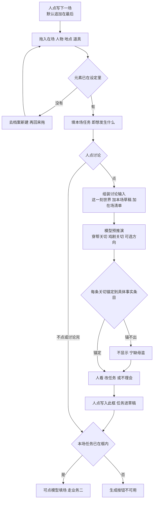
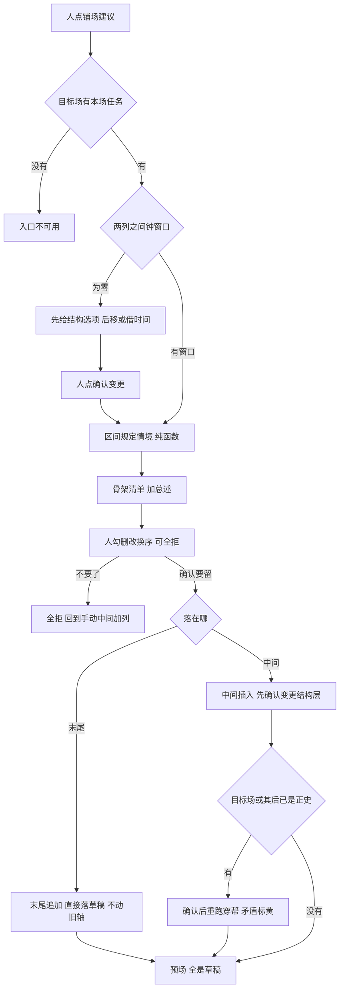
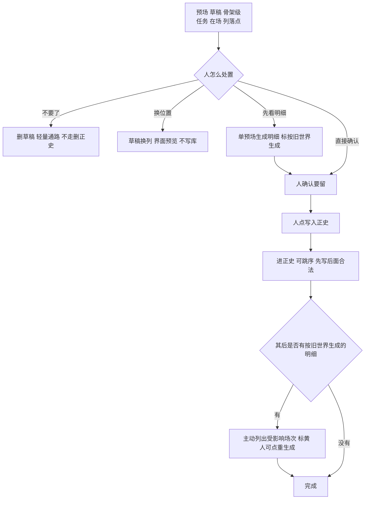

# 设定图：模型协作两场景设计方案（v2：业务图审查完善版）

日期：2026-08-31。本方案是**新增能力的待拍板稿**，不推翻现有真源：产品九条仍以 [`设定图-v1.md`](../设定图-v1.md) 为准，算出这一刻仍以 [`世界引擎.md`](../世界引擎.md) 为准，工程现状以 [`2026-08-31-审计核实与改造方案.md`](./2026-08-31-审计核实与改造方案.md) 为准。未经授权不改产品代码。

v2 形成过程：先把方案里每一条业务画成流图（第 3 节），再由两位专家基于图审查——文学教授管「写戏对不对」，大模型系统架构师管「状态与闭环对不对」——发现列在第 4 节，修订已吸收进第 5、6 节，修订处标【修】。

图里不用 `click` 当节点名（会把 Mermaid 解析打崩）。凡是人点的动作，都写成「人点……」。

---

## 1. 两个场景（用户原话的设计化重述）

**场景一：单场生成闭环。** 开一场，往里拖元素（主角、配角、物品、地点），填「这场想发生什么」。填的时候可以和模型讨论，模型真的预推演「我想填的这么写会怎么样」，和我来回讨论。确认后写进框，点「生成一场」，系统基于这场所有相关信息把整场详细内容生成出来。

**场景二：目标倒推铺场。** 我手动填了一场目标场。在前一场和目标场之间要加戏，系统参考我的目标和之前的信息，智能建议中间要几场比较合适、这些场是并行还是串行、每一场的推荐信息是什么。这些场全部预生成，但都是预场（草稿），我确认后才是正式场。

---

## 2. 红线对照（九条怎么约束这两个场景）

| 红线 | 来源 | 对两场景的约束 |
|---|---|---|
| 模型填、人改补；人点才进历史 | 九条第 2、9 | 讨论稿、预推演、生成稿、预场全是草稿；写入正史只能人点 |
| 没有本场任务不准点写下一场 | 九条第 6 | 场景一里「想发生什么」= 本场任务，是生成的前置；场景二里目标场没有任务则拒给建议 |
| 不许穿帮，不等于指定写哪一场 | 九条第 6 | 场景二的建议只是建议，人拍板后才成为场；建议不挡写入正史 |
| 建议不进模型填场输入 | 世界引擎·规定情境 | 场景二的规划建议不进规定情境；场景一的讨论内容也不进，进框的只有人确认后的字段 |
| 草稿不进算出这一刻 | 世界引擎 | 预场不影响世界；这也决定了预场不预生成明细（见 6.4） |
| 同一列全部在场都算进去 | 九条第 5 | 场景一拖什么进列，什么就进规定情境和在场 |
| 中间改结构须确认变更 | 完整方案 F46–F49 | 场景二落预场插在中间时，结构层先确认变更，场仍是草稿 |

---

## 3. 业务流图（每一业务一张）

四张图覆盖方案全部业务：场景一拆成前半（任务讨论环）与后半（生成与正史），场景二拆成前半（建议与落预场）与后半（预场到正史）。凡是人点的动作，图里都画成「人点」开头。

### 3.1 业务一：开场、在场、任务讨论环（场景一前半）



图说：讨论可多轮也可不讨论；讨论的输入与填场吃同一份规定情境，区别只在输出（话语 vs 场稿）。元素只认已存在设定，没有先去档案建——在场标记上对基本设定只读（v1 已拍板）。关切锚不出具体世界事实就不显示，见 4.2 L1。

### 3.2 业务二：生成整场与写入正史（场景一后半）

```mermaid
flowchart TD
  tapFill["人点模型填场"]
  hasTask{"本场任务已在框内"}
  refuse["生成不可用"]
  call["规定情境 送模型 整场草稿"]
  ok{"成功"}
  fail["超时 拒答 不合结构<br/>原草稿不动 错误可见 可重试"]
  draft["整场草稿 不进历史"]
  humanEdit["人改补"]
  tapCanon["人点写入正史"]
  hard{"硬穿帮"}
  block["挡住 不进历史"]
  yellow["标黄不挡 如知情穿帮 转折空"]
  canon["进正史 进入算出这一刻"]

  tapFill --> hasTask
  hasTask -->|否| refuse
  hasTask -->|是| call --> ok
  ok -->|失败| fail --> tapFill
  ok -->|成功| draft --> humanEdit --> tapCanon --> hard
  hard -->|是| block
  hard -->|否| yellow --> canon
```

图说：生成稿不自动进历史；失败路径明文——模型超时或输出不合结构时，原草稿一个字不动，错误可见，可重试。穿帮检查只拦硬穿帮；标黄（如知情穿帮、转折空）不挡写入。

### 3.3 业务三：铺场建议与落为预场（场景二前半）



图说：目标场有没有任务是入口闸门。钟窗口为零时没有故事时间可铺，先解决结构再给建议。落预场分两路：末尾追加不动旧轴；中间插入属结构变更，按 F46 先确认结构（场内容仍是草稿），且若目标场或其后已是正史，确认后必须重跑穿帮检查——这是 4.1 A1 修上的。

### 3.4 业务四：预场到正史（场景二后半）



图说：预场只到骨架级（原因见 6.4）。跳序写入合法——世界按故事时间折，不按写入序；但每当一个预场进正史，系统主动扫描其后列里「按旧世界生成」的明细，列出、标黄、给重生成入口。这是 4.1 A5 修上的。

---

## 4. 双专家审查（基于四张业务图）

### 4.1 架构师发现（状态、闭环、失败路径）

| 编号 | 级别 | 发现 | 处置 |
|---|---|---|---|
| A1 | 漏洞 | v1 方案「落为预场=批量建草稿」漏了结构层：插在中间的预场若不走确认变更，列钟不重排，预场的钟窗口悬空；目标场已正史时也没重跑检查 | 已修：业务三落预场分两路，中间插入先走确认变更，后面有正史则重跑穿帮并标黄 |
| A2 | 漏洞 | 铺场建议的模型输入没定义：把全世界塞给模型不可行 | 已修：新增「区间规定情境」纯函数，见 6.2 |
| A3 | 漏洞 | 两列之间钟窗口为零时没分支，建议无处安放 | 已修：业务三先给结构选项（后移 / 借时间），解决结构再建议 |
| A4 | 增强 | v1 说讨论记录存内存，崩溃即丢；讨论半小时的结晶不该这么脆 | 已修：讨论记录随草稿场落草稿侧文件（不进库、仍不是正史），与「丢一段草稿」同层 |
| A5 | 增强 | 预场写入正史后，其后面「按旧世界生成」的明细没人提醒，会带着旧知情进正史 | 已修：业务四写入正史后主动扫描、列出、标黄、给重生成入口 |
| A6 | 成立 | 跳序写入合法（按故事时间折，写入序只影响第几次写入）；删预场走轻量通路；草稿换列不写库 | 图四已画，验收补用例 |

### 4.2 文学教授发现（写戏对不对）

| 编号 | 级别 | 发现 | 处置 |
|---|---|---|---|
| L1 | 漏洞 | v1 的「戏剧关切」没有锚定要求，会退化成「建议加强冲突」这类空话 | 已修：凡建议类输出（预推演关切、骨架总述）必须锚定具体世界事实条目（哪条知情差、哪条伏笔、上场转折），锚不出不显示。全方案统一原则 |
| L2 | 漏洞 | 骨架清单只说「每场干什么」，没说「为什么非有这场不可」，场数建议无依据 | 已修：每个骨架带必要性——这场不存在，目标场哪里塌 |
| L3 | 增强 | 并行戏若没有交汇点，并行没有戏剧意义，只是结构炫技 | 已修：并行骨架必须带「与主线交汇点」字段（两线哪一刻相撞） |
| L4 | 增强 | 预推演若评价「该不该写这场」就越权——写什么场是人的主权 | 已修：预推演只评「这么写会不会穿帮、会不会塌」，不评该不该写 |
| L5 | 增强 | 窗口内有期限将到的伏笔，建议应优先排，v1 没写成规则 | 已修：区间规定情境含期限内伏笔，骨架可带伏笔操作 |
| L6 | 成立 | 生成稿转折空标黄不挡；建议不挡写入、人可全拒——符合九条 | 维持 |

### 4.3 两专家共同确认的闭环成立项

- 场景一全环成立：开场 → 在场 → 任务 →（讨论环）→ 入框 → 生成 → 改补 → 正史，失败与硬穿帮都有回路。
- 场景二全环成立：目标任务 → 建议 → 筛选 → 落预场 → 逐场明细 → 逐场正史，全拒、删预场、换序、跳序分支齐全。
- 每条「人点」在图上都可指认，模型没有任何一条自动进正史的边。

---

## 5. 完善后的场景一设计：讨论—预推演—生成—写入正史

### 5.1 用户流程

对应业务一、业务二两张图。七步：开新场（默认最后追加）→ 拖入在场（没有先去档案建）→ 填本场任务 → 可反复讨论（预推演）→ 人点写入此框 → 人点模型填场 → 人改补 → 人点写入正史。

### 5.2 讨论的输入与记录【修】

输入 = 该字段当前草稿 + 本场规定情境（知情差、当场利害、相关未收伏笔最多 5、上场价值转折、本场默认谁会看见）+ 当场在场清单。讨论与填场吃同一份规定情境，区别只在输出。

记录：讨论随草稿场落草稿侧文件，不进库、不是正史；崩溃重启后还在；与「丢一段草稿」辅助入口同层。建议一件仍不进讨论输入。

### 5.3 预推演的形态与边界【修】

输出三类，每条都必须锚定具体世界事实条目，锚不出不显示：

1. **穿帮关切：** 软性一致性问题。例：阿福已正史知道「刀在抽屉」，任务若让阿莲当众说出这句，标出知情穿帮风险（与库内标黄同口径，不挡写）。
2. **戏剧关切：** 任务写得平、没有转折、利害不清——必须说出平在哪（「两人都想要刀但没人让步，转折从哪来」），不许说「建议加强冲突」。
3. **可选方向：** 两到三个改法，供人选或不理。

边界：预推演只评「这么写会不会穿帮、会不会塌」，不评该不该写这场；不输出成稿、不替人改框、不写库。

### 5.4 生成整场与失败路径【修】

走现有「模型填下一场」通路：规定情境 → 整场草稿，不含伏笔建议、不含结构建议、不含讨论记录里未确认的部分。

失败路径明文：超时、拒答、输出不合结构——原草稿不动，错误可见，可重试。长输出可中断。生成稿价值转折空 = 标黄不挡（与 v1 一致）。

### 5.5 实例（渡口书）

阿莲、阿福、刀、渡口拖进列。任务草稿：「阿莲来要刀」。预推演锚着「阿福上一场已正史藏刀且阿莲不在场」这条知情差指出：阿莲直接说出藏刀处即知情穿帮；给三个方向：阿莲诈、阿福露馅、第三者说漏。人选「阿福露馅」，写入此框。点生成：模型拿着含「阿莲不知道刀在抽屉」的规定情境写整场，阿莲的台词就不会用她不知道的事。写入正史。

---

## 6. 完善后的场景二设计：目标倒推的场次规划建议

### 6.1 用户流程

对应业务三、业务四两张图。目标场有任务（草稿或正史都行）→ 列缝点铺场建议 → 系统给骨架清单加总述 → 人勾删改换序（可全拒）→ 落为预场（末尾直接落草稿；中间先确认变更结构层）→ 逐场走场景一通路 → 逐场写入正史。

### 6.2 区间规定情境【修·新增纯函数】

铺场建议不能吃全世界。新增纯函数：输入 = 前场这一刻的世界 + 目标场的任务与已有内容；输出 = 两列之间用得上的那一截：窗口内期限将到或已过期的伏笔、目标场涉及实体的情状与知情差、两列之间已有的正史场。不落库、不进模型填场输入、不指定写哪一场。它错得可以被用例检验（纯函数），这是它比「塞全世界」强的另一点。

### 6.3 骨架清单的字段【修】

每个骨架 = 列落点（新列串行 / 同列并行）+ 本场任务 + 建议在场 + 可对伏笔做哪一件（可空）+ 必要性（这场不存在，目标场哪里塌）+ 并行者另带与主线交汇点（两线哪一刻相撞）。总述必须锚着区间规定情境内的事实讲理由，空话不收。

钟窗口为零时，先给结构选项（后移 / 借时间，走确认变更），再谈建议。

### 6.4 预场只到骨架级，不预生成明细

硬约束：草稿不进算出这一刻。连续预生成明细时第 2 场的规定情境看不到第 1 个预场的效果，场与场自相矛盾。所以落预场只落任务、在场、列落点；明细在该预场被确认要留后走场景一。单个预场可先看明细，但必须标「按旧世界生成」，其前置预场进正史后系统主动列出并可重生成（业务四）。

### 6.5 落为预场分两路【修】

1. **追加在最后：** 直接落草稿场，不动旧轴。
2. **插在中间：** 先走确认变更（结构层：列缝、钟重排），场的内容仍是草稿；目标场及之后已有正史的，确认后重跑穿帮检查，矛盾标黄。

预场的删除走轻量通路（不走删正史）；草稿换列界面预览不写库。

### 6.6 实例（渡口书）

已正史到第 3 场「阿福藏刀」。目标场第 8 场任务：「阿莲当众揭穿阿福」。铺场建议给四个骨架：4（串，阿莲发现刀不见、起疑；必要性：不起疑则揭穿无动机）、5（串，阿莲向船工打听；必要性：无证据则当众只是撒泼）、6（并，阿福转移刀；交汇点：转移被船工撞见，证词到阿莲手里）、7（串，阿莲设局；必要性：不收回伏笔「阿莲的急性子」，揭穿像开挂）。人删 5、把 6 改串行，落为预场：三个草稿场上条。逐场生成明细、逐场写入正史。

---

## 7. 接口与数据

| 接口 | 输入 | 输出 | 写库 |
|---|---|---|---|
| 字段讨论 | 书、草稿场、字段名、人这句话 | 回复 + 锚定关切清单 | 不写库；记录落草稿侧文件【修】 |
| 铺场建议 | 书、前列缝、目标场 | 骨架清单（含必要性、交汇点）+ 总述 | 不写库 |
| 落为预场 | 书、人确认后的骨架清单 | 末尾：直接建草稿场；中间：先确认变更再建草稿【修】 | 只写草稿，不走写入正史事务 |

新增纯函数「区间规定情境」（见 6.2）。模型填场沿用现有接口，真模型通路按改造方案第 2 项接通；讨论与铺场建议复用同一条模型出站通路，不另开配置。不动表；预场就是草稿场；建议不落库。

---

## 8. 验收（真模型、真点击、证据不复制）

场景一：

1. 配好密钥，开新场，拖入阿莲、阿福、刀、渡口；讨论一轮，预推演锚着知情差指出穿帮；写入此框。
2. 点生成，格子里不是写死的假句；生成稿不自动进历史；断网重试，原草稿不动、错误可见。
3. 写入正史后问这一刻可见；未点之前不可见。
4. 讨论到一半重启应用，讨论记录还在草稿侧。【修】
5. 模型给出锚不出事实的空话关切时，界面不显示该条。【修】

场景二：

1. 目标场只有任务，点铺场建议，骨架每条带必要性、并行带交汇点；刷新页面建议消失（不落库）。
2. 目标场无任务，入口不可用。
3. 两列钟窗口为零，先给结构选项（后移 / 借时间）。【修】
4. 末尾追加落预场不动旧轴；中间插入落预场先出结构确认，确认后目标场及之后的已正史场重跑穿帮、矛盾标黄。【修】
5. 预场可删（轻量）、可换列（预览不写库）；全拒回到手动中间加列。
6. 预场跳序写入正史后，其后「按旧世界生成」的明细被主动列出、标黄、可重生成。【修】

证据规则：每项自己的剧本、自己的断言、内容与别项不同的运行记录。

---

## 9. 分期

| 期 | 内容 | 依赖 |
|---|---|---|
| 一期 | 讨论输入与记录落地 + 真模型填场接通 + 场景一整环 | 改造方案第 2 项 |
| 二期 | 区间规定情境 + 铺场建议 + 落为预场两路 + 按旧世界生成标记与重扫描 | 一期 |

整页出场表、连线图仍后做，不挡本方案。

---

## 10. 明确不做

- 模型不指定写哪一场；建议不挡写入正史；建议不进规定情境。
- 建议类输出无锚定不显示——空话建议等于没有建议。【修】
- 预推演不评价该不该写这场。【修】
- 预场不预生成明细为默认；单预场预览明细必须带「按旧世界生成」标记。
- 不做检索增强注入模型填场；不做情绪打分、张力分。
- 建议不为「显得留痕」落库；要留痕由人把结论写进字段。讨论记录落草稿侧是为了防丢，不是为了留档。【修】
- 不改成按人物一条线往下写；不改成替人写小说的流水线。

---

## 11. 风险

- 预推演质量依赖规定情境的完整：知情差算错，预推演就误导人。先有改造方案第 3 项（标黄真的出现）再上场景一更稳。
- 区间规定情境裁剪错了，铺场建议就偏。它是纯函数，可以用例检验；但仍要文学验收——总述锚着事实还说不说人话，接口通了不算完。
- 「按旧世界生成」的明细若人无视标黄直接写入正史，旧知情可能进历史。缓减：写入正史时穿帮检查本就重跑；标黄只是提醒，不挡——这是九条的代价，接受。
- 讨论记录落草稿侧，人可能误以为进了正史。界面明示「讨论不是历史」。

---

## 附：与现有编号的对应

- 场景一：写下一场 F07、规定情境 F26、模型填场（现有接口）、写入正史状态机 F35、穿帮检查（同人两地等）、价值转折空标黄不挡。
- 场景二：中间加列 F46、确认变更 F61、同列多场（同一事件多个场）F41、草稿换列 F17、删已正史 F50（预场删除不走它）、草稿不进算出（世界引擎）、结构预览未确认不写库（世界引擎）。
- 建议模式：伏笔建议一件（不进输入、不挡写入、人可忽略）的同款推广；本方案再加一条：无锚定不显示。
