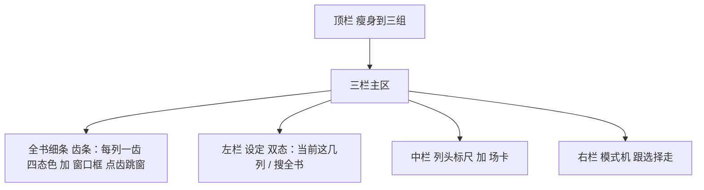
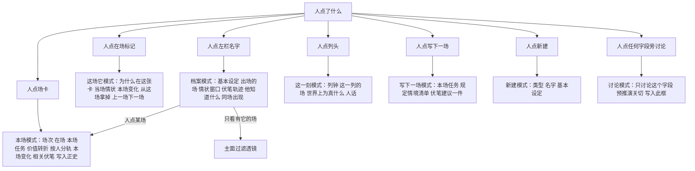

# 设定图：界面交互全面优化设计

日期：2026-08-31。范围：分场条主面（`apps/stripboard/index.html`）的界面与交互全面重做。不动世界引擎、不动九条、不动写入正史与确认变更的闸门——这次只改人看见和摸到的东西。与《模型协作两场景设计方案》配套的界面落位见第 7 节。

本方案是**界面交互的待拍板稿**，不推翻现有真源：产品九条仍以 [`设定图-v1.md`](../设定图-v1.md) 为准，算出这一刻仍以 [`世界引擎.md`](../世界引擎.md) 为准，两场景能力以 [`2026-08-31-设定图-模型协作两场景.md`](./2026-08-31-设定图-模型协作两场景.md) 为准。未经授权不改产品代码。

图里不用 `click` 当节点名。凡是人点的动作，都写成「人点……」。

---

## 1. 先给结论

实现版不是「丑」，是信息架构没做：全部 20+ 个控件永远堆在顶栏和侧栏，点什么都不变。这是测试脚手架的形状（每个功能一个裸按钮，为自动化测试服务），不是产品的形状。

仓里的 demo（[`demos/stripboard-v1.html`](../../demos/stripboard-v1.html)）已经把正确的形状做出来了：侧栏是模式机——点卡看本场、点标记看「这场·它」、点名字看档案、点列头看「这一刻」。优化方案的主干就是把 demo 的形状落进真实现，不是另起炉灶。

全网同类产品验证过这套形状：Scrivener 的检查器跟选择走、Plottr 的卡片过滤、StudioBinder 的色带即状态、Novelcrafter 的设定中枢——各家殊途同归的结论都一样：写作工具的中间是稿，左右跟着选择变。

有一个超出视觉的缺口必须修：实现版把「每人的动作/对白/内心」拍平成了整场三个文本框，世界引擎明明要求按人分轨（每人的对白只用他已经知道的）。这是数据粒度的对齐问题，不是美化。

---

## 2. 现状诊断：实现版 vs demo 差距清单

证据：实现版 `apps/stripboard/index.html`（约 33K，全部内联），demo `demos/stripboard-v1.html`（约 86K）。

| 区 | 实现版现状 | demo 已验证的形状 | 差的是什么 |
|---|---|---|---|
| 顶栏 | 一行挤 20+ 控件：书名、建书、开书、疏中密、−＋‹›、加列减列合并换列、读序、写下一场、再写一场、省略场、出场、导出、丢草稿、埋伏笔、地点、读序号、标读序（`index.html` 顶栏） | 左品牌、中窗口控制组（‹ − 本页N/共M ＋ ›）、右主行动「写下一场」+ 主题切换 | 分组与主次；结构编辑六件套应收进一个菜单（它们都走确认变更，同一闸门同一入口） |
| 全书细条 | 12×16 像素小齿，只有颜色，无文字无框 | demo 未做齿条，但列头有钟、时长、透镜条、覆盖色点 | 齿条按已拍板规格做：齿色四态 + 窗口框 + 点齿跳窗（见 5.3） |
| 列头标尺 | 一行「列 col0 0–10」 | 衬线大序号 + 等宽字体钟 + 「2 小时 · 等宽」+ 透镜条 + 五类覆盖色点 + 拖右缘手柄 | 信息层级：序号给人定位、钟给故事时间、透镜条给相对时长、色点给在场覆盖 |
| 场卡 | 灰边框 div；正史绿底、草稿黄底；标记显示原始实体 id | 草稿=虚线框、省略场=斜纹、闪回=缩进、不在读者眼前=降透明、同列两地=警告徽标；标记=色点+角色+名字 | 状态用形状编码（虚线/斜纹/缩进），不只靠底色；标记是人话不是 id |
| 左栏 | 200px 通栏：新建表单、删设定、搜索、列表全堆着 | 双态：默认只列当前这几列出过的（按类分组+色点）；输入即搜全书；「场」按钮过滤主面；搜不到直接用搜索词新建；「不在本页」标注 | 左栏跟着窗口走；过滤是主面透镜不是列表筛选 |
| 侧栏 | 所有控件常驻：任务、讨论、写入此框、三个文本框、填场、当众私下、写入正史、删草稿、删正史、来源分组、规定情境、他知道什么、伏笔建议、世界 JSON | 模式机：本场 / 这场·它 / 档案 / 这一刻 / 写下一场 / 新建 / 讨论，点什么显示什么 | 这是最大的差距，见第 5.6 节 |
| 动作对白内心 | 整场三个文本框 | 按人分轨：每个在场人物一块「谁：动作/对白/内心」 | 数据粒度必须对齐世界引擎（见 3.4 / 第 4 节） |
| 世界状态 | 原始 JSON 扔进 `<pre>` | 「这一刻」模式：列钟 + 这一列的场清单 + 人话说明 | 世界状态是给人看的，不是日志 |
| 空态 | 无 | 「还没有一场戏。可以先只写人物、地点、规则。」+ 引导按钮 | 空书第一屏 |
| 对话框 | 原生 `<dialog>` 默认样式 | 上下文菜单（缺口建议浮在鼠标旁）+ 统一样式 | 确认变更、缺口建议是同一个形状：列影响 → 给建议 → 人点 |
| 主题与质感 | 无 | 暗/亮双主题、纸粒纹理、三套字体分工、六类实体色 | 整套设计令牌可直接移植，见第 6 节 |
| 辅助功能 | 无 | 跳转链接、键盘可操作、焦点可见、减弱动效 | 一并移植 |

---

## 3. 调研：全网同类产品借什么

本仓已拍板「NN 只借交互」（[`docs/references/narrative-node.md`](../references/narrative-node.md)），demo 已对齐。这里把视野放宽到全网写作与场记工具，验证并补充。原则不变：借怎么点、怎么看，不借他们怎么算。

### 3.1 StudioBinder 场记板（分场条的行业祖师爷）

场记板 strips 的传统：每条戏一个色带，颜色编码日/夜、内/外；拖动重排；日界分隔条；不用的戏进「bone-yard（搁置区）」不删。

借到设定图：卡的状态视觉沿用行业直觉——色与形状承载状态（草稿/正史/省略/闪回），人扫一眼就知道哪块没定。搁置区对应我们的「空场次/草稿不收进正史」：不进计算，但看得见。

来源：StudioBinder 场记板、条块重排。

### 3.2 Plottr（情节时间线）

横向时间线 + 情节线分行 + 交点放场卡；卡按情节线着色；按人物/地点/标签过滤主面；点卡弹编辑。

借到设定图：过滤是主面透镜。demo 的左栏「场」按钮（只看有它的场）就是这一件，已拍板「不是人物泳道」。补一件：过滤激活时，主面顶部要有一条「正在只看：阿禾 ×」的可撤除提示，防止人忘了自己开着过滤。

来源：Plottr 官网、Plottr 评测。

### 3.3 Novelcrafter（设定中枢 + 矩阵）

设定库（Codex）是全书中枢：别名、跨场提及自动追踪、每个条目挂「它出现在哪些场」。规划面有网格/矩阵/大纲三视图。

借到设定图：档案页就是中枢页——demo 的档案模式（出场的场、情状窗口、他知道什么、同场出现）方向全对，补上「别名」（搜全书连别名一起中，完整方案已要求）。矩阵视图我们不借：出场飞出层已拍板为只读矩阵，全高出场表仍后做，不开第三视图。

来源：Plan 界面、Codex。

### 3.4 Scrivener（三栏职责）

左装订线（结构）/ 中编辑 / 右检查器；检查器永远跟选择走；软木板=索引卡。

借到设定图：右栏跟选择走是铁律，demo 的侧栏模式机就是它。中栏的「卡」在密度高时收成索引卡（序号+标题+任务），密度低时展开——已拍板的疏/中/密就是这个。

来源：Scrivener 时间线用法、写作规划工具横评。

### 3.5 Sudowrite（AI 贴着字段走）

AI 动作贴在选区和字段旁（展开、改写、描述），不开独立聊天窗；故事设定（Story Bible）作为生成上下文。

借到设定图：「讨论」必须长在每个可填字段旁（demo 已做对），讨论面板只讨论那个字段，带该字段的世界切片——与两场景方案的「讨论输入=字段草稿+规定情境」是同一个决定。不借它的自由画布。

来源：Aeon 官网（同类对照）。

### 3.6 综合成六条界面原则

1. 中栏是稿，左右跟着选择走（Scrivener）。
2. 状态用形状与色承载，扫一眼就懂（StudioBinder）。
3. 过滤是透镜，随时可撤，开着有提示（Plottr）。
4. 设定是中枢页，从哪都能点进去，从哪都能点回来（Novelcrafter）。
5. AI 贴着字段走，确认才进框（Sudowrite + 九条第 2 条）。
6. 时间轴给层级：序号定位、钟给故事时间、透镜条给比例（Aeon）。

---

## 4. 一个必须修的结构性缺口：按人分轨

世界引擎写明：每人的动作、对白、内心只用该人已经知道的（限知）。demo 的卡就是按人分轨（每个在场人物一块：动作/对白/内心）。实现版拍平成了整场三个文本框——模型填出来的「阿莲说：刀在抽屉吧」该挂到谁名下、改谁的，界面表达不了，限知检查也无从挂。

优化方案：侧栏「本场」模式与卡上展开态都恢复按人分轨（demo 的 track-block 形状）。这牵动接口（填场输出按人分包、草稿存的也是分轨），列进二期，跟真模型填场一起上——因为真填场的输出结构本来就得定这个。

---

## 5. 主面逐区优化设计

### 5.1 信息架构总图

顶栏三组：

- 左：书名与切换
- 中：窗口控制组 ‹ − 本页N/共M ＋ ›
- 右：写下一场主按钮 ＋ 更多菜单

更多菜单：结构编辑、出场、导出、丢一段草稿、按读序排、主题。

结构编辑子菜单：加列、减列、合并、换列；全部走确认变更。

顶栏现状 20+ 控件 → 收成：看得见的只有 8 个（书名、‹、−、＋、›、写下一场、更多、主题）。「中间➕加列/减列/合并列/换列位置」四件套进「更多 → 结构编辑」（它们都走确认变更，同一闸门）；「埋伏笔」从顶栏撤下——伏笔是设定，入口在左栏新建（类型选伏笔）与档案页；「标读序」进「本场」模式的字段区；「本场地点」进「本场」模式的在场区（地点就是在场的一项）。

### 5.2 列头标尺（时间轴的层级）

每列头四行：衬线大序号（定位）→ 等宽字体故事钟（09:00–10:00）→ 「2 小时 · 标签」（时长+人的标注）→ 透镜条（相对最长列的比例）+ 五类覆盖色点（地点/人物/道具/组织/伏笔，本列有就亮）。右缘拖拽手柄改故事时间（走确认变更预览）。点列头 = 右栏切到「这一刻」。

### 5.3 全书细条（齿条升级）

按已拍板规格落地：每一故事列一齿；齿色四态（正史/仅草稿/空场次/省略场）；讲述序≠列序的齿加第二道色；本页窗口画成框；点齿或拖框跳窗口；与 ‹ › 同效。齿条只改窗口起点，不改场、不写库。现有 12px 小齿保留交互、重做视觉：加高到 20px、hover 出列号与钟、窗口框可拖。

### 5.4 场卡（状态即形状）

- 正史：实色卡；草稿：虚线框；省略场：斜纹底；闪回：缩进+「闪回」徽标；不在读者眼前：降透明+「不在读者眼前」徽标；同列两地等硬穿帮：警告色徽标，写明原因。
- 卡内容按密度分档（已拍板）：1–2 列展开按人分轨摘要；3–4 列显示价值转折与本场变化摘要；5–6 列只留场次、在场、黄点。
- 在场标记：色点（六类实体色）+ 角色（地/人/物/势力/伏笔）+ 名字；可拖回左栏拿掉；点标记 = 右栏「这场·它」。
- 点卡 = 右栏「本场」；卡点出现动画（rise，尊重减弱动效设置）。

### 5.5 左栏（双态设定库）

- 默认态「当前这几列」：只列本页窗口里出过的，按人物/地点/道具/组织/伏笔/规则分组，色点+名字；底部一行统计「本页 N 项 · 设定共 M 项」。
- 输入即搜全书：命中项标注「不在本页」；搜不到给「用这个词新建」；清空搜索词回到默认态。
- 每项右侧「场」按钮：过滤主面只看有它的场；过滤激活时主面顶部出可撤除提示条。
- 「新建」进右栏新建模式（类型选择、名字、基本设定）。规则类不可拖进卡（规则不当作出场）。
- 点名字 = 右栏档案模式。

### 5.6 右栏模式机（本次优化的核心）

七个模式覆盖现状侧栏全部功能，外加 demo 已验证的三件：「为什么在这张卡」（点标记的解释）、「这一刻」人话化（替掉世界 JSON）、档案中枢页。来源分组（现 inspector）并进「本场」模式底部一个折叠区，不单独占常驻位。

模式之间可来回：芯片页 → 档案 → 某场 → 芯片页，每一步都有「回到这场/回到档案」。没有死胡同。

### 5.7 确认变更与缺口建议（同一个形状）

所有结构变更和删除走同一个弹层形状：发生了什么的清单（人话，红色标注影响）→ 全部建议（每条可点选）→ 确认变更 / 取消。样式上做成浮在操作点旁的上下文卡片（demo 缺口菜单的形状），不用浏览器默认对话框皮。删已正史的影响清单最重，占满中栏宽度，必须滚动看完才能点确认。

### 5.8 空态与第一屏

空书：整页一句「还没有一场戏。可以先只写人物、地点、规则。」+ 两个按钮（去设定里新建 / 写下一场）。空列：卡位显示「这段故事时间没有戏。空场次 ≠ 省略场。」没有任何已填字段时，规定情境各栏目显示「无」，不显示报错。

---

## 6. 视觉设计系统（直接移植 demo 令牌）

- **主题：** 暗色默认、亮色可选，全部走变量（night/panel/cream/mute/line/brass/warn），纸粒纹理覆盖层。
- **字体三分工：** 标题与序号用衬线（文学感），钟与元数据用等宽（可比对齐），正文用无衬线。注意：demo 引的在线字体在本机网络受限环境加载不了，落地时改系统字体栈或本地打包字体文件（衬线：苹方/宋体系；等宽：系统等宽；英文衬线可本地打包 EB Garamond）。
- **六类实体色：** 人/地/物/组织/伏笔/规则各一色，全套界面统一（标记、左栏、覆盖点、连线同色）。
- **警告与标黄：** 同一套琥珀色；硬穿帮（挡写入）用警告徽标+原因原文；软提示（转折空、知情穿帮）标黄不挡。
- **动效：** 只保留卡出现、模式切换两类轻动效；尊重系统减弱动效设置。
- **辅助功能：** 跳转主区链接、全部可键盘到达、焦点可见、按钮有名称。
- **工程形态：** 保持单文件无构建链（项目现状），但样式集中为变量区、脚本按模式分区注释；不引框架。

---

## 7. 与两场景方案的界面落位

- **讨论与预推演：** 每个可填字段旁「讨论」→ 右栏讨论模式（demo 已有形状）。预推演输出的锚定关切显示为讨论区里的关切卡片（每条卡注明锚定的是哪条知情差/伏笔），不是聊天气泡混在一起。「写入此框」按钮在没有待写入内容时禁用。
- **铺场建议：** 列缝加列的上下文卡片里加一项「让系统建议这段怎么铺」→ 右栏出骨架清单（每条：串/并、任务、在场、必要性，可勾选改删）→「落为预场」。预场卡与普通草稿卡同形，加「预」字徽标；「按旧世界生成」的明细在卡上带琥珀色小标。
- **真模型填场：** 「本场」模式的「模型填场」按钮，生成中原位显示进行中状态（可中断），失败原文可见，成功按人分轨填进各块。

配套方案见 [`2026-08-31-设定图-模型协作两场景.md`](./2026-08-31-设定图-模型协作两场景.md)。

---

## 8. 分期实施

| 期 | 内容 | 性质 |
|---|---|---|
| 一期 | 设计令牌移植（主题/字体栈/六类色）、顶栏瘦身、右栏模式机七模式、场卡状态形状、左栏双态、空态 | 纯前端，不动库不动接口；可全部对照 demo 抄形状 |
| 二期 | 按人分轨编辑（动草稿数据结构与填场接口，与真模型填场同期）、「这一刻」人话化、齿条升级、确认变更上下文卡片化 | 动接口 |
| 三期 | 讨论模式接真模型与预推演关切卡、铺场建议面板、过滤提示条、选中实体连线导航（只导航） | 依赖两场景方案一期 |

红线：一期不做完不动二期；每期验收走改造方案的诚实口径（真点击、不复制证据）。

---

## 9. 验收（界面任务脚本）

找一条没用过的人（或自己隔三天），计时不教：

1. 创建书，建人物「阿禾」「船娘」、地点「渡口」、道具「密信」——全程不问人怎么建。
2. 写下一场，任务「把信交出去」，把人和物和地点拖进卡，点任务旁讨论一轮，写入此框，写入正史。
3. 点「船娘」标记，说出她这一刻知道什么；再点进她档案，说出她出现在哪几场。
4. 点列头，说出这一列的故事时间和这一列有什么场。
5. 用齿条跳到第 1 列再跳回来。
6. 中间加一列，说出确认变更前列出了什么影响。

六条全过算界面及格；任何一条卡住，对应区域回炉。另跑一遍键盘-only 走查（不用鼠标完成 1、2）。

---

## 10. 明确不做

- 不引前端框架与构建链（单文件保持，样式变量化即可）。
- 不做画布自由拖摆（NN 的画布坐标掺故事序是反面教材，已拍板不借）。
- 不做人物泳道主面、全高出场表（仍后做）、连线图（仍后做，做了也只导航）。
- 不用在线字体/CDN（本机网络受限）。
- 不为「好看」动任何闸门：写入正史、确认变更的触发位与确认流程一步不少。
- 不做情绪分、张力仪表盘；张力行维持「从字段拼、不打分」。

---

## 附：调研来源

- StudioBinder：场记板条块与色带惯例（见 3.1）
- Plottr：时间线卡片与过滤透镜（见 3.2）
- Novelcrafter：设定中枢与规划视图（见 3.3）
- Scrivener / Aeon Timeline：三栏职责与时间轴层级（见 3.4 / 3.5）
- 本仓：[`demos/stripboard-v1.html`](../../demos/stripboard-v1.html)（已验证形状）、[`docs/references/narrative-node.md`](../references/narrative-node.md)（NN 交互合同）、[`docs/设定图-v1.md`](../设定图-v1.md) 与 [`AGENTS.md`](../../AGENTS.md)（已拍板规格）
