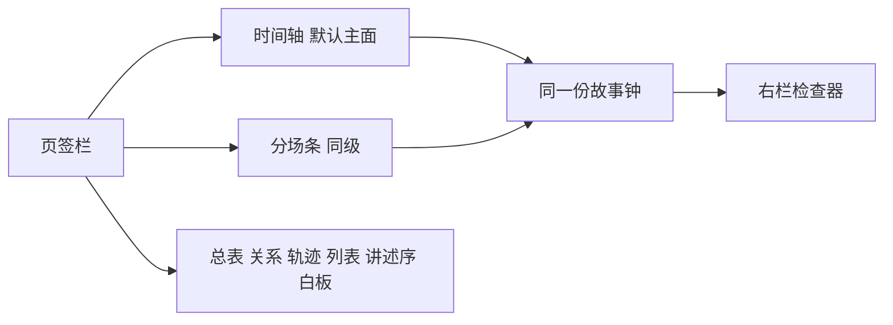

# 设定图：照抄 Aeon 界面与时间轴

**状态：按旧世界生成的可选时间轴，不是打开默认主面。** 2026-09-16 与 v1 九条第 4 条对齐：打开书默认分场条；时间轴是同级可选看法；拖已正史改钟走确认变更，不即时写库。颜色与手势仍可抄 Aeon 壳，不得推翻分场条默认与确认变更。

三份真源只留下会改「世界上为真」的那几条：Narra 仍是唯一世界库；算出这一刻仍是纯函数；逻辑线 / 讲述序仍不算进算出这一刻；草稿变成正史仍要人点「写入正史」。铜炉不碰。时间轴手写，不绑 vis-timeline。除此以外，Aeon 里更好的外观、页签、时间轴、手势、颜色，全部覆盖 [`2026-09-01-设定图-前端完整方案.md`](./2026-09-01-设定图-前端完整方案.md)。

**来源：** [Aeon Timeline Guides](https://www.aeontimeline.com/guides) 现行全部正文 + Story 子目录 + 官网产品截图采色。URL 全表见第 12 节。

**对人说话：** 场、正史、草稿、算出这一刻、本场规定情境、写入正史、确认变更、看法、分场条、讲述序、逻辑线。图上能看见的字用中文。

---

## 0. 结论

打开一本书，中栏默认是 **分场条**（v1 九条第 4 条）。时间轴是同级可选看法，按旧世界生成：按故事时从左到右排，条的长短等于这场持续多久，能缩放、能平移、能分组、能测间隔、能拖。分场条用来把一场写厚。两者看的是同一份钟、同一场，不是两套故事。

新书第一次打开默认 **分场条**。之后记住这本书上次停在哪一枚页签。时间轴不关死，也不升成打开默认主面。

要抄的是 Aeon **产品壳 + 时间轴主面**，不是官网文档站：

1. **三栏**：左类型面板 / 中画布 / 右检查器。选中即填右栏。
2. **页签栏**：时间轴、分场条、总表、关系、轨迹、列表、讲述序、白板。同一看法可开两枚，过滤存在页签本地。
3. **看法顶条**：显示 / 分组 / 排序 / 过滤；时间轴另加 **尺度**。
4. **检查器手风琴**：选场=场页，选人=档案。底栏增改字段。
5. **颜色全抄 Aeon**：亮色默认（冷灰蓝壳 + 白画布 + 天蓝选中），暗色跟 Aeon 深灰壳，丢掉黄铜纸色当品牌。
6. **手势全抄**：双击空白建场、拖条改钟、拖边改时长、⌘滚轮缩放、Shift 滚轮平移、⌘拖嵌套、Option+Shift 测间隔、关系格一点即连、地铁轨交叉、讲述序拖卡片。草稿即时生效；已正史改钟即时生效，⌘Z 撤销。影响多场时给「跟着动 / 只动这一场」，默认跟着动（对标 Aeon 依赖）。



---

## 1. 只留会改故事真假的边界

旧前端合同、黄铜主题、本页死锁 1–6、白板默认关、看法不许改、拖一下必须弹确认变更、依赖只标不挪、一期不许做地铁——**都不守**。有利就改。

| 仍守 | 为什么（不是包袱，是真假） | 界面上怎么做 |
|---|---|---|
| Narra 唯一世界库 | 两份库会打架 | 时间轴 / 分场条 / 总表写的是同一场 |
| 算出这一刻是纯函数 | 同一时刻必须算出同一世界 | 逻辑线、讲述序、白板便笺不进算出这一刻 |
| 草稿 vs 正史 | 后面的场要有可引用的历史 | 点「写入正史」才从草稿变成后面能用的历史；拖钟不是这件事 |
| 不 import 铜炉 | 仓规 | — |
| 时间轴不绑 vis-timeline | 禁止把主面交给那套库 | 手写画布 / SVG，外观对标 Aeon |

| 旧合同里挡手、本文改掉 | 改成 |
|---|---|
| 打开书永远分场条，时间轴永远不是主面 | **已收回：** 打开仍默认分场条；时间轴同级可选，按旧世界生成 |
| 颜色黄铜 / 夜色纸 | Aeon 亮色默认，暗色深灰 |
| 本页列数死锁 1–6 | 只约束分场条等宽卡「标题还能读」；时间轴用缩放，无列数钳 |
| 看法只看不写 | 所有页签改同一份数据 |
| 拖钟必须确认变更 | **已正史仍须确认变更**（v1 三个操作）；草稿条可即时改钟并用撤销收回 |
| 依赖只标不挪 | 默认像 Aeon 一样跟着挪，可改成只标 |
| 白板默认关 | 白板是普通页签 |
| 结构手势只活在分场条 | 时间轴也能拖钟、改时长、嵌套 |
| 主线必须黄铜、支线 6 槽 | 用 Aeon 那套条目色；人可给线换色 |
| 不做 Scrivener | 双向写回仍不利（第二份库）；单向按讲述序导出可以做 |
| 一期只做空壳 | 第一刀就要能看见时间轴 |

---

## 2. 用语对照

| Aeon | 设定图界面上写 | 说明 |
|---|---|---|
| Event | 场 | |
| Item type | 人物 / 地点 / 道具 / 组织 / 伏笔 / 规则 | 左栏六类，不开放无限类型当正史 |
| Timeline view | **时间轴** | 默认主面，按钟比例 |
| Stripboard（我们独有） | **分场条** | 一行一场、列等宽，同级页签 |
| Spreadsheet | 总表 | 可改 |
| Relationship view | 关系 | 点格即改在场 |
| Subway | 轨迹 | 轨 = 人 or 逻辑线 |
| List | 列表 | |
| Mindmap | 白板 | 便笺不进正史；引用场可跳回 |
| Narrative | 讲述序 | 只改读序和导出，不算进算出这一刻 |
| Inspector | 右栏 | 选场=场页，选人=档案 |
| Item type sidebar | 左栏 | |
| Tab bar | 页签栏 | |
| Content / Group / Sort / Filter | 显示 / 分组 / 排序 / 过滤 | |
| Timescale | 尺度 | 只作用于时间轴 |
| Context bar | 时间轴底条；分场条仍用全书细条 | |
| Dependency | 上场依赖 | 默认跟着动，可改只标 |
| Story arc | 逻辑线 | 过滤 / 轨迹用，不算进算出这一刻 |
| Age at event | 这场他多大 | 只读 |
| Lifespan bar | 寿命条 | 只看 |
| Sync Scrivener | 不双向写回 | 导出 Markdown 可按讲述序 |

---

## 3. 打开书长什么样

### 3.1 整窗

```
┌─────────────────────────────────────────────────────────────────┐
│ 设定图 › 渡口 ▾ › 阿禾在城里等信                    写下一场  ⌘K │
│ 页签： 时间轴 · 分场条 · 总表 · 关系 · 轨迹 · 列表 · 讲述序  +  │
│        显示 ▾  分组 ▾  排序 ▾  过滤 ▾  尺度 ▾     ‹ ›          │
├────┬──────────────────────────────────────────────┬─────────────┤
│类型│ 中栏：当前页签的画布                          │ 检查器      │
│ 人 │  时间轴：标尺 + 按钟比例的条/卡 + 底条总览     │  场 / 档案  │
│ 地 │  分场条：细条 + 等宽列 + 一行一场              │  手风琴     │
│ 物 │                                              │  写入正史   │
│组织│                                              │             │
│伏笔│                                              │             │
│规则│                                              │             │
│ 搜 │                                              │             │
│  + │                                              │             │
└────┴──────────────────────────────────────────────┴─────────────┘
```

- 左栏 220px，可收到 40px 图标条。
- 右栏检查器 400px。
- 中栏吃剩余。分屏时两枚页签并排，都可以收到很窄，**允许把分场条收到 0**（关掉那一格），因为分场条已是普通页签。
- 时间轴页签出现「尺度」；分场条页签出现列数（− / + / 疏中密），列数按窗口宽度自适应，下限 1，上限「卡上标题还能读」（不再写死 6）。

### 3.2 页签（照抄 Aeon Tab Bar）

- 默认一枚 **时间轴**。`+` 可加：分场条、总表、关系、轨迹、列表、讲述序、白板，也可再加一枚时间轴（不同过滤）。
- 页签可改名、改图标、关掉（至少留一枚）。
- 挤不下进「更多」。
- 每本书记住打开的页签和当前枚。

### 3.3 顶条四块 + 时间轴尺度

| 块 | 时间轴 | 分场条 |
|---|---|---|
| **显示** | 类型显隐、整卡 / 只留标记、每卡几行、依赖线、寿命条 | 按当前列数展开或收字段 |
| **分组** | 按人 / 地点 / 逻辑线 / 颜色；折叠组 | 默认同场一行；可改成每人一行 |
| **排序** | 故事时 | 故事时；读序走讲述序页签 |
| **过滤** | 人 / 线 / 草稿 / 正史 | 同左 |
| **尺度** | 年 / 月 / 日 / 时 / 自定义滑条、From–To、跳到某日 | 无（等宽列不是按分钟缩放） |

### 3.4 左栏

人 / 地 / 物 / 组织 / 伏笔 / 规则各一图标一面板。底行回车新建。拖到时间轴条或分场条卡 = 这场在场。逻辑线不进左栏，进过滤和轨迹。

紧凑显示：头像（色圆 + 一字）或短名芯片。

### 3.5 检查器

选中即换。场页手风琴：本场任务、在场、价值转折、动作/对白/内心、本场变化、知情、伏笔、逻辑线、故事时。档案：基本设定可填，出场 / 情状 / 他知道什么只读。底栏增改字段、在视图中查找（⌘G）。

「写入正史」仍在场页底：只负责草稿 → 正史。改钟、改在场、改时长不走这个按钮。

### 3.6 颜色（全抄 Aeon，丢掉黄铜）

采自 Aeon 官网现行产品截图（分组时间轴、检查器、叙事、地铁）和站点强调色 `rgb(70, 101, 225)`。亮色是默认（Aeon 新用户默认 Light）。

**壳（亮色）**

| 令牌 | 色 | 用在 |
|---|---|---|
| `--chrome` | `#BDD5EF` | 页签栏、窗口外缘 |
| `--chrome-2` | `#D8E0F0` | 尺度条、底条 |
| `--icon-rail` | `#4A4E54` | 最左类型图标条 |
| `--canvas` | `#FFFFFF` | 中栏画布 |
| `--panel` | `#FAFAFA` | 检查器、左栏列表 |
| `--panel-2` | `#F0F0F0` | 分组行底、斑马纹 |
| `--line` | `#E0E0E0` | 分割、虚线日界 |
| `--ink` | `#333333` | 主文字 |
| `--mute` | `#888888` | 次文字、占位条 |
| `--accent` | `#6098D8` | 当前页签、选中描边、主按钮 |
| `--accent-fill` | `#E0F0F8` | 选中场卡底 |
| `--brand` | `#4665E1` | 站点级链接 / 主行动（写下一场） |

**壳（暗色，对标 Aeon Dark：深灰不是黄铜夜）**

| 令牌 | 色 |
|---|---|
| `--chrome` | `#3A4048` |
| `--icon-rail` | `#2C3036` |
| `--canvas` | `#2A2E34` |
| `--panel` | `#32363C` |
| `--ink` | `#E8EAED` |
| `--mute` | `#9AA0A6` |
| `--accent` | `#70B0F0` |
| `--accent-fill` | `#1E3A54` |

**条目色（故事模板截图里的条 / 头像，逻辑线与人物共用这套，不再黄铜 6 槽）**

| 名 | 色 | 默认给谁 |
|---|---|---|
| 天蓝 | `#70B0F0` | 场条默认、主线默认 |
| 叶绿 | `#90C080` | 人物示例槽 |
| 玫粉 | `#D06090` | 人物示例槽 |
| 藕紫 | `#B090F0` | 讲述序文件夹、人物示例槽 |
| 青灰 | `#89B558` | 地点 |
| 珊瑚 | `#DF627A` | 伏笔 |
| 选中蓝 | `#6098D8` | 当前选中，盖过条目色描边 |

人可以给任意场 / 人 / 线换这些色，也可加自定义色（Aeon Colors 设置）。主线不再锁死黄铜。

**形状（跟截图走，不是黄铜底边）**

- 当前页签：圆角顶、实心 `--accent` 底、白字（时间轴）；讲述序页签用藕紫，提醒这是读序不是故事时（Aeon 用 teal/紫区分叙事页签）。
- 场在时间轴上：顶上一根条目色带，白底卡，选中浅蓝底 + 蓝边。
- 只留标记时：圆角条 / 菱形点，颜色同条目色。
- 依赖满足绿、违规红。
- 字体：界面无衬线（Aeon 是系统无衬线）。分场条场名仍可用衬线，时间轴卡用无衬线，跟 Aeon 一致。
- 不要纸粒纹理。

---

## 4. 时间轴主面（按 Aeon Timeline 整页照抄）

这是打开书后的默认中栏。同一份故事钟，禁止第二条钟。

### 4.1 画什么

- **横向 = 故事时**，比例真实：两小时的场比两天的场短。空档按钟留白。
- **纵向 = 行**：不分行时一场一行自动避开重叠；开分组后每人 / 每线一行（Aeon Group）。
- **条**：有时长画圆角条；无时长画菱形点。悬停出铅笔：复制 / 在上建 / 在下建。
- **卡**：显示打开时，条上叠白卡（标题、日期、在场头像、地点、摘要行数由「显示」钳）。
- **标尺**：上排日期，下排时刻 / 日名；竖虚线落到画布。
- **底条**：全书缩略，当前窗口蓝框，点跳。分场条页签仍用全书细条（齿色：正史 / 草稿 / 空 / 省略）。
- **寿命条**：滤单人时钉在顶上；「显示」可勾选所有人的寿命。
- **进度**：若场页有完成百分比，画在条上，**不算世界上为真**。

### 4.2 导航（照抄）

| 手势 | 行为 |
|---|---|
| ⌘ / Ctrl + 滚轮，或双指捏 | 缩放尺度 |
| Shift + 滚轮，或左右滑 | 平移 |
| 顶条 ‹ › | 翻一屏 |
| 点底条 | 跳窗口 |
| ⌘J | 跳到某日 / 某钟 |
| ⌘G | 滚到选中场 |
| 尺度面板 | 年 / 月 / 日 / 时 / 自定义、From–To、尺度上下限 |

### 4.3 改钟（照抄 Aeon，不弹窗挡手）

| 手势 | 行为 |
|---|---|
| 拖条左右 | 改这场 `clock_from`，时长不变，即时写入 |
| 拖条左右缘 | 改开始或结束，即时写入 |
| Shift+拖 | 按当前尺度吸附 |
| ⌘+拖到另一条上 | 嵌套 / 并进父场 |
| Option+Shift 从一条拖到另一条 | 测间隔，弹出人话（「隔了两个时辰」） |
| 双击空白 | 在该钟新建草稿场 |
| ⌘N | 可视区中央建；有选中则同钟建 |
| 日期锁定 | 锁住的场不能拖 |

已正史场同样可拖。⌘Z 撤到上一次松手。若开了依赖「跟着动」，其它场一起挪，一次撤销全部。

多场会被带着走时，拖动预览条上出现角标「还将移动 N 场」；松手后右下角提示带「撤销」。不要每次先弹确认变更。删已正史、整列合并、会掏空后续规定情境的结构手术，仍列出缺口再点一次确认——那是删历史，不是调钟。

### 4.4 分组、依赖、比较

- 分组按人 / 地点 / 逻辑线 / 色。组头可折叠；右键全开 / 全收。
- 拖进某人的组 = 这场加上他在场（Aeon：追加关系，不离开原组）。
- 依赖线可画在时间轴上。默认 **跟着动**（Aeon Resolve）。顶条可改成 **只标红绿**。
- 分屏：两枚时间轴可锁滚 / 分滚（Aeon stacked scroll）。
- 滤单人：顶上钉寿命条，卡上显示这场他多大（只读）。

### 4.5 和分场条怎么分工（两者都要，都是主面）

| | 时间轴 | 分场条 |
|---|---|---|
| 默认 | 新书打开这里 | 同级页签 |
| 几何 | 按钟比例，可缩放 | 等宽列，列数随窗口 |
| 擅长 | 何时发生、持续多久、谁和谁重叠、测间隔 | 把一场写厚：任务、动作、对白、知情、伏笔 |
| 改钟 | 拖条 | 拖列边界 |
| 写正文 | 检查器 | 卡面 + 检查器 |

点时间轴上的场，分场条若开在另一格会滚到该列。点分场条的场，时间轴滚到该条。

---

## 5. 其它页签（能抄的全抄，都能改同一份数据）

| 页签 | 对标 | 中栏 | 写入 |
|---|---|---|---|
| 时间轴 | Timeline | 第 4 节 | 拖即写钟 |
| 分场条 | （我们独有） | 一行一场 | 卡面写正文；列结构手术要确认 |
| 总表 | Spreadsheet | 场为行 | 草稿和正史都可改格；批量改读序即时，⌘Z 撤 |
| 关系 | Relationship | 场×人 / 人×人 | 点格加/删在场；格内只读年龄/间隔 |
| 轨迹 | Subway | 人轨或逻辑线轨 | 拖到另一轨 = 加上在场，不离开原轨 |
| 列表 | List | 一场一行 | 同总表更干净 |
| 讲述序 | Narrative | 幕/回文件夹 + 卡 | 只改读序与导出；藕紫色页签 |
| 白板 | Mindmap | 自由卡 | 便笺不进正史；引用场跳回时间轴或分场条 |

进度 / 出场不另开页签：做轨迹 / 关系的布局选项。

---

## 6. 交互总表（相对旧稿：改道改成照抄）

图例：**照抄** = 手势与 Aeon 相同。**改薄** = 仍要保住草稿/正史或算出这一刻。**不做** = 第二份库或项目管理冒充正史。

### 6.1 新建与选中

双击空白建草稿、左栏回车新建、⌘N、铅笔复制/上/下建、组内双击带上该组在场、⌘/Shift 多选、检查器随选中变 —— 全部照抄。

### 6.2 时间

相对日历、寿命、纪念日、跳日、底条、尺度上下限 —— 照抄到时间轴。自定义改月长仍不做（Aeon 有正史后自己也禁）。改历精度不静默改写已有钟。

分场条不按分钟缩放（等宽是它的用处）。⌘滚轮只作用于时间轴页签。

### 6.3 关系 / 地铁 / 表 / 白板 / 讲述序

点格、拖轨、表底新建、叙事文件夹、白板从视图拿掉不删 —— 照抄。讲述序拖卡不改故事时。检查器里删场：草稿直接删；已正史仍先列缺口。

### 6.4 依赖

默认跟着动。只标是选项。Resolve All = 「按依赖把后面的场一起挪」，即时，可撤销。约束（「婚礼在求婚后一年」）同样可跟着动。

### 6.5 导入导出

CSV / 表格进「丢一段草稿」：建议落到哪几场，写入此框才进框，不自动正史。导出 MD 含草稿并标注；时间轴可另存 PNG。Scrivener / Ulysses **不双向同步**（第二产品面）；若以后要，只做按讲述序的单向导出。

### 6.6 键盘

⌘K 命令面板；⌘N 新建；⌘J 跳钟；⌘G 滚到选中；⌘滚轮缩放（仅时间轴）；Shift 滚轮平移；⌘Z 撤即时编辑（含已正史改钟）。

---

## 7. 和旧前端合同

[`前端完整方案`](./2026-09-01-设定图-前端完整方案.md) 里关于壳、色、列数死锁、看法只读、拖钟弹窗、白板默认关、时间轴降级的段落，**以本文为准覆盖**。实现的人先读本文，再读旧合同里还没被覆盖的场页字段 / API。

算出这一刻、Narra、用语仍认 v1 / 世界引擎 / Narra 底座。

---

## 8. 第一刀就做时间轴（不空转壳）

分期不再「先做没时间轴的壳」。第一刀必须能打开《渡口》看见 Aeon 那种时间轴。

**第一刀（能交差）：** Aeon 色令牌 + 三栏 + 页签 + 时间轴主面（标尺、按钟比例条、缩放平移、双击建草稿、拖条改钟、检查器随选中、底条）。分场条作为第二枚页签能切回去写厚。

**第二刀：** 分组行、寿命/年龄、测间隔、依赖跟着动、显示整卡/标记。

**第三刀：** 总表、关系格、轨迹。

**第四刀：** 讲述序页签、分屏、白板。

每刀 e2e 认 `data-testid`。

---

## 9. 验收（人话）

打开《渡口》，不看说明书：

1. 第一眼是按钟排开的条，不是等宽四列。能 ⌘滚轮拉近、Shift 滚平移。
2. 拖「阿禾在城里等信」左右，钟变了，右栏日期跟着变，不必先点确认变更。⌘Z 能撤回来。
3. 点条，右栏是这场；点阿禾，右栏是档案。
4. 切到分场条，同一场在等宽列里，能改本场任务。
5. 切回时间轴，条还在刚才的钟上。
6. 双击空白出现新草稿场。点写入正史之前，细条齿是草稿色。
7. 开分组「按人」，阿禾一行、阿莲一行。
8. Option+Shift 两场之间能读出间隔人话。
9. 壳是冷灰蓝 + 白画布，不是黄铜夜色。

九条全过算第一刀及格。

---

## 10. 明确仍不做

- 完成划线、RACI、工时当正史。
- 自定义历法改月长。
- 双向同步 Scrivener / Ulysses / Obsidian。
- 多设备协同、只读分享链接。
- vis-timeline 库、铜炉。
- 逻辑线、讲述序、白板便笺进算出这一刻。
- 一贴 CSV 即正史。

---

## 11. 风险

- **两套几何。** 时间轴按钟、分场条等宽。必须同一份 `clock_from / clock_to`，禁止各记各的。
- **默认时间轴会让人忘了写厚。** 页签里分场条要一眼能找到；写下一场仍跳到有本场任务的检查器。
- **即时改已正史的钟。** 有利（对标 Aeon），后续场的规定情境会变。用 ⌘Z 和「还将移动 N 场」兜住；删正史仍走缺口清单。
- **依赖跟着动。** 默认开，可关。关掉的人得到旧的「只标」。

---

## 12. 读过的文档

**索引：** https://www.aeontimeline.com/guides

**入门与类型：** getting-started、customize-item-types

**时间与结构：** add-and-customize-dates、connect-events-people-and-more、categorize-and-group-events-and-items、nest-items-and-manage-hierarchy、compare-timelines、measure-time-between-events、manage-dependencies-and-event-order、add-links-files-and-images、add-notes-tags-and-extra-details、organize-a-separate-story-structure

**视图：** the-different-views、the-timeline-view、the-spreadsheet-view、the-relationship-view、the-subway-view、the-list-view、the-mindmap-view、the-narrative-view、split-views

**写作：** story/getting-started、outline-your-story、track-characters、track-story-arcs-or-plotlines、organize-categorize-and-add-detail-to-events、work-out-dates-ages-and-story-math

**导入导出：** importing-data、exporting-printing-and-sharing、sync-with-scrivener、sync-with-ulysses

**采色截图：**  
`1_grouped-timeline.png`、`3_timeline-inspector.png`、`2_narrative.png`、`a_story.png`（地铁）、getting-started 四张界面图。站点强调色 `#4665E1`。

旧版 `/3-4-guides/*` 只对照。`sitemap.xml` 404。`/guides/intro-to-views-and-tabs` 404，等于 `the-different-views`。
