# 设定图：前端完整方案

**状态：已拍板（2026-09-01）。** 本文是前端 / 界面合同的**现行稿**。实现的人只认这一份，不必再同时读两份 9/1 稿。附录原「仍待拍板」已按本文默认全部确认。

**与三份产品真源的关系：** 不推翻 [`docs/设定图-v1.md`](../设定图-v1.md)（产品面、九条、用语）、[`docs/世界引擎.md`](../世界引擎.md)（算出这一刻）、[`docs/plans/2026-08-30-设定图-Narra底座.md`](./2026-08-30-设定图-Narra底座.md)（Narra 是唯一世界库）。冲突时认那三份。本文只覆盖人看见什么、点什么、哪一层只看不写，以及为此要补的接口字段。

**与两份 9/1 稿的关系：** 本文**覆盖**二者的前端合同。

| 较早的稿 | 降为 | 本文怎么用 |
|---|---|---|
| [`2026-09-01-设定图-前端架构-正史与逻辑线.md`](./2026-09-01-设定图-前端架构-正史与逻辑线.md) | 过程稿 | 壳、看法、主线/支线、数据合同、第 13 节吸收清单已被本文整份写进正文 |
| [`2026-09-01-设定图-界面与交互彻底重构.md`](./2026-09-01-设定图-界面与交互彻底重构.md) | 过程稿 | U01–U40、六个缺页面、窗口件、键盘、验收九条、流程图按**新壳**重写成逐步可点的合同，不是「保留」两个字 |

冲突以本文为准。那两份不再当现行稿。

**与完整方案的关系：** [`docs/设定图-完整方案.md`](../设定图-完整方案.md) 仍是综合阅读入口，不推翻三份真源。本文只吸收与主面 / 列数 / 结构编辑相关的已拍板（第 11.6 / 11.7 节、F10 档案键、F49 讲述序、F51 多书）。不复制全世界引擎，不算第二份算出这一刻。

**与 Aeon 照抄方案的关系：** [`2026-09-01-设定图-Aeon交互与界面照抄方案.md`](./2026-09-01-设定图-Aeon交互与界面照抄方案.md) 已按用户纠正：**时间轴升为默认主面**，颜色全抄 Aeon，旧合同里挡手的壳 / 色 / 列数死锁 / 看法只读 / 拖钟弹窗 **以那份为准覆盖**。算出这一刻、Narra、草稿→正史仍认三份真源。

对人说话只用 v1 用语右列：场、正史、草稿、算出这一刻、本场规定情境、写入正史、确认变更。图上能看见的字用中文。本文「看法」= 同一份正史换一种看。禁止铜炉。禁止 vis-timeline 当主面。禁止逻辑线进算出这一刻。禁止 IDE 默认壳。禁止伏笔全页台账。禁止第二条时间轴。

产品前端方向是 Vite + React + TypeScript，**本文件写产品合同，不是工程脚手架**。产品入口是 `apps/web`。打开 `127.0.0.1:8787` 只出新前端。`setting-api` 禁止再 `include_str!` 或静态挂载旧单文件当分场条。旧 `apps/stripboard/index.html` 已废入口（可在 `archive/`，不是备用路由，不能再靠它写正史）。验收认 `data-testid` 与人话合同，不认内部组件名。禁止把旧 HTML 逻辑搬进 React 冒充重构。

落地标记（对照 2026-09-01 **新壳** `apps/web`，禁止把脚手架写成已交付）：

| 标记 | 意思 |
|---|---|
| **已落地** | 新壳能点到，主干行为对得上合同 |
| **未落地** | 合同写了，新壳没有，或只有骨架 / 测试桩 / 行为不对 |
| **合同** | 本文规定；落地状态见同行或第 12 节 |

半成品标 **未落地**，并在「新壳」一行写清已经能点到哪一步。脚手架、空演示、旧单文件对照都不算已交付。

---

## 1. 结论：打开书看见什么；什么算写，什么只看

**一本书只有一条正史时间。主线、支线是作者贴在场上的逻辑线，用来过滤和高亮，不另开一条钟，不算进算出这一刻。**

打开一本书，永远落到分场条：顶栏 + 全书细条 + 左栏设定 + 中栏一行一场 + 右栏这一场。看法用右栏页签或侧开，**分场条关不掉**。书架 / 新建书 / 设定库 / 书的设定 / 导出可以整页盖住，因为它们不是看法。

| 算写 | 只看 |
|---|---|
| 分场条那一行（加列 / 减列 / 合并 / 换位 / 拖钟 / 删已正史 → 确认变更） | 人物线、支线进度、支线轨迹、关系图、出场表、时间轴、总表、白板 |
| 场页（本场任务、动作 / 对白 / 内心、在场、本场变化、知情、伏笔四件事、逻辑线归属） | 全书细条（只改本页窗口起点） |
| 点「写入正史」才进历史 | 讲述序开关（只改中栏排列和导出顺序） |
| 档案页的基本设定、从故事起点就成立的关系 | 人物透镜（只改看法，禁止当算出这一刻） |
| 新建元素、删未出场的设定、建书 / 删书 | 逻辑线过滤（完整卡 / 薄条，不藏场） |

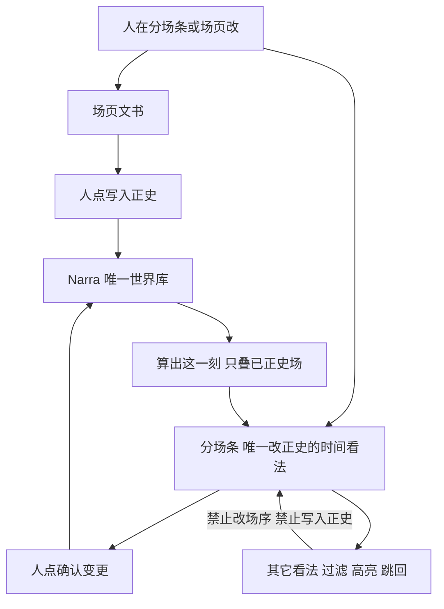

七条硬原则：

1. **Narra 是唯一世界库。** 前端只做缓存和命令。草稿缓存在应用里；正史只经「写入正史」或「确认变更」进库。禁止前端再叠一遍算出这一刻。
2. **改正史只能从分场条那一行 + 场页出手。** 关系图、出场表、时间轴、白板、支线进度里禁止改场序、禁止写入正史。
3. **逻辑线不是第二条时间轴。** 场仍只排在一条正史序列上。`story_threads` 是场上的轻量归属。没贴线也能写场。空归属 = 未归线。
4. **逻辑线不算进算出这一刻。** 穿帮、知情、在场、本场规定情境仍只看正史场。
5. **伏笔不是一种逻辑线。** 伏笔已有埋设 / 推进 / 兑现 / 作废。逻辑线只管主线 / 支线。
6. **过滤不藏场。** 不在线上的场收成薄条或点，仍可点进写。顺序永远是故事时（或人开了「按读序排」时的读序）。
7. **主面是一维分场条，不是无限画布，不是 VS Code 式自由停靠。** 看法用右栏页签或侧开，不平级成可关掉分场条的页签。

禁止回退（8/31 已落地 + 此后接上的能力，实现新壳时必须仍在）：点卡填框；规定情境进侧栏（写下一场模式或场页折页）；确认变更失败不关窗；删完正史清当前选中；同列还有正史时改价值转折挡住；草稿 Cmd+Z 撤销；删书须手打书名；本页 1–6；写入正史必须人点；算出这一刻只叠已正史、不读逻辑线。

---

## 2. 壳与路由

### 2.1 默认三栏（分场条关不掉）

打开一本书，永远是这三块：

```
顶栏（书 · 窗口件 · 写下一场 · 看法 · 命令）
全书细条（列齿，只跳窗口）
逻辑线排（主线 / 支线名 · 未归线 · 显示全部）
┌──────────┬────────────────────────────┬─────────────────────────┐
│ 左栏设定  │ 中栏 分场条（一行一场）      │ 右栏 场页文书            │
│ 本页出场  │ 列头标尺 + 卡               │ 默认：这一场             │
│ 搜全书    │ 逻辑线色带 / 薄条           │ 可切：规定情境 / 看法    │
└──────────┴────────────────────────────┴─────────────────────────┘
```

- **中栏**：分场条。唯一按故事时改正史的时间看法。一维虚拟化列表（列窗口 + 列内场）。
- **右栏**：场页文书。点卡就地打开这一场。看法在右栏页签或从右缘侧开，**分场条仍在**。
- **左栏**：设定。默认只列当前本页列里出现过的人物 / 地点 / 道具 / 组织 / 伏笔。不是出场表。不是逻辑线目录。

可简单分栏（左 / 中 / 右宽度记在本机）。**不鼓励自由停靠**：不准把分场条拖成角落小窗，不准把看法做成和平级的可关页签。关闭右栏看法页签，回到场页，中栏不动。

**现宿主：** 三栏已在。右栏仍是七模式互斥面板，不是「默认场页 + 折页」。顶栏仍平铺书名框 / 疏中密 / −＋‹› / 埋伏笔。**未落地：** 窗口件收成一个、七模式改场页折页、中栏下限 480、取消 `min-width: 1100px`。

### 2.2 路由：主面永不离开 `board`

单页应用，用 URL 片段记住位置。**主面路由永不离开 `board`。** 看法用查询参数，不另开一条会卸掉分场条的路径。

| 路径 | 页面 | 打开方式 | 现宿主 |
|---|---|---|---|
| `#/` | 书架 | 整页（可盖住分场条） | 已落地 `#shelf` overlay；哈希未统一成 `#/` |
| `#/new` | 新建书 | 整页 | 已落地 `#new-book` overlay |
| `#/b/{书}/board` | **主面** | 默认三栏 | 已落地哈希骨架 |
| `#/b/{书}/board?s={场}` | 主面 + 右栏该场 | 就地 | **未落地**（靠内存选中，刷新丢失） |
| `#/b/{书}/board?s={场}&open=side` | 场页侧开 | 侧开 | **未落地** |
| `#/b/{书}/s/{场}` | 场页整页 | 整页 | **未落地** |
| `#/b/{书}/board?look=进度` | 主面 + 右栏进度 | 侧开 / 右栏 | 已落地 `look-rail`；刷新可恢复 `look` |
| `#/b/{书}/board?look=轨迹&line={线}` | 主面 + 该线轨迹 | 侧开 / 右栏 | 已落地骨架 |
| `#/b/{书}/board?look=出场` | 主面 + 出场 | 飞出层或右栏全高 | 已落地 `look-rail`，分场条仍在 |
| `#/b/{书}/board?look=关系&who={人}` | 主面 + 关系图 | 右栏 | 已落地 `look-rail` |
| `#/b/{书}/board?look=时间轴` | 主面 + 时间轴 | 侧开 / 右栏 | 已落地：不再整页盖住分场条 |
| `#/b/{书}/board?look=总表` | 主面 + 总表 | 侧开 | 已落地 `look-rail` |
| `#/b/{书}/board?look=白板` | 主面 + 灵感层 | 侧开 | **未落地** |
| `#/b/{书}/board?line={线}` | 主面 + 该线过滤 | 就地作用于中栏 | 已落地；刷新可恢复 `line` |
| `#/b/{书}/e/{元素}` | 档案整页 | 整页 | **未落地**（现是 `<dialog>`） |
| `#/b/{书}/library` | 设定库 | 整页可留 | 已落地 overlay |
| `#/b/{书}/settings` | 书的设定 | 整页 | **未落地**（现是 `craft-dlg`） |
| `#/b/{书}/export` | 导出 | 整页 | **未落地**（现是 dialog） |

**作废的平级主面路由（昨天 4.1，本文删除）：** `#/b/{书}/timeline`、`#/b/{书}/occupancy`、`#/b/{书}/relations`、`#/b/{书}/table`。这些看法不准把分场条卸掉。

刷新必须回到同一本书、同一本页窗口、同一场、同一过滤线、同一看法。窗口起点与本页列数记在 URL（`n=` `start=`）或本机；细条跳窗口不改 `n`。**现宿主：** `line` / `look` 刷新可恢复；选中场 / 本页列数 / 窗口起点仍未从 URL 还原。

### 2.3 三种打开方式

同一个场页、同一个档案页，三种打开方式内容完全一样，只是占多少地方。光标位置和滚动位置保留。`Esc` 逐级退回。

| 方式 | 触发 | 占多少 | 用在什么时候 |
|---|---|---|---|
| **就地** | 在分场条上点卡 | 右栏约 440 像素 | 一边看着前后场，一边改这一场 |
| **侧开** | 点卡右上角展开，或按 `空格` | 右侧 60% 宽，中栏还看得见 | 要写长段落，但不想丢掉分场条 |
| **整页** | 侧开再点一次展开，或进 `#/b/{书}/s/{场}` | 满屏，居中 760 像素栏宽 | 专心写这一场 |

整页只用于场页、档案、书架、新建书、设定库、书的设定、导出。时间轴 / 总表 / 出场 / 关系 / 进度 **不准**整页卸掉分场条。

**相对昨天：** 昨天把时间轴 / 总表做成平级整页主面。本文改成侧开，中栏仍在。**现宿主：** 看法已是右侧 `look-rail`；场页 / 档案的侧开与整页 **未落地**。

### 2.4 断点

| 宽度 | 布局 |
|---|---|
| ≥ 1440 | 左栏 240 + 中栏自适应 + 右栏 440。左右可拖宽，**中栏下限 480**，拖到下限停止，不准把分场条拖没 |
| 1024–1439 | 左栏收成 56 图标条，点开浮出；中栏 + 右栏 |
| < 1024 | 单栏：中栏满屏；左 / 右改成抽屉。本页列数自动钳到 ≤2。抽屉盖住中栏时，顶栏仍能 ‹ › 和「写下一场」 |

取消现行 `min-width: 1100px`。任何宽度都不许整页横向滚动把右栏切掉。**未落地。**

### 2.5 前端技术方向（产品合同，不是脚手架）

| | 决定 |
|---|---|
| 产品前端 | **`apps/web`：Vite + React + TypeScript**。虚拟化分场条、场页稳定输入、URL 状态、看法页签。本轮全新搭建，不是把旧单文件搬进 React |
| 旧 `apps/stripboard/index.html` | **已废入口。** 禁止 `include_str!`、禁止静态挂载当分场条、禁止 `#/legacy`、禁止直接打开旧文件写正史。文件可删或进 `archive/`，产品路径必须死掉 |
| 打开方式 | `setting-api` 开发时代理 `apps/web` 或静态挂载其构建产物。打开 `127.0.0.1:8787` 只出新前端。e2e 全部打新前端 |
| 算出这一刻 | 仍只打 `GET /world?t=`。React 里禁止再写一套叠场 |
| 白板 | **本轮交付。** 默认关，独立动态加载，不算进算出这一刻，不能写入正史 |
| 不绑 | vis-timeline、铜炉、NarrativeNode 源码、tldraw 当默认主面 |

昨天「不引前端框架」作废。**现在就切 Vite**，不是后续工程。禁止空壳演示宣称完成。

---

## 3. 分场条 + 逻辑线视觉语言

### 3.1 一行场序

中栏是按故事时排的一维场序列，用本页窗口切成 1–6 列（默认 4；疏 / 中 / 密 = 2 / 4 / 6）。故事列总数仍可很多。列内可有多场（同时并列）。

卡上永远能看见的（与密度无关）：场次或本场任务、正史 / 草稿形状、在场标记、**逻辑线主色带**（有则画）。密度只决定正文露出多少。

状态用形状，不只用色（8/31 已落地，禁止回退）：正史实线、草稿虚线、省略场斜纹、闪回缩进、预场带「预」、不在读者眼前降透明。**已落地。**

### 3.2 逻辑线在卡上怎么画

一场可以挂 0 到多条逻辑线。卡上最多：

- **一条主色带**：取该场 `story_threads` 里第一条主线；没有主线则取第一条支线。
- **一个「+N」**：其余线条数。悬停（或键盘焦点）才展开全部线名。
- **未归线**：不画色带，左缘一条中性灰细线，表示「没贴线」，不是错误。

入线 / 出线**默认不算人填的栏**，从该书该线的场序推导：

- **入线**：该线在全书故事时上第一次出现的场。卡顶一条向右的短折。
- **出线**：该线最后一次出现的场。卡底一条收住的短折。
- **暂停**：只有「中途暂停但仍挂着」才在场页记一笔 `role=暂停`。卡上画一道细虚切，不是出线。`role=暂停` 不打断「仍挂着」。

5–6 列密度下折线可收成角上一个小三角，悬停再出「从这里起 / 收到这里」。

禁止：每条线一条彩虹顶边、齿上再铺逻辑线色、用 emoji 当线标。

**现宿主：** 能贴线、顶栏有线名、过滤收成 `.card.thin`。**未落地：** 主色带 4px、+N、入出线折、暂停虚切、6 槽色、未归线灰细线。

### 3.3 过滤：淡出，不藏

点顶栏一条逻辑线名（或 URL `?line=`）：

1. 在线上的场：完整卡，色带加亮。
2. 不在线上的场：收成薄条（约 8–10 像素高）或列内一个点，**仍占故事时位置**，仍可点开场页写。
3. 本页窗口里完整卡为 0、只剩薄条：合法。顶上一条横幅：「这条线上的场不在本页这几列。‹ › 或点细条跳到最近一场。」横幅带「显示全部」。
4. 清除过滤：再点同一线名，或点「显示全部」，或 `Esc`（焦点不在输入框），或清掉 `line=`。

悬停一条线名（未点选）：中栏临时加亮该线场、淡出其它场。移开指针即恢复。点选才写进 URL。

过滤时顺序仍是故事时。开了「按读序排」则按读序——**讲述序与逻辑线正交**。禁止把「按读序排」做成按逻辑线重排。禁止把逻辑线过滤做成按线把场抽出来另排一轴。

人物透镜与逻辑线可同时开：先按人滤在场高亮，再按线收薄条。两人同时不在场且不在线 → 仍是薄条，不隐藏。**禁止**用 `display:none` 冒充过滤（现行人物透镜仍有此坑，实现时一并改）。

**相对昨天：** 昨天没有逻辑线。8/31 人物透镜把不中的卡藏掉。本文统一为薄条。**现宿主：** 逻辑线过滤已是薄条；人物透镜仍可能藏卡。**过滤主干已落地；人物透镜改薄条未落地。**

### 3.4 密度 1–6

档位不是第二套状态。只看当前本页列数 N。逻辑线色带在所有 N 都在。顶栏 − / +、疏 / 中 / 密、‹ › **不走确认变更**，不写 Narra。

| N | 卡上 |
|---|---|
| 1–2 | 展开动作 / 对白 / 内心；价值转折；本场变化摘要；色带 + 线名全文；入线 / 出线折线 |
| 3–4（默认 4） | 价值转折 + 本场变化摘要最多 3 条；色带 + 线名（放得下）或 +N；入线 / 出线折线 |
| 5–6 | 场次、在场、黄点、色带、+N；折线收成小三角 |

空书进入分场条时 N=1。禁止 N=0。到 1 时 − 灰掉，到 6 时 + 灰掉。**密度档位与 −＋‹› 已落地。色带 / +N / 折线未落地。**

### 3.5 讲述序正交

| 开着什么 | 中栏 |
|---|---|
| 都关 | 故事时序，完整卡 |
| 只开读序 | 按读序重排完整卡；齿上第二道色仍标「读序 ≠ 列序」 |
| 只开逻辑线 | 故事时序，线上完整、线外薄条 |
| 两个都开 | 按读序排，再套薄条 |

只改中栏排列和导出 Markdown 的顺序，**不算进算出这一刻**。**读序开关已落地；与逻辑线同时开的正交验收未写进 e2e。**

### 3.6 细条齿色不让线

全书细条齿色**只编码** v1 已拍板的四种：有正史 / 只有草稿 / 空场次 / 省略场。讲述序 ≠ 列序时齿上第二道色。

**逻辑线不给齿加第四种语义。** 过滤开着时，允许把「本页窗口框」以外、且该线上有场的齿画得略亮（同一齿色、提高亮度），方便跳窗口。禁止把齿改成支线调色板。

细条只改窗口起点，不改场，不写入正史，不改逻辑线归属。**四态齿 + 窗口框已落地。线上齿略亮、章界竖线、悬停小卡未落地。**

### 3.7 色（写死，避免五颜六色）

沿用已落地的夜色底 + 黄铜（`--night` / `--panel` / `--cream` / `--brass`）。逻辑线**另开一套、槽数封顶**，不跟六类元素色抢。元素色（人物 / 地点 / 道具 / 组织 / 伏笔 / 规则）仍只用于标记与左栏，不用于逻辑线。

| 用途 | 色 | 规则 |
|---|---|---|
| 主线 | **一本只用 1 个主线色** | 固定黄铜 `#C4A46A`（亮色主题改为深铜 `#8A6A2A`）。人不能给主线换色。一本默认一条主线；若人坚持建第二条主线，仍用这同一色，靠名称区分 |
| 支线 | **用户色上限 6** | 青 `#3D8A8A`、靛 `#4A6FA5`、赭 `#B56A3C`、葡萄 `#7A5A8A`、苔 `#5A7A42`、玫灰 `#A85A6A`。第 7 条起**循环套这 6 色**，必须同时显示名称 |
| 未归线 | 中性灰 | `#6E6A64` 细线 |
| 过滤淡出 | 不换色相 | 完整卡保持原对比；薄条文字对比不低于 3:1，色带降到 35% 不透明度 |

色不是唯一信道：线名、+N、入线 / 出线折线形状必须同时在。**未落地。**

一场多线：色带只取一条（主线优先）；+N = 其余条数；悬停列出全部（线名、主线 / 支线、对本线作用）。过滤某条线时，这场若挂了该线，色带临时改成被滤的那条，离开过滤恢复主色带。

### 3.8 结构手势仍只活在分场条

中间 ➕加列、减列、合并、换位、拖列侵入、删已正史：列出全部建议，人点「确认变更」才写库。未确认可预览，Narra 不改。这些手势**不出现在**时间轴、总表、支线进度、白板上。

写下一场默认追加在现有最后一列 / 最后一场之后。没有本场任务不准点写下一场。加列不会自动变成写入正史。顶栏 − / + **不是**中间 ➕。

---

## 4. 全部业务流（U01–U40，按新壳重写）

编号与昨天同一套，避免实现的人对不上号。`F` 讲产品规则和演算合同，`U` 讲人在界面上怎么走。凡与 `F` 或三份真源冲突，以真源为准。

每条都写死：人怎么开始、逐步点什么、成功看见什么、谁挡住、正史改没改、空态 / 加载 / 焦点、撤销范围、键盘、一张中文图。新壳下有优化的，写**改进后的步骤**，并注明相对昨天改了什么。

反馈统一规矩（昨天 5.4，全文适用，不再每条重复）：

| 什么事 | 用什么 | 停留 |
|---|---|---|
| 存好了、加上了 | 右下角短提示 | 3 秒 |
| 拿掉了、删了草稿 | 右下角短提示 + 「撤销」 | 8 秒 |
| 这个格子填得不对 | 红字贴在这个格子下面 | 改好就消失 |
| 穿帮标黄，仍可写入正史 | 卡上黄边 + 场页黄块 | 常驻到改掉 |
| 穿帮挡写入正史 | 「写入正史」变灰 + 按钮下红字 | 常驻到改掉 |
| 模型在跑 | 按钮原地「正在填…」+ 中断 | 到结束 |
| 接口坏了、书没打开 | 顶部横幅 | 到修好 |

不再用一处 `$('sidebar').textContent` 收所有话。**未落地**（现宿主仍有单一反馈口，同时已有 toast）。

---

### U01 书架

**落地：未落地（骨架已有）。** 现宿主有 `#shelf` overlay，卡上已有书名、主脑、正史场数、草稿场数、列数；缺「写到第几列」、上次打开、⋯菜单（设定 / 导出）、空书架大按钮、失败横幅、Esc 回当前书分场条。

**相对昨天：** 打开书永远落到 `#/b/{书}/board`，不先选视图。整页可盖住分场条（书架不是看法）。

**人怎么开始：** 打开应用，或顶栏书名 ▾ → 回书架，或 `#/`。

**逐步点什么：**

1. 本机没有书：看见一句「还没有书。从这里开始写第一本」+ 大按钮「新建书」。
2. 本机有书：卡片网格。每张卡必须能看见：书名、一句主脑（空则「还没写主脑」）、写到第几列、多少场已正史、多少场草稿、上次打开时间。
3. 点卡主体或「打开」→ 进该书分场条（U05）。
4. 点卡上「⋯」→ 打开 / 书的设定 / 导出 / 删书。
5. 点「新建书」→ U02。

**成功：** URL 进 `#/b/{书}/board`；中栏分场条在；右栏场页或空列文案；细条齿在。

**失败：** 「打不开这本书」顶部横幅；停在书架；正史不改。

**空态 / 加载 / 焦点：** 加载「正在打开书架」；空书架焦点在大按钮；打开失败焦点留在该卡。

**撤销：** 无（打开书不是草稿操作）。

**键盘：** Tab 到卡，回车打开；`N` 新建书；`Esc` 若从某书进来则回该书分场条。

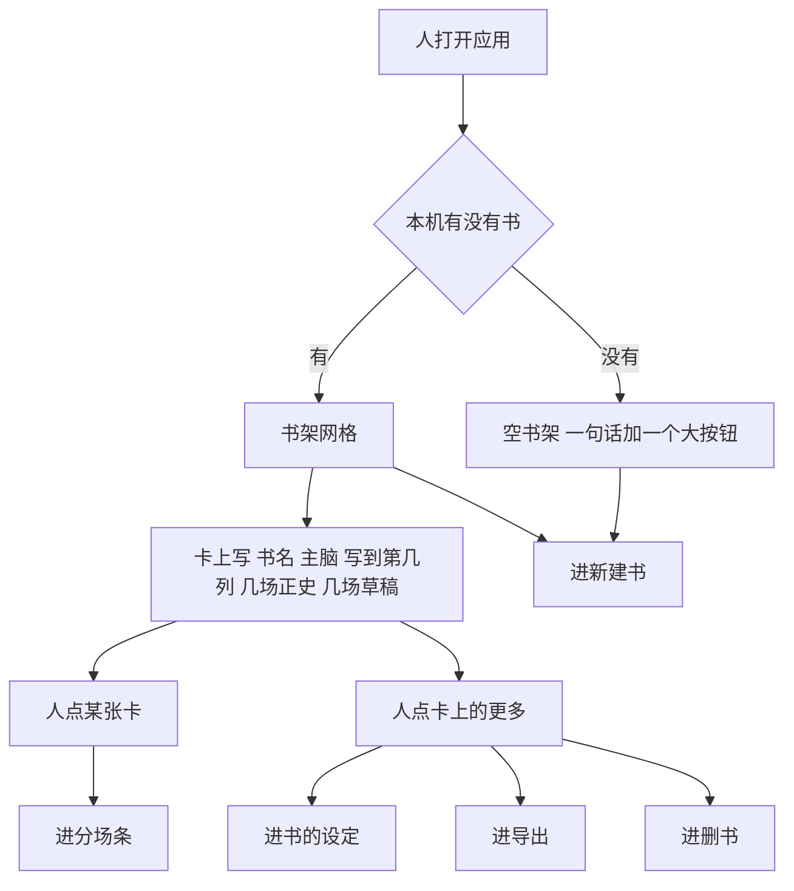

---

### U02 新建书

**落地：未落地（骨架已有）。** 现宿主 overlay 已有书名 / 主脑 / 故事时间起点；缺分步、重名就地红字、建失败不丢表单、建完本页 1 列的合同验收。

**相对昨天：** 建完永远落分场条，不先选视图，不自动写入正史。

**人怎么开始：** 书架「新建书」，或顶栏书名 ▾ → 新建书，或 `#/new`。

**逐步点什么：**

1. 第一步：书名（必填）。空则「建这本书」灰。重名：就地红字「这个名字已经有一本」，给「打开那一本」。
2. 第二步：一句主脑（可跳过）。不算进算出这一刻。
3. 第三步：故事时间起点（必填，默认「第一天 20:00」）+ 一格代表多少分钟 + 怎么显示（第几天几点 / 只显示标签 / 显示分钟数）。不定起点，时间轴永远只能显示分钟整数。
4. 点「建这本书」。
5. 成功落到分场条，本页 1 列，空书第一屏（U05）。取消回书架。

**成功：** 该书一份世界建好；中栏 1 列空场次；不出现任何正史场；URL `#/b/{书}/board`。

**失败：** 顶部横幅写清哪一步坏了；表单内容不丢；正史不改（本来也没有）。

**空态 / 加载 / 焦点：** 打开时光标在书名；进行中按钮「正在建…」；失败焦点留在出错那一格。

**撤销：** 建完不能 Cmd+Z 撤掉这本书；要删走 U04。

**键盘：** 回车到下一步；最后一步回车 = 建；`Esc` 回书架。

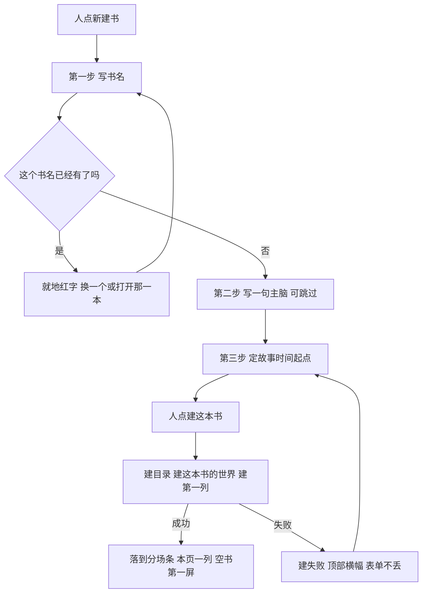

---

### U03 书的设定

**落地：未落地（骨架已有）。** 现宿主 `craft-dlg` 已有主脑、钟起点、回目；缺整页四块、导出偏好、改书名提示、删书入口在页底。

**相对昨天：** 主脑 / 回目仍不算进算出这一刻。进度看法拿回目当列。整页可盖住分场条。

**人怎么开始：** 书名 ▾ → 书的设定，或书架卡 ⋯ → 书的设定，或 `#/b/{书}/settings`。

**逐步点什么：**

1. 看见四块：**这本书**（书名可改、主脑、创建时间、写到哪）、**故事时间**（起点标签、起点对应多少分钟、一格多少分钟、显示格式）、**章界与回目**（一行一回：回目名 + 从哪一列起，可拖排序、可删）、**导出偏好**（默认含不含草稿、默认按故事序还是读序、要不要带本场变化摘要）。
2. 改任一格，就地存。
3. 改书名：提示「改书名只改显示，目录名不变」。
4. 改故事时间显示：全书所有钟立刻按新格式重画，**不动库里的分钟整数**。
5. 加一回或拖一回：列头出现章界竖线；时间轴多一层按回目分组；导出多一级标题。
6. 底部危险区「删除这本书」→ U04。

**成功：** 右下角「已存」；分场条列头 / 细条 / 导出按新设定重画；算出这一刻不变。

**失败：** 钟格式错贴在格子下；存失败顶部横幅；正史场不改。

**空态 / 加载 / 焦点：** 无回目时章界块写「还没有回目。进度看法会按每 10 列一段」；焦点留在刚改的格子。

**撤销：** 主脑 / 回目 / 钟显示按草稿级可 Cmd+Z（未写入书页前）；已点「写入书页」不能静默撤。删书不能撤。

**键盘：** `Esc` 回 `#/b/{书}/board`，窗口起点不变。

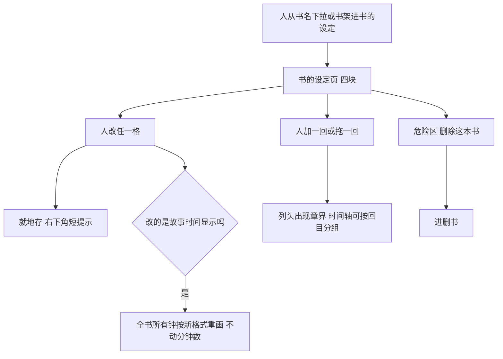

---

### U04 删书

**落地：已落地。** 现宿主须手打书名；错名确认灰；删完回书架；正史不能 Cmd+Z 撤回来。禁止回退。

**人怎么开始：** 书的设定危险区，或书架卡 ⋯ → 删书。

**逐步点什么：**

1. 系统数清楚：多少场正史、多少场草稿、多少个元素、多少条伏笔。
2. 数不出来：挡住，顶部横幅「查不出这本书有多少东西」，不准删。
3. 危险确认卡片列出全部数量，写明不能撤销。
4. 人手打这本书的书名。打错则确认保持灰。
5. 打对后点「确认删除」。
6. 删掉该书整个目录（世界、草稿、讨论、书的设定、逻辑线目录）。回书架。

**成功：** 书架少一张卡；短提示「已删掉 {书名}」。

**失败：** 错名确认灰；数不出不准删；正史（这本书的）被整本删掉，**不是**场级写入正史，也不能 Cmd+Z 回来。

**空态 / 加载 / 焦点：** 焦点在书名输入框。

**撤销：** 不能。提示写清。

**键盘：** 打书名后回车仅当名字对得上才提交；`Esc` 取消，书还在。

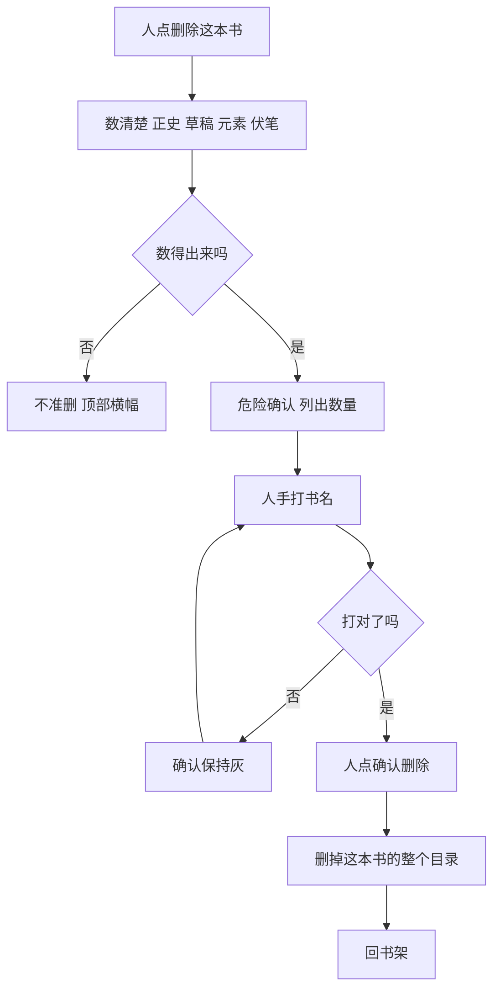

---

### U05 打开书第一屏

**落地：已落地（空书 / 有场能进分场条）。** 未落地：加载「正在打开书」、失败横幅、上次窗口按书恢复、没有「请先选视图」的合同验收。

**相对昨天：** 永远是分场条 + 场页，没有「请先选一个视图」。

**人怎么开始：** 书架点卡，或顶栏打开书。

**逐步点什么：**

1. 读该书的列、元素、正史、草稿、书的设定、逻辑线目录。
2. 一场都没有、元素也没有：空书第一屏「还没有一场戏。可以先只写人物、地点、规则。」两个按钮：去建人物 / 写第一场。本页 1 列。逻辑线排空，不出现过滤。
3. 有元素、没有场：中间仍空，左栏已有元素，提示「设定里有几项了，写第一场时可以直接拖进来」。
4. 有场：落到上次看的窗口，选中上次那一场；没有记录则落到最后一列、选中最后一场。
5. URL 含 `/board`。

**成功：** 中栏有列；右栏是场页或空列提示；细条在。

**失败：** 顶部横幅「打不开这本书」；停在书架；正史未动。

**空态 / 加载 / 焦点：** 加载「正在打开书」；空书焦点在「写第一场」或「去建人物」。

**撤销：** 无。

**键盘：** 回车打开卡（U01）；空书 `N` 聚焦本场任务。

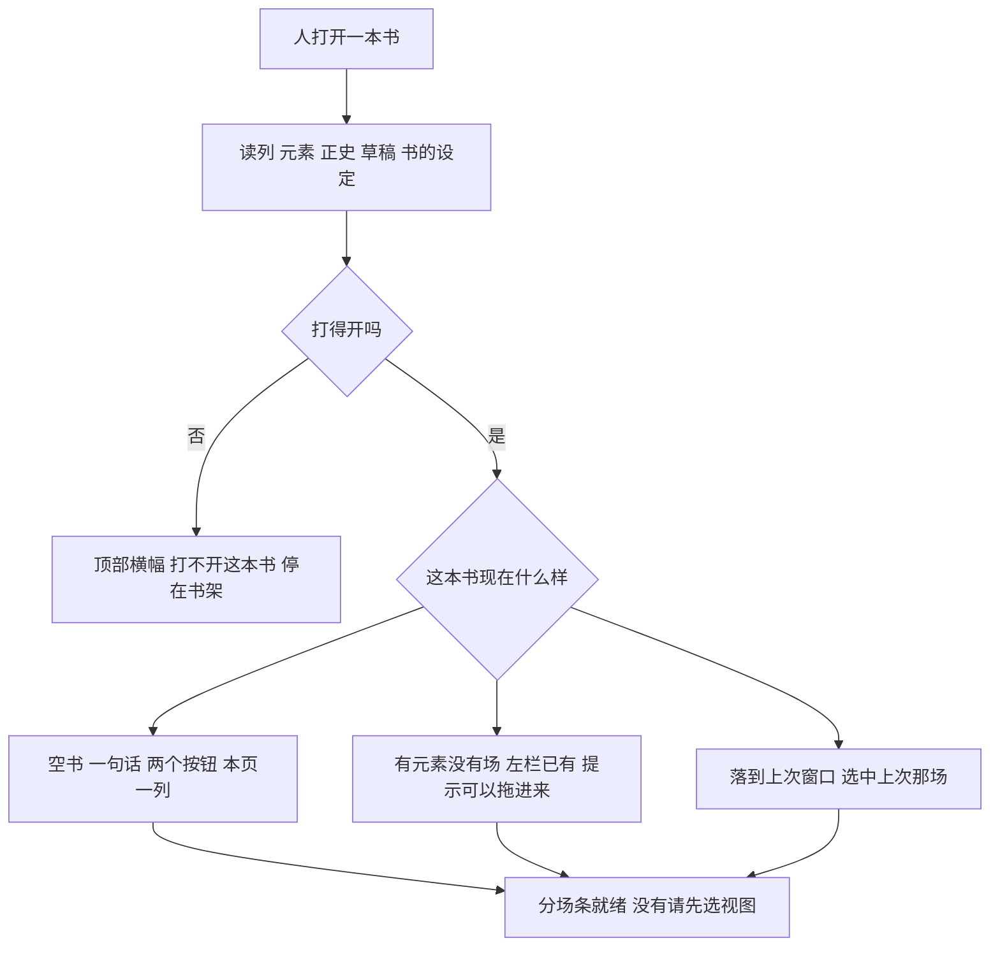

---

### U06 本页窗口

**落地：已落地（1–6、疏中密、−＋‹›、到边界灰）。** 未落地：收成一个窗口件 `‹ 4 列 ▾ ›`、`[` `]`、`⌥1`–`⌥6`、细条跳窗口不改 N 的键盘验收。

**相对昨天：** 控件收成一个；规则不变。不走确认变更。

**人怎么开始：** 顶栏窗口件。

**逐步点什么：**

1. 看见 `‹  4 列 ▾  ›`（数字是当前本页列数）。
2. 点中间下拉：1 到 6，其中 2 / 4 / 6 标「疏 / 中 / 密」。
3. 选一个数：可见列重新均分；卡上详略跟着变（见 3.4）。
4. 点 ‹ ›：窗口移一列；选中的场不变，若移出视野则跟着滚过去。到头的箭头灰。
5. 细条点齿或拖框：只改窗口起点，**不改 N**。

**成功：** 本页列数变了；故事列总数不变；Narra 不改；焦点不丢。

**失败：** 下拉里没有 0 或 7，不可能越界。

**空态 / 加载 / 焦点：** 空书 N=1，− 灰；N=6 时 + 灰。

**撤销：** 不进撤销栈（只改看法）。再点回去即可。

**键盘：** `[` `]` 平移；`⌥1`–`⌥6` 设列数。

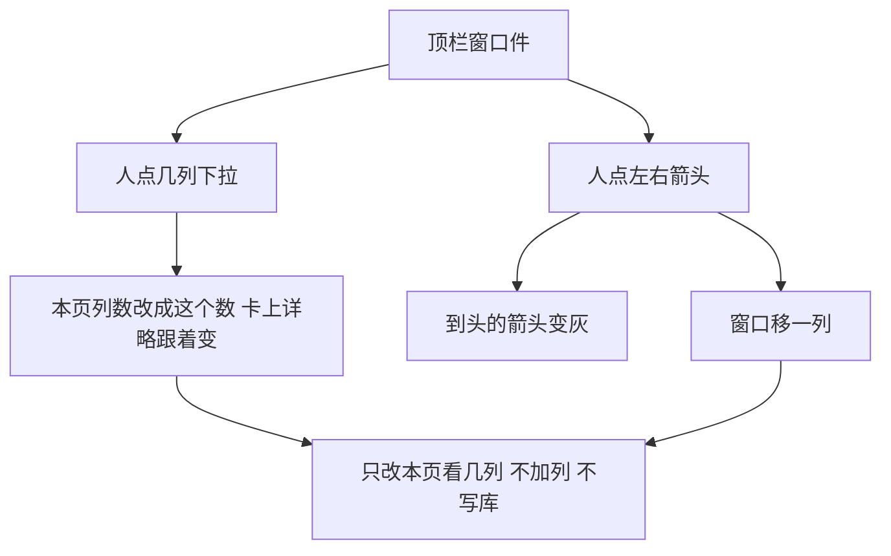

---

### U07 全书细条

**落地：已落地（四态齿 + 窗口框 + 点齿跳）。** 未落地：齿宽自适应、章界竖线、悬停小卡、过滤时线上齿略亮、键盘点齿等价。

**相对昨天：** 过滤时线上齿可略亮，**不改齿语义**。逻辑线不给齿加第四种色。

**人怎么开始：** 主面顶上细条始终在。

**逐步点什么：**

1. 每列一齿。齿色：有正史 / 只有草稿 / 空场次 / 省略场。讲述序 ≠ 列序的齿底部第二道色。
2. 本页窗口画成可拖的框。
3. 悬停一齿：小卡写列号、故事时间（人话）、这一列几场、场次名。
4. 点一齿：窗口跳过去，本页列数不变，选中的场不变。
5. 拖窗口框：边拖边跟，松手落位。
6. 总列数超过细条宽度：细条自己可横向拖，当前窗口始终可见。

**成功：** 只看见另一段窗口；场、正史、逻辑线归属都不改。

**失败：** 无（细条不能写入正史）。拖框不能改钟。

**空态 / 加载 / 焦点：** 空书一齿；齿可 Tab。

**撤销：** 无。再点原来的齿即可。

**键盘：** Tab 到齿，回车 = 点齿。

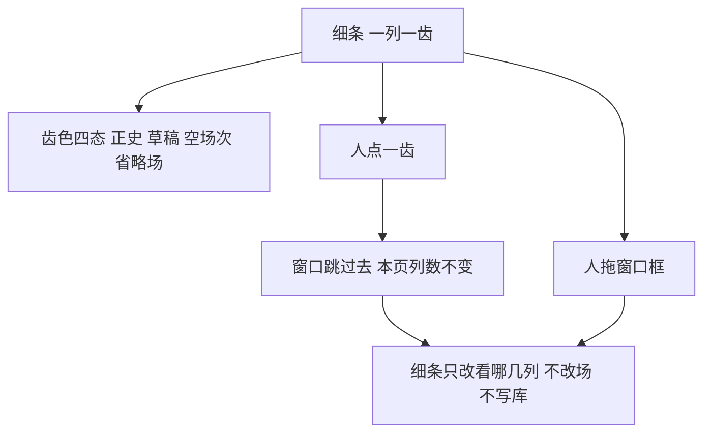

---

### U08 时间轴

**落地：未落地（骨架已有）。** 现宿主右侧 `look-rail`，分场条仍在，e2e 已断言不卸中栏。缺三级刻度、空段人话、讲述序对照轨、点条跳场、拖条挡住文案、无钟起点时提示去书的设定。

**相对昨天（改进后的步骤）：** 昨天是 `#/b/{书}/timeline` 整页盖住分场条，且「能拖能排」。本文改为看法侧开，**中栏仍在**；拖条一律挡住，改钟回分场条 + 确认变更。

**人怎么开始：** 看法 ▾ → 时间轴，或 `T`，或 `?look=时间轴`。

**逐步点什么：**

1. 右侧侧开时间轴。中栏分场条仍在 DOM 且可见（可收窄，不可卸）。URL 仍含 `/board`。
2. 顶部切三级刻度：按全书 / 按回目 / 按天。无钟起点：提示「去书的设定定故事时间起点」，刻度退化为分钟整数，不假装「第几天」。
3. 每一段按故事时长成比例。正史 / 草稿形状优先；条左端可画逻辑线主色 + +N（规则与卡相同）。没有戏的列画浅色空段，标「空场次」。省略场斜纹。
4. 底部**不再**做第二条可改正史的轨。讲述序对照若做，只画连线示意错位，不能拖。
5. 点一条：关或收看法；分场条滚到该列；选中该场；右栏回场页。
6. 拖一条：挡住「改故事时间去分场条拖列，确认变更后才生效。」Narra 场钟不变。
7. `Esc` 收看法，窗口起点不变。

**成功：** 能说出这段钟里哪段是空的；点条能跳回分场条。

**失败：** 拖条 / 拖段改序被挡住；正史不改。

**空态 / 加载 / 焦点：** 全书没有场：侧栏写「还没有场」；中栏仍有空列。无回目时「按回目」提示去书的设定。

**撤销：** 无（只看）。

**键盘：** `T` 开；回车 = 点条跳场；`Esc` 关看法，不关分场条。

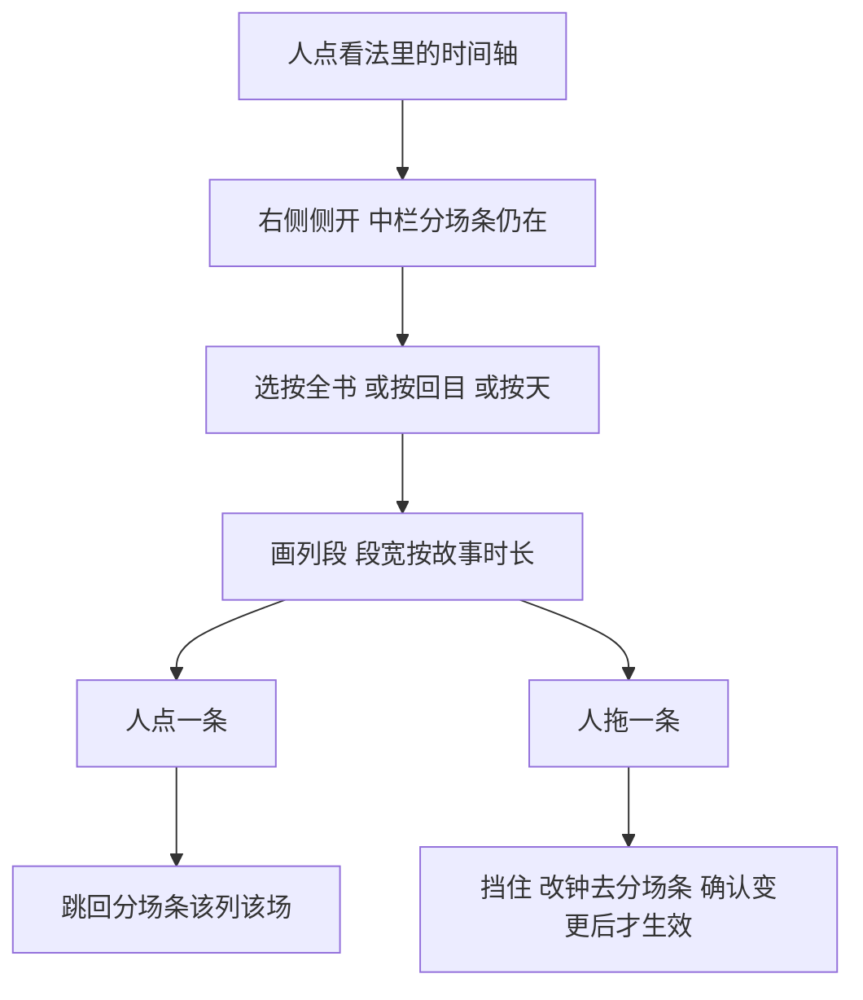

---

### U09 新建元素

**落地：已落地（名字 + 类型 + 别称能建）。** 未落地：建完侧开档案并落在第一个空键、三个入口走同一流程、规则 / 伏笔就地提示。

**人怎么开始：** 左栏「新建」；左栏搜不到「用这个词新建」；正文 `@` 搜不到「新建并引用」。

**逐步点什么：**

1. 选类型：人物 / 地点 / 道具 / 组织 / 规则 / 伏笔。
2. 填名字与别称。重名：就地提示并给出已有档案链接。
3. 点新建。身份从故事起点就成立，**不需要写入正史**。
4. 右边同时打开档案（U10），光标落在第一个空键。不强制填完。
5. 规则：提示「规则不当作在场，拖不进卡」。伏笔：提示「建了不等于埋了」。人物 / 地点 / 道具 / 组织：可拖进卡。
6. 从 `@` 进来的：建完插入正文，并加进本场在场，短提示带撤销。

**成功：** 左栏出现该项；档案可填；算出这一刻能看见身份层（序号 0），不是一场戏。

**失败：** 重名可继续或改用已有；正史场不改。

**空态 / 加载 / 焦点：** 焦点在名字；建完焦点在档案第一空键。

**撤销：** 未挂场的新建可 Cmd+Z 删回（草稿级）；已挂场不能从设定里静默撤。

**键盘：** 左栏 `N` 不占用（`N` 是写下一场）；新建用命令面板或 Tab 到「新建」。

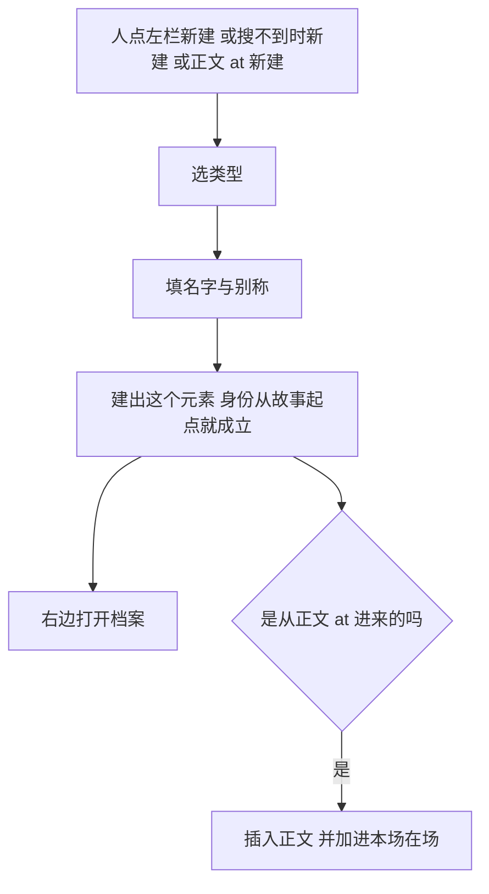

---

### U10 档案页

**落地：未落地（骨架已有）。** 现宿主 dialog 已有基本设定若干键、从故事起点就成立的关系、场上变过只读、出场 / 情状窗口。缺：F10 全键中文标签、空键默认折起、三种打开、点出场跳回分场条、档案页写清「改这一场去分场条」、不能在档案写入正史。

**相对昨天：** 就地 / 侧开 / 整页；出场场次只读，点了跳回分场条该场。

**人怎么开始：** 点左栏名字；点卡上标记再点打开档案；关系图点节点；`#/b/{书}/e/{元素}`。

**逐步点什么：**

1. 上半：按类给 F10 全键（见第 5.5 节），全部可空。空键默认折起，「展开全部」才出来。每个键旁有「讨论」。
2. 改一个键：就地存。短提示「已存。这是身份，从故事起点就成立，不用写入正史」。
3. 中段关系：上面「从故事起点就成立」可加可删（U12）；下面「场上变过」只读，写清哪一场变的，可点跳场。
4. 下半只读：出场的场、当场情状、他知道什么（含信错与出处）、相关伏笔。点一条跳回分场条对应场。
5. 人想改「这一场他怎么了」：提示「那要去那一场改」，给跳转。
6. 删设定走 U13。

**成功：** 基本设定进身份层；出场 / 情状仍只来自已正史场。

**失败：** 不能在档案改在场、不能写入正史、不能确认变更。

**空态 / 加载 / 焦点：** 无出场：「还没上过场」；焦点在第一个展开的键。

**撤销：** 基本设定存草稿级可撤；出场不能在这里撤。

**键盘：** 回车开档案；`Esc` 整页 → 侧开 → 就地 → 关；出场行回车 = 跳场。

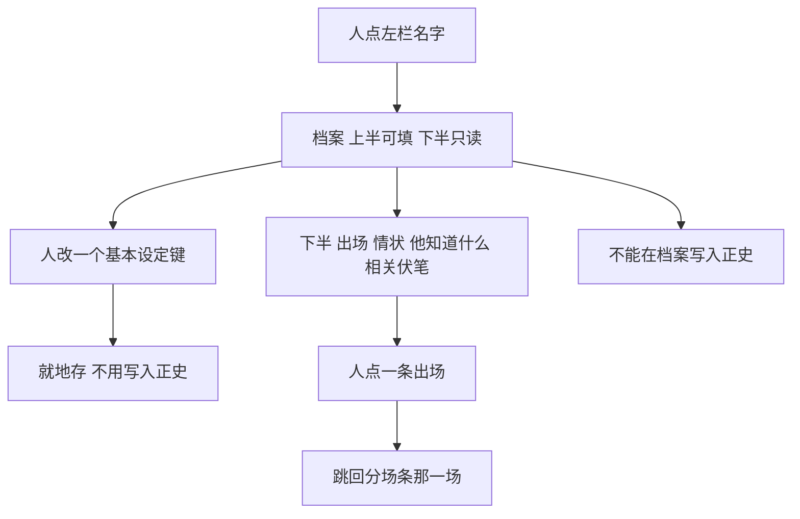

---

### U11 设定库

**落地：未落地（骨架已有）。** 现宿主 overlay 列表；缺按类 / 表格 / 画廊、筛选、批量删仍走挂场检查。

**相对昨天：** 整页可留。打开方式从「视图下拉平级」改为书名 ▾ 或命令面板，回 `#/b/{书}/board`。

**人怎么开始：** 书名 ▾ → 设定库，或命令面板「设定库」，或 `#/b/{书}/library`。

**逐步点什么：**

1. 默认按类分组：人物 / 地点 / 道具 / 组织 / 规则 / 伏笔六组。
2. 可切表格（一行一个：名字、类、别称、出场几次、第一次 / 最后一次在第几列、有几条关系）或画廊（大卡 + 小传前两行）。
3. 共用筛选：按类、按有没有出场、按有没有填小传、搜名字与别称。
4. 点名开档案（U10）。
5. 多选批量改类或批量删：删仍逐个走「已挂在场则挡住」。
6. 点「回分场条」。

**成功：** 能按类看完全书元素；左栏仍只列本页出场（不冲突）。

**失败：** 已挂场的不能从这里删（U13）；正史不改。

**空态 / 加载 / 焦点：** 空书「还没有设定。去左栏新建。」

**撤销：** 未挂场的删可在 8 秒内撤；已确认删不能静默撤。

**键盘：** `/` 或 ⌘K 跳设定库；`Esc` 回分场条。

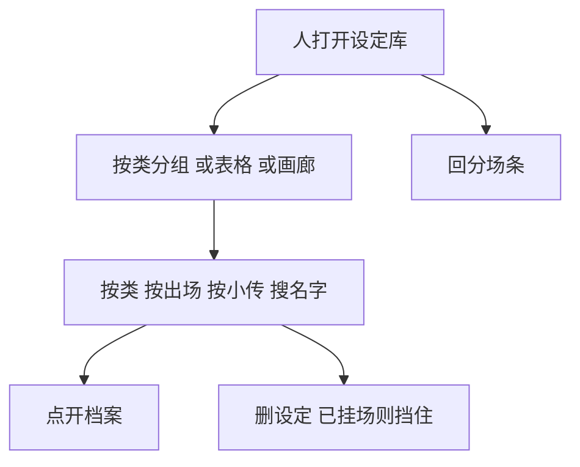

---

### U12 元素与元素的关系

**落地：未落地（骨架已有）。** 现宿主档案里能建 `related` / `member` / `holds` / `contains`；关系图仍偏推演共场。缺：种类合法性就地红字、建在一边另一边自动出现的验收、想写「从某场起」时跳到本场变化、拖边挡住。

**相对昨天：** 关系图改为右栏页签，分场条仍在；拖边挡住。设定关系挂元素下，不造第二份真源。

**人怎么开始：** 档案页关系区「加一条关系」。

**逐步点什么：**

1. 选种类：和…有关系 / 属于 / 拿着 / 在…之内。
2. 种类与两端类型不合法：就地红字（例如「属于只能从人物指向组织」）。
3. 用元素选择器选对方（含别称；搜不到可新建并直接选上）。
4. 可写一句说明。点存。
5. 已有同样一条：问改说明还是取消。
6. 写下后：本页多一行，对方档案自动多一行反向。短提示带撤销。
7. 人想说「从第 5 场起才这样」：提示「那不是设定，是戏」，跳到那一场写本场变化（U17）。
8. 「场上变过」只读，删不了——要改去那一场。

**成功：** 身份层关系成立，不进「第几次写入正史」。算出这一刻能看见身份关系；场上变过的仍只来自已正史场。

**失败：** 类型不合法不存；正史场不改。

**空态 / 加载 / 焦点：** 无关系：「还没有从故事起点就成立的关系」。

**撤销：** 设定关系 8 秒内可撤；场上变过不能在这里撤。

**键盘：** Tab 到种类 / 对象 / 存；`Esc` 取消这一条。

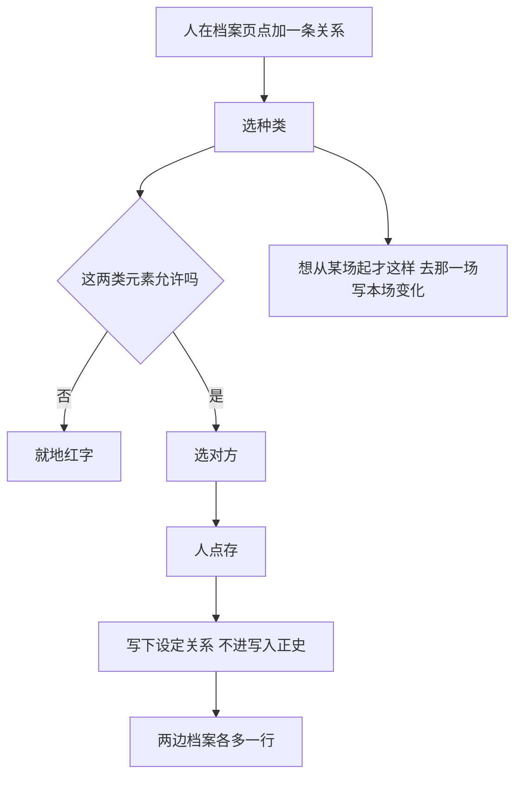

---

### U13 删设定

**落地：已落地（已挂场挡住）。** 未落地：列出挂在哪几场且每条可点、关系一并没了的提示、查不出则不准当作没有引用。

**人怎么开始：** 档案页或设定库点「删设定」。

**逐步点什么：**

1. 查它挂在哪些场、有几条关系指着它、有几条知情提到它。
2. 查不出：挡住，不准当作没有引用。
3. 挂在场上：不准删，列出场次（每条可点），提示先从分场条拿掉。
4. 未挂场：若有设定关系，提示会一起没了。确认卡片写明不能撤销。
5. 人点确认。删掉元素与指向它的设定关系。回原页。

**成功：** 设定里没了它；正史场不动（因为它本来没挂场）。

**失败：** 已挂场挡住；正史不改。

**空态 / 加载 / 焦点：** 焦点在确认按钮（未挂场时）。

**撤销：** 未挂场的删，8 秒内可撤（草稿级）。已确认后不能静默撤。

**键盘：** `Esc` 取消确认。

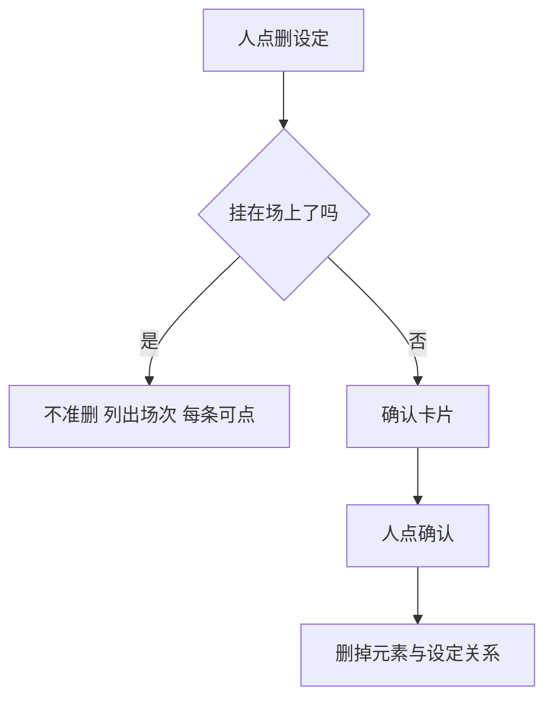

---

### U14 写下一场

**落地：已落地（本场任务必填、默认最后追加、规定情境在侧栏）。** 未落地：开场面板左右分栏、按钮下「先写一行本场任务」不靠 Rust 串、列选择器改落点。

**相对昨天：** 开场面板仍在右栏「写下一场」；规定情境六块顺序不乱，人看着账写任务。没有本场任务按钮灰，不靠后端原文。

**人怎么开始：** 顶栏「写下一场」，或 `N`。

**逐步点什么：**

1. 出开场面板：左边本场任务，右边本场规定情境六块（本场任务、上场价值转折、世界账、人物账含不知 / 信错、读者账、未收伏笔最多 5）。另附「建议本场对伏笔做哪一件」，可忽略，不进模型输入。
2. 本场任务空：「开这一场」灰，按钮下「先写一行本场任务。这场要改变什么。」
3. 可点任务旁「讨论」（U20）。
4. 落点默认：现有最后一列 / 最后一场之后。人可改成落进某一列（列选择器）。可先定地点。
5. 点「开这一场」：建一场草稿，选中它，右栏就地打开场页，光标落在第一个人的动作上（无人则在场面提示里）。
6. 卡是虚线草稿。**不是**写入正史。

**成功：** 中栏多一张虚线卡；右栏是这场；规定情境仍在折页或面板右侧。

**失败：** 任务空不能提交；后端仍拦；正史不改。

**空态 / 加载 / 焦点：** 规定情境加载中占位，不闪空；焦点在本场任务。

**撤销：** 这场草稿可 Cmd+Z 删掉（U28 / U40）。

**键盘：** `N` 聚焦任务；有任务后回车 = 开这一场；没有任务回车不提交。

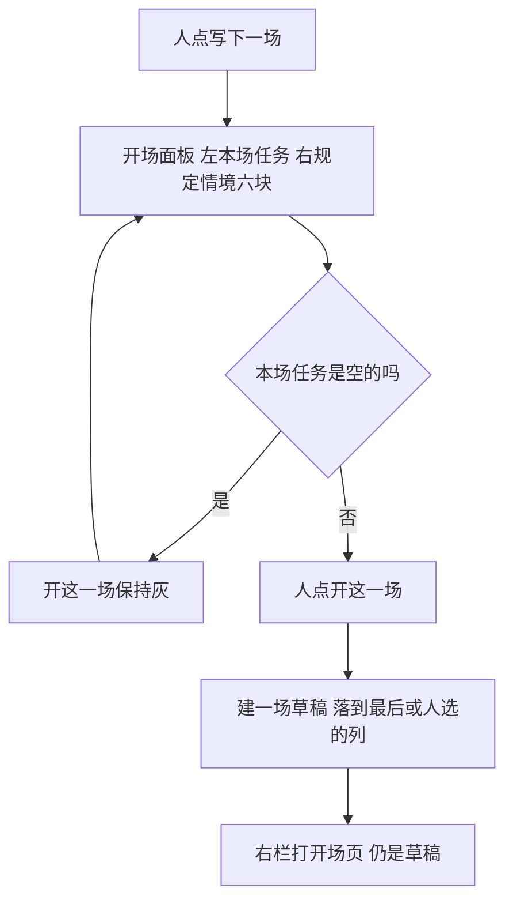

---

### U15 场页填空

**落地：未落地（骨架已有）。** 现宿主点卡填框、按人分轨、场次 / 因果 / 读序 / 当众私下 / 逻辑线贴线已有。缺：上半属性区信息层级、三种打开、自适应高度、稳定输入节点、800ms 存草稿、`@` `/`、讨论按场+格分开存、空属性折起、当众私下按场不按全局。

**相对昨天：** 加「本场涉及的逻辑线」区块；右栏默认场页，七模式不再卸掉场页。规定情境改折页，**不卸掉点卡填框**。

**人怎么开始：** 点卡（就地）；`空格`（侧开）；进 `#/b/{书}/s/{场}`（整页）。

**逐步点什么：**

1. 看见上半属性区，从上到下：身份（场次大字、草稿 / 正史 / 省略场徽标、第几次写入正史）→ 本场任务 + 价值转折 → 落点（地点、出场、故事时间、因为哪一场、当众 / 私下、读序）→ **本场涉及的逻辑线** → 本场变化 / 知情 / 伏笔（空则折起）→ 底栏（写入正史 · 模型填下一场 · ⋯）。
2. 下半：一个在场人物一块，每块动作 / 对白 / 内心。省略场收起正文，只留「这段时间发生了什么」。无人在场：提示拖人或 `@`。
3. 改属性：填错则红字贴在格子下。立刻存草稿。
4. 打字：框随内容长高，最少 3 行。每 800ms 存一次，标题旁「保存中 / 已存」。**打字时刷新不许丢焦点。**
5. `@`：元素选择器；选中后插入名字并加进在场。`/`：加本场变化 / 知情 / 伏笔 / 讨论这一段 / 插省略。
6. 某格旁「讨论」：只讨论这一格，结果按「哪一场 + 哪个格子」分开存。
7. 逻辑线：多选已有线；可「新建支线」（名称 + 6 槽拣色）；每条线作用推进 / 旁及 / 暂停，默认推进。空 = 未归线，不标黄。入线 / 出线只读推导。改归属立刻进草稿；点「写入正史」之后看法才按新归属过滤。草稿场的归属可参与过滤。
8. 点「写入正史」走 U22。

**成功：** 草稿在；卡上色带随归属变；算出这一刻仍看不见这场（除非已是正史）。

**失败：** 必填空则写入正史灰；正史不因打字而改。

**空态 / 加载 / 焦点：** 空属性折起；焦点在人点的那一格；三种打开切換时光标与滚动保留。

**撤销：** 字段、在场、变化、知情、贴线（草稿）可 Cmd+Z。

**键盘：** 回车就地打开；空格侧开；`Esc` 逐级退；`⌘Enter` 存并跳下一格；`L` 聚焦逻辑线排（场页内 Tab 选线）；`A` 加在场。

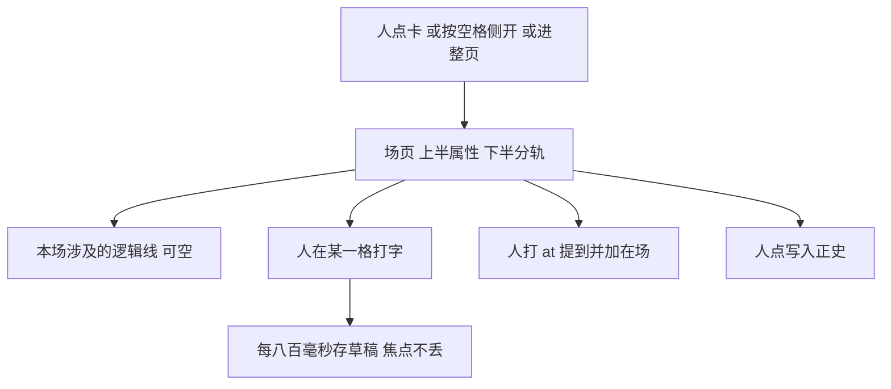

场页硬要求（昨天保留，本文写死）：自适应高度；稳定输入节点；800ms 存草稿；`@` `/`；讨论按场+格分开；不许再打印 `阿福.where=渡口`。逻辑线区块不是第二套结构编辑。场页**不出现**「请写下一场铜牌」。

---

### U16 改在场

**落地：已落地（左栏拖进拖出）。** 未落地：`@`、`A`、规则就地提示、场面至少一人、地点不能拿空、已正史走确认变更。

**禁止回退：** 左栏拖进拖出；规则不能当在场。

**人怎么开始：** 要往这场加或拿掉人物 / 地点 / 道具 / 组织 / 伏笔。

**逐步点什么：**

1. 加：从左栏拖到卡或场页出场区；或正文 `@`；或选中卡按 `A`；或出场栏直接选。
2. 规则：就地「规则不当作在场」，给开档案的链接。
3. 地点：单个，拖进即替换，提示「本场地点从甲换成乙」。
4. 成功：卡上多标记；场页出场跟着变；该人多分轨一块。
5. 拿掉：标记拖回左栏；或选中标记 `Delete`；或「这场·它」点从这场拿掉。
6. 场面拿掉最后一人：挡住，「要么先加一个人，要么改成省略场」。
7. 地点不能拿空。
8. 正文里还提到他：正文不动，提示要不要一起删那几句。
9. 已正史改在场：走确认变更（U26）。

**成功：** 卡与场页一致。

**失败：** 规则 / 最后一人 / 地点空挡住；正史未确认则不改。

**空态 / 加载 / 焦点：** 选择器打开时光标在搜索框。

**撤销：** 草稿可撤；已正史须再走确认变更。

**键盘：** `A` 加；`Delete` 拿掉。

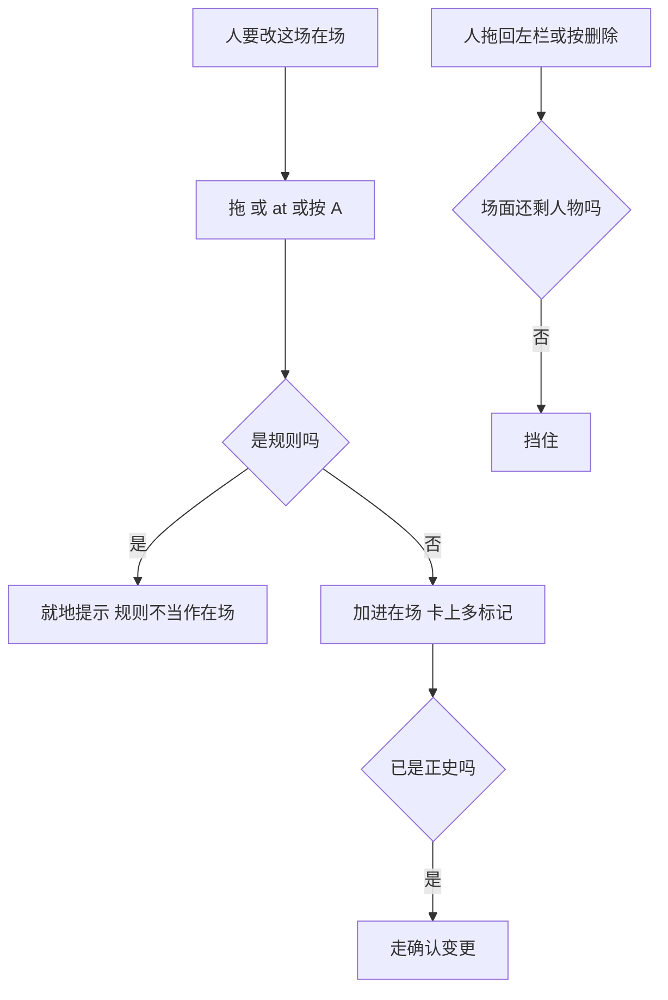

---

### U17 本场变化

**落地：未落地（骨架已有）。** 现宿主能加变化并 toast 撤销；仍易手打键。缺：四格选择器、只列本场在场、人话行、立刻存草稿、晚到事实提示、不准打印代码键。

**人怎么开始：** 场页「加一条本场变化」，或正文 `/`。

**逐步点什么：**

1. 一行四格：**谁 / 什么**（元素选择器，只列本场在场；不在场则提示先加在场）、**哪一样**（按类型候选，末尾自定义）、**变成什么**（「在哪」出地点选择器，「在谁手上」出人物选择器，其余自由文本）、**从什么时候起**（默认本场开始；改早了提示晚到事实，不改旧场动作 / 对白 / 内心）。
2. 属性候选：人物（在哪 / 受伤 / 拿着 / 属于 / 状态 / 自定义）；地点（状态 / 进出 / 自定义）；道具（在谁手上 / 在哪 / 状态 / 自定义）；组织（成员 / 首领 / 状态 / 自定义）。伏笔不走这里，走 U19。
3. 与已有开着的区间撞了：问「从这一刻起收口换成新值」还是取消。
4. 点加上：立刻存进草稿。显示人话「刀 从 第 1 天 20:30 起 在 阿莲 手上」，右边 ×。

**成功：** 刷新不丢；仍是草稿。

**失败：** 不在场选不了；正史不改。

**空态 / 加载 / 焦点：** 无变化：「还没有本场变化」折起。

**撤销：** Cmd+Z 或短提示「撤销」。

**键盘：** `/` 加一条；Tab 四格；回车加上。

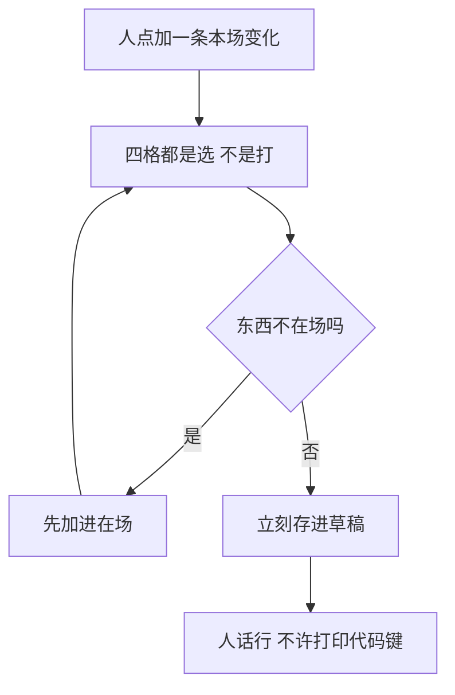

---

### U18 知情

**落地：未落地（骨架已有）。** 现宿主能写知情。缺：本场默认谁会看见、选信错才出现「实际是什么」、选被告诉才出现「谁告诉的」、人话行、立刻存草稿。

**人怎么开始：** 写完动作 / 对白后收窄默认；或场页加一条；或 `/`。

**逐步点什么：**

1. 界面列出「本场默认谁会看见」（同场同地）。当众 = 在场的人都看见；私下 = 只有「私下谁会看见」里的人。省略场不默认让谁学会。
2. 人点掉没看见的人。
3. 加一条：谁（本场在场人物多选）→ 知道什么（从本场变化挑或手写）→ 确定性（知道 / 信错 / 怀疑；**选信错才出现「实际是什么」，不填不让加**）→ 怎么知道的（看见 / 听见 / 被告诉 / 推断 / 发现；**选被告诉才出现「谁告诉的」**）。
4. 人话：「阿莲 信错 铜牌在城里（实际：铜牌在抽屉）· 被阿福告诉」。
5. 和已有知情打架：标黄仍可写，写清哪一条。
6. 立刻存草稿。对白里有人说了不该知道的事：卡上标黄（U32）。

**成功：** 刷新不丢；仍是草稿。

**失败：** 信错缺「实际是什么」不让加；正史不改。

**空态 / 加载 / 焦点：** 省略场提示「要学会得自己写一条」。

**撤销：** 草稿可撤。

**键盘：** `/` 加一条；条件字段随上一格显示。

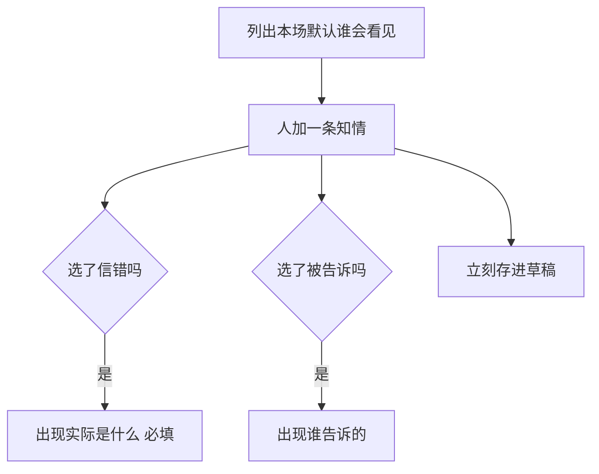

---

### U19 伏笔四件事

**落地：未落地（骨架已有）。** 现宿主「埋伏笔」已改成填名字的 dialog，不再写死《渡口》台词；场页伏笔操作与 `promise_ops` 仍未接完。缺：埋设 / 推进 / 兑现 / 作废人话行、未埋先兑的挡住、与逻辑线「推进」分开放。

**相对昨天：** 伏笔不是逻辑线。逻辑线类型只有主线 / 支线。

**人怎么开始：** 左栏新建类型选伏笔（建 ≠ 埋）；或场页伏笔区「加一件」；或侧栏未收 5 条旁「在这一场做一件」。

**逐步点什么：**

1. 建伏笔：档案填欠读者什么 / 种类 / 期限 / 关联。未收列表里还不出现。
2. 场页选一条伏笔（未收排前面）→ 做哪一件：埋设 / 推进 / 兑现 / 作废。可写一句这一场对它做了什么。
3. 不合法（还没埋就兑现、已经兑现又兑现）：标黄或挡住，写清原因。
4. 立刻存草稿。人话「铜牌三日 在这一场 埋设」。
5. 点「写入正史」之后，未收列表与档案相关伏笔才变。
6. 侧栏建议一件可忽略，不挡写入正史，不进模型输入，不指定写哪一场。

**成功：** 草稿里有这一件；正史未点则世界上未收状态不变。

**失败：** 不合法件挡住或标黄；正史不改。

**空态 / 加载 / 焦点：** 无伏笔：「这本书还没有伏笔。去设定新建。」

**撤销：** 草稿可撤。已写入正史走改已正史 / 删已正史。

**键盘：** `/` 埋一条；与逻辑线「推进」控件分开，Tab 顺序不相邻混用。

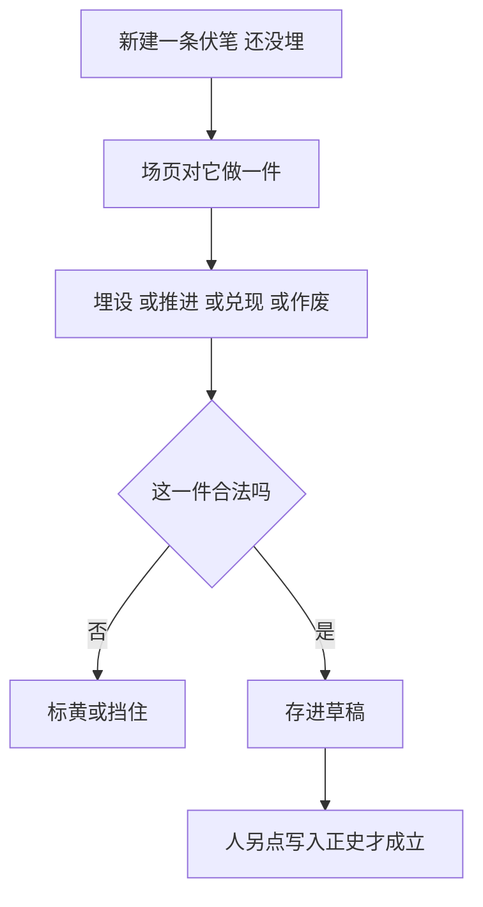

---

### U20 讨论

**落地：未落地（骨架已有）。** 现宿主有讨论与写入此框。缺：按「哪一场 + 哪个格子」分开存、面板顶写清正在讨论什么、没有待写入时按钮灰。

**禁止回退：** 写入此框才进对应输入框；不自动正史。

**人怎么开始：** 任一可填格旁「讨论」。

**逐步点什么：**

1. 这场没有本场任务：提示先写一行本场任务。
2. 右栏切到讨论。顶上写清：「正在讨论：阿禾 · 对白 · 第 4 列 · {场次}」。常驻「讨论不是历史」。
3. 把这一格现有内容 + 本场规定情境交给模型。按钮「正在想…」，可中断。
4. 失败：写清超时或被拒；人已写的东西保留；给再试。
5. 回来一段话 + 几条关切（每条锚在哪，例如「阿莲不知道刀在抽屉」）。人点一条或用整段。
6. 「写入此框」亮起。点了只写进刚才那一格。这场仍是草稿。
7. 讨论记录留在这一场这一格下面；换格不覆盖。

**成功：** 对应格子出现文字；短提示「已写入此框，仍是草稿」。

**失败：** 没有待写入：按钮灰；正史不改。

**空态 / 加载 / 焦点：** 焦点留在该格。

**撤销：** 写入此框后可撤草稿。

**键盘：** 回车点「写入此框」（焦点在按钮上时）。

```mermaid
flowchart TD
  in[人点某一格旁的讨论]
  need{有本场任务吗}
  no[提示先写本场任务]
  open[讨论面板写清正在讨论哪一格]
  back[模型给回一段话]
  tap[人点写入此框]
  where[只写进那一个格子 仍是草稿]
  in --> need
  need -->|没有| no
  need -->|有| open --> back --> tap --> where
```

---

### U21 模型填下一场

**落地：未落地（能点，过程不可见）。** 现宿主有填场按钮；缺进行中 / 中断、逐块「用这一块」、不进逻辑线列表。

**人怎么开始：** 场页「模型填这一场」。

**逐步点什么：**

1. 没有本场任务：按钮灰，「先写一行本场任务」。
2. 把本场规定情境与本场任务交给模型。**结构建议、伏笔建议一件、逻辑线列表、进度缺口都不进去。**
3. 按钮「正在填…」，旁边中断标。点中断：立刻停，已经写的东西一点不动。
4. 失败：写清没配密钥 / 超时 / 被拒；给再试；人写的东西一点不动。
5. 回来按人分轨的内容 + 一句价值转折。以待确认样子显示，每块旁「用这一块 / 不要这一块」。可逐块或一次全用。全不用则回到人自己写的样子。
6. 若按旧世界生成：卡上小标「按旧世界生成」，旁有「按现在的世界重填」。
7. 任何情况下都不自动写入正史。

**成功：** 选用的块进对应格子，仍是草稿。

**失败：** 无任务 / 超时 / 无密钥挡住；正史不改。

**空态 / 加载 / 焦点：** 进行中焦点不丢；失败焦点留在按钮。

**撤销：** 用进格子的内容可 Cmd+Z。

**键盘：** 焦点在按钮上回车 = 开始填；`Esc` 在进行中等于中断（先确认不丢已写）。

```mermaid
flowchart TD
  in[人点模型填这一场]
  need{有本场任务吗}
  no[按钮灰]
  run[正在填 可中断]
  back[按人分轨待确认]
  apply[人点用这一块 仍是草稿]
  never[不自动写入正史]
  in --> need
  need -->|没有| no
  need -->|有| run --> back --> apply --> never
```

---

### U22 写入正史

**落地：已落地（必须人点；挡住的写不进）。** 未落地：按钮三种样子提前说话、进行中「正在写入…」、成功后细条齿变色、提示不能 Cmd+Z。

**相对昨天：** 看法里找不到「写入正史」。贴线不改变算出这一刻。

**人怎么开始：** 场页底栏「写入正史」。

**逐步点什么：**

1. 每次改完，穿帮检查只读重跑，不写库。
2. 按钮三种样子：亮 = 「点了才进历史」；亮 + 黄点 = 「有 n 处标黄，仍然可以写入」；灰 = 缺必填或有挡住的穿帮，下面逐条可点，点了跳到那个格子。
3. 人点「写入正史」。进行中按钮「正在写入…」，焦点不丢。
4. 中途失败：整笔回退，仍是草稿，不分配第几次写入正史，写清哪一步坏了。窗不关。
5. 成功：卡变实线「正史」；徽标写第几次写入正史；细条齿改有正史色；侧栏可点看这一刻；后面场的规定情境、未收伏笔、相关档案跟着变。
6. 短提示「已写入正史」，旁「接着写下一场」。提示写清：**不能 Cmd+Z**；要改走改已正史 / 删已正史。

**成功：** 这场进入算出这一刻。逻辑线归属随场进库，但 **算出这一刻与未贴线时相同**。

**失败：** 灰按钮或事务失败；正史不改。

**空态 / 加载 / 焦点：** 焦点留在按钮或跳到出错格子。

**撤销：** **不能 Cmd+Z。**

**键盘：** 焦点在按钮上回车 = 点。看法里无此按钮。

```mermaid
flowchart TD
  edit[人在场页改东西]
  live[穿帮检查只读重跑]
  tap[人点写入正史]
  txFail{中途失败吗}
  rb[整笔回退 仍是草稿]
  done[卡变正史 细条改色]
  noUndo[不能 Cmd+Z]
  edit --> live --> tap --> txFail
  txFail -->|是| rb
  txFail -->|否| done --> noUndo
```

---

### U23 单列多场

**落地：未落地（能存，取列可能错）。** 现宿主「在本列再写一场」可能取本页最左列。缺：列头写几场、卡上 1/2 与本场钟、列底加场位用当前列、同时标。

**相对昨天：** 取当前列不是本页最左列。看法里不能加场。

**人怎么开始：** 列底「＋ 在这一列再写一场」，或命令面板「在本列再写一场」。

**逐步点什么：**

1. 列头写清：第几列 · 起止钟 · 这一列几场。
2. 卡右上角「1 / 2」；卡头写这一场自己的故事时间（可窄于列）。窄于列则画出自己占的那一段。
3. 列内按每场起点钟排。起点相同标「同时」，并排画。
4. 点列底加场：走 U14，落点固定成**这一列**，不是本页最左列。新场默认继承该列钟，可改窄。
5. 上下拖卡：草稿立刻改起点钟；已正史走确认变更。
6. 提醒：同一列全部在场都算进算出这一刻。

**成功：** 新卡出现在当前列；仍是草稿。

**失败：** 取错列视为未落地缺陷，合同禁止。正史未确认不改。

**空态 / 加载 / 焦点：** 一列一场时不显示「1 / 1」也可，有两场必须显示。

**撤销：** 新草稿场可撤。

**键盘：** 命令面板「在本列再写一场」；← → 在同列场之间选。

```mermaid
flowchart TD
  col[一列是一段故事时间]
  add[列底加场 用的是这一列]
  write[走写下一场 落点固定]
  drag[人上下拖卡]
  canon{已是正史吗}
  cc[走确认变更]
  col --> add --> write
  col --> drag --> canon -->|是| cc
```

---

### U24 场与场的关系

**落地：未落地（骨架已有）。** 现宿主有「因为哪一场」输入。缺：场选择器、反向「导致了哪几场」、卡上竖线、因果透镜 `C`、闪回必须指时间。

**相对昨天：** 看法里禁止第二入口。改因果只在场页。

**人怎么开始：** 场页「因为哪一场」。

**逐步点什么：**

1. 场选择器按列分组。选的那场若在本场之后：挡住，「因为的那一场要在这一场之前发生」。
2. 存进草稿。本场显示「因为：{那场}」可点跳。对方场页「导致了哪几场」自动多一行。
3. 两张卡左缘竖线；悬停出人话。
4. 按 `C` 或点因果标：在分场条上画上游 / 下游连线。只画只导航，拖边不能改。再按 `C` 收起。
5. 闪回必须指明闪回到哪一段故事时间，不指就标黄。
6. 清空「因为」：两边竖线与反向行一起没。
7. 被指着的场要删已正史：影响清单写「有几场说因为这一场」，每条可点。

**成功：** 草稿里有因果；正史未点则算出这一刻不读这条（因果随场进正史）。

**失败：** 选未来场挡住；看法里拖边挡住；正史未确认不改。

**空态 / 加载 / 焦点：** 无因果：该栏空，不报错。

**撤销：** 草稿可撤。

**键盘：** `C` 开 / 关透镜。

```mermaid
flowchart TD
  in[人在场页点因为哪一场]
  pick[场选择器]
  after{选的在本场之后吗}
  no[挡住]
  save[存进草稿 两边互相看见]
  lens[人按 C 只画只导航]
  in --> pick --> after
  after -->|是| no
  after -->|否| save --> lens
```

---

### U25 省略场与闪回

**落地：已落地（斜纹省略、闪回缩进）。** 未落地：列底「加一段省略」、斜杠插入、省略场不默认学会的提示。

**人怎么开始：** 列底加场位选「加一段省略」；或草稿属性区改成省略场；或 `/` 插省略。

**逐步点什么：**

1. 建成斜纹卡。只填：这段时间发生了什么（一句话）+ 占多长故事时间。
2. 正文区收起。在场仍可填（谁挪了地方）。提示：省略场不默认让谁学会。
3. 换地：在这里写本场变化「在哪」。
4. 仍须写入正史才算历史。改回场面：属性区改回，正文展开。
5. 闪回是另一件事：必须指闪回时间；卡缩进；读序常与列序不同。

**成功：** 卡形状对；正史未点则不算历史。

**失败：** 省略场没有动作 / 对白 / 内心可填（收起）。

**空态 / 加载 / 焦点：** 焦点在「这段时间发生了什么」。

**撤销：** 草稿可撤。

**键盘：** `/` 插省略。

```mermaid
flowchart TD
  make[建成省略场 斜纹卡]
  ask[填发生了什么 与占多长]
  body[正文收起]
  commit[仍须写入正史]
  flash[闪回必须指时间]
  make --> ask --> body --> commit
  make --> flash
```

---

### U26 结构编辑总入口

**落地：已落地（确认变更、失败不关窗、未确认 Narra 不改）。** 未落地：入口在列缝 / 列头右键、一律用当前列、卡片浮在操作点旁、建议不预选。

**禁止回退：** 失败不关窗；未确认 Narra 不改。看法里没有确认变更。

**人怎么开始：** 列缝悬停「＋」；列头右键「减这一列 / 和右边合并 / 和右边换位置」；拖列右缘（U27）；命令面板结构命令；顶栏更多仍保留但用当前选中列。

**逐步点什么：**

1. 定下对**当前那一列**做哪一件，不是本页最左列。
2. 整列重算。算不出：挡住，顶部横幅，不准当作没有影响。
3. 确认卡片浮在操作点旁：上红字影响，下全部建议（不预选、不藏）。界面先按选中建议预览，库不改。
4. 取消或 `Esc`：预览作废，回到原样。
5. 点「确认变更」：一笔写入。失败**不关窗**，红字在卡片里，正史 / Narra 仍是拖前。
6. 成功：列序 / 钟变；细条跟着变；短提示「已确认变更，不能撤销」。

**成功：** Narra 改结构；算出这一刻重跑受影响区间。

**失败：** 窗不关；正史不改。

**空态 / 加载 / 焦点：** 建议列表空则只留取消。

**撤销：** 未确认 = 没改。已确认不能 Cmd+Z。

**键盘：** `Esc` = 取消。

```mermaid
flowchart TD
  op[人对当前列发起结构改动]
  card[确认卡片 影响加建议 可预览]
  cancel[人点取消 库不改]
  go[人点确认变更]
  fail{失败吗}
  stay[不关窗 红字在卡片里]
  done[生效]
  op --> card
  card --> cancel
  card --> go --> fail
  fail -->|是| stay
  fail -->|否| done
```

---

### U27 拖列改故事时间

**落地：已落地（拖缘预览 + 确认变更）。** 未落地：边拖边显示人话钟、被侵入列幽灵预览。

**人怎么开始：** 按住列右缘手柄。

**逐步点什么：**

1. 边拖边显示：这一列现在多长、拖到哪个钟点（人话，不是分钟数）。列宽不变。
2. 往右 = 侵入；往左 = 空出。被影响列同时画出将变成什么样。
3. 松手：整列重算，列出全部建议。侵入是空出的超集，同一卡片。
4. 人选一条，界面预览，库不改。会造成两列钟重叠的建议挡住。
5. `Esc` 或取消：拖动作废。
6. 点确认变更：钟才变。

**成功：** 列钟更新；不允许两列重叠当正式状态。

**失败：** 未确认 / 失败不关窗；正史钟不改。

**空态 / 加载 / 焦点：** 焦点在确认卡片。

**撤销：** 未确认 = 没改。已确认不能 Cmd+Z。

**键盘：** 拖是指针手势；取消用 `Esc`。改钟没有看法入口。

```mermaid
flowchart TD
  grab[人按住列右缘]
  live[边拖边显示人话时长]
  drop[松手列出建议]
  prev[预览 库不改]
  ok[人点确认变更]
  grab --> live --> drop --> prev --> ok
```

---

### U28 删草稿场

**落地：已落地（缺口对话 + 撤销）。** 未落地：已正史误走这条时跳到 U29；空场 8 秒撤销。

**人怎么开始：** 场页 ⋯ → 删这一场；或选中卡 `Delete`。

**逐步点什么：**

1. 已是正史：挡住，「要列影响和补洞」，给跳到删已正史的按钮。
2. 空草稿：直接删，短提示带撤销，8 秒内可撤。
3. 有内容：若该列还有别的场，只删这场、列不动。若删完列空：缺口卡片（留空场次 / 并进下一列 / 后面往前挪）。
4. 人点确认。短提示带撤销。

**成功：** 草稿没了；正史不动。

**失败：** 正史场走这条被挡住。

**空态 / 加载 / 焦点：** 未选中：按钮灰，**不回退到第一场**（禁止回退）。

**撤销：** Cmd+Z 或 8 秒提示。

**键盘：** `Delete` 在选中卡上（草稿）。

```mermaid
flowchart TD
  in[人点删这一场]
  is{是正史吗}
  refuse[挡住 去删已正史]
  empty{是空草稿吗}
  quick[直接删 八秒可撤]
  gap[缺口卡片]
  in --> is
  is -->|是| refuse
  is -->|否| empty
  empty -->|是| quick
  empty -->|否| gap
```

---

### U29 删已正史

**落地：已落地（影响清单 + 补洞 + 确认 + 删完清当前）。** 未落地：八类影响每条可点、必须滚完才能确认、因果类。

**禁止回退：** 影响清单 + 补洞；人确认才删；删完清当前选中；未选中按钮灰，不回退到第一场。看法里无此按钮。

**人怎么开始：** 场页 ⋯ → 删已正史。

**逐步点什么：**

1. 逐类算八类影响：故事时间空洞、后面场规定情境、知情、伏笔状态、在场连续性、这一刻的世界、因果（有几场说因为这一场）、第几次写入正史（该次作废，序号不重编）。
2. 哪一类算不出：不准删，横幅写清，不准当作没有影响。
3. 确认卡片占满中栏：上半影响（人话，每条可点），下半补洞（留空场次 / 并进下一列 / 后面往前挪 / 改成省略场保住时长）。必须滚到底才让确认。
4. 人选一条补法，点确认变更。
5. 失败：整笔回退，这场仍是正史，窗不关。
6. 成功：场没了；细条改空 / 草稿；当前选中清空；重算这一刻、规定情境、档案、未收伏笔、因果反向。

**成功：** 正史少这场；序号不重编。

**失败：** 未确认 / 失败则正史仍在。

**空态 / 加载 / 焦点：** 未选中灰。焦点在确认（滚完后）。

**撤销：** 不能静默撤。

**键盘：** 仅场页；看法无此按钮。

```mermaid
flowchart TD
  in[人点删已正史]
  list[八类影响 每条可点]
  scroll[必须滚完才能确认]
  go[人点确认变更]
  fail{失败吗}
  rb[整笔回退]
  after[场没了 选中清空]
  in --> list --> scroll --> go --> fail
  fail -->|是| rb
  fail -->|否| after
```

---

### U30 改已正史

**落地：未落地（后端 `revise` 在，前端未接完）。** 缺：正史默认只读、「改这一场」、不新分配第几次、同列还有正史时 shift 挡住（现宿主已有挡住，禁止回退）。

**人怎么开始：** 打开一场正史，点「改这一场」。

**逐步点什么：**

1. 默认只读。顶上「这一场已经是正史，第 n 次写入」。
2. 点「改这一场」：可改。顶上「正在改一场正史，改完要再点一次存进正史」。
3. 文字类（场次、任务、转折、动作 / 对白 / 内心、贴线归属）走这条。结构类（换列、改钟、改在场）提示走确认变更。
4. 同列另有正史时改价值转折等：挡住，文案说清。正史不改。
5. 边改边跑穿帮。挡住则「存进正史」灰。
6. 点「存进正史」：不新分配第几次。重算这一刻与后面规定情境。和后面场打架：列出可点，标黄不挡。
7. 放弃：回到改之前。

**成功：** 序号不变；世界按新文字重算。只改贴线不作废算出这一刻缓存。

**失败：** 同列挡住 / 穿帮挡住；正史不改。

**空态 / 加载 / 焦点：** 焦点在「改这一场」。

**撤销：** 未存前可放弃；已存不能 Cmd+Z。

**键盘：** 无单独快捷键，避免误改正史。

```mermaid
flowchart TD
  open[人打开一场正史]
  btn[人点改这一场]
  same{同列还有正史且改转折吗}
  block[挡住]
  save[人点存进正史]
  seq[第几次不重编号]
  open --> btn --> same
  same -->|是| block
  same -->|否| save --> seq
```

---

### U31 这一刻的世界

**落地：已落地（点列头人话，原始 JSON 已弱化）。** 未落地：四块每条可点、透镜提示「只改看法」、贴线后与未贴线相同的验收。

**人怎么开始：** 点列头，或标尺上某一处。右栏「这一刻」折页，不卸场页。

**逐步点什么：**

1. 问这一刻。有物化先画，对不上正史则丢掉重算。
2. 四块人话：时间；谁在哪（名字可点开档案）；什么正开着（可点跳造成它的场）；谁知道什么（含信错与出处，可点跳学会的场）。
3. 空列：「这段故事时间没有戏。空场次不等于省略场。世界仍按上一场的样子。」
4. 开着人物透镜：顶上「现在只看某人看到的。透镜只改看法，不改算出来的世界。」本场任务仍全知。
5. 界面不再出现原始数据行。
6. 贴线后点同一列：与未贴线相同。

**成功：** 人能说出这一刻谁在哪、谁知道什么。

**失败：** 不算失败路径；读失败顶部横幅，正史不改。

**空态 / 加载 / 焦点：** 先占位再填，不闪空。

**撤销：** 无。

**键盘：** 点列头可用回车（列头可聚焦）。

```mermaid
flowchart TD
  in[人点列头]
  show[四块人话]
  lens{开着人物透镜吗}
  tip[提示透镜不改算出来的世界]
  line[贴线后与未贴线相同]
  in --> show --> lens -->|是| tip
  show --> line
```

---

### U32 穿帮检查的呈现

**落地：已落地（标黄不挡 / 挡住写清）。** 未落地：卡 / 场页 / 齿三处同时、每条可跳格子。

**相对昨天：** 穿帮不因换逻辑线而变。

**人怎么开始：** 在场页改任何会触发检查的栏。

**逐步点什么：**

1. 只读重跑。只记：不打扰，场页折叠区可查。标黄：卡黄边 + 黄点，写入正史仍亮。挡住：卡红边 + 红徽标，齿描红，写入正史灰。
2. 每条人话：什么事、涉及谁、在哪一场。旁「跳到那个格子」。
3. 改好：三处一起消失。
4. 硬要写入：挡住的写不进；标黄的写得进，黄留在卡上。

**成功：** 人能找到该改的格子。

**失败：** 挡住时正史不改。

**空态 / 加载 / 焦点：** 干净则清单不占位。

**撤销：** 改回草稿可撤。

**键盘：** 清单条目回车 = 跳格子。

```mermaid
flowchart TD
  edit[人改场页]
  run[只读穿帮检查]
  strict[挡住 按钮灰]
  warn[标黄 仍可写]
  jump[跳到那个格子]
  edit --> run
  run --> strict --> jump
  run --> warn --> jump
```

---

### U33 讲述序透镜

**落地：已落地（按读序排开关）。** 未落地：列头双号、顶上数清错位数、改列序时问读序跟不跟。

**相对昨天（改进）：** 读序不按逻辑线重排；齿色不变成支线色。两个都开：按读序排，再套薄条。

**人怎么开始：** 顶栏「按读序排」。

**逐步点什么：**

1. 中栏按读序重排。列头同时写第几列与读者第几个看到。不一样的列号码换色；齿第二道色亮。
2. 顶上「有 n 列的读序和故事序不一样」。提示：只改怎么排，不改算出来的世界。
3. 改某一场读序：场页读序栏。总表批量若做，走确认变更。
4. 改了列序：问一次「读序跟着新列序走，还是保持原来的数字」。
5. 再点一次回到按故事时排，选中场不变。

**成功：** 排列变了；算出这一刻不变。

**失败：** 无。

**空态 / 加载 / 焦点：** 全部读序=列序时，提示「目前没有错位」。

**撤销：** 开关不进撤销栈。

**键盘：** 命令面板「按读序排」。

```mermaid
flowchart TD
  in[人点按读序排]
  reorder[中栏按读序重排]
  filter{同时开着逻辑线吗}
  thin[再套薄条 不按线重排]
  back[再点一次回到故事时]
  in --> reorder --> filter -->|是| thin
  reorder --> back
```

---

### U34 出场表

**落地：未落地（飞出层骨架；打印内部 id 的旧病须灭）。** 现宿主看法不卸分场条。缺：人话矩阵、点格跳列、格上不画逻辑线色、过滤时只亮线上列。

**相对昨天：** 飞出层或右栏全高，分场条仍在。改在场仍拖标记。

**人怎么开始：** 标尺旁「出场」，或看法 ▾ → 出场，或 `?look=出场`。

**逐步点什么：**

1. 矩阵：行按类分组（色点 + 名字）；列头列号 + 故事时间人话。
2. 格：在场实心、只被提到空心、不在场留空。省略场整列斜纹。连续缺席浅色贯通线。
3. 点格：跳到那一列并选中那场；看法关掉或收起。
4. 想在这里改在场：挡住，「改在场回分场条拖标记」。
5. 可只看某一类。过滤逻辑线时，可「只亮线上的列」——列仍在，不删列。格上不画逻辑线色。

**成功：** 能跳回分场条。

**失败：** 改在场被挡；正史不改。

**空态 / 加载 / 焦点：** 无元素：「先建人物或地点」。

**撤销：** 无。

**键盘：** 回车 = 点格跳列；`Esc` 关看法。

```mermaid
flowchart TD
  in[人打开出场]
  build[只读矩阵]
  tap[人点一格]
  jump[跳回分场条该列]
  edit[人想改在场]
  refuse[挡住 去分场条拖标记]
  in --> build --> tap --> jump
  build --> edit --> refuse
```

---

### U35 关系图

**落地：未落地（look-rail 骨架，选中才画）。** 缺：三种边、点节点开档案、点虚线跳场、拖边挡住、自己的选人器。

**相对昨天：** 右栏页签，分场条仍在。图不按逻辑线滤节点。

**人怎么开始：** 看法 ▾ → 关系，或档案「看他的关系」，或 `?look=关系&who=`。

**逐步点什么：**

1. 没选人：给人物选择器，不再要求先改人物透镜。
2. 以该人为中心画。边：从故事起点就成立 = 实线 + 关系名；场上变过 = 虚线 + 第几场起；同场出现过 = 极淡细线，不当关系存。
3. 点节点开档案。点虚线边跳场。点实线边跳写着它的档案。
4. 顶上可问「到第几列为止」。默认可看两层。
5. 拖边改正史：挡住，「改设定关系去档案页，改戏里发生的去那一场。」

**成功：** 能跳档案或场。

**失败：** 拖边挡住；正史不改。图里无写入正史。

**空态 / 加载 / 焦点：** 无人：「先选一个人」。

**撤销：** 无。

**键盘：** 回车点节点；`Esc` 关看法。

```mermaid
flowchart TD
  in[人打开关系图]
  draw[选中人才画]
  clickN[人点节点]
  doss[开档案]
  clickE[人点虚线边]
  scene[跳场]
  drag[人拖边]
  block[挡住]
  in --> draw
  draw --> clickN --> doss
  draw --> clickE --> scene
  draw --> drag --> block
```

---

### U36 导出

**落地：未落地（dialog 骨架：含草稿勾选、列范围、复制）。** 缺：整页预览、按回分节、常驻「改了不写回」。

**人怎么开始：** 书名 ▾ → 导出，或命令面板，或 `#/b/{书}/export`。

**逐步点什么：**

1. 左边选项：范围（全书 / 某几回 / 从第几列到第几列 / 只选中的场）；含不含草稿（**默认含**，必须标清）；按故事序还是读序；要不要带本场变化 / 知情 / 未收伏笔 / 在场摘要。
2. 右边实时预览。顶上「这次会导出 n 场，其中 m 场是草稿」。每场标「正史」或「草稿」。
3. 复制或下载 md（书名 + 日期）。
4. 常驻：「这份文件改了不会写回正史。要改回来改分场条。」

**成功：** 剪贴板或文件里标清正史 vs 草稿。

**失败：** 范围不合法贴在格子下；预览空 = 该范围没有场。

**空态 / 加载 / 焦点：** 空书预览「没有场」。

**撤销：** 无。

**键盘：** ⌘C 在预览里复制。

```mermaid
flowchart TD
  in[人打开导出]
  opt[选范围 含草稿 序]
  preview[右边预览 每场标正史或草稿]
  out[复制或下载]
  warn[改了不写回]
  in --> opt --> preview --> out
  preview --> warn
```

---

### U37 丢一段草稿

**落地：已落地（有粘贴框，不自动正史）。** 未落地：建议落到哪几格、写入此框才进、空贴不拿《渡口》台词。

**相对昨天：** 进命令面板。禁止一贴即正史、禁止自动指定写哪一场。

**人怎么开始：** 命令面板「丢一段草稿」，或更多菜单。

**逐步点什么：**

1. 大粘贴框。空贴：提示「先贴一段」，不拿别的框、不写死台词。
2. 默认落到当前选中场；可改选别的场或「新开一场」（新开仍是草稿，且仍要本场任务才能当一场写）。
3. 拆成几段，每段猜格子。对白猜得出是谁则标上，人可改。
4. 每条旁「写入此框 / 不要这一条」。可一次全用，仍一条一条进格子。
5. 写完人自己改补，再点写入正史。

**成功：** 对应格子有字；仍是草稿。

**失败：** 空贴挡住；建议空态「看不出该进哪一格」；正史不改。

**空态 / 加载 / 焦点：** 焦点在粘贴框。

**撤销：** 写入此框后可撤草稿。

**键盘：** 无必须快捷键。

```mermaid
flowchart TD
  in[人点丢一段草稿]
  paste[贴一段]
  empty{是空的吗}
  no[挡住 先贴一段]
  show[列出猜到的格子]
  apply[人点写入此框 仍是草稿]
  never[不自动写入正史]
  in --> paste --> empty
  empty -->|是| no
  empty -->|否| show --> apply --> never
```

---

### U38 铺场建议

**落地：未落地（能出 JSON 骨架）。** 缺：卡片清单、落中间走确认变更、不进模型填下一场。

**人怎么开始：** 选一场当目标，命令面板或场页「建议这一段怎么铺」。

**逐步点什么：**

1. 目标场没有本场任务：挡住。
2. 看目标与前面已正史之间有没有故事时间可铺。没有：给「先加一列」或「把前面那一列拉长」，都走确认变更。
3. 把这一段规定情境交给模型。进行中可中断。回来一串骨架卡（做什么、谁在、为什么必要、串 / 并），不是一坨数据。
4. 每条可改删调序。落在最后：直接预场草稿。落在中间：先插列，确认变更，卡片写清后面细稿会标「按旧世界生成」。
5. 预场与草稿同形，多一个「预」。仍须一场一场写入正史。建议本身不进历史，不算进算出这一刻。

**成功：** 预场卡出现。

**失败：** 无任务 / 无空间挡住；正史不改。

**空态 / 加载 / 焦点：** 「正在想…」。

**撤销：** 预场草稿可撤。已确认的插列不能 Cmd+Z。

**键盘：** 无必须快捷键。

```mermaid
flowchart TD
  in[人选目标场 点建议铺场]
  need{有本场任务吗}
  no[挡住]
  show[骨架卡片]
  drop[落成预场草稿]
  never[建议不进历史]
  in --> need
  need -->|没有| no
  need -->|有| show --> drop --> never
```

---

### U39 命令面板

**落地：未落地（有 `/` 入口骨架）。** 缺：分组、伏笔与线名分开标、跳线 = 过滤不是写场。

**相对昨天：** 分组：跳 / 写 / 看 / 结构 / 书。打「铜牌」同时命中伏笔与线时，两条结果分开。

**人怎么开始：** ⌘K 或 `/`（焦点不在输入框时）。

**逐步点什么：**

1. 没输入：最近去过的几场 + 常用命令。
2. 像场次 / 本场任务 → 出场；像人名 → 出元素；数字 → 跳列；动作词 → 命令。前缀：`#` 场、`@` 元素、`>` 命令。
3. 什么都没有：用这个词新建元素，或用这个词开一场（开一场仍要本场任务）。
4. 选场 → 跳到那场并就地 / 侧开场页。选元素 → 开档案。选列 → 跳窗口。选命令 → 跑。
5. 选逻辑线 → **打开过滤**，不是写场。
6. 结构命令随后仍要确认变更。

**成功：** 跳到对应位置；正史不因打开面板而改。

**失败：** 无。

**空态 / 加载 / 焦点：** 焦点在输入框。

**撤销：** 无（除非命令本身是草稿操作）。

**键盘：** 上下选，回车确认，`Esc` 关。

```mermaid
flowchart TD
  in[人按命令键]
  type[人打字]
  pick[人选一条]
  line[选逻辑线 打开过滤]
  scene[选场 跳场]
  cmd[选命令 去跑]
  in --> type --> pick
  pick --> line
  pick --> scene
  pick --> cmd
```

---

### U40 撤销

**落地：已落地（草稿栈 + toast 撤销）。** 未落地：提示写清正史不能撤、切书清空栈、切场不清。

**禁止回退：** 草稿 Cmd+Z；写入正史 / 确认变更不能静默撤。

**人怎么开始：** 做完一件草稿事后，或按 ⌘Z。

**逐步点什么：**

1. 草稿层（改字段、加减在场 / 变化 / 知情 / 设定关系、删草稿、贴线）进该书撤销栈，最多 50 步，关页面清空。
2. 右下角短提示带「撤销」，8 秒。
3. ⌘Z 退一步；⌘⇧Z 重做。
4. 正史层（写入正史、确认变更、删已正史、改已正史已存）不进栈。点撤销时提示：「写入正史和确认变更不能撤销。要改这一场请打开它。要删走删已正史。」
5. 切书清空栈。切场不清。

**成功：** 界面立刻回到上一步草稿。

**失败：** 正史操作无撤销项。

**空态 / 加载 / 焦点：** 栈空时 ⌘Z 无效果，不报错。

**撤销：** 本条即定义。

**键盘：** ⌘Z / ⌘⇧Z。

```mermaid
flowchart TD
  act[人做了一件事]
  layer{在哪一层}
  draft[进撤销栈]
  canon[不进栈]
  undo[人按撤销]
  pop[退回上一步草稿]
  why[提示正史不能撤]
  act --> layer
  layer --> draft --> undo --> pop
  layer --> canon --> why
```

---

### U41 贴逻辑线（新壳新增，昨天无）

昨天 U01–U40 没有贴线。合同补在这里，验收仍用第 11 节第 5、7、8 条。

**落地：已落地（场页可贴、过滤薄条、不改算出这一刻）。** 未落地：视觉语言（色带 / +N / 入出折）、`L` 聚焦、删仍有挂场的线挡住并列出场次。

**人怎么开始：** 场页「本场涉及的逻辑线」；或顶栏线名旁「新建」。

**逐步点什么：**

1. 选已有线，或新建支线（名 + 6 槽色）。主线色强制黄铜。
2. 每条线选推进 / 旁及 / 暂停，默认推进。空 = 未归线，不标黄。
3. 草稿立刻色带变化。写入正史后看法按新归属过滤。
4. **算出这一刻与未贴线相同。**
5. 点顶栏线名：线上完整、线外薄条，URL `line=`。点薄条进场页，过滤保持。本页无完整卡：横幅 + 跳最近 + 显示全部。
6. 再点或 `Esc`（不在输入框）清过滤。
7. 删线：仍有场挂着则挡住，列出场次。

**成功：** 看法变了；世界没变。

**失败：** 删有挂场的线挡住；正史不因过滤而改。

**空态 / 加载 / 焦点：** 无线：顶栏不画线名。未归线灰细线。

**撤销：** 草稿贴线可撤；已正史贴线走 revise，不能静默撤。

**键盘：** `L` 聚焦逻辑线排；Tab 到线名，回车点选；`Esc` 清过滤。

```mermaid
flowchart TD
  attach[人在场页选线]
  draft[草稿色带立刻变]
  commit[人点写入正史]
  same[算出这一刻与未贴线相同]
  filter[人点顶栏线名]
  thin[线外收成薄条 仍可点]
  attach --> draft --> commit --> same
  attach --> filter --> thin
```

---

## 5. 六个缺页面的完整填空

三种打开方式见 2.3。本节把昨天「保留」展开成格子。落地状态：骨架见第 12 节，填空整体 **未落地**。

### 5.1 书架卡

每张卡必须有：

| 格 | 写什么 | 空则 |
|---|---|---|
| 书名 | 目录名 | 不可能空 |
| 主脑 | 一句 | 「还没写主脑」 |
| 写到哪 | 第几列 · 最后一场场次或本场任务 | 「还没有场」 |
| 正史场数 | 数字 | 0 |
| 草稿场数 | 数字 | 0 |
| 列数 | 数字 | 1（空书） |
| 上次打开 | 本机时间 | 「还没打开过」 |
| ⋯ | 打开 / 书的设定 / 导出 / 删书 | — |

空书架：一句话 + 大按钮「新建书」。数据：`GET /api/books` 每本带上列数、正史数、草稿数、主脑、上次打开（接口缺口 8.5 节）。

### 5.2 新建书表单

| 步 | 格 | 必填 | 默认 |
|---|---|---|---|
| 1 | 书名 | 是 | 空 |
| 2 | 主脑 | 否 | 空 |
| 3 | 起点标签 | 是 | 「第一天 20:00」 |
| 3 | 起点对应分钟 | 否 | 0 |
| 3 | 一格多少分钟 | 否 | 1 |
| 3 | 显示格式 | 否 | 第几天几点 |

缺书名按钮灰。重名就地红字。建完本页 1 列，不自动写入正史。取消回书架。

### 5.3 书的设定

四块见 U03。回目一行：回目名 + 从哪一列起。可拖排序。主脑 / 回目 / 钟显示格式**不算进算出这一刻**。底部删书走 U04。

### 5.4 设定库

| 看法 | 格子 |
|---|---|
| 按类分组（默认） | 六组各一排卡：色点、名字、别称、出场次数 |
| 表格 | 名字、类、别称、出场几次、第一 / 最后列、关系数；可排序 |
| 画廊 | 大卡 + 小传前两行 |

筛选：类、有没有出场、有没有小传、搜名字与别称。点名开档案。回分场条。左栏仍只列本页出场。

### 5.5 档案 F10 全键

界面中文；代码键英文；全部可空。空键默认折起。出场 / 情状 / 他知道什么 / 相关伏笔**只读**，不进本表。

**人物 `kind=person`：** 小传 `setup`、别称 `aliases`、身份 `role`、外观 `appearance`、说话方式 `voice`、欲望 `desire`、深层需要 `need`、创伤 `wound`、恐惧 `fear`、秘密 `secret`、底线 `limit`、矛盾 `contradiction`、关系摘要 `ties`、能力与限制 `capability`。

**地点 `kind=place`：** 小传、别称、种类 `place_kind`、上级地点 `parent`、氛围 `atmosphere`、感官 `senses`、功能 `function`、进出 `access`。

**道具 `kind=thing`：** 小传、别称、外形 `appearance`、功能 `function`、默认归属 `owner_setup`、默认所在 `place_setup`、能力 `capability`、限制 `limit`、象征 `symbol`。

**组织 `kind=faction`：** 小传、别称、宗旨 `creed`、明面 `public_face`、暗线 `private_line`、层级 `hierarchy`、默认首领 `leader_setup`、成员资格 `membership_rule`、对外关系摘要 `ties`。

**规则 `kind=rule`：** 小传、别称、能力、代价 `cost`、限制、例外 `exception`、生效范围 `scope`、检查分级 `enforcement`（只记 / 标黄 / 挡写入正史）。

**伏笔 `kind=promise`：** 欠读者什么 `debt`、种类 `promise_kind`、期限 `deadline`、关联 `related`。埋设 / 推进 / 兑现场只读，从 `promise_ops` 算。

现宿主档案键名与上表不完全对齐（例如 `speech` / `bio`）——**以本表为准**，实现时改标签与存键，禁止两套键并存当真源。

### 5.6 场页

上半属性区 + 下半分轨 + 逻辑线区块，见 U15。三种打开内容一样。自适应高度、稳定节点、800ms 存草稿、`@` `/`。逻辑线：多选、作用、未归线不标黄、入出只读。底栏：写入正史（提前说话）· 模型填下一场 · ⋯（删草稿 / 删已正史）。本场规定情境折页，六块顺序不得乱。读者账不算进算出这一刻。

---

## 6. 只读看法

全部从右栏页签或侧开进入。点跳 = 关或收看法 + 分场条滚到该列 + 选中该场 + 右栏回场页。禁止在看法里改场序、改钟、写入正史、确认变更。

| 看法 | 禁止操作 | 跳回 |
|---|---|---|
| 进度 | 拖格换回、在格里改归属、把空格「填一场」、写入正史 | 点格 → 该回第一场属于该线的列 |
| 轨迹 | 拖行改序、在列表里写入正史 | 点行 → 该场 |
| 出场 | 改在场、画逻辑线色、删列 | 点格 → 该列 |
| 关系 | 拖边、写入正史、按逻辑线删节点 | 点节点 → 档案；点虚线 → 场 |
| 时间轴 | 拖条改钟、拖段改序、无级缩放、vis-timeline | 点条 → 该场 |
| 总表 | 单元格里改场序、就地改读序（批量若做须确认变更） | 点行 → 场页 |
| 白板 | 移动卡片改列序 / 钟 / 归属、从白板写入正史 | 点只读卡片 → 该场（可选） |

进度：行 = 逻辑线（主线最上）；列 = 回目。格 = 场数或色点。未归线不占行，顶上「未归线 N 场」。无回目：列退化为每 10 列一段，提示去书的设定加回目。轨迹仍按故事时。白板笔迹不进 Narra，不算进算出这一刻；默认关，可延后实现（第 14 节）。

**现宿主：** 进度 / 轨迹 / 时间轴 / 总表 / 出场 / 关系已是 `look-rail`，分场条仍在，看法里没有写入正史。点跳、禁止拖、进度无回目提示 **未落地齐**。白板 **未落地**。

---

## 7. 顶栏 / 左栏 / 命令面板 / 人物透镜

### 7.1 顶栏

永远三段：**书 › 分场条 › 当前列 / 场**。右侧只留主行动与看法入口。

```
设定图  ›  渡口 ▾  ›  第 3 列 · 阿禾在城里等信          写下一场    看法 ▾    ⌘K
                                                         ‹  4 列 ▾  ›
逻辑线：  主线  铜牌  城里   未归线 12   显示全部
```

| 控件 | 去哪 | 不是什么 |
|---|---|---|
| 书名 ▾ | 切书、书的设定、回书架 | 不是顶栏四个建书控件 |
| 窗口件 | U06 | 不是中间 ➕ |
| 写下一场 | U14 | 没有本场任务按钮灰 |
| 看法 ▾ | 进度 / 轨迹 / 出场 / 关系 / 时间轴 / 总表 / 白板 | **没有**「关掉分场条」 |
| 逻辑线名 | 过滤 | 不是写下一场的目标 |
| 只看某人 | 人物透镜 | **禁止当算出这一刻** |
| 按读序排 | U33 | 不重排逻辑线 |
| ⌘K | U39 | 收走主题、导出、丢一段草稿、结构命令 |

结构命令进列缝、列头右键和命令面板。测试桩「埋伏笔」删除（现宿主已改成填名字 dialog，最终入口应只在新建元素 + 场页伏笔区）。

**现宿主：** 顶栏仍平铺。**未落地。**

### 7.2 左栏

仍是设定，不是出场表，不是逻辑线目录。

- 默认：当前本页列出现过的人物 / 地点 / 道具 / 组织 / 伏笔。
- 搜全书。点名字开档案。行上「场」= 只看有它的场（人物透镜一类，**薄条不藏**，不是逻辑线过滤）。
- 新建写入设定。已挂在场上的不能从设定里删。
- 拖到卡上 = 这场在场。标记拖回 = 从这场拿掉。
- **逻辑线不进左栏分组。**

**现宿主：** 左栏双态 + 「场」已落地；「场」仍可能藏卡。**薄条化未落地。**

### 7.3 命令面板

见 U39。分组：跳（场 / 列 / 元素 / 逻辑线=过滤）、写、看、结构、书。

### 7.4 人物透镜

顶栏「只看某人」：中栏无此人在场的卡收成薄条，不藏。侧栏「他知道什么」切到该人。`GET /world?t=` 仍是全知。本场任务仍按全知写。规定情境里的人物账是知情差，不是透镜写回。禁止透镜状态进入 `ScenePacket`。可与逻辑线同时开。

---

## 8. 数据合同

前端不自造第二份写模型。逻辑线**全部不进**算出这一刻。

### 8.1 场上已有栏

现行 `Beat` / `BeatDraft` 已有：`id` `kind` `column_id` `status` `commit_seq` `intent` `value_shift` `do_text` `say_text` `think_text` `clock_from` `clock_to` `place_id` `telling_ord` `cause_beat` `visible_to` `deltas` `knowledge_writes` `promise_ops` `presences` `tracks` `story_threads`。v1 另有 `title` `prose` `t_label`。

### 8.2 `StoryThread`（书内目录）

```
StoryThread
  id            稳定 id，不因改名而变
  name          给人看的线名
  color         支线：6 槽索引 0–5；主线：忽略，界面固定黄铜
  type          主线 | 支线     // 禁止第三值「伏笔」
  description   可空，不算世界上为真
```

0 条主线合法。`type` 不是算出这一刻的输入。

### 8.3 场上 `story_threads`

```
Beat.story_threads[]     // 可空
  id      → StoryThread.id
  role    推进 | 旁及 | 暂停     // 默认 推进
```

空 = 未归线。入 / 出不存栏，按 `clock_from` 升序、同列再 `commit_seq` / 草稿创建序推导。`promise_ops` 保持独立。

### 8.4 哪些进 Narra

| 数据 | 存放 | 写入时机 | 进 fold / given_circumstances / constrain ? |
|---|---|---|---|
| `StoryThread` 目录 | Narra，按书隔离 | 新建 / 改名 / 改色 / 删线（无人挂才许删） | **不进** |
| `Beat.story_threads` | 挂在场上 | 场页改归属 → 存草稿；写入正史后随场进库；已正史走 `revise` | **不进** |
| 入线 / 出线 | 不存 | 查询时推导 | **不进** |
| `line=` `look=` `n` `start` | URL + 本机 | 即时 | **不进** |
| 人物透镜 | URL 或本机 | 即时 | **不进** |
| `telling_ord` | 已在场上 | 场页或确认变更 | **不进** fold；读者账沿它投影 |
| 白板笔迹 | 该书应用草稿旁 | 自动存本地 | **不进** |
| 回目 / 主脑 | `craft` | 书的设定 | **不进** fold |

改归属、改线名 **不必** `invalidate` 算出这一刻。只有改世界上为真的栏才失效物化。

**现宿主：** `threads.json` + 场上 `story_threads` 已进 Narra；`GET/POST /api/threads`、`GET /api/threads/{id}/track`、`GET /api/threads/progress` 已有。检验：`story_threads_do_not_change_world_at`。

### 8.5 建议 API

| 方法 | 做什么 | 不做什么 | 现宿主 |
|---|---|---|---|
| `GET /api/threads` | 目录 | 不返回 fold | 已落地 |
| `POST /api/threads` | 建线 | 不自动给场贴线 | 已落地 |
| `PATCH /api/threads/{id}` | 改名 / 色 / 备注 | 不重算世界 | 已落地 |
| `DELETE /api/threads/{id}` | 无场挂着才许 | 有挂着 → 400 列出场次 | 已落地 |
| `PATCH /api/beats/{id}` 增 `story_threads` | 进草稿 | 不单独变成写入正史 | 已落地 |
| `GET /api/threads/{id}/track` | 只读轨迹 | 不是第二真源 | 已落地 |
| `GET /api/threads/progress` | 线 × 回目计数 | 无回目则一段 | 已落地 |

昨天三类接口缺口仍有效，与逻辑线并行：

**后端已有、前端没接齐：** `cause_beat`、`promise_ops`、`title`、`deltas` / `knowledge_writes` 存草稿、档案 F10 全键、`revise`、讨论按格存。

**要改后端的小改：** `BookCraft` 钟起点与刻度、导出默认、`GET /api/books` 卡数字、建书收主脑与钟、`PATCH/DELETE` 书、`write-parallel` 收本场钟、搜索含场、删正史影响加因果、单场 `GET`、导出范围。

**要新加：** `POST /api/entities/{id}/relations` 只存从故事起点就成立的四种边；`POST /api/relations` 仍拒绝当写口。现宿主档案已能建关系——须对齐「挂在元素下、场上变过只读」。

### 8.6 前端缓存

`/api/state`、`/api/world`、`/api/threads` 分钥。写入正史 / 确认变更成功 → 作废该书 `world` 与 `beats`。只改 `story_threads` 或线目录 → 作废 `threads` 与场列表，**不作废** `world`。禁止把缓存场数组当成当前世界就地改情状。

---

## 9. 键盘总表

昨天附录 B 全接进新壳，并增 `Esc` 清过滤、`L` 聚焦逻辑线。

| 键 | 做什么 |
|---|---|
| `⌘K` | 命令面板 |
| `⌘Z` / `⌘⇧Z` | 撤销 / 重做（只管草稿） |
| `[` `]` | 窗口往左 / 往右一列 |
| `⌥1`–`⌥6` | 本页看几列 |
| `←` `→` | 同一列的场之间选；到头跳邻列 |
| `↑` `↓` | 在列之间选 |
| `回车` | 打开选中的场（就地）；线名上 = 点选过滤 |
| `空格` | 侧开选中的场 |
| `Esc` | 逐级退回：整页 → 侧开 → 就地 → 关掉看法。**焦点不在输入框时：清除逻辑线过滤**。不关分场条 |
| `N` | 写下一场（聚焦本场任务） |
| `A` | 给选中的场加一个在场 |
| `L` | 聚焦顶栏逻辑线排 |
| `Delete` | 选中标记：从这场拿掉；选中卡：删这一场（走 U28 / U29） |
| `C` | 开 / 关因果透镜 |
| `T` | 开 / 关时间轴看法（不卸分场条） |
| `⌘Enter` | 正文：存这一格并跳下一格 |
| `@` | 输入框里：元素选择器 |
| `/` | 正文里：场内命令；焦点不在输入框：命令面板 |

全部卡、标记、齿、薄条、行都能 Tab 到。弹窗关闭后焦点回到触发它的按钮。**现宿主：** ⌘Z、部分 Esc、卡 onkeydown 已有。总表 **未落地**。

---

## 10. 状态与空态

| 状态 | 人看见什么 | 能点什么 |
|---|---|---|
| 空书 | 本页 1 列；「先建一个人物、一个地点，或写下一场」；逻辑线排空 | 去设定新建；写下一场（仍要本场任务） |
| 有场、全未归线 | 卡左缘灰细线；顶栏「未归线 N」；点「未归线」= 已归线的场收薄条 | 场页选线 |
| 无线可滤 | 顶栏不画线名 | 场页或命令面板新建逻辑线 |
| 一场挂 4 条线 | 一条主色带 +「+3」；悬停列出 4 名；不画 4 条带 | 场页拿掉线 |
| 过滤后本页完整卡为 0、仍有薄条 | 薄条在原列；横幅指出最近一场在第几列 | 点薄条；‹ › / 细条；显示全部 |
| 过滤后全书该线 0 场 | 横幅「这条线上还没有场」，中栏全薄条 | 显示全部；去场页贴线 |
| 草稿挂线、正史未挂 | 过滤看得到虚线完整卡；算出这一刻仍无这场 | 写入正史 |
| 人物透镜 + 逻辑线同时开 | 先按人淡出，再按线收薄；双重不中仍是薄条 | 分别清除 |
| 侧开看法时选中场 | 中栏选中态保持；看法里高亮对应格 / 行 | 点看法另一格 = 改选中并跳列 |
| 加载书 | 「正在打开书」 | 不能写入正史 |
| 打不开书 | 顶部横幅；停在书架 | 正史未动 |

空态文案用读者语言，不打印 `thread_id`、`col0`、`true`。

---

## 11. 验收合同

主语是人看见什么。可直接写成 e2e。合并昨天九条 + 逻辑线 15 条，去重。

1. **建书落分场条。** 建一本新书，定故事时间从「第一天 20:00」起。进入 `#/b/{书}/board`。本页 1 列。没有「请先选一个视图」。中栏有列，右栏是场页或空列提示。
2. **档案能填 F10。** 建人物「阿禾」「船娘」、地点「渡口」、道具「密信」；给阿禾填欲望、秘密、说话方式。档案出场只读。
3. **设定关系双边出现。** 阿禾属于渡口帮。回到渡口帮档案看见反向行。不能在关系图拖边改正史。
4. **写下一场必须有任务。** 任务空则「开这一场」灰。有任务后开一场，卡是草稿。
5. **@ 与写入正史。** 把人、物、地点放进第一场，正文 `@` 提到密信，写三句对白，人点写入正史。卡变正史。看法里找不到写入正史。
6. **单列多场用当前列。** 在同一列再写一场（并列）。新场落在该列，不是本页最左列。
7. **因果双边。** 第三场因为第一场。回到第一场看见「导致了哪几场」。
8. **本场变化与知情是人话。** 密信易手 + 船娘看见、阿禾信错。不出现 `阿福.where=渡口`。选信错才出现「实际是什么」。
9. **时间轴不卸分场条。** 打开时间轴后中栏仍可见。URL 仍含 `/board`。能说出哪段没有戏。拖条挡住，Narra 钟不变。
10. **删已正史有因果。** 删第一场，确认卡片列出影响，其中因果指第三场。必须滚完。删完当前选中清空。失败不关窗。
11. **没贴线能写场。** 新场 `story_threads` 为空。卡左缘灰细线。写入正史不因未归线被挡。
12. **贴线只改看法。** 场页把一场挂到「铜牌 / 推进」并写入正史。点列看这一刻与未贴线时相同。`GET /world?t=` 的 playing / knows / where 不变。
13. **过滤不藏。** 点「铜牌」后，未挂该线的场变成薄条仍可见。点薄条打开场页，过滤保持。本页若无完整卡，出现跳转横幅，不出现空白舞台。
14. **一场多线。** 一场挂主线 + 3 条支线：卡上 1 条黄铜色带 +「+3」。悬停列出四名。不出现四条并列色带。
15. **入线出线是推的。** 只给第 2、5 列贴「铜牌」。第 2 列卡顶有入线标，第 5 列卡底有出线标，中间场没有。场页没有「入线 / 出线」必填格。第 3 列标「暂停」后出现虚切，入 / 出仍在 2 与 5。
16. **讲述序正交。** 开「按读序排」再滤「铜牌」：列按读序，薄条规则仍按是否挂线。细条齿色仍是正史 / 草稿 / 空 / 省略。
17. **进度只跳不写。** 点「铜牌 × 第二回」跳到该回第一场铜牌列。拖格无效果。场页不出现「请写下一场铜牌」。
18. **人物透镜不当算出这一刻。** 「只看阿莲」时中栏可淡出（薄条），本场任务仍能写阿福看得见的圈套。`GET /world?t=` 与透镜无关。
19. **伏笔不是线。** 新建逻辑线类型只有主线 / 支线。场页伏笔区仍是埋设 / 推进 / 兑现 / 作废。命令面板「铜牌」同时命中时两条结果分开。
20. **刷新回原处。** `#/b/渡口/board?s={场}&line={线}&look=进度&n=4&start=2` 刷新，书、场、过滤、看法、窗口一致。
21. **看法不卸分场条。** 出场 / 关系 / 时间轴 / 进度 / 总表打开后，分场条仍在 DOM 且可见。`Esc` 回到场页，窗口起点不变。
22. **本页 1–6。** N=1 时 − 灰；N=6 时 + 灰。细条跳窗口不改 N。不走确认变更。
23. **确认变更失败不关窗。** 未确认 Narra 不改。
24. **删书须手打书名。** 错名确认灰。删完回书架。不能 Cmd+Z。
25. **导出标清草稿。** 默认含草稿；每场标「正史」或「草稿」。
26. **键盘不碰鼠标。** 完成：点逻辑线过滤 → 点薄条进场页 → Esc 回分场条并清过滤 → 显示全部。另跑：写下一场（有任务）→ 加在场 → 写入此框。

昨天九条对应本表 1–3、5–10。逻辑线 15 条对应 11–21 及键盘。重复的「打开书落分场条 / 看法不卸 / 写入正史只在场页」已并入。

---

## 12. 打开书现在怎样（相对第 11 节二十六条）

对照腾讯已部署栈 `127.0.0.1:8787` 上的 `apps/web`。旧单文件不是入口。第 11 节二十六条点击测试 `e2e/playwright/contract26.spec.ts` **26/26 全绿**（`workers: 1`，打已部署 8787）。算出这一刻未改松。`archive/stripboard/` 未救活。

### 12.1 打开书能点到的

| 人看见什么 | 对应第 11 节 |
|---|---|
| 建书落到分场条，本页 1 列，没有「请先选一个视图」 | 1 |
| 档案能填欲望、秘密、说话方式（F10） | 2 |
| 设定关系两边都出现；关系图不能拖边改正史 | 3 |
| 没有本场任务，「开这一场」是灰的 | 4 |
| `@` 提人、写入正史只在场页；看法里没有写入正史 | 5 |
| 同一列再写一场，落在当前列 | 6 |
| 因果两边都能看见 | 7 |
| 本场变化、知情是人话，选「信错」才出现实际是什么 | 8 |
| 打开时间轴，分场条还在 | 9 |
| 删已正史要确认，因果会列出来 | 10 |
| 没贴线也能写场，卡左缘灰细线 | 11 |
| 贴线只改看法；`GET /world?t=` 的 playing / knows / where 不变 | 12 |
| 过滤变薄条，不藏场 | 13 |
| 一场多线：一条色带 +N，悬停列名 | 14 |
| 入线 / 出线是推出来的，场页不用填 | 15 |
| 按读序排与过滤各管各的 | 16 |
| 进度表只跳不写 | 17 |
| 人物透镜改薄条，不当成算出这一刻 | 18 |
| 伏笔不是线；命令里过滤和伏笔分开 | 19 |
| 刷新能回到原来的书、场、过滤、看法、窗口 | 20 |
| 看法不卸分场条 | 21 |
| 本页 1–6；细条跳窗口不改列数、不走确认变更 | 22 |
| 确认变更失败不关窗，未确认 Narra 不改 | 23 |
| 删书须手打书名 | 24 |
| 导出标清正史 / 草稿 | 25 |
| 键盘能完成过滤、进场、Esc、写下一场、写入此框 | 26 |

书架卡上能看见这本书写到哪一场（`GET /api/books` 的 `last_intent`）。已正史要先点「改这一场」才动。挂在场上的设定删不掉。

### 12.2 未落地

无。第 11 节二十六条已在打开的书上点通。

---

## 13. 风险

1. **逻辑线被读成指挥写哪一场。** 进度表必须是导航。场页不出现「请写下一场铜牌」。模型输入不含逻辑线、不含进度缺口。没有本场任务仍不准写下一场。
2. **过滤藏场变成第二轴。** 薄条必须占位可点。人物透镜一并改薄条，否则两套过滤行为。
3. **颜色噪音。** 主线 1 色、支线 6 槽循环、齿色不让线、出场格不用线色、卡上只 1 带 + +N。
4. **前端缓存变成第二份库。** 线目录与正史归属必须走 Narra；禁止只存在 `localStorage` 冒充已写入正史。
5. **看法页签悄悄变可写。** 总表改读序、时间轴拖钟一律挡住。
6. **白板当主面。** 卡片只读引用场 id，移动不写库。
7. **与昨天平级视图双源。** 禁止同时做 `#/timeline` 整页和 `board?look=`。以本文 2.2 为准。
8. **把未落地写成已交付。** 第 12 节以打开书和第 11 节二十六条为准。`contract26.spec.ts` 26/26 绿覆盖这二十六条，不另开一套库。
9. **切 Vite 另起空壳。** 禁止。本轮必须是接同一组 `/api/*` 的新壳，打开 8787 就是产品。验收仍认 `data-testid`。禁止把旧单文件再当入口。

---

## 14. 已拍板（原「仍待拍板」，2026-09-01 按文档默认全部确认）

下表全部按本文默认确认。若以后改，只改下表，不推翻第 1 节七条、九条、Narra 唯一库、逻辑线不进算出这一刻、看法不改正史。

| 点 | 已确认 |
|---|---|
| 一本可否两条主线 | **允许，同色靠名字** |
| 第 7 条支线 | **循环 6 色 + 必须显示名称**（不挡住新建） |
| 未归线能不能当过滤 | **能**：已归线收薄条 |
| 草稿场参不参与逻辑线过滤 | **参与**（虚线完整卡） |
| 白板是否进本轮交付 | **进。** 默认关，不算进算出这一刻，不能写入正史 |
| 总表批量标读序 | **要做则走确认变更** |
| Vite 切换时机 | **现在就切。** 产品入口是 `apps/web`。旧单文件废入口，不是后续工程 |

---

## 15. 实现分期（本轮 Vite 全新壳 + 白板）

红线：打开 8787 只出新前端；每一期做完界面都还能用。禁止再往旧单文件堆功能。禁止空壳演示宣称完成。

| 期 | 做什么 | 验收认什么 |
|---|---|---|
| **本轮 · Vite 全新壳 + 白板** | 新建 `apps/web`：壳 / 路由 / 分场条 / 场页 / 逻辑线过滤 / 看法不卸分场条 / 六个缺页面接现有 API / 白板（默认关）/`setting-api` 只挂新前端 / e2e 打新前端 | 第 11 节主路径能在浏览器走通；写入正史必须人点；逻辑线不进算出这一刻；白板画了不进正史；旧单文件不能再当入口 |
| **随后 · 场页与页面填空** | F10 全键、三种打开、色带 / +N / 入出折、`s`/`n`/`start` 刷新、窗口件收成一个、键盘总表 | 新壳；未完成仍标未落地 |
| **随后 · 看法补齐** | 时间轴三级刻度与挡拖、出场人话矩阵、关系三种边、进度点格跳、人物透镜薄条 | 新壳 `look-rail`；第 11 节 9–21 |

本轮不做完，产品入口也不许退回旧单文件。未接 API 的脚手架不算已交付。

---

## 附录 A · 模块关系

```mermaid
flowchart LR
  shelf[书架整页]
  board[打开书进入分场条]
  page[场页写草稿]
  commit[人点写入正史]
  confirm[人点确认变更]
  narra[Narra 按书隔离]
  world[问这一刻只打一个读口]
  look[右栏或侧开的看法]
  shelf --> board --> page
  page --> commit --> narra
  board --> confirm --> narra
  narra --> world --> board
  board --> look
  look -->|跳列跳场| board
```

依据：壳在第 2 节；写边界在第 1 节；读口在世界引擎（`GET /world?t=`）。

---

## 附录 B · 昨天控件迁到哪

| 现在在哪 | 迁到 |
|---|---|
| 顶栏书名框 + 创建 + 打开 | 书架 + 新建书 + 书名 ▾ |
| 疏中密 + −＋‹› | 一个窗口件 |
| 写下一场 | 留在顶栏 → 开场面板 |
| 书页弹窗 | 书的设定整页 |
| 更多里加列减列合并换位 | 列缝 + 列头右键 + 命令面板，用当前列 |
| 在本列再写一场 | 列底加场位 |
| 省略场按钮 | 加场位一项 + 场页属性 |
| 出场 / 关系 / 时间轴 / 总表 | `board?look=` 侧开，分场条仍在 |
| 埋伏笔 | 删测试桩；新建伏笔 + 场页伏笔区 |
| 右栏七模式 | 默认场页；规定情境 / 这一刻 / 讨论改折页或临时面板 |
| `#timeline` 全屏 overlay | 作废 |

---

## 附录 C · 与过程稿对照

| 主题 | 本文 |
|---|---|
| 六个缺页面 | 第 5 节整份填空，不是「保留」 |
| 窗口件 1–6 | U06 |
| 键盘 | 第 9 节 |
| URL | 主面锁 `board`；看法 `?look=` |
| 平级五个视图 | 删除；分场条唯一时间主面 |
| IDE 停靠 | 删除 |
| 时间轴能拖能排 | 改为只读 + 挡住 |
| 不引框架 | 删除；产品前端 Vite+React，分期最后切 |
| 逻辑线 | 第 3、8 节 + U41 |
| 8/31 禁止回退 | 第 1 节末 + 第 12.1 节 |

九条、Narra 唯一库、逻辑线不进算出这一刻、看法不改正史——不在待拍板里。
