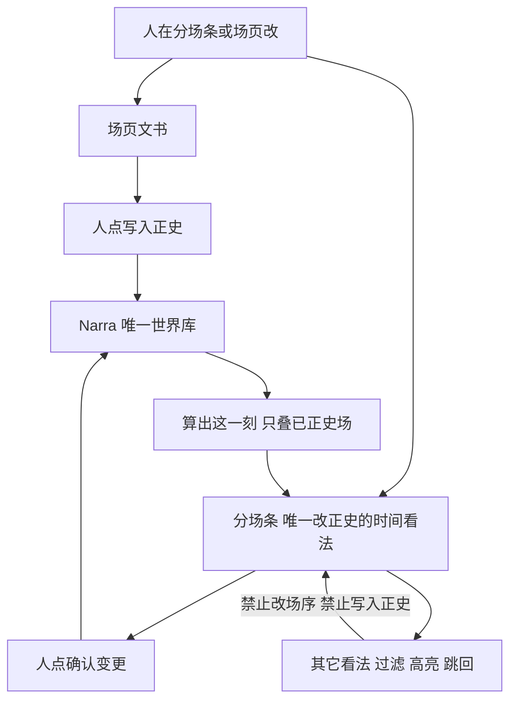
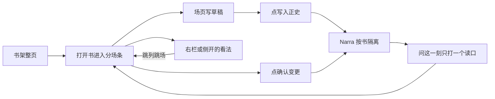

# 设定图：前端架构（一份正史 + 逻辑线看法）

**状态：待拍板。**

**与三份真源的关系：** 不推翻 [`docs/设定图-v1.md`](../设定图-v1.md)（产品面、九条、用语）、[`docs/世界引擎.md`](../世界引擎.md)（算出这一刻）、[`docs/plans/2026-08-30-设定图-Narra底座.md`](./2026-08-30-设定图-Narra底座.md)（Narra 是唯一世界库）。本文是**前端壳与逻辑线看法**的设计稿：人看见什么、点什么、哪一层只看不写。

**与 2026-09-01《界面与交互彻底重构》的关系：** 本文件在**壳、看法层级、主线/支线**上覆盖该稿对应章节。该稿里六个缺页面、窗口件、键盘、场页填空、反馈规矩、接口缺口（因果 / 伏笔操作 / 档案全键等）仍有效处，见第 9 节变更表，显式保留。冲突时：写模型与看法层级认本文；页面填空与键盘认 9/1 稿，除非本文改口。

对人说话只用 v1 用语右列：场、正史、草稿、算出这一刻、本场规定情境、写入正史、确认变更。图上能看见的字用中文。本文「看法」= 同一份正史换一种看；不用「投影」当界面词。

---

## 1. 结论与原则

**一本书只有一条正史时间。主线、支线是作者贴在场上的逻辑线，用来过滤和高亮，不另开一条钟，不算进算出这一刻。**

写和看分开：

| 算写 | 只看 |
|---|---|
| 分场条那一行（加列 / 减列 / 合并 / 换位 / 拖钟 / 删已正史 → 确认变更） | 人物线、支线进度、支线轨迹、关系图、出场表、时间轴、白板 |
| 场页（本场任务、动作 / 对白 / 内心、在场、本场变化、知情、伏笔四件事、逻辑线归属） | 全书细条（只改本页窗口起点） |
| 点「写入正史」才进历史 | 讲述序开关（只改中栏排列和导出顺序） |
| 档案页的基本设定、从故事起点就成立的关系 | 人物透镜（只改看法，禁止当算出这一刻） |



七条硬原则：

1. **Narra 是唯一世界库。** 前端只做缓存和命令。草稿缓存在应用里；正史只经「写入正史」或「确认变更」进库。禁止前端再叠一遍算出这一刻。
2. **改正史只能从分场条那一行 + 场页出手。** 关系图、出场表、时间轴、白板、支线进度里禁止改场序、禁止写入正史。
3. **逻辑线不是第二条时间轴。** 场仍只排在一条正史序列上（列序 / 故事时间）。`story_threads` 是场上的轻量归属。没贴线也能写场。空归属 = 未归线。
4. **逻辑线不算进算出这一刻。** 穿帮、知情、在场、本场规定情境仍只看正史场。逻辑线是作者看法，不是世界上为真的情状。
5. **伏笔不是一种逻辑线。** 伏笔已有埋设 / 推进 / 兑现 / 作废。逻辑线只管主线 / 支线。
6. **过滤不藏场。** 不在线上的场收成薄条或点，仍可点进写。顺序永远是故事时（或人开了「按读序排」时的读序）。
7. **主面是一维分场条，不是无限画布，不是 VS Code 式自由停靠。** 看法用右栏页签或侧开，不平级成可关掉分场条的页签。

与铜炉无关。不绑 vis-timeline。不把 tldraw / 无限画布当默认主面。

---

## 2. 信息架构 / 壳

### 2.1 默认打开看见什么

打开一本书，永远是这三块，分场条不能被看法页签关掉：

```
顶栏（书 · 窗口件 · 写下一场 · 看法 · 命令）
全书细条（列齿，只跳窗口）
┌──────────┬────────────────────────────┬─────────────────────────┐
│ 左栏设定  │ 中栏 分场条（一行一场）      │ 右栏 场页文书            │
│ 本页出场  │ 列头标尺 + 卡               │ 默认：这一场             │
│ 搜全书    │ 逻辑线色带 / 薄条           │ 可切：规定情境 / 看法    │
└──────────┴────────────────────────────┴─────────────────────────┘
```

- **中栏**：分场条。唯一按故事时改正史的时间看法。一维虚拟化列表（列窗口 + 列内场）。
- **右栏**：场页文书。点卡就地打开这一场。看法（人物线、支线进度、关系图、出场表、白板）在右栏页签或从右缘侧开，**分场条仍在**。
- **左栏**：设定。默认只列当前本页列里出现过的人物 / 地点 / 道具 / 组织 / 伏笔。不是出场表。

可简单分栏（左 / 中 / 右宽度记在本机）。**不鼓励自由停靠**：不准把分场条拖成角落小窗，不准把看法做成和平级的可关页签。关闭右栏看法页签，回到场页，中栏不动。

### 2.2 看法清单：就地 / 侧开 / 整页

| 看法 | 打开方式 | 能不能改场 / 改正史 | 关掉回到哪 |
|---|---|---|---|
| 分场条 | 默认主面，不能关 | **能**（卡 + 结构手势 + 确认变更） | — |
| 场页 | 就地（右栏）；侧开（右 60%）；整页 | **能**写草稿；写入正史必须人点 | 整页 `Esc` → 侧开 → 就地 |
| 本场规定情境 | 场页内一块；写下一场时开场面板右侧 | 只读（建议一件可忽略） | 仍在场页 |
| 逻辑线过滤 | 顶栏逻辑线名，就地作用于中栏 | 只改完整卡 / 薄条，不藏场 | 点「显示全部」 |
| 支线进度 | 右栏页签或侧开 | 只读；点格跳回分场条该列 | 关页签，分场条仍在 |
| 支线轨迹 | 从进度或逻辑线名展开 | 只读；点行跳场 | 同上 |
| 出场表 | 标尺旁「出场」飞出层；或右栏「出场」页签（全高） | 只读；点格跳列 | 飞出层关掉；改在场仍拖标记 |
| 关系图 | 右栏页签；选中人才画 | 只读；点节点开档案，点虚线边跳场 | 改边去档案或场页 |
| 时间轴 | 右栏页签或侧开 | 只读；点条跳回分场条 | **不是**第二个主面 |
| 白板 | 命令面板或右栏「灵感」；默认关 | 只涂灵感，**不算进算出这一刻**，不能写入正史 | 关层，正史不动 |
| 总表 | 右栏页签或侧开 | 只读排序 / 筛选；点行开场页 | 批量标读序若做，走确认变更 |
| 档案 | 侧开或整页 | 基本设定可填；出场与情状窗口只读 | 要改世界上发生了什么 → 分场条那一场 |
| 设定库 / 书架 / 书的设定 / 导出 | 整页（盖住分场条可以，因为不是看法） | 设定库新建元素；书的设定改主脑 / 钟起点 / 回目（不算进算出这一刻） | 回 `#/b/{书}/board` |

**铁律：** 看法只改怎么看。出场表、关系图、时间轴、支线进度、白板禁止改场序。结构改动手势只活在分场条上，且必须确认变更。

### 2.3 路由（对照现行 overlay）

单页应用，用 URL 片段记住位置。**主面路由永不离开 `board`。** 看法用查询参数，不另开一条会卸掉分场条的路径。

| 路径 | 页面 | 相对现行 `index.html` |
|---|---|---|
| `#/` | 书架 | 现行 `#shelf` overlay，盖住分场条。整页保留 |
| `#/new` | 新建书 | 现行 `#new-book` overlay。整页保留 |
| `#/b/{书}/board` | **主面**（分场条 + 右栏场页） | 现行默认屏。这是打开书的唯一落点 |
| `#/b/{书}/board?s={场}` | 主面 + 右栏打开该场 | 现行靠内存选中，刷新丢失。补进 URL |
| `#/b/{书}/board?s={场}&open=side` | 场页侧开 | 现行无 |
| `#/b/{书}/s/{场}` | 场页整页 | 现行无独立页；右栏七模式挤在一起 |
| `#/b/{书}/board?look=进度` | 主面 + 右栏支线进度 | 现行无 |
| `#/b/{书}/board?look=轨迹&line={线}` | 主面 + 右栏该线轨迹 | 现行无 |
| `#/b/{书}/board?look=出场` | 主面 + 出场飞出层或右栏全高表 | 现行 `<dialog id="flyout">`，卸掉上下文 |
| `#/b/{书}/board?look=关系&who={人}` | 主面 + 右栏关系图 | 现行 `<dialog id="graph">` |
| `#/b/{书}/board?look=时间轴` | 主面 + 右栏 / 侧开时间轴 | 现行 `#timeline` **整页 overlay，分场条被盖住**——改为侧开，中栏仍在 |
| `#/b/{书}/board?look=总表` | 主面 + 侧开总表 | 现行 `#table-view` overlay，同样改成侧开 |
| `#/b/{书}/board?look=白板` | 主面 + 灵感层 | 现行无 |
| `#/b/{书}/board?line={线}` | 主面 + 该逻辑线过滤开着 | 现行无 |
| `#/b/{书}/e/{元素}` | 档案整页 | 现行 `<dialog id="dossier">` |
| `#/b/{书}/library` | 设定库 | 现行 `#library` overlay，整页可留 |
| `#/b/{书}/settings` | 书的设定 | 现行 `<dialog id="craft-dlg">` |
| `#/b/{书}/export` | 导出 | 现行 `<dialog id="export-dlg">` |

**覆盖 9/1 稿 4.1：** 删除 `#/b/{书}/timeline`、`#/b/{书}/occupancy`、`#/b/{书}/relations`、`#/b/{书}/table` 四条**平级主面路由**。这些看法不准把分场条卸掉。时间轴、出场、关系、总表全部挂在 `board?look=` 上。

刷新必须回到同一本书、同一本页窗口、同一场、同一过滤线、同一看法。窗口起点与本页列数记在 URL 或本机（`n=` `start=`），细条跳窗口不改 `n`。

### 2.4 断点（覆盖 9/1 的「三栏都可拖成 IDE」）

| 宽度 | 布局 |
|---|---|
| ≥ 1440 | 左栏 240 + 中栏自适应 + 右栏 440。左右可拖宽，**中栏下限 480**，拖到下限停止，不准把分场条拖没 |
| 1024–1439 | 左栏收成 56 图标条，点开浮出；中栏 + 右栏 |
| < 1024 | 单栏：中栏满屏；左 / 右改成抽屉。本页列数自动钳到 ≤2。抽屉盖住中栏时，顶栏仍能 ‹ › 和「写下一场」 |

取消现行 `min-width: 1100px`。任何宽度都不许整页横向滚动把右栏切掉。

### 2.5 前端技术方向（诚实，不冻成「不引框架」）

v1 原文已写「界面：独立 Vite/React」。9/1 稿第 10 节把「不引前端框架、单文件无构建链」冻成产品决策——**本文改口**：那是现行实现的权宜，不是产品面。

| | 决定 |
|---|---|
| 产品前端 | **`apps/web`：Vite + React + TypeScript**。虚拟化分场条、场页稳定输入、URL 状态、看法页签，单文件 HTML 扛不住 |
| 现行 `apps/stripboard/index.html` | 仍是已落地交互合同与 e2e 宿主（`setting-api` 的 `include_str!`）。迁移期双轨：新壳接同一组 `/api/*`，**验收仍认 `data-testid` 与人话合同**，不认内部组件名 |
| 迁移边界 | 先迁壳与路由（书架 / 主面 / 场页 / 看法页签），再迁场页填空，最后删单文件。迁完之前，禁止在单文件里再堆第三个时间轴或停靠系统 |
| 算出这一刻 | 仍只打 `GET /world?t=`。React 里禁止再写一套叠场 |
| 白板 | 若做，独立动态加载；默认不进主包。不当宿主 |
| 不绑 | vis-timeline、铜炉、NarrativeNode 源码、tldraw 当默认主面 |

---

## 3. 分场条

### 3.1 一行场序，虚拟化

中栏是**按故事时排的一维场序列**，用本页窗口切成 1–6 列（默认 4；疏 / 中 / 密 = 2 / 4 / 6）。故事列总数仍可很多。列内可有多场（同时并列）。

虚拟化只渲染本页列 + 两侧各一列缓冲。全书细条是窗口控件，不是第二条分场条。

卡上永远能看见的（与密度无关）：场次或本场任务、正史 / 草稿形状、在场标记、**逻辑线主色带**（有则画）。密度只决定正文露出多少，见 3.4。

### 3.2 逻辑线在卡上怎么画

一场可以挂 0 到多条逻辑线。卡上最多：

- **一条主色带**：取该场 `story_threads` 里第一条主线；没有主线则取第一条支线。
- **一个「+N」**：其余线条数。悬停（或键盘焦点）才展开全部线名。
- **未归线**：不画色带，左缘一条中性灰细线（比色带更淡），表示「没贴线」，不是错误。

入线 / 出线**默认不算人填的栏**，从该书该线的场序推导：

- **入线**：该线在全书故事时上第一次出现的场。
- **出线**：该线最后一次出现的场。
- **暂停**：只有「中途暂停但仍挂着」才在场页记一笔 `role=暂停`。卡上画一道细虚切，不是出线。

入线画卡顶一条向右的短折；出线画卡底一条收住的短折。颜色跟该线。5–6 列密度下折线可收成角上一个小三角，悬停再出「从这里起 / 收到这里」。

### 3.3 过滤：淡出，不藏

点顶栏一条逻辑线名（或 URL `?line=`）：

- **在线上的场**：完整卡，色带加亮。
- **不在线上的场**：收成薄条（约 8–10 像素高）或列内一个点，**仍占故事时位置**，仍可点开场页写。
- **本页窗口里完整卡为 0、只剩薄条**：合法。顶上一条横幅：「这条线上的场不在本页这几列。‹ › 或点细条跳到最近一场。」横幅带「显示全部」。
- **清除过滤**：再点同一线名，或点「显示全部」，或清掉 `line=`。

悬停一条线名（未点选）：中栏临时加亮该线场、淡出其它场（对比度见第 4 节）。移开指针即恢复。点选才写进 URL。

过滤时顺序仍是故事时。开了「按读序排」则按读序——**讲述序与逻辑线正交**，见 3.5。

人物透镜与逻辑线可同时开：先按人滤在场高亮，再按线收薄条。两人同时不在场且不在线 → 仍是薄条，不隐藏。

### 3.4 密度 1–6 卡上显示什么

档位不是第二套状态。只看当前本页列数 N。逻辑线色带在所有 N 都在。

| N | 卡上（在 v1 已拍板之上加逻辑线） |
|---|---|
| 1–2 | 展开动作 / 对白 / 内心；价值转折；本场变化摘要；色带 + 线名全文；入线 / 出线折线 |
| 3–4（默认 4） | 价值转折 + 本场变化摘要最多 3 条；色带 + 线名（放得下）或 +N；入线 / 出线折线 |
| 5–6 | 场次、在场、黄点、色带、+N；折线收成小三角 |

顶栏 − / +、疏 / 中 / 密、‹ › **不走确认变更**，不写 Narra。

### 3.5 讲述序透镜与逻辑线正交

顶栏「按读序排」只改中栏排列和导出 Markdown 的顺序，**不算进算出这一刻**。逻辑线过滤不改列序，只改完整 / 薄条。

| 开着什么 | 中栏 |
|---|---|
| 都关 | 故事时序，完整卡 |
| 只开读序 | 按读序重排完整卡；齿上第二道色仍标「读序 ≠ 列序」 |
| 只开逻辑线 | 故事时序，线上完整、线外薄条 |
| 两个都开 | 按读序排，再套薄条 |

禁止把「按读序排」做成按逻辑线重排。禁止把逻辑线过滤做成按线把场抽出来另排一轴。

### 3.6 结构手势仍只活在分场条

中间 ➕加列、减列、合并、换位、拖列侵入、删已正史：列出全部建议，人点「确认变更」才写库。未确认可预览，Narra 不改。这些手势**不出现在**时间轴、总表、支线进度、白板上。

写下一场默认追加在现有最后一列 / 最后一场之后。没有本场任务不准点写下一场。加列不会自动变成写入正史。

---

## 4. 视觉语言（写死，避免五颜六色）

沿用已落地的夜色底 + 黄铜（`--night` / `--panel` / `--cream` / `--brass`）。逻辑线**另开一套、槽数封顶**，不跟六类元素色抢。元素色（人物 / 地点 / 道具 / 组织 / 伏笔 / 规则）仍只用于标记与左栏，不用于逻辑线。

### 4.1 色

| 用途 | 色 | 规则 |
|---|---|---|
| 主线 | **一本只用 1 个主线色** | 固定黄铜 `#C4A46A`（亮色主题改为深铜 `#8A6A2A`）。人不能给主线换色。一本默认一条主线；若人坚持建第二条主线，仍用这同一色，靠名称区分 |
| 支线 | **用户色上限 6** | 产品给 6 个互不撞主线、互不撞元素色的槽：青 `#3D8A8A`、靛 `#4A6FA5`、赭 `#B56A3C`、葡萄 `#7A5A8A`、苔 `#5A7A42`、玫灰 `#A85A6A`。第 7 条起**循环套这 6 色**，必须同时显示名称，色不能当唯一标识 |
| 未归线 | 中性灰 | `#6E6A64` 细线，不饱和，不进支线槽 |
| 过滤淡出 | 不换色相 | 完整卡保持原对比；薄条 / 淡出卡文字对比不低于 3:1，色带降到 35% 不透明度。禁止用「变灰到看不清」冒充隐藏 |

色不是唯一信道：线名、+N、入线 / 出线折线形状必须同时在。

### 4.2 标记形状

| 标记 | 位置 | 何时出现 |
|---|---|---|
| 主色带 | 卡左缘 4px 实心竖条 | 该场至少挂一条线 |
| +N | 色带旁、场次行尾 | 挂线 ≥ 2 |
| 未归线灰线 | 同位置，1px | `story_threads` 为空 |
| 入线折 | 卡顶（密列收三角） | 推导为该线首次出现 |
| 出线折 | 卡底（密列收三角） | 推导为该线末次出现 |
| 暂停虚切 | 色带中段一道缺口 | 人在场页标了「暂停」 |
| 悬停清单 | 浮层，线名 + 对本线作用 | 悬停 +N 或色带 |

禁止：每条线一条彩虹顶边、齿上再铺逻辑线色、用 emoji 当线标。

### 4.3 过滤交互

| 人怎么做 | 看见什么 |
|---|---|
| 点逻辑线名 | 过滤开着；该线完整、其它薄条；顶栏该名处于按下态；URL 带 `line=` |
| 再点同一名或「显示全部」 | 清除过滤 |
| 悬停线名（未点） | 临时加亮，不写 URL |
| 点薄条 | 打开该场场页，**过滤保持**（人能看着「不在这条线上」去改归属） |
| 键盘 | 顶栏逻辑线可 Tab；回车 = 点选；`Esc` 清除过滤（若焦点不在输入框） |

薄条仍是同一场，点进去能改、能写入正史。过滤不是只读模式。

### 4.4 一场多线

1. 色带只取一条（主线优先，否则列表第一）。
2. +N = 其余条数（3 条线则 +2）。
3. 悬停列出全部：线名、主线 / 支线、对本线作用（推进 / 旁及 / 暂停）。
4. 一场挂 4 条及以上：规则相同，浮层可滚；卡上绝不画 4 条彩虹带。
5. 过滤某条线时：这场若挂了该线，按完整卡显示，色带改成**被滤的那条**（临时），离开过滤恢复主色带。

### 4.5 细条齿色与逻辑线（不冲突）

全书细条齿色**只编码** v1 已拍板的四种：有正史 / 只有草稿 / 空场次 / 省略场。讲述序 ≠ 列序时齿上第二道色。

**逻辑线不给齿加第四种语义。** 过滤开着时，允许把「本页窗口框」以外、且该线上有场的齿画得略亮（同一齿色、提高亮度），方便跳窗口——这是窗口导航，不是新的状态色。禁止把齿改成支线调色板。

细条只改窗口起点，不改场，不写入正史，不改逻辑线归属。

---

## 5. 场页

场页仍是 9/1 稿 U15 的形状：**上半属性区、下半分轨正文区**；就地 / 侧开 / 整页内容一样。本文只补**本场涉及的逻辑线**，并收紧信息层级。逻辑线区块**不是**第二套结构编辑。

### 5.1 属性区信息层级（从上到下）

1. **身份**：场次（大字）、状态徽标（草稿 / 正史 / 省略场）、第几次写入正史（仅正史）。
2. **本场任务**（必填）+ 价值转折。
3. **落点**：地点、出场、故事时间、因为哪一场、当众 / 私下、读序。
4. **本场涉及的逻辑线**（新增，见 5.2）。
5. **本场变化 / 知情 / 伏笔**（空则折起）。
6. **正文**：按人分轨的动作 / 对白 / 内心（省略场收起）。
7. **底栏**：写入正史（会提前说话）· 模型填下一场 · ⋯（删草稿 / 删已正史）。

本场规定情境不跟属性区抢：写下一场用开场面板右侧；已有场用场页一个「本场规定情境」折页，六块顺序不得乱。读者账不算进算出这一刻。建议一件可忽略，不进模型输入。

9/1 对填空的硬要求保留：自适应高度、稳定输入节点（打字时刷新不许丢焦点）、800ms 自动存草稿、`@` 加在场、`/` 出命令、讨论按「哪一场 + 哪个格子」分开存。不许再打印 `阿福.where=渡口`。

### 5.2 本场涉及的逻辑线

| 控件 | 人做什么 | 不是什么 |
|---|---|---|
| 选线 | 多选已有逻辑线；可「新建支线」（名称 + 从 6 槽里拣色） | 不是加列、不是换场序 |
| 对本线作用 | 每条线：推进 / 旁及 / 暂停，默认推进 | 不是伏笔的埋设 / 推进 / 兑现 / 作废 |
| 未归线 | 选线为空即可。不要强制「必须入线」 | 空不是错误，不标黄 |

入线 / 出线不在场页手填。界面可只读显示：「这条线从本场起」或「这条线收到本场」——来自推导。只有「暂停」需要人勾。

改归属立刻进草稿（与其它属性一样）。**点「写入正史」之后**，后面的看法才按新归属过滤。草稿场的归属可参与过滤（人要找未写入的支线场），但算出这一刻仍看不见这场。

删一条逻辑线：若仍有场挂着，挡住，提示先从场上拿掉。与「已挂在场上的设定不能从设定里删」同一类。

### 5.3 逻辑线不是指挥写哪一场

场页不出现「下一条该写哪条支线」。支线进度看法可以显示「这条线最近一场在第 12 列」，点格跳过去——那是导航，不是任务。没有本场任务仍不准点写下一场。

---

## 6. 只读看法

全部从右栏页签或侧开进入。点「点跳」= 关看法（或收起）+ 分场条滚到该列 + 选中该场 + 右栏回到场页。禁止在看法里改场序、改钟、写入正史、确认变更。

### 6.1 支线进度（线 × 卷 / 回目）

| | |
|---|---|
| 打开 | 顶栏看法 → 进度；或 `?look=进度` |
| 看见 | 行 = 逻辑线（主线在最上，其下支线按人建序）；列 = 书页上的回目 / 章界。格 = 该线在该回里有几场（数字或色点）。未归线不占行，顶上另有「未归线 N 场」 |
| 点格 | 跳到该回第一场属于该线的列 |
| 禁止 | 拖格换回、在格里改归属、把空格「填一场」 |

回目来自书页 `craft`，不算进算出这一刻。没有回目时，列退化为「每 10 列一段」或「全书一段」，并提示「去书的设定加回目」。

### 6.2 支线轨迹列表

| | |
|---|---|
| 打开 | 进度里点线名；或 `?look=轨迹&line=` |
| 看见 | 该线全部场，**仍按故事时**（可读序开关只影响分场条，轨迹默认故事时）。每行：列号、钟的人话、场次、对本线作用、入线 / 出线 / 暂停标 |
| 点行 | 跳回分场条该场 |
| 禁止 | 拖行改序；在列表里写入正史 |

### 6.3 关系图

9/1 U35 保留，改打开方式：右栏页签，分场条仍在。选中人才画。边分三种：从故事起点就成立（实线 + 关系名）、场上变过（虚线 + 第几场起）、同场出现过（极淡细线，不当关系存）。点节点开档案；点虚线边跳场。拖边改正史 → 挡住。

与逻辑线的关系：图**不**按逻辑线滤节点。要看「这条支线上的人」，去分场条过滤后再看卡上在场——关系图回答的是「谁和谁」，不是「哪条线」。

### 6.4 出场表

飞出层（标尺旁「出场」）与全高表（右栏页签）作法必有，打开都不是默认主面。只读矩阵；点格跳列。改在场仍拖标记（或场页出场、`@`、键盘 `A`）。格上不画逻辑线色。过滤逻辑线时，出场表可选择「只亮线上的列」——列仍在，不删列。

### 6.5 时间轴

回答「这段故事时间里发生了什么、哪段是空的」，**不是**第二条改正史的轴。

- 打开：`?look=时间轴`，侧开或右栏，中栏分场条仍在（可收窄，不可卸）。
- 三级刻度（天 / 回目 / 全书）依赖书的设定里故事时间起点（9/1 接口缺口 7.2-1，保留）。
- 条的长度按该场故事时长。色：正史 / 草稿形状优先；逻辑线色带可画在条左端，规则与卡相同（一条主色 + +N）。
- 点条 = 跳回分场条。拖条改钟 → 挡住：「改故事时间去分场条拖列，确认变更后才生效。」
- 不绑 vis-timeline，不做无级缩放。

覆盖 9/1 U08：时间轴不再是 `#/b/{书}/timeline` 整页主面，也不再「能拖能排」。

### 6.6 白板

非默认灵感层。命令面板「打开白板」或 `?look=白板`。

- 可涂、可贴场的只读卡片（从正史 / 草稿拉一条引用）。
- 移动白板上的卡片 **不改** 列序、故事时间、逻辑线归属。
- 不能从白板点「写入正史」。
- 白板笔迹存在该书应用草稿旁，**不进 Narra 正史，不算进算出这一刻**。
- 默认不加载画布库。

### 6.7 总表

侧开。全部场的表格：列号、钟、场次、本场任务、状态、逻辑线（名称列表，不是彩虹）。可排序可筛选。点行开场页。**禁止在总表单元格里改场序。** 批量标读序若做，列出将改哪些场，走确认变更（读序不算进算出这一刻，但仍是结构旁路，要人点）。

---

## 7. 左栏 / 顶栏 / 命令面板

### 7.1 顶栏归位

永远三段：**书 › 分场条 › 当前列 / 场**。右侧只留主行动与看法入口。

```
设定图  ›  渡口 ▾  ›  第 3 列 · 阿禾在城里等信          写下一场    看法 ▾    ⌘K
                                                         ‹  4 列 ▾  ›
逻辑线：  主线  铜牌  城里   未归线 12   显示全部
```

| 控件 | 去哪 | 不是什么 |
|---|---|---|
| 书名 ▾ | 切书、书的设定、回书架 | 不是顶栏四个建书控件 |
| 窗口件 `‹ 4 列 ▾ ›` | 9/1 U06 **保留**：1–6 + 疏 / 中 / 密别名 | 不是中间 ➕ |
| 写下一场 | 开场面板（本场任务 + 规定情境） | 没有本场任务按钮灰 |
| 看法 ▾ | 进度 / 轨迹 / 出场 / 关系 / 时间轴 / 总表 / 白板 | **没有**「关掉分场条」 |
| 逻辑线名 | 过滤（第 4 节） | 不是写下一场的目标 |
| 只看某人 | 人物透镜，中栏 / 侧栏可滤成该人知情 | **禁止当算出这一刻**；本场任务仍全知 |
| 按读序排 | 讲述序开关 | 不重排逻辑线 |
| ⌘K | 命令面板 | 收走主题、导出、丢一段草稿、结构命令 |

结构命令（加列 / 减列 / 合并 / 换位 / 省略场）进列缝、列头右键和命令面板，不回堆顶栏。测试桩「埋伏笔」删除（9/1 已判，保留）。

### 7.2 左栏

仍是设定，不是出场表，不是逻辑线目录。

- 默认：当前本页列出现过的人物 / 地点 / 道具 / 组织 / 伏笔。
- 搜全书。点名字开档案。行上「场」= 只看有它的场（人物透镜一类，**不是**逻辑线过滤）。
- 新建写入设定。已挂在场上的不能从设定里删。
- 拖到卡上 = 这场在场。标记拖回 = 从这场拿掉。
- **逻辑线不进左栏分组。** 线的目录在顶栏那一排。避免「左栏又是一条轴」。

### 7.3 命令面板

9/1 U39 保留。命令分组：

- 跳：场、列、元素、逻辑线（跳 = 打开过滤，不是写场）。
- 写：写下一场、在本列再写一场、打开场页。
- 看：出场、关系、进度、时间轴、总表、白板。
- 结构：加列 / 减列 / 合并 / 换位（随后仍要确认变更）。
- 书：书的设定、导出、丢一段草稿。

打「铜牌」若既是伏笔又是支线名：两条结果分开标「伏笔」「逻辑线」，点错不会把伏笔当成线。

### 7.4 人物透镜（重申）

顶栏「只看某人」：中栏可淡出无此人在场的卡（**薄条，不藏**），侧栏「他知道什么」切到该人。`GET /world?t=` 仍是全知。本场任务仍按全知写。规定情境里的人物账是知情差，不是透镜写回。禁止透镜状态进入 `ScenePacket`。

---

## 8. 数据合同（前端视角）

前端不自造第二份写模型。下列字段：哪些进 Narra、哪些纯前端看法、**全部不进算出这一刻**。

### 8.1 对照现有场栏位

现行 `Beat` / `BeatDraft`（`vendor/narra/src/services/world.rs`）已有：`id` `kind` `column_id` `status` `commit_seq` `intent` `value_shift` `do_text` `say_text` `think_text` `clock_from` `clock_to` `place_id` `telling_ord` `cause_beat` `visible_to` `deltas` `knowledge_writes` `promise_ops` `presences` `tracks`。v1 附录还有 `title` `prose` `col` `t_label` `narrative_order`。

**要新增的（只写合同，本方案不改代码）：**

### 8.2 `StoryThread`（书内目录）

```
StoryThread
  id            稳定 id，不因改名而变
  name          给人看的线名（「铜牌」「城里」）
  color         支线：6 槽之一的索引 0–5；主线：忽略，界面固定黄铜
  type          主线 | 支线     // 禁止第三值「伏笔」
  description   可空，作者备忘，不算世界上为真
```

一本默认 0 条或 1 条主线。0 条主线合法（全未归线也能写）。`type` 不是算出这一刻的输入。

### 8.3 场上 `story_threads`

```
Beat.story_threads[]     // 可空
  id      → StoryThread.id
  role    推进 | 旁及 | 暂停     // 默认 推进
```

- 空数组 = 未归线。
- 入线 / 出线 **不存栏**。前端与只读接口按该书故事时（`clock_from` 升序，同列再 `commit_seq` / 草稿创建序）推导：该 `id` 首次出现 = 入线，末次 = 出线。`role=暂停` 不打断「仍挂着」，只影响卡上虚切；暂停场仍算该线的出现。
- `promise_ops` 保持独立。禁止把埋设 / 兑现写成 `StoryThread.type`。

### 8.4 哪些进 Narra，哪些纯前端

| 数据 | 存放 | 写入时机 | 进 fold / given_circumstances / constrain ? |
|---|---|---|---|
| `StoryThread` 目录 | Narra，按书隔离 | 新建 / 改名 / 改色 / 删线（无人挂才许删） | **不进** |
| `Beat.story_threads` | 挂在场上，与其它草稿栏一起 | 场页改归属 → 存草稿；「写入正史」后随场进库。改已正史的归属走 `revise` | **不进** |
| 入线 / 出线 | 不存 | 查询时推导 | **不进** |
| 过滤 `line=`、看法 `look=`、本页 `n` / `start` | URL + 本机 | 即时 | **不进** |
| 人物透镜当前人 | URL 或本机 | 即时 | **不进**（v1 / 世界引擎已禁） |
| 讲述序 `telling_ord` | 已在场上 | 场页或确认变更 | **不进** fold；读者账沿它投影 |
| 白板笔迹 | 该书应用草稿旁，不进 Narra 正史 | 自动存本地 | **不进** |
| 回目 / 主脑 | `craft`，已有 | 书的设定 | **不进** fold；进度看法拿来当列 |

物化区间缓存也不读逻辑线。改归属、改线名 **不必** `invalidate` 算出这一刻。只有改场上世界上为真的栏（在场、本场变化、知情、伏笔操作、钟、删正史）才失效物化。

### 8.5 建议新增的 API（合同，不改代码）

| 方法 | 做什么 | 不做什么 |
|---|---|---|
| `GET /api/threads` | 该书逻辑线目录 | 不返回 fold |
| `POST /api/threads` `{name, type, color?}` | 建线。`type=主线` 且已有主线 → 仍允许，色强制黄铜 | 不自动给场贴线 |
| `PATCH /api/threads/{id}` | 改名 / 改支线色槽 / 改备注 | 改 `type` 若已有场挂着，只改标签，不重算世界 |
| `DELETE /api/threads/{id}` | 无场挂着才许 | 有挂着 → 400，列出场次 |
| `PATCH /api/beats/{id}` 增 `story_threads` | 进现有 `PatchDraft` | 不单独变成写入正史 |
| `GET /api/threads/{id}/track` | 只读：该线场列表 + 推导的入 / 出 + 每场 role。可选前端用已有 `GET /api/beats` 自算 | 服务端也可算，但是看法，不是第二真源 |
| `GET /api/threads/progress` | 只读：线 × 回目格计数 | 回目来自 craft；无回目则一段 |

9/1 稿第 7 节三类接口缺口（因果、伏笔操作、档案全键、钟起点、设定关系等）**原样保留**，与逻辑线并行，不互相替代。

### 8.6 前端缓存规矩

- React Query / 等价层：`/api/state`、`/api/world`、`/api/threads` 分钥。
- 写入正史 / 确认变更成功 → 作废该书 `world` 与 `beats` 缓存，再拉。
- 只改 `story_threads` 或线目录 → 作废 `threads` 与场列表，**不作废** `world`。
- 禁止把缓存里的场数组当成「当前世界」就地改一列情状。

---

## 9. 对现行 9/1 方案的变更表

9/1 稿 = [`2026-09-01-设定图-界面与交互彻底重构.md`](./2026-09-01-设定图-界面与交互彻底重构.md)。

| 主题 | 处置 | 说明 |
|---|---|---|
| 六个缺页面（书架 / 新建书 / 书的设定 / 设定库 / 场页 / 档案页） | **保留** | 仍要整页或三种打开方式；路由见 2.3 |
| 窗口件 `‹ 4 列 ▾ ›`、疏中密 = 2/4/6、1–6 钳制 | **保留** | U06；键盘 `[` `]`、`⌥1`–`⌥6` 仍有效 |
| 键盘总表、撤销只管草稿、改在场键盘路径 | **保留** | 附录 B 仍有效；增：`Esc` 清逻辑线过滤；`L` 聚焦逻辑线排（待实现时写入 e2e） |
| URL 片段记住位置 | **改** | 主面锁定 `#/b/{书}/board`；看法改 `?look=`，删除四条平级视图路由 |
| 「一份正史，五个视图」平级 | **改** | 分场条是唯一时间主面；其余降为右栏 / 侧开看法 |
| 顶栏「视图 ▾」可切走分场条 | **删** | 改为「看法 ▾」，切看法不卸中栏 |
| IDE 式自由停靠、三栏任意拖没中栏 | **删** | 中栏下限 480；不准把分场条关到角落 |
| 时间轴 / 总表「能拖能排」 | **改** | 只读；改钟 / 改序回分场条 + 确认变更 |
| `#/b/{书}/timeline` 整页 | **改** | `board?look=时间轴`，分场条仍在 |
| 多时间轴（按线一条轴） | **删** | 逻辑线不是轴；过滤薄条 |
| 伏笔全页台账 | **仍不做** | v1 不做；侧栏最多 5 条未收 + 建议一件；逻辑线不承接伏笔 |
| 「不引前端框架」 | **删** | 产品前端 Vite + React + TS；单文件是迁移前宿主 |
| 场页填空、`@` `/`、选择器、人话行、反馈规矩 | **保留** | U15–U22、5.3–5.4 |
| 元素关系、因果、单列多场、删正史补洞 | **保留** | U12 U23 U24 U29；看法里禁止做这些的第二入口 |
| 白板 | **延后作法、合同先写** | 非默认；不算进算出这一刻 |
| 逻辑线 / 支线进度 / 轨迹 | **新增** | 9/1 无；以本文为准 |
| 现行 overlay（shelf / timeline / table / library） | **改** | 书 / 库 / 新建书可整页盖住；时间轴 / 总表改为侧开 |
| 七模式右栏 | **改** | 右栏默认场页；规定情境、这一刻、讨论改为场页内折页或临时面板，不再用模式把场页卸掉 |

分期建议（覆盖 9/1 第 8 节，不另开工程）：在 9/1 一期止血、二期接闲置字段、三期场页之后，插入 **「壳 + 逻辑线」期**：Vite 壳、`board?look=`、`StoryThread` API、色带与过滤、进度 / 轨迹。时间轴整页降级与白板放更后。若只做一半，做到场页 + 逻辑线过滤，主面已经能按线看，不必先做白板。

---

## 13. 与昨天方案的吸收清单

**审计结论（2026-09-01，对照原文，不是对照变更表）：** 本稿写成时**没有**把昨天两份界面方案逐节吸收完。第 9 节变更表只标了「保留 / 改 / 删」，没有把 U01–U40 的填空、六页三种打开方式、反馈规矩、键盘附录写成可点的闭环。8/31《界面交互全面优化》已落地的壳（点卡填框、规定情境进侧栏、确认变更失败不关窗、删完正史清当前、同列还有正史时 shift 挡住、草稿撤销、删书手打书名）本稿也没有写成「禁止回退」清单。本节把缺口补死；实现按本节 + 第 3–6、11 节，不另起 Vite 空壳。

对照文件：

- [`2026-09-01-设定图-界面与交互彻底重构.md`](./2026-09-01-设定图-界面与交互彻底重构.md) 第 4 节页面清单、第 5.4–5.5 反馈/键盘、第 6 节 U01–U40、附录 B 键盘、第 9 节验收九条
- [`2026-08-31-设定图-界面交互全面优化.md`](./2026-08-31-设定图-界面交互全面优化.md) 第 5 节主面分区（顶栏瘦身、列头标尺、齿条、场卡形状、左栏双态、右栏跟选择走）——9/1 稿取代它当界面现行稿，但这些已落地交互**不许回退**

### 13.1 条目对照

| 昨天条目（Uxx / 页面 / 流程） | 吸收了？ | 深度优化了什么 | 交互闭环（触发→反馈→空态→错误→撤销→键盘）是否写死 | 缺口 |
|---|---|---|---|---|
| U01 书架（卡：主脑 / 写到哪 / 正史场数 / 草稿场数；⋯打开/设定/导出/删） | **第 9 节写「保留」，正文没写填空** | 打开书永远落到分场条，不先选视图 | 未写 | 补：空书架一句 + 大按钮；卡上数字；⋯菜单；失败横幅「打不开这本书」；Esc 回当前书分场条 |
| U02 新建书（书名 / 主脑 / 故事时间起点） | 路由保留，填空未抄 | 建完本页 1 列，不自动写入正史 | 未写 | 补：缺书名按钮灰；建完落分场条；取消回书架 |
| U03 书的设定（主脑 / 钟起点 / 回目 / 删书入口） | 路由保留 | 主脑 / 回目仍不算进算出这一刻 | 未写 | 补：存好右下角短提示；钟格式错贴在格子下；删书走 U04 |
| U04 删书（手打书名） | 未写；**8/31 已落地，禁止回退** | — | 产品已有，本稿未写死 | 写死：错名确认灰；删完回书架；正史不能 Cmd+Z 撤回来 |
| U05 打开书第一屏 | 第 2.1 / 第 10 节空书 | 永远是分场条 + 场页，没有「请先选视图」 | 空书写了，加载/失败未写 | 补：加载「正在打开书」；失败顶部横幅，正史未动 |
| U06 窗口件 1–6、疏/中/密、`[` `]`、`⌥1`–`⌥6` | 第 9 节保留 | 不走确认变更 | 未写闭环 | 补：到 1 / 6 按钮灰；焦点不丢；细条跳窗口不改 N |
| U07 全书细条（四态齿 + 窗口框 + 点齿跳） | 第 4.5 写了与逻辑线不冲突 | 过滤时线上齿略亮，**不改齿语义** | 未写 | 补：细条只改窗口；不能写入正史；键盘点齿等价 |
| U08 时间轴 | **架构化了（整页→侧开），业务未加深** | **改进后的步骤**见 13.3：不再整页抢走分场条；拖条挡住，改钟回分场条 | 未写 | 补：点条跳场；空段人话；无钟起点时提示去书的设定 |
| U09 新建元素 | 第 9 节保留 | — | 未写 | 仍认 9/1：名字+类型；建完开档案；已出场不能从设定删 |
| U10 档案（F10 全键 + 出场只读 + 「改这一场去分场条」） | 第 9 节保留，三种打开方式未写闭环 | 出场 / 情状窗口只读 | 未写 | 补：就地/侧开/整页；点出场场次跳回分场条；不能在档案写入正史 |
| U11 设定库 | 整页可留 | — | 未写 | 补：按类看；点名开档案；回分场条 |
| U12 元素关系 | 第 6.3 改打开方式 | 关系图只读；拖边挡住 | 未写 | 仍认 9/1：设定关系挂元素下；场上变过只读 |
| U13 删设定 | 第 7.2 一句 | — | 未写 | 仍认 9/1：已挂场挡住；未挂可删，草稿可撤 |
| U14 写下一场（本场任务必填 + 规定情境） | **只复述规则，没优化步骤** | 开场面板仍在右栏「写下一场」，规定情境六块顺序不乱 | 未写 | 补闭环见 13.2；没有本场任务按钮灰，不靠 Rust 串 |
| U15 场页填空 | 第 5 节补了逻辑线区块，填空硬要求「保留」 | 加「本场涉及的逻辑线」；右栏默认场页，七模式不再卸掉场页 | 逻辑线未写闭环 | 9/1 自适应高度 / 稳定输入 / 800ms 存草稿 / `@` `/` 仍有效；本轮在现宿主先接逻辑线区块 |
| U16 改在场（拖 + `@` + `A`） | 第 7.2 保留 | — | 未写 | 禁止回退：左栏拖进拖出；`A` 加在场；规则不能当在场 |
| U17 本场变化 | 第 9 节保留 | — | 未写 | 存草稿；人话行；不准再打印 `阿福.where=渡口` |
| U18 知情（信错条件显示） | 第 9 节保留 | — | 未写 | 选信错才出现「实际是什么」；存草稿 |
| U19 伏笔四件事 | 第 5.3 / 第 12 条验收 | 伏笔不是逻辑线 | 未写 | 埋设/推进/兑现/作废仍在场页；与逻辑线「推进」分开放 |
| U20 讨论（写入此框） | 第 9 节保留 | — | 未写 | 按「哪一场+哪个格子」分开存；写入此框才进框；不自动正史 |
| U21 模型填下一场 | 第 12 风险写了不含逻辑线 | 模型输入仍只吃规定情境 | 未写 | 进行中「正在填…」；可中断；结果仍是草稿 |
| U22 写入正史必须人点 | **硬约束保留，未加深反馈** | 看法里找不到写入正史 | 未写 | 补闭环见 13.2；算出这一刻不因贴线改变 |
| U23 单列多场 | 第 3.1 一句 | — | 未写 | 仍认 9/1：取当前列不是本页最左列 |
| U24 场与场因果 | 第 9 节保留 | 看法里禁止第二入口 | 未写 | `cause_beat` 仍在场页 |
| U25 省略场 / 闪回 | 第 3.4 密度表 | — | 未写 | 省略场无动作对白内心 |
| U26 确认变更 | **只复述，未优化** | 结构手势不出现在看法里 | 未写 | 禁止回退：失败不关窗；未确认 Narra 不改 |
| U27 拖列侵入 | 第 3.6 一句 | — | 未写 | 预览可看，确认后才改钟 |
| U28 删草稿 | 未写；产品已有撤销 | — | 未写 | 缺口对话；Cmd+Z 可撤 |
| U29 删已正史补洞 | **只复述规则** | 看法里不能删正史 | 未写 | 禁止回退：影响清单 + 补洞建议；人确认才删；删完清当前 |
| U30 改已正史 / revise | 第 8.4 写了改归属走 revise | 只改贴线不作废算出这一刻缓存 | 未写 | 第几次写入正史不重编号 |
| U31 这一刻 | 第 11.5 / 11.11 | 贴线后这一刻与未贴线相同 | 未写 | 点列看这一刻；透镜不当 fold |
| U32 穿帮呈现 | 第 11.5 | 穿帮不因换线而变 | 未写 | 标黄不挡 / 挡住仍写清哪一条 |
| U33 讲述序 | 第 3.5 写了与逻辑线正交 | **改进：** 读序不按线重排；齿色不变成支线色 | 未写 | 只改中栏排列和导出顺序 |
| U34 出场飞出层 / 全高出场表 | 第 6.4 改打开方式 | 侧开 / 右栏，分场条仍在；点格跳列 | 未写 | 只读；改在场仍拖标记 |
| U35 关系图 | 第 6.3 | 右栏页签；选中人才画；点虚线跳场 | 未写 | 拖边挡住；不能写入正史 |
| U36 导出含草稿标注 | 第 9 节未单列 | — | 未写 | 默认含草稿；必须标清已正史 vs 草稿 |
| U37 丢一段草稿 | 第 7.3 进命令面板 | — | 未写 | 有粘贴框；建议写入此框；不自动正史 |
| U38 铺场建议 | 第 9 节未单列 | 不进模型填下一场 | 未写 | 落为预场仍是草稿 |
| U39 命令面板 | 第 7.3 保留并分组 | 伏笔与线名分开标 | 未写 | ⌘K；跳线 = 过滤不是写场 |
| U40 撤销只管草稿 | 第 9 节保留 | 正史不能静默撤 | 未写 | 提示写清：写入正史不能撤销 |
| 六个缺页面三种打开方式 | 第 2.2 表有就地/侧开/整页，**没有填空与切换闭环** | 场页 / 档案三种方式；书架等整页可盖住 | 未写 | 补：Esc 逐级退；光标与滚动保留 |
| overlay 平级 vs `board?look=` | **第 2.3 改了路由，产品仍是全屏 overlay** | 时间轴 / 总表 / 出场 / 关系改为侧开，中栏仍在 | 未写 | **本轮必须落地**；书架 / 新建书 / 设定库整页可留 |
| 8/31 已落地壳（七模式右栏、列头标尺、卡形状、左栏「场」） | 第 9 节「七模式改为场页折页」有回退风险 | 右栏默认场页；规定情境改折页，**不卸掉点卡填框** | 未写 | 禁止回退清单见 13.4 |
| 逻辑线 / 进度 / 轨迹 | 本稿新增 | 不是第二条轴；过滤不藏场 | 第 4、6、10、11 节有形状，缺失败/撤销 | 补 13.2 |

**三问的直接答案：**

1. **参考了昨天的方案吗？** 参考了变更意向（第 9 节），**没有**逐节对照 U01–U40、六个缺页面填空、附录 B 键盘、验收九条。8/31 已改过的壳交互也只在 SESSION 里，没写进本稿。
2. **深度优化了原有业务流吗？** 只优化了「看法层级」（时间轴不再整页抢走分场条；过滤不藏场）。写下一场、写入正史、确认变更、删已正史、丢一段草稿、导出——本稿写成时只复述旧规则，没有改进步骤。
3. **每一次交互有闭环吗？** 没有。第 10 节有空态，第 11 节有验收，**没有**按「触发→成功看见什么→谁挡住→空态/加载/焦点→可撤销范围→键盘」写死。下面 13.2 补上。

### 13.2 主路径交互闭环（写死，最佳实践不是口号）

每条都是：人看见什么变了。正史没被改的情况必须写清。看法里点一下必须能跳回分场条对应场，且不能在看法里改正史。

| 路径 | 触发 | 成功（人看见） | 失败（谁挡住、文案、正史） | 空态 / 加载 / 焦点 | 可撤销 | 键盘 |
|---|---|---|---|---|---|---|
| 打开书 | 书架点卡 / 打开书 | 中栏分场条在；右栏场页或空列文案；细条齿在；URL 含 `/board` | 「打不开这本书」顶部横幅；停在书架；正史不改 | 加载「正在打开」；空书本页 1 列 | — | 回车打开卡 |
| 写下一场 | 顶栏「写下一场」 | 开场面板：左本场任务、右规定情境六块；有任务才亮「开这一场」；新卡虚线草稿；光标在动作 | 任务空：按钮灰，按钮下「先写一行本场任务」；后端仍拦；正史不改 | 规定情境加载中占位，不闪空 | 草稿可 Cmd+Z | `N` 聚焦任务；没有任务不能提交 |
| 写入此框 | 讨论面「写入此框」 | 对应格子出现文字；短提示「已写入此框，仍是草稿」 | 没有待写入：按钮灰；正史不改 | 焦点留在该格 | 草稿可撤 | 回车点按钮 |
| 写入正史 | 场页「写入正史」 | 卡变实线「正史」；细条齿改有正史色；侧栏可点看这一刻；按钮恢复可点下一场 | 挡住：按钮下红字（哪一条穿帮）；正史不改；窗不关 | 进行中按钮「正在写入…」；焦点不丢 | **不能 Cmd+Z**；要改走改已正史 / 删已正史 | 焦点在按钮上回车 = 点；看法里无此按钮 |
| 贴逻辑线 | 场页选线 + 推进/旁及/暂停 | 草稿立刻色带变化；写入正史后看法按新归属过滤；**算出这一刻与未贴线相同** | 删仍有挂场的线：挡住，列出场次；正史不改 | 无线：灰细线，不标黄 | 草稿贴线可撤；已正史贴线走 revise，不能静默撤 | `L` 聚焦逻辑线排；场页内 Tab 选线 |
| 过滤线 | 点顶栏线名 | 线上完整卡、线外薄条仍占位可点；顶栏该名按下；URL `line=` | 本页无完整卡：横幅「这条线上的场不在本页这几列」+ 跳最近 + 显示全部；不出现空白舞台 | 无线名：不画过滤排 | 再点或 Esc（不在输入框）清过滤 | Tab 到线名、回车、Esc |
| 点薄条 | 点薄条 | 打开该场场页；**过滤保持**；能改归属再写入正史 | — | 薄条可聚焦 | — | 回车 = 点 |
| 看法不卸分场条 | 看法 ▾ 或 `?look=` | 中栏分场条仍在 DOM 且可见（可收窄）；右栏/侧开看法；URL 仍含 `/board` | — | 看法空态在侧栏，中栏仍有列 | Esc 关看法，窗口起点不变 | `T` 时间轴；Esc 关看法不关分场条 |
| 看法点跳 | 进度格 / 轨迹行 / 时间轴条 / 出场格 / 关系虚线 | 关或收看法；分场条滚到该列；选中该场；右栏回场页 | 拖格 / 拖条 / 拖边：挡住「改序改钟去分场条，确认变更后才生效」；Narra 不改 | 无回目：进度提示「去书的设定加回目」 | — | 回车 = 点跳 |
| 确认变更 | 结构手势后弹窗 | 预览可见；点确认后列序/钟变；细条跟着变 | 失败**不关窗**；红字在卡片里；正史/Narra 仍是拖前 | 建议列表空则只留取消 | 未确认等于没改；已确认不能 Cmd+Z | Esc = 取消 |
| 删已正史 | 场页「删已正史」 | 影响清单 + 补洞建议；确认后场没了；细条改空/草稿；当前选中清空 | 未选中：按钮灰，**不回退到第一场**；未确认不删 | 必须滚完影响才能确认 | 不能静默撤 | 仅场页；看法无此按钮 |
| 同列还有正史时 shift | 改已正史的价值转折等 | 同列另有正史则挡住，文案说清 | 正史不改 | — | — | — |
| 丢一段草稿 | 命令 / 按钮 | 粘贴框；建议落到哪几场/哪几格；写入此框才进框 | 空贴：提示「先贴一段」；不写死《渡口》台词 | 建议列表空态「看不出该进哪一格」 | 写入此框后可撤草稿 | — |
| 导出 | 导出页 | 默认含草稿；每场标「正史」或「草稿」 | 范围不合法贴在格子下 | 预览空 = 该范围没有场 | — | — |
| 左栏拖在场 | 拖到卡 / 拖回左栏 | 卡上多/少标记；场页出场跟着变 | 规则：就地「规则不当作在场」；地点不能拿空 | — | 草稿可撤；已正史改在场走确认变更 | `A` 加；Delete 拿掉 |
| 档案出场只读 | 点名字 | 基本设定可填；出场场次只读，点了跳回分场条该场 | 不能在档案改在场、不能写入正史 | 无出场：「还没上过场」 | 基本设定存草稿级；出场不能在这里撤 | 回车开档案 |

### 13.3 新壳下改进后的步骤（不是「改为侧开」一句话）

| 旧步骤（昨天 / 现行） | 改进后的步骤 | 为什么更好 |
|---|---|---|
| 点「时间轴」→ 整页 overlay 盖住分场条 → 看完点「回分场条」才找得回列 | 点「看法 → 时间轴」→ 右侧侧开，**中栏分场条仍在** → 点一条跳到该列该场 → Esc 收看法，窗口起点不变 | 对照「这段钟里有没有空」时，还能看见旁边的场卡；不会丢本页窗口 |
| 点「总表 / 出场 / 关系」同上，整页或 modal 卸掉上下文 | 同样侧开或右栏；点行/格/虚线跳回分场条；看法里没有写入正史、没有确认变更 | 看法只回答一个问题，改正史只有一条路 |
| 人物透镜 / 左栏「场」把不中的卡 `display:none`（现行 `renderCard`） | 不中的收成薄条，仍占故事时位置，可点进写 | 避免过滤变成第二条时间轴 |
| 顶栏「视图 ▾」可切走分场条（9/1 4.1 平级路由） | 「看法 ▾」只加 `?look=`，路径锁在 `board` | 打开书永远能写场 |
| 写下一场：静态一句 + 后端 Rust 串 | 开场面板看着规定情境写本场任务；空则按钮灰 | 人在写之前就知道这场要接什么账 |
| 进度表容易读成「该写哪条支线」 | 格上只显示场数；点格跳场；场页**不出现**「请写下一场铜牌」 | 逻辑线是看法，不是指挥 |

### 13.4 禁止回退（8/31 已落地 + 9/1 已接上的能力）

实现本轮壳 / 逻辑线时，下列行为必须仍在：

点卡填框；规定情境进侧栏（写下一场模式或场页折页）；确认变更失败不关窗；删完正史清当前选中；同列还有正史时 shift 挡住；草稿 Cmd+Z 撤销；删书须手打书名；本页 1–6；写入正史必须人点；算出这一刻只叠已正史、不读逻辑线。

附录 C 待拍板：本轮实现用文档已写默认——两条主线可（同色靠名字）；第 7 条支线循环 6 色且必须显示名称；未归线可当过滤；草稿场参与过滤。

---


## 10. 状态与空态

| 状态 | 人看见什么 | 能点什么 |
|---|---|---|
| 空书 | 分场条本页 1 列；空列文案「先建一个人物、一个地点，或写下一场」；逻辑线排空，不出现过滤 | 去设定新建；写下一场（仍要本场任务） |
| 有场、全未归线 | 卡左缘灰细线；顶栏「未归线 N」；点「未归线」= 完整卡全在（因为都未归），其它线若有则那些线的场也会是完整——未归线过滤 = 只把**已归线**的场收薄条 | 场页选线；新建支线 |
| 无线可滤 | 顶栏不画线名，只留「看法」和窗口件。不出现空的过滤横幅 | 场页「新建支线」或命令面板「新建逻辑线」 |
| 一场挂 4 条线 | 一条主色带 +「+3」；悬停列出 4 名；5–6 列同样，不画 4 条带 | 场页可拿掉线 |
| 过滤后本页完整卡为 0、仍有薄条 | 薄条在原列位置；顶栏横幅指出最近一场在第几列 | 点薄条仍进场页；‹ › / 细条跳窗口；「显示全部」 |
| 过滤后全书该线 0 场 | 不该出现（删线或从未贴）。若线还在、场已摘光：横幅「这条线上还没有场」，中栏全薄条 | 显示全部；去场页贴线 |
| 草稿挂线、正史未挂 | 过滤看得到虚线完整卡；算出这一刻仍无这场 | 写入正史之后看法与世界才一起「有这场」——世界仍不读线 |
| 人物透镜 + 逻辑线同时开 | 先按人淡出，再按线收薄；双重不中的仍是薄条 | 分别清除 |
| 侧开看法时选中场 | 中栏选中态保持；看法里高亮对应格 / 行 | 点看法里另一格 = 改选中并跳列 |

空态文案用读者语言，不打印 `thread_id`、`col0`。

---

## 11. 验收（可点选的界面合同）

主语是人看见什么、点什么发生什么。不把组件名当验收主语。下列可直接写成以后的 e2e。

1. **打开书落在分场条。** 进入 `#/b/{书}/board`。中栏有列，右栏是场页或空列提示。没有「请先选一个视图」。
2. **看法不卸分场条。** 打开出场 / 关系 / 时间轴 / 进度 / 总表之后，中栏分场条仍在 DOM 里可见（可收窄）。URL 仍含 `/board`。`Esc` 或关闭回到场页，窗口起点不变。
3. **写入正史只在场页。** 关系图、出场表、时间轴、进度、白板、总表里找不到「写入正史」。结构改动只在分场条手势后出现「确认变更」。
4. **没贴线能写场。** 新场 `story_threads` 为空。卡左缘灰细线。写入正史不因未归线被挡。
5. **贴线只改看法。** 场页把一场挂到「铜牌 / 推进」并写入正史。算出这一刻（点列看这一刻）与未贴线时相同。穿帮结果不因换线而变。
6. **过滤不藏。** 点「铜牌」后，未挂该线的场变成薄条仍可见。点薄条打开场页，过滤保持。本页若无完整卡，出现跳转横幅，不出现空白舞台。
7. **一场多线。** 一场挂主线 + 3 条支线：卡上 1 条黄铜色带 +「+3」。悬停列出四名。不出现四条并列色带。
8. **入线出线是推的。** 只给第 2、5 列贴「铜牌」。第 2 列卡顶有入线标，第 5 列卡底有出线标，中间场没有。场页没有「入线 / 出线」必填格。第 3 列标「暂停」后出现虚切，入 / 出仍在 2 与 5。
9. **讲述序正交。** 开「按读序排」再滤「铜牌」：列按读序，薄条规则仍按是否挂线。细条齿色仍是正史 / 草稿 / 空 / 省略，不变成支线色。
10. **进度只跳不写。** 进度表点「铜牌 × 第二回」跳到该回第一场铜牌列。拖格无效果。不能在格上新增场。
11. **人物透镜不当算出这一刻。** 「只看阿莲」时中栏可淡出，本场任务仍能写阿福看得见的圈套。`GET /world?t=` 响应与透镜无关。
12. **伏笔不是线。** 新建逻辑线的类型只有「主线 / 支线」。场页伏笔区仍是埋设 / 推进 / 兑现 / 作废。命令面板「铜牌」同时命中伏笔与线时，两条结果分开。
13. **空书。** 本页 1 列。逻辑线排不出现假线。写下一场仍要本场任务。
14. **刷新回原处。** 在 `#/b/渡口/board?s={场}&line={线}&look=进度&n=4&start=2` 刷新，书、场、过滤、看法、窗口一致。
15. **时间轴改钟被拒。** 侧开时间轴拖条，出现挡住说明，Narra 场钟不变。回到分场条拖列 + 确认变更，钟才变。

另跑键盘：不碰鼠标完成「点逻辑线过滤 → 点薄条进场页 → Esc 回分场条 → 显示全部」。

---

## 12. 风险

1. **逻辑线被误当成指挥写哪一场。** 进度表「这条线断了三回」很容易读成待办。界面必须把进度写成导航（点格跳场），场页不出现「请写下一场铜牌」。没有本场任务仍不准写下一场。模型填下一场的输入仍只吃本场规定情境，**不含**逻辑线列表、不含进度缺口。
2. **过滤藏场变成第二轴。** 若有人把薄条做成 `display:none`（现行人物透镜已有此坑），逻辑线就会变成第二条时间轴。验收第 6 条卡死：薄条必须占位、可点。
3. **颜色噪音。** 支线一多，卡、齿、出场格、关系节点一起上色会花。封顶：主线 1 色、支线 6 槽循环、齿色不让线、出场格不用线色、卡上只 1 带 + +N。
4. **前端缓存演化成第二份库。** 逻辑线很好缓存在 `localStorage`。禁止：线目录或场归属只存在浏览器、刷新后从库里消失；或库是旧的、界面用本地覆盖冒充已写入正史。草稿可本地，正史归属必须走场上字段 + 写入正史 / `revise`。
5. **看法页签悄悄变成可写。** 总表「就地改读序」、时间轴「拖一拖更方便」会在实现期回流。合同写死：看法里改序 / 改钟一律挡住，回分场条。
6. **白板当主面。** 灵感层一旦能排场，就会和确认变更抢权。白板卡片只读引用场 id，移动不写库。
7. **与 9/1 平级视图双源。** 若实现同时做 `#/timeline` 整页和 `board?look=`，e2e 会对不上。以本文 2.3 为准，9/1 4.1 四条平级路由作废。

---

## 附录 A · 模块关系（给人看）



依据：壳在本文第 2 节；写边界在第 1 节；读口在世界引擎 F55。

---

## 附录 B · 从单文件迁到 Vite 的边界

| 仍认现行合同 | 迁到 `apps/web` 时必须保持 |
|---|---|
| `data-testid`：`stripboard` `write-next` `confirm-change` `left-rail` 等 | 选择器不因换框架失效 |
| `/api/state` `/api/commit` `/api/world` 等 | 新壳只换 UI，不换写模型 |
| 本页 1–6、疏中密、写入正史必须人点 | 产品合同 |
| e2e `e2e/playwright/*.spec.ts` | 先双轨跑通再删 `index.html` |

| 允许丢掉的实现细节 |
|---|
| 右栏七 `mode-panel` 互斥显示 |
| `#timeline` `#table-view` 全屏 overlay |
| `$('sidebar').textContent` 单一反馈口 |
| 单文件内联 CSS / 无构建 |

`setting-api` 今日 `include_str!` 单文件。切 Vite 后改为静态目录或 dev proxy。这是工程切换，不是产品切换。未切之前，禁止把「不引框架」写回 v1。

---

## 附录 C · 仍待产品拍板

正文按上列默认写死，便于开工；若拍板相反，只改下表，不推翻第 1 节。

| 点 | 本文默认 | 另一种 |
|---|---|---|
| 一本可否两条主线 | 允许，同色靠名字 | 一本只许一条主线 |
| 第 7 条支线 | 循环 6 色 + 必须显示名称 | 挡住新建，要求先合并 |
| 未归线能不能当过滤 | 能：已归线收薄条 | 未归线只统计、不可滤 |
| 草稿场参不参与逻辑线过滤 | 参与（虚线完整卡） | 过滤只算已正史 |
| 白板是否进 v1 交付 | 作法可有、默认关、可延后实现 | v1 不做入口 |
| 总表批量标读序 | 要做则走确认变更 | v1 只在场页单场改读序 |
| Vite 切换时机 | 壳 + 逻辑线期同时开 `apps/web` | 先在单文件做完色带再迁 |

九条、Narra 唯一库、逻辑线不进算出这一刻、看法不改正史——这四条不在待拍板里。
