# 设定图：界面与交互彻底重构（v2）

范围：`apps/stripboard/index.html` 这一整个前端，以及为了让界面成立必须补的接口。不动九条、不动算出这一刻、不动「写入正史」与「确认变更」这两处必须人点的地方。

真源不变：产品面认 [`设定图-v1.md`](../设定图-v1.md)，算出这一刻认 [`世界引擎.md`](../世界引擎.md)，世界库认 [`2026-08-30-设定图-Narra底座.md`](./2026-08-30-设定图-Narra底座.md)，综合入口 [`设定图-完整方案.md`](../设定图-完整方案.md)。本文只覆盖人看得见、摸得到的那一层，以及为此要补的接口字段。

本文取代 [`2026-08-31-设定图-界面交互全面优化.md`](./2026-08-31-设定图-界面交互全面优化.md) 作为界面方案的现行稿。那一份只做了「把控件重新排一遍」，没有解决没有页面、没有时间轴、关系建不了、填空难用这四件事。

对人说话只用用语表右列。图里凡是人做的动作都写成「人点……」。

---

## 0. 先给结论

**这套界面的问题不是不好看，是它只有一个屏。** 一本书、一个元素、一场戏、一段关系，本来各自都该是一个能打开、能填、能回来的地方；现在它们全被塞进一个 380 像素宽的右栏和几个原生弹窗里。人想给书写点什么，只有顶栏一个输入框；想给人物写小传，档案页只开放了「欲望」一个格子；想说这场是因为上一场才发生的，界面里一行代码都没有。

四件缺的东西，按严重程度排：

1. **没有页面。** 创建书是顶栏一个 input 加一个按钮，建完直接扔进空白分场条。元素只能填名字和类型，F10 定义的十四个人物档案键一个也填不了。场只能在右栏里挤着改。
2. **没有时间轴。** 列头写的是 `0–50`、`120–180` 这种分钟整数，人不知道那是第几天几点。顶上那条「全书细条」是一排 14 像素的色块，没有刻度、没有列号、不能拖。
3. **关系一条都建不了。** 场与场的因果：后端 `PatchDraft` 早就收 `cause_beat`，前端搜 `cause` 是零处。元素与元素的关系：`POST /api/relations` 直接返回 400，关系图是一圈静态圆点。
4. **填空是这套界面最难用的一块。** 动作、对白、内心是三个两行高的框，挤在 380 像素里；「本场变化」和「知情」被折进一个叫「地点、读序、本场变化、知情」的折叠区，里面是十个裸输入框，元素 id 和属性名要手打，填完还只存在浏览器内存里，切走就没了。

后端并不欠多少。`PatchDraft` 已经收 `deltas`、`knowledge_writes`、`promise_ops`、`cause_beat`、`title` 五个字段，前端一个都没用；`POST /api/dossier/{id}` 接受任意档案键，前端只发 `desire`。**大部分能力是有的，界面没接。**

重构的形状借 Notion：**每一行都能打开成一页；同一份数据换几个视图看；关系是一等属性，建在一边、另一边自动出现。** 主面仍然是分场条，一行一场，按故事时排——这一条不变。

---

## 1. 现状审查

证据全部指向 `apps/stripboard/index.html`（2378 行，全内联）与 `vendor/narra/src/bin/setting_api.rs`。

### 1.1 只有一个屏：该有的页面都没有

| 本该是一页 | 现在是什么 | 位置 | 结果 |
|---|---|---|---|
| 书架（我有哪些书） | 顶栏一个 `<select>` | `index.html:409` | 看不见书的主脑、写到哪、有多少场；不能删书、不能改书名 |
| 新建书 | 一个文本框 + 一个按钮 | `index.html:410-411` | 只能填书名。建完就是一个空列，没有任何下一步指引 |
| 书的设定 | `craft-dlg` 弹窗 | `index.html:657-667` | 只有「主脑」一个文本域和「回目 / 从哪一列起」两个输入框。故事时间起点、时间刻度、导出偏好、删除书，全都没有 |
| 新建元素 | 右栏「新建」模式 | `index.html:600-612` | 只有名字和类型两个控件。F10 的人物十四键、地点八键、道具九键，一个都填不了 |
| 元素档案 | `dossier` 弹窗 | `index.html:640-649` | 弹窗里只有「欲望」一个输入框。`openDossier`（2099–2130）也只绑了 `dossier-desire` |
| 场 | 右栏「本场」模式 | `index.html:483-559` | 380 像素宽，三个两行高的文本域，其余字段折进折叠区 |
| 设定库（全书元素总览） | 左栏一个列表 | `index.html:457-467` | 默认只列本页出场过的四五项，没有全书视图、不能按类看、不能排序 |
| 出场表（全高） | 只有一个只读飞出层 | `index.html:633-639` | 表格是 `<tr><td>阿福</td><td>col0</td><td>true</td></tr>`，直接把内部 id 和 `true` 打在屏幕上（2063 行） |
| 关系图 | `graph` 弹窗 | `index.html:650-656` | 圆周布局静态 SVG，边没有名字，节点不能点，不能跳场 |
| 导出 | 页面底部一个 `<pre>` | `index.html:668, 2080-2084` | 不能选范围、不能下载、不能复制 |

**档案页只开放一个键，是本次审查里最贵的一处浪费。** 后端 `POST /api/dossier/{id}` 收 `{profile: {任意键: 值}}`，`/api/state` 返回的阿福已经带着十三个键（身份、外观、说话方式、欲望、深层需要、创伤、恐惧、秘密、底线、矛盾、小传……），全部是别的途径灌进去的——界面填不了，也看不见。

### 1.2 时间轴不存在

- **列头写的是分钟整数。** `render()` 里列头拼的是 `c.clock_from + '–' + c.clock_to`（`index.html:1156`），屏幕上就是 `0–50`、`50–60`、`60–120`。`clockLabel()`（793–798）只把差值换算成「50 分钟」「1 小时」的**时长**，从来没有「第几天几点」的概念。库里 `clock_from/to` 是分钟整数，但**没有任何地方定义过零点是什么时候**——书里没有这个字段，`BookCraft` 只有 `premise` 和 `chapters`（`craft.rs:8-14`）。
- **全书细条不是时间轴。** `.tooth` 是 14×20 像素的色块（`index.html:272`），只编码四种状态色。没有列号、没有钟、hover 只有一个 `title` 属性。
- **窗口框的位置是硬编码算的。** `renderMinimap()` 里 `const step = 16`（1268 行），窗口框左边距按 `start * 16` 算。列数一多，齿条早就超出容器（`#minimap` 是 `overflow: hidden`），框还在按 16 像素往右推,和实际齿位对不上。
- **没有分层。** 没有「按天看」「按回目看」「按全书看」的切换。已拍板的章界和回目存在 `craft.json` 里，但主面完全不显示章界在哪。
- **讲述序和故事序不能对照。** 「按读序排」（2059 行）只是把列重排一遍，看不到两条序的错位在哪；齿条上那道第二色（`.tooth.telling-diff`）宽 4 像素，等于没有。

### 1.3 单列多场：能存，但没做完

一列多场后端是支持的，《渡口》第 3 列现在就有两场。但界面上：

- **卡上不显示列内位置。** 没有「第 1 场 / 共 2 场」，也不显示这一场自己占的故事时间（`Beat` 有 `clock_from/to`，卡上不画）。
- **列内顺序不能调。** `render()` 里先渲染全部正史、再渲染全部草稿（1189–1190 行），列内既不按钟排也不能拖。
- **「在本列再写一场」取错了列。** 第 1770 行：

```javascript
const col = (state.columns && state.columns[state.window_start] && state.columns[state.window_start].id) || 'col0';
```

取的是**本页最左那一列**，不是人当前选中的列。人在第 4 列点「在本列再写一场」，场会加到第 1 列去。同样的错误在「中间➕加列」（2014 行）和「减列」（2019 行）里也有。
- **入口藏得深。** 这个按钮在顶栏「更多」菜单的「结构」组里，和「合并列」「换列位置」并排。列本身没有任何「＋」。
- **同列两场的关系没法表达。** 是同时发生，还是一前一后？界面没问，也没画。

### 1.4 场与场的关系：一行代码都没有

```
$ rg 'cause|因果' apps/stripboard/index.html
（无结果）
```

后端准备好了：`PatchDraft` 有 `cause_beat: Option<String>`（`setting_api.rs:158`），表里有 `setting_beat.cause_beat`，v1 场上栏位写着 `causes[]`。前端一处都没接。

结果是：闪回场（卡上有 `is-flash` 缩进样式，1384 行）指不出它闪回到哪一段故事时间；删已正史时的影响清单里，没有「有三场说因为这一场」这条；铺场建议落下来的预场，和它服务的那个目标场之间没有连线。

### 1.5 元素与元素的关系：只能看，不能建

- `POST /api/relations` 是 `relations_write_refuse`，固定返回 400（`setting_api.rs:1803-1807`）。
- `GET /api/relations` 返回的 `nodes`/`edges` 是**从共场推出来的**（`relations_for(&canon, &world, &person)`，1845 行），不是人写的关系。
- v1 定义了八种边：`related` `member` `holds` `contains` `at` `involves` `causes` `knows`。界面能建的只有三种：`at`（本场地点输入框）、`involves`（拖标记）、`knows`（那排六个控件的表单）。**`related`（谁和谁）、`member`（谁属于哪个组织）、`holds`（谁拿着什么）、`contains`（哪个地方在哪个地方里面）四种，界面里完全不存在。**
- 打开关系图还要绕：「关系」按钮读的是「人物透镜」下拉的值（2278 行），没选就报「先选一个人」。看关系和换视角被绑在同一个控件上。
- 画出来是 `drawGraph()`（2295–2327）：节点均分在半径 180 的圆周上，边是直线，没有标签，节点不能点、不能拖、不能跳到那一场。

### 1.6 填空是这套界面最难用的一块

**分轨正文区：**

```javascript
blk.innerHTML = '<div class="who">' + who + '</div>' +
  '<div class="field-head">…<button …>讨论</button></div>' +
  '<textarea data-track="' + idx + '" data-f="do_text" rows="2">' + (tr.do_text || '') + '</textarea>' + …
```

`index.html:1535-1541`。三个问题挤在这五行里：

1. **文本域固定 `rows="2"`**，在 380 像素栏里一行放得下十来个字，写三句话就要在小窗口里滚。
2. **用 `innerHTML` 把已有文字拼进标签中间。** 正文里出现 `<` 或 `&` 会坏；更要紧的是每次 `render()` 都重建这一整块 DOM，人正在打字时任何一次刷新都会**丢焦点、丢光标位置**。
3. **只在 `change` 事件保存**（1545 行），也就是失焦才存。没有保存中/已保存的提示，人不知道自己写的进没进去。

**本场变化：**

折在一个叫「地点、读序、本场变化、知情」的 `<details>` 里（522–558 行）。里面是四个裸输入框：

| 输入框 | 人要打什么 | 问题 |
|---|---|---|
| 实体 | `阿福` | 手打字符串。打错一个字就是个不存在的元素，界面不拦 |
| 属性 | `where` | 要人知道内部属性名叫什么。界面里从来没告诉过 |
| 新值 | `渡口` | 同样手打 |
| 变化起点钟 | `180` | 分钟整数。人得自己换算 |

加完只在 `delta-list` 显示成 `阿福.where=渡口`（2246 行）——把代码键直接打给人看。

**知情：**

同一个折叠区，六个控件（谁 / 知道什么 / 确定性 / 实际是什么 / 怎么知道的 / 谁告诉的），535–553 行。「谁」也是手打。确定性选「知道」时，「实际是什么」那个框仍然亮着；怎么知道的选「发现」时，「谁告诉的」也仍然亮着——**没有任何条件显示**。

**最伤的一条：这两块填的东西不存草稿。**

`pendingDeltas` 和 `pendingKnows` 是两个 JS 全局数组（690–691 行）。它们只在人点「写入正史」时才随请求体一起发出去（1920–1921 行）。中途刷新页面、切一场、切一本书，全丢。

而 `PatchDraft` **本来就收 `deltas` 和 `knowledge_writes`**（`setting_api.rs:155-156`）。这是纯粹的前端没接。

**讨论只能有一个待写入内容。** `pendingTalk` 是单个字符串变量（672 行）。人在「本场任务」旁点讨论，再去「对白」旁点讨论，第一次的结果就被覆盖了，「写入此框」写的是最后那一次。

**没有字段级校验。** 「没有本场任务不准写下一场」只是写在页面上的一句静态文字（594 行）；真正的拦截在后端，返回的是一行 Rust 错误字符串，被扔进 `$('sidebar').textContent`。

### 1.7 顶栏塞了测试用的假数据

这三处是发到界面上的测试桩，不是功能：

```javascript
// index.html:1775-1778 —— 「埋伏笔」按钮
$('plant-promise').onclick = async () => {
  await api('/api/promises', { method: 'POST', body: JSON.stringify({
    id: 'token_due', name: '铜牌三日', related: ['阿莲'], deadline_clock: 0 }) });
};
```

不管打开的是哪本书，点一下就往里塞一条叫「铜牌三日」、关联「阿莲」的伏笔。

```javascript
// index.html:2085-2090 —— 「丢一段草稿」
const text = $('do-text').value || '阿福打开抽屉。\n阿莲：东西呢。';
```

它读的是「动作」文本域的当前值当输入，没有粘贴框；空的时候用一段写死的《渡口》台词。

```javascript
// index.html:2007-2012 —— 「删已正史」
const id = currentCanon || (state.committed && state.committed[0] && state.committed[0].id);
```

没选中任何一场时，**回退到第一场**。同样的回退在「标读序」里也有（1780 行）。这是删数据的按钮。

另外一处：卡上「不在读者眼前」的判断读的是右栏那个全局单选框——

```javascript
// index.html:1379
const off = !!(b.visible_to && b.visible_to.length && $('vis-private') && $('vis-private').checked);
```

人在右栏点一下「私下」，中栏**所有**带 `visible_to` 的卡一起变半透明。这是把表单控件当渲染状态用。

### 1.8 反馈、错误、加载

- **所有话都往同一个 div 里写。** `$('sidebar').textContent = ...` 在全文出现约二十次：成功提示、错误原文、操作指引、「先选一个人」，互相覆盖，不分级，不消失。
- **错误直接把后端原文打出来。** `api()` 失败时 `throw new Error(await r.text())`（848 行），显示出来是 Rust 的错误串。
- **模型填场没有进行中状态。** `fill-live` 会真的调模型（后端 `call_chat`，最多 1200 token），点下去按钮不变、界面不动，人不知道它在跑还是坏了，也没法中断。
- **没有撤销。** 拖错一个标记、加错一条变化，只能反着再操作一次。
- **没有确认。** 「删设定」「删草稿场」里删草稿有缺口对话框，「删设定」直接发请求。

### 1.9 布局、键盘、无障碍

- `.app { min-width: 1100px }`（91 行），三栏宽度写死 `--lib: 220px`、`--side: 380px`（30–31 行），都不能拖。窗口窄于 1100 像素时整页横向滚动，右栏被裁掉——上面第一张 1024 宽的截图就是这样。
- **卡有 `role="button"` 和 `tabIndex`，但没有键盘处理。** 1389–1390 行设了这两个属性，1472 行只绑了 `onclick`。用键盘 Tab 到卡上按回车，什么也不会发生。
- **改在场只有拖拽一条路。** 没有键盘替代，也没有右键菜单。
- 弹窗用原生 `showModal()`，关闭之后焦点不回到触发它的按钮。
- 被过滤掉的卡不是不渲染，是渲染成一个 `display:none` 的空 div 留在 DOM 里（1370–1373 行）。

### 1.10 缺陷汇总

| 级别 | 条目 | 判据 |
|---|---|---|
| **会丢数据** | 本场变化、知情只存内存，刷新即失 | `pendingDeltas` / `pendingKnows`，`index.html:690-691` |
| **会丢数据** | 正在打字时刷新会丢焦点与光标 | `renderTracks` 用 `innerHTML` 重建，1535 行 |
| **会误删** | 「删已正史」未选中时回退到第一场 | `index.html:2008` |
| **会写错** | 「在本列再写一场」「加列」「减列」取本页最左列而非选中列 | `index.html:1770, 2014, 2019` |
| **假数据** | 「埋伏笔」写死《渡口》伏笔 | `index.html:1776` |
| **假数据** | 「丢一段草稿」默认写死台词，且没有粘贴框 | `index.html:2086` |
| **能力闲置** | `cause_beat` / `promise_ops` / `title` 后端收、前端不发 | `setting_api.rs:141-161` |
| **能力闲置** | 档案十四键后端存、界面只开放一个 | `index.html:2099-2133` |
| **缺功能** | 元素与元素的关系建不了 | `POST /api/relations` 返回 400 |
| **缺功能** | 没有时间轴，故事时间没有零点定义 | `craft.rs:8-14` 无起点字段 |
| **缺页面** | 书架、新建书、书的设定、设定库、场页、档案页 | 见 1.1 表 |
| **难用** | 变化与知情要手打元素 id 和属性名 | `index.html:527-534` |
| **难用** | 三个文本域固定两行高 | `index.html:1537-1541` |
| **难用** | 讨论只能有一份待写入内容 | `index.html:672` |
| **难用** | 全部反馈写进同一个 div | 全文约 20 处 |
| **不可达** | 卡不能用键盘操作 | `index.html:1389-1472` |
| **不可达** | 窄屏右栏被裁 | `index.html:91` |

---

## 2. 借 Notion 什么，不借什么

Notion 让人觉得顺手，靠的是四条机制。逐条对到设定图上：

| Notion 的机制 | 它解决什么 | 落到设定图 |
|---|---|---|
| **每一行都是一页** —— 数据库里一条记录，点开就是完整页面，上半是属性、下半是正文；可以侧开看、可以全屏改 | 表格里塞不下的东西有地方放 | 场是一行，点开是**场页**（属性区 + 按人分轨的正文区）；元素是一行，点开是**档案页**（F10 键表 + 小传） |
| **一份数据、多个视图** —— 同一个库能同时是表格、看板、时间轴、日历、画廊，各视图有自己的筛选和排序 | 同一批东西按不同问题看 | 一份正史，五个视图：分场条（默认）、时间轴、出场表、关系图、总表。**视图不改数据，只改怎么看** |
| **关系是一等属性** —— 在 A 里选了 B，B 那边自动出现 A；关系可以带说明 | 双向关系不用维护两遍 | 元素与元素的关系（谁和谁、谁属于哪个组织、谁拿着什么、哪儿在哪儿里面）；场与场的因果（因为哪一场 ↔ 导致了哪几场） |
| **`@` 引用与 `/` 命令** —— 打字中途 `@` 提到一个人、`/` 插入一种块，不用离开键盘 | 减少「停下来去找那个按钮」 | 正文里 `@阿福` 直接把阿福加进本场在场；`/` 出「加一条本场变化 / 加一条知情 / 埋一条伏笔 / 和模型讨论这一段」 |

**不借的：**

| 不借 | 为什么 |
|---|---|
| 块可以随便嵌套、随便拖 | 场有固定结构（本场任务、价值转折、分轨）。让人自由嵌块，等于让人把正史写成一篇散文，穿帮检查就没有挂点了 |
| 数据库公式与汇总数字 | 会变成给戏打分。九条第 8 条：情绪分不进主面 |
| 多人评论与分享 | 已拍板单用户、本机、无登录 |
| 把主面换成表格视图 | 九条第 4 条：主面按故事时排戏，默认是分场条 |
| 一改即保存到正史 | 九条第 2 条：点了「写入正史」才算历史。**Notion 的即时保存只用在草稿层** |

**一条必须说清的边界：** Notion 里改一个格子就是改了数据。设定图里改一个格子只改草稿；正史要人点「写入正史」，结构要人点「确认变更」。**借的是页面形状和引用手势，不借它的保存语义。**

---

## 3. 每个业务借业界哪一家

| 业务 | 借谁 | 借什么具体动作 | 不借什么 |
|---|---|---|---|
| 书架与创建书 | Scrivener 项目模板、Ulysses 书架 | 建书是一张有几个格子的表单（书名、一句主脑、故事时间起点），不是一个输入框；书架卡片显示写到哪 | 不做云同步、不做模板市场 |
| 时间轴 | Aeon Timeline | 钟点是一等公民；可切「按天 / 按回目 / 按全书」三级刻度；事件条按真实时长占宽 | 不做可无级缩放的真实时间轴（九条第 4 条：不绑 vis-timeline） |
| 分场条 | StudioBinder 场记板 | 一行一场；状态用形状和色编码；条块可拖重排 | 不按拍摄日、不按场地重排 |
| 单列多场 | Google 日历的同时段并列事件 | 同一段时间里几件事并排，各占自己的时间高度；空处点一下就能加 | 不做像素级拖时长（我们的时长改动要走确认变更） |
| 场页填空 | Notion 页面 + Linear 的 issue 面板 | 属性区在上、正文在下；属性用选择器不用手打；条件字段（选了「信错」才出现「实际是什么」） | 不做自由块 |
| 引用与命令 | Notion `@` / `/`，Linear 的 `Cmd+K` | 打字中途提元素、插入结构、跳转任何地方 | 不做 AI 全局对话框（讨论必须贴着字段） |
| 元素与元素的关系 | Obsidian 的双链 + Notion 的 relation | 在一边建、另一边自动出现；关系带一句说明 | 不做图谱当主面、不做自动推断关系 |
| 场与场的因果 | Linear 的 blocks / blocked-by | 一个「因为哪一场」的引用属性，反向自动列出；删的时候把反向引用列进影响 | 不做跨章因果网络图当主面 |
| 设定库 | Novelcrafter 的 Codex | 全书元素中枢；每条挂「它出现在哪几场」；别称一起搜 | 不做自动从正文抽取实体 |
| 关系图 | Obsidian 图谱视图 | 选中才画、点节点跳档案、边有名字 | 只读、只导航，不能拖边改正史 |
| 讨论 | Sudowrite 贴着选区的 AI 动作 | 讨论长在字段旁，只讨论那个字段，带那个字段的世界情况 | 不开自由聊天窗 |
| 错误与反馈 | Linear 的提示条 | 成功走右下角短提示，字段错误贴在字段下，阻塞性问题走顶部横幅 | 不用浏览器 `alert` |

---

## 4. 重构后的信息架构

### 4.1 页面清单

单页应用，用 URL 片段（`#/...`）记住位置，刷新回到原处。仍然单文件、无构建链。

| 路径 | 页面 | 说明 |
|---|---|---|
| `#/` | 书架 | 全部书的卡片；新建书；每张卡显示主脑、多少列、多少场正史、上次写到哪 |
| `#/new` | 新建书 | 分步表单：书名 → 一句主脑 → 故事时间起点与刻度 → 建 |
| `#/b/{书}/board` | **分场条（主面）** | 默认落点。三栏 + 列头标尺 + 全书细条 |
| `#/b/{书}/timeline` | 时间轴 | 三级刻度；故事序与讲述序对照 |
| `#/b/{书}/occupancy` | 出场表 | 全高矩阵，只读，点格跳列 |
| `#/b/{书}/relations` | 关系图 | 只读，只导航 |
| `#/b/{书}/table` | 总表 | 全部场的表格，可排序、可筛选、可批量标读序 |
| `#/b/{书}/library` | 设定库 | 全部元素；按类分组 / 画廊 / 表格三种看法 |
| `#/b/{书}/e/{元素}` | 档案页 | F10 全键表 + 关系 + 只读动态区 |
| `#/b/{书}/s/{场}` | 场页 | 属性区 + 分轨正文区 |
| `#/b/{书}/settings` | 书的设定 | 书名、主脑、故事时间起点与刻度、章界回目、导出偏好、删除书 |
| `#/b/{书}/export` | 导出 | 选范围 → 预览 → 复制 / 下载 |

### 4.2 三种打开方式

借 Notion 的 peek / side peek / full page。同一个场页、同一个档案页，三种打开方式内容完全一样，只是占多少地方：

| 方式 | 触发 | 占多少 | 用在什么时候 |
|---|---|---|---|
| **就地** | 在分场条上点卡 | 右栏 420 像素 | 一边看着前后场，一边改这一场 |
| **侧开** | 点卡右上角的展开标，或按 `空格` | 右侧 60% 宽，中栏还看得见 | 要写长段落，但不想丢掉分场条的上下文 |
| **整页** | 侧开面板上再点一次展开，或直接进 `#/b/{书}/s/{场}` | 满屏，居中 760 像素栏宽 | 专心写这一场 |

三种之间随时切，光标位置和滚动位置保留。`Esc` 逐级退回。

### 4.3 一份正史，五个视图

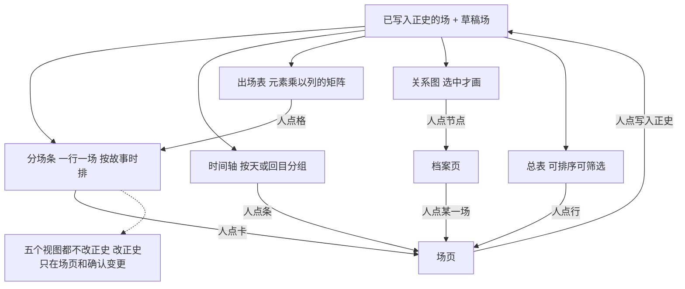

**铁律：视图只改怎么看，不改写了什么。** 出场表和关系图只读；时间轴和总表能拖能排，但一切结构改动仍然走「确认变更」；唯一能改内容的地方是场页（草稿）和「写入正史」（历史）。

### 4.4 导航

顶栏永远三段：**书 › 视图 › 当前位置**。

```
设定图  ›  渡口 ▾  ›  分场条 ▾  ›  第 3 列 · 阿禾在城里等信
```

- 点书名出书的下拉：切书、书的设定、回书架
- 点视图名出视图下拉：分场条 / 时间轴 / 出场表 / 关系图 / 总表 / 设定库
- 最后一段是当前选中的列和场，点它侧开场页

右侧只留两个：**写下一场**（主行动）和 `⌘K`（命令面板）。其余全部收进命令面板和右键菜单——顶栏不再是功能仓库。

---

## 5. 设计系统

### 5.1 布局与断点

| 断点 | 布局 |
|---|---|
| ≥ 1600 | 左栏 260 + 中栏自适应 + 右栏 420，三栏都可拖宽，宽度记在本机 |
| 1280–1599 | 同上，右栏 380 |
| 1024–1279 | 左栏收成图标条（56 像素），点开浮出 |
| < 1024 | 单栏：中栏满屏，左右栏改成从边上滑出的抽屉；本页列数自动钳到 2 |

取消 `min-width: 1100px`。任何宽度都不许出现横向滚动条把右栏切掉。

### 5.2 视觉令牌

沿用现有的暗色底 + 黄铜（`--night` / `--panel` / `--cream` / `--brass`），已经对路，不推翻。补三件：

- **层级用四级底色**，不是靠边框区分：页底 → 面板 → 卡 → 输入框，每级亮一档。现在卡和输入框几乎同色，看不出哪里能打字。
- **六类元素色统一到一处**：人物、地点、道具、组织、伏笔、规则各一色，在标记、左栏、覆盖点、关系图、时间轴上必须是同一个色。现在 `kindColor()`（787 行）和 CSS 变量 `--ent-person` 等各写了一份，改一处漏一处。
- **状态用形状，不只用色**：正史实线、草稿虚线、省略场斜纹、闪回缩进、预场带「预」字标。已经做了，保留。

字体三分工不变：序号与标题衬线、钟与元数据等宽、正文无衬线。不引在线字体。

### 5.3 组件清单（新增的）

| 组件 | 用在哪 | 关键行为 |
|---|---|---|
| **元素选择器** | 本场变化的第一格、知情的「谁」、在场的 @ 引用、关系的对方、地点 | 输入即搜（含别称）；按类分组；搜不到给「用这个词新建」；**不允许提交不存在的元素** |
| **属性选择器** | 本场变化的第二格 | 按元素类型给候选（人物：在哪 / 受伤 / 拿着 / 属于；道具：在谁手上 / 在哪 / 状态；组织：成员 / 首领），末尾一项「自定义」 |
| **故事时间选择器** | 变化起点、场的起止、伏笔期限 | 显示成「第 2 天 03:00」，输入也按这个格式；内部仍是分钟整数 |
| **场选择器** | 「因为哪一场」、闪回指向 | 按列分组，显示场次 + 列号 + 钟 |
| **自适应文本域** | 动作 / 对白 / 内心 / 小传 | 随内容长高，最小 3 行；`⌘Enter` 保存并跳下一格 |
| **属性行** | 场页与档案页的上半 | 左标签右值，值就地可改；必填项标签后带一点；条件字段按上一格的值显示或隐藏 |
| **人话行** | 已加的变化、已加的知情、已建的关系 | 「刀 从 第 1 天 20:30 起 在 阿莲 手上」，右边一个 ×。**不许再打印 `阿福.where=渡口`** |
| **命令面板** | `⌘K` | 搜场、搜元素、跳列、跑命令 |
| **短提示** | 成功与信息 | 右下角，3 秒后消失，带「撤销」时延到 8 秒 |
| **确认变更卡片** | 结构改动、删已正史 | 影响清单在上（红字）、建议在下（可选一条）、确认与取消在底；删已正史时必须滚到底才能点确认 |

### 5.4 反馈的统一规矩

| 什么事 | 用什么 | 停留多久 |
|---|---|---|
| 存好了、加上了、拿掉了 | 右下角短提示 | 3 秒 |
| 拿掉了、删了草稿、清空了字段 | 右下角短提示 + 「撤销」 | 8 秒 |
| 这个格子填得不对 | 红字贴在这个格子下面 | 改好就消失 |
| 穿帮标黄，仍可写入正史 | 卡上黄边 + 右栏黄块写清原因 | 常驻到改掉 |
| 穿帮挡写入正史 | 「写入正史」按钮变灰 + 按钮下红字写清是哪一条 | 常驻到改掉 |
| 模型在跑 | 按钮原地变成「正在填…」+ 一个中断标 | 到结束 |
| 接口坏了、书没打开 | 顶部横幅 | 到修好 |

**不再有 `$('sidebar').textContent = ...` 这种写法。** 一处 div 收所有话，是现在最难查的一类问题。

### 5.5 键盘与撤销

- 全部卡、标记、齿、行都能 Tab 到，回车等于点开，`空格` 侧开。
- 改在场必须有键盘路径：选中卡按 `A` 出元素选择器加在场；选中标记按 `Delete` 从这场拿掉。拖拽只是快捷方式，不是唯一路径。
- **撤销只管草稿层。** `⌘Z` 能撤：改字段、加减在场、加减本场变化、加减知情、加减关系。**撤不了写入正史和确认变更**——那两件事本来就是人点了才生效的，要反悔走「改已正史」或「删已正史」。这条界限写在撤销提示里：「写入正史不能撤销，要改这一场请打开它」。

---

## 6. 全部业务流程

编号 `U01`–`U38`（U = 用户流程），与完整方案的 `F` 系列不冲突：`F` 讲产品规则和演算合同，`U` 讲人在界面上怎么走。凡与 `F` 冲突以 `F` 为准。

| 组 | 编号 | 业务 |
|---|---|---|
| 书 | [U01](#u01) 书架 · [U02](#u02) 新建书 · [U03](#u03) 书的设定 · [U04](#u04) 删书 | |
| 定位 | [U05](#u05) 打开书第一屏 · [U06](#u06) 本页窗口 · [U07](#u07) 全书细条 · [U08](#u08) 时间轴视图 | |
| 设定 | [U09](#u09) 新建元素 · [U10](#u10) 档案页 · [U11](#u11) 设定库 · [U12](#u12) 元素与元素的关系 · [U13](#u13) 删设定 | |
| 写场 | [U14](#u14) 写下一场 · [U15](#u15) 场页填空 · [U16](#u16) 改在场 · [U17](#u17) 本场变化 · [U18](#u18) 知情 · [U19](#u19) 伏笔四件事 · [U20](#u20) 讨论 · [U21](#u21) 模型填下一场 · [U22](#u22) 写入正史 | |
| 列与场 | [U23](#u23) 单列多场 · [U24](#u24) 场与场的关系 · [U25](#u25) 省略场与闪回 | |
| 改结构 | [U26](#u26) 结构编辑总入口 · [U27](#u27) 拖列改故事时间 · [U28](#u28) 删草稿场 · [U29](#u29) 删已正史 · [U30](#u30) 改已正史 | |
| 看法 | [U31](#u31) 这一刻的世界 · [U32](#u32) 穿帮检查的呈现 · [U33](#u33) 讲述序透镜 · [U34](#u34) 出场表 · [U35](#u35) 关系图 | |
| 出入 | [U36](#u36) 导出 · [U37](#u37) 丢一段草稿 · [U38](#u38) 铺场建议 | |
| 系统 | [U39](#u39) 命令面板与搜索 · [U40](#u40) 撤销 | |

---

### U01 书架 <a id="u01"></a>

**这是现在完全没有的页面。** 打开应用第一眼看到的应该是「我有哪些书」，不是一个预填「渡口」的输入框。

书架是卡片网格。每张卡：书名、一句主脑、写到第几列、多少场已正史 / 多少场草稿、上次打开时间。卡上右键或点「⋯」出：打开、书的设定、导出、删书。

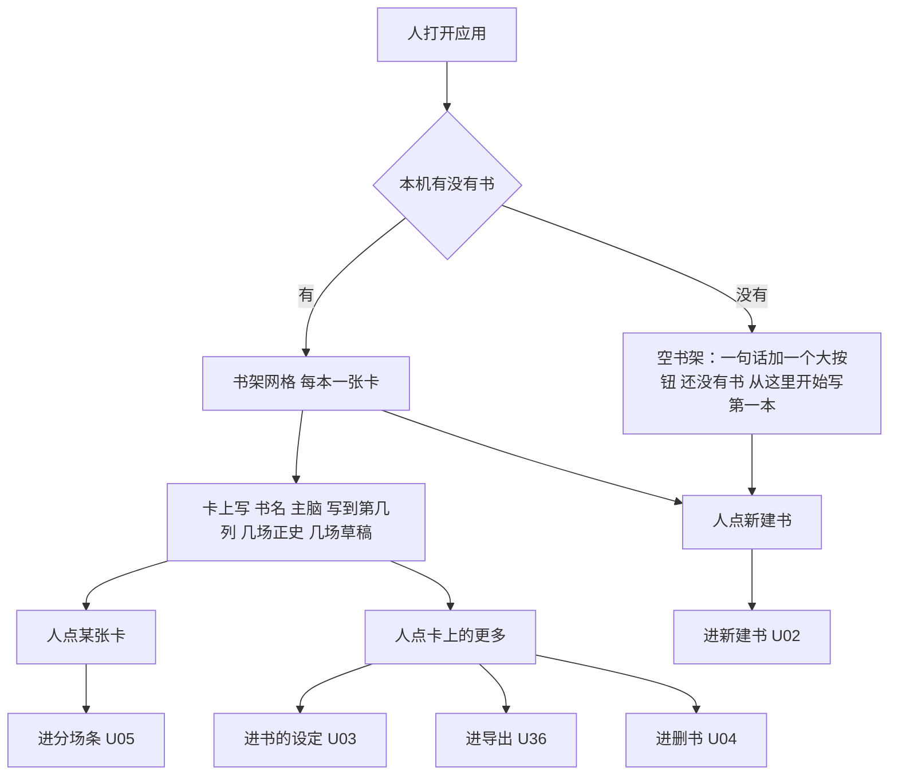

书架的数据来自 `GET /api/books`，现在只返回书名数组。要补：每本书的主脑、列数、正史场数、草稿场数、上次打开时间（见第 7 节）。

---

### U02 新建书 <a id="u02"></a>

现在是「填个书名点创建」，建完扔进一个空列，人不知道下一步。新的建书是一张有三步的表单，每一步都能跳过，但**故事时间起点必须定**——不定这个，时间轴就永远只能显示分钟整数。

| 步 | 填什么 | 必填 | 为什么在这里问 |
|---|---|---|---|
| 一 | 书名 | 是 | 一本书一份世界，名字就是它的目录 |
| 二 | 一句主脑（这本书在写什么） | 否 | 章法主脑只挂书页，不算进算出这一刻。可以后来在书的设定里补 |
| 三 | 故事时间起点：起点写成什么（如「第一天 20:00」或「七月初七 戌时」）+ 一格代表多少分钟 + 怎么显示（第几天几点 / 只显示标签 / 显示分钟数） | 起点是 | 库里的故事时间是分钟整数，界面要把它显示成人话，必须知道零点是什么时候 |

建完落到分场条，本页 1 列，中间是空书第一屏（见 U05）。

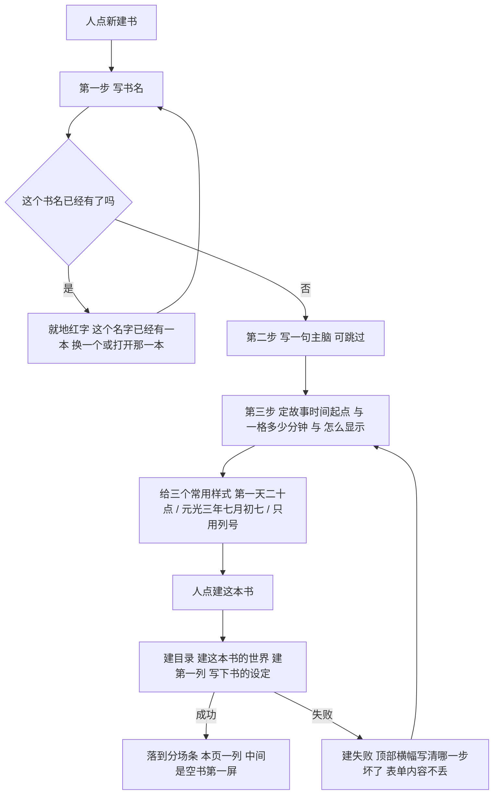

---

### U03 书的设定 <a id="u03"></a>

现在的「书页」弹窗只有主脑和回目两样。新的书的设定是一整页，四块：

| 块 | 内容 | 影响什么 |
|---|---|---|
| **这本书** | 书名（可改）、一句主脑、创建时间、写到哪 | 主脑与回目进导出，不算进算出这一刻 |
| **故事时间** | 起点标签、起点对应多少分钟、一格多少分钟、显示格式 | 全书所有钟的显示方式；只改怎么显示，不改库里的分钟整数 |
| **章界与回目** | 一行一回：回目名 + 从哪一列起。可拖排序、可删 | 分场条列头上出现章界竖线；时间轴可按回目分组；导出按章分节 |
| **导出偏好** | 默认含不含草稿、默认按故事序还是读序、要不要带本场变化摘要 | 只是导出的默认值，导出时仍可改 |

底部一条危险区：**删除这本书**（走 U04）。

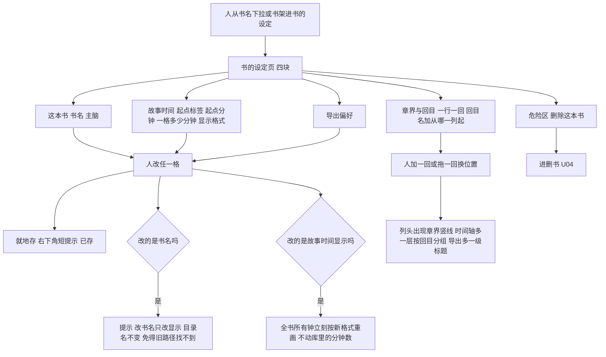

---

### U04 删书 <a id="u04"></a>

现在没有这个功能，书只能靠删目录清掉。删书是不可逆的（一本书 = 一份世界），所以走最重的确认：列清楚要删掉什么，让人手打书名。

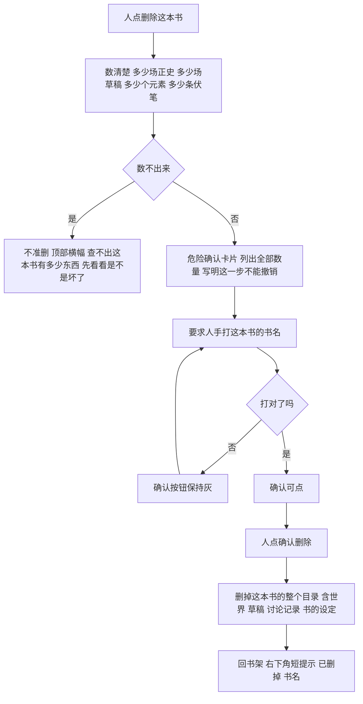

---

### U05 打开书第一屏 <a id="u05"></a>

分三种情况，现在只做了第三种的一半。

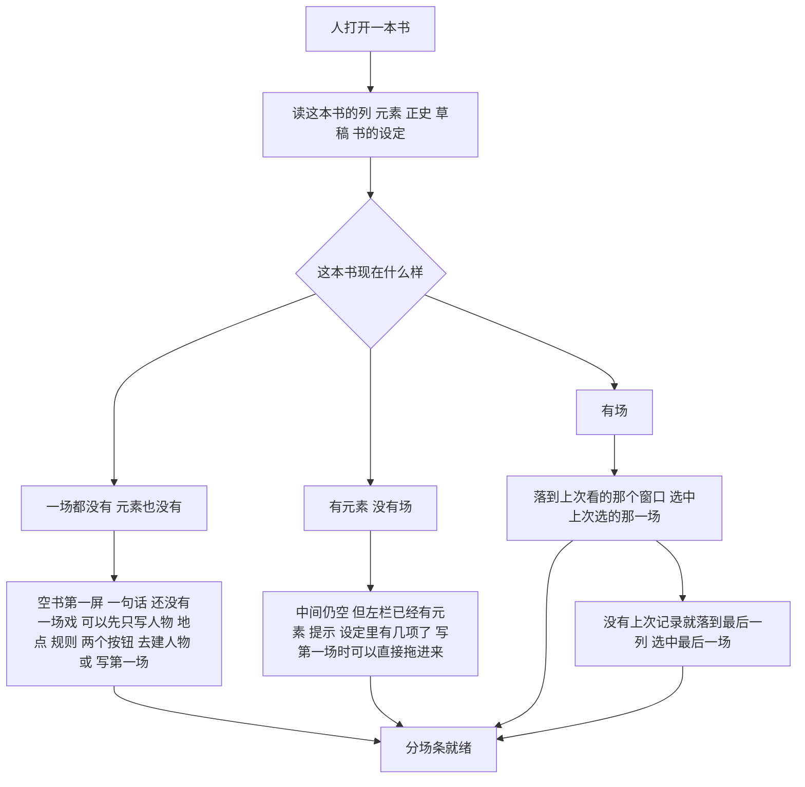

「上次看到哪」记在本机，按书分开存。现在每次打开都从第 0 列开始，写到第 40 列的人每次都要重新翻。

---

### U06 本页窗口 <a id="u06"></a>

规则不变（本页列数 1–6，疏 / 中 / 密 = 2 / 4 / 6，6 就是上限，禁止 0）。改的是控件：现在三套控件（疏中密、− ＋、‹ ›）平铺在顶栏做两件事，收成一个。

顶栏只留一个窗口件：`‹  4 列 ▾  ›`。点中间的「4 列」出下拉：1 到 6 六个选项，加「疏 / 中 / 密」三个别名标在 2 / 4 / 6 后面。键盘 `[` `]` 平移，`⌥1`–`⌥6` 直接设列数。

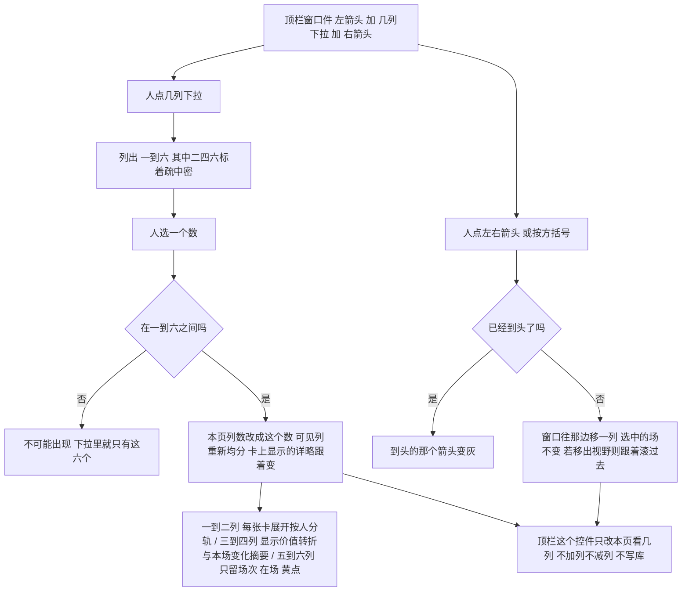

---

### U07 全书细条 <a id="u07"></a>

现在是一排 14 像素色块。重做成一条真的定位条：

- 每列一齿，齿宽随总列数自适应（列多则细，最细 3 像素，装不下就横向可拖）
- 齿色四态：有正史 / 只有草稿 / 空场次 / 省略场
- 讲述序 ≠ 列序的齿，底部加第二道色
- 本页窗口画成一个可拖的框，拖框即平移窗口
- 章界在齿条上画竖线，线上标回目名
- 悬停出小卡：列号、故事时间（人话格式）、这一列有几场、场次名

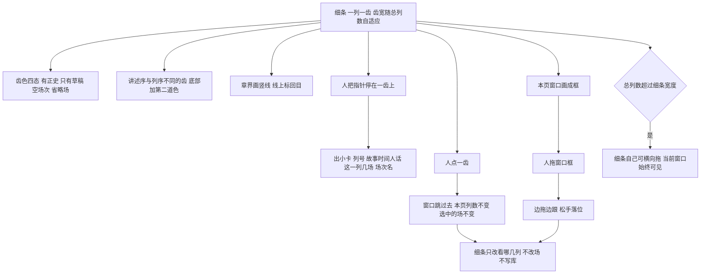

---

### U08 时间轴视图 <a id="u08"></a>

**这是现在完全没有的视图。** 分场条回答「这一场接着哪一场」，时间轴回答「这段时间里发生了什么、哪段是空的、故事序和读序差在哪」。

三级刻度，顶部切换：

| 刻度 | 一行是什么 | 用来看什么 |
|---|---|---|
| **按全书** | 一行就是全书，每列一段，宽度按故事时长 | 哪几段特别长、哪几段是空的 |
| **按回目** | 一回一行，行里是这一回的列 | 每一回的分量差多少 |
| **按天** | 一天一行（用书的设定里的一格多少分钟折算） | 一天里的戏怎么分布、夜里有没有戏 |

每一段（列）里画这一列的场，多场就上下并排。段宽按故事时长真实成比例——这是分场条给不了的信息（分场条里所有列等宽）。

底部第二条轨：**讲述序**。同一批场按读序排一遍，和上面的故事序用连线对上，错位一眼可见。

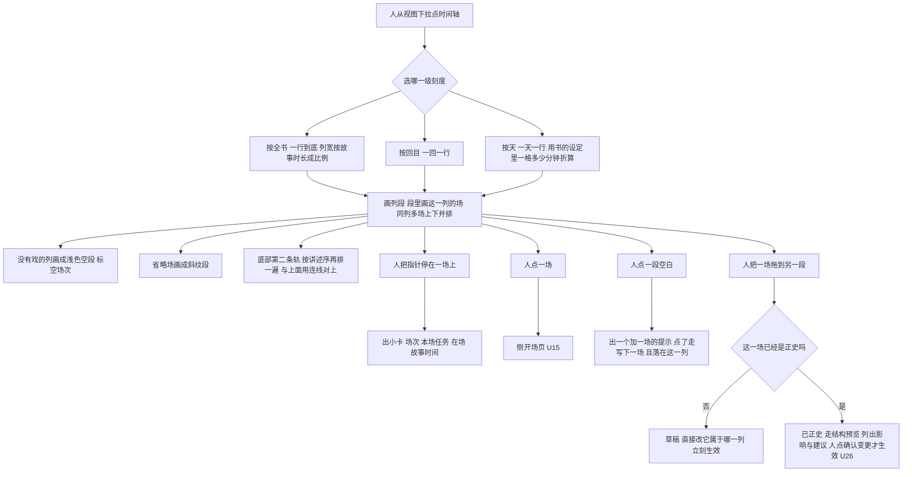

时间轴不绑 vis-timeline，不做无级缩放。它是「一份正史的另一个看法」，不是第二个主面——切回分场条，选中的场不变。

---

### U09 新建元素 <a id="u09"></a>

现在只能填名字和类型。新的建元素是「先建骨架，再补档案」两段：选类型 → 填名字和别称 → 立刻建出来，同时把档案页在旁边打开，让人接着填 F10 的键。**不强制填完**——九条第 1 条说人物地点规则没有戏也能写，那也意味着写一半也能存。

三个入口都走同一条流程：左栏「新建」、搜不到时的「用这个词新建」、任何输入框里 `@` 搜不到时的「新建并引用」。

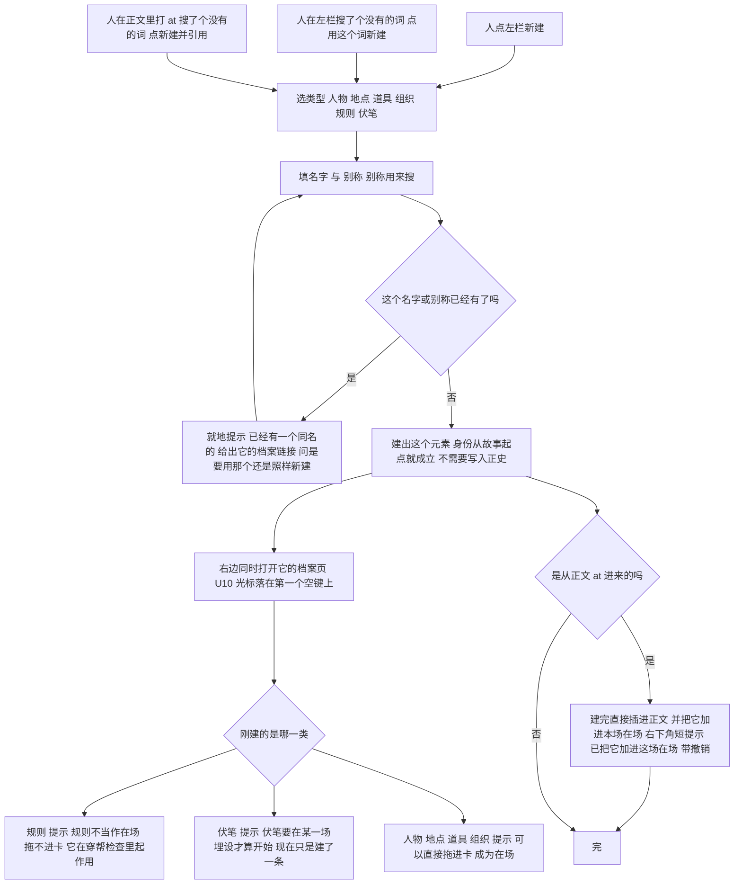

---

### U10 档案页 <a id="u10"></a>

**现在只能填「欲望」一个格子，这是最该先修的一处。** 档案页分上下两半，上半可填、下半只读——这条界限是已拍板的：基本设定进入身份层，动态情况只能从已正史的场算出来。

**上半：基本设定（可填，全部可空）**，按类给不同的键（F10 键表）：

| 类 | 键 |
|---|---|
| 人物 | 小传、别称、身份、外观、说话方式、欲望、深层需要、创伤、恐惧、秘密、底线、矛盾、关系摘要、能力与限制 |
| 地点 | 小传、别称、种类、上级地点、氛围、感官、功能、进出 |
| 道具 | 小传、别称、外形、功能、默认归属、默认所在、能力、限制、象征 |
| 组织 | 小传、别称、宗旨、明面、暗线、层级、默认首领、成员资格、对外关系摘要 |
| 规则 | 小传、别称、能力、代价、限制、例外、生效范围、**检查分级**（只记 / 标黄仍可写 / 挡写入正史） |
| 伏笔 | 欠读者什么、种类、期限、关联 |

每个键旁边有「讨论」。空的键默认折起来，点「展开全部」出全部键——不要一上来就把十四个空框砸在人脸上。

**中段：关系（新增，见 U12）** —— 分「从故事起点就成立」（可填）和「场上变过」（只读）两块。

**下半：只读，全部从已正史的场算出来**

| 区 | 显示什么 | 点了去哪 |
|---|---|---|
| 出场的场 | 按列排，每条：列号 + 故事时间 + 场次 + 是正史还是草稿 | 点一条侧开那一场 |
| 当场情状（情状窗口） | 「第 1 天 20:00 起 在渡口」「第 2 天 03:00 起 在阿莲手上」 | 点一条跳到造成这个变化的那一场 |
| 他知道什么 | 每条：知道什么 + 确定性（知道 / 信错 / 怀疑）+ 怎么知道的 + 谁告诉的 + 哪一场学会的。信错的条目额外显示「实际是什么」 | 点一条跳到学会的那一场 |
| 相关伏笔 | 每条：伏笔名 + 现在是未收还是已兑现 + 埋设 / 推进 / 兑现分别在哪一场 | 点一条跳到那一场 |

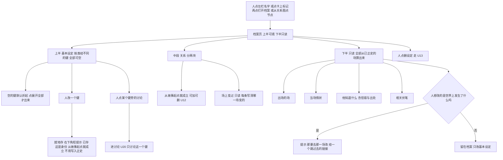

**一条要在界面上写清的话：** 档案页改的是「这个人本来是什么样」，不是「这一场他怎么了」。后者去场页。现在界面里有一句「只读。改基本设定去档案，不在这场改」，方向对，但反过来那一句（在档案页提示「改这一场去分场条」）没有。

---

### U11 设定库 <a id="u11"></a>

左栏那个只列本页出场四五项的列表，不够当全书的设定中枢。设定库是一个独立页面，三种看法：

| 看法 | 长什么样 | 用来做什么 |
|---|---|---|
| **按类分组**（默认） | 人物 / 地点 / 道具 / 组织 / 规则 / 伏笔六组，每组一排卡 | 快速找人 |
| **表格** | 一行一个元素，列可选：名字、类、别称、出场几次、第一次出场在第几列、最后一次在第几列、有几条关系 | 按出场次数排序，找出建了没用的元素 |
| **画廊** | 大卡，卡上显示小传前两行 | 通读设定 |

三种看法共用同一套筛选：按类筛、按有没有出场筛、按有没有填小传筛、搜名字与别称。

左栏保持原样（默认只列本页出场的，输入即搜全书），它是**工作时的顺手工具**；设定库是**整理时的地方**。两者不冲突。

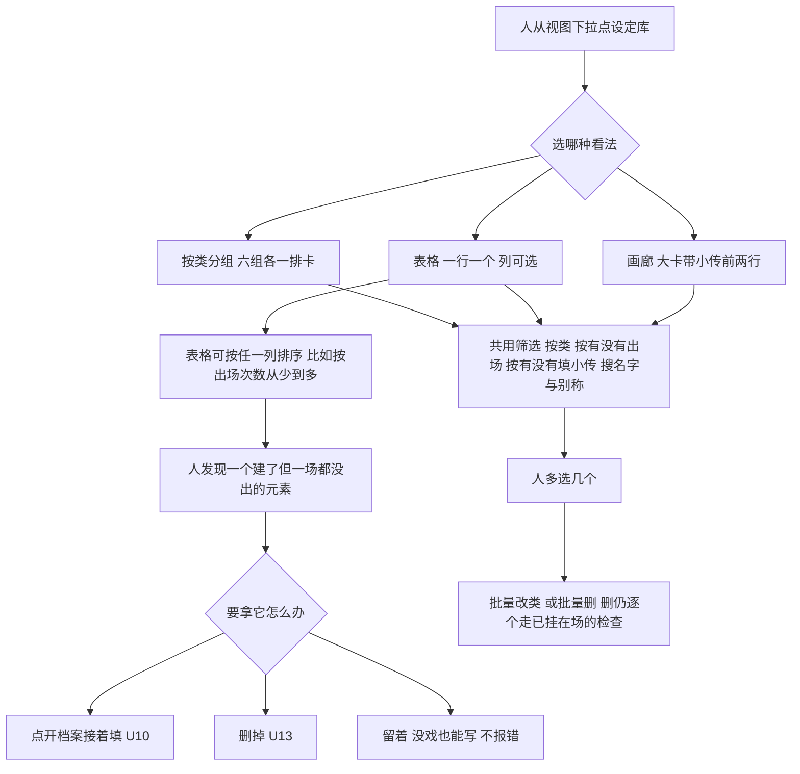

---

### U12 元素与元素的关系 <a id="u12"></a>

**这是现在完全没有的能力。** 界面上一条关系都建不了，`POST /api/relations` 直接返回 400。

设计上最关键的一条判断：**关系有两种，必须在界面上分开，否则会造出第二份真源。**

| 种类 | 例子 | 在哪写 | 什么时候成立 | 要不要写入正史 |
|---|---|---|---|---|
| **从故事起点就成立** | 阿福和阿莲是同乡；渡口帮的成员有阿福、阿禾；城门在城里之内 | 档案页的关系区 | 故事开始前就是这样 | **不要**。这是基本设定，属于身份层，和小传同一级 |
| **场上变过** | 第 5 场起阿禾入了帮；第 3 场刀从阿福手上到了阿莲手上 | 场页的「本场变化」（U17） | 从那一场的故事时间起 | **要**。点了「写入正史」才成立 |

档案页的关系区把这两块上下并排，上面可填、下面只读，每条只读的旁边写着「第 5 场起」并可点进去。人一眼就知道哪些是设定、哪些是戏里发生的。

**关系种类**（对应 v1 的边）：

| 界面说法 | 内部边 | 从哪一类到哪一类 | 反向在对方页面上显示成 |
|---|---|---|---|
| 和…有关系 | `related` | 任意 ↔ 任意 | 和…有关系（对称） |
| 属于… | `member` | 人物 → 组织 | …的成员 |
| 拿着… | `holds` | 人物 → 道具 | 在…手上 |
| 在…之内 | `contains` | 地点 → 地点 | …里面有 |

每条关系可以带一句说明（「同乡，一起长大」）。**建在一边，另一边自动出现**——这是借 Notion 的关系属性，人不用维护两遍。

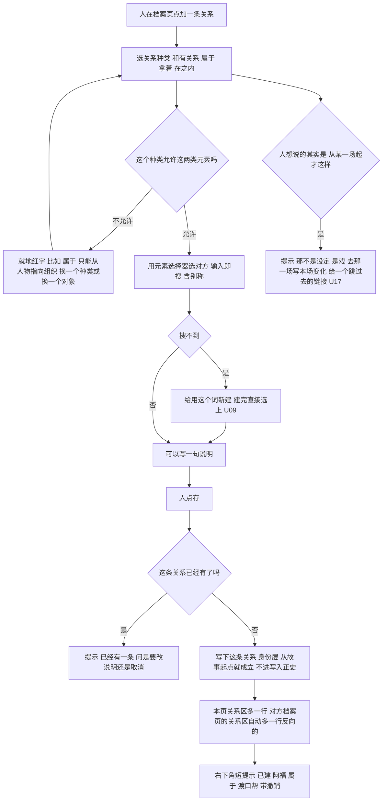

**删关系**：点关系行右边的 ×，右下角短提示带撤销，8 秒内可撤。删「从故事起点就成立」的关系不需要确认变更（它没进正史）；「场上变过」那一块是只读的，删不了——要改去那一场。

---

### U13 删设定 <a id="u13"></a>

规则不变：已经挂在场上的不能从设定里删，先从分场条拿掉。改的是**怎么告诉人**——现在删失败只返回一行后端错误串。

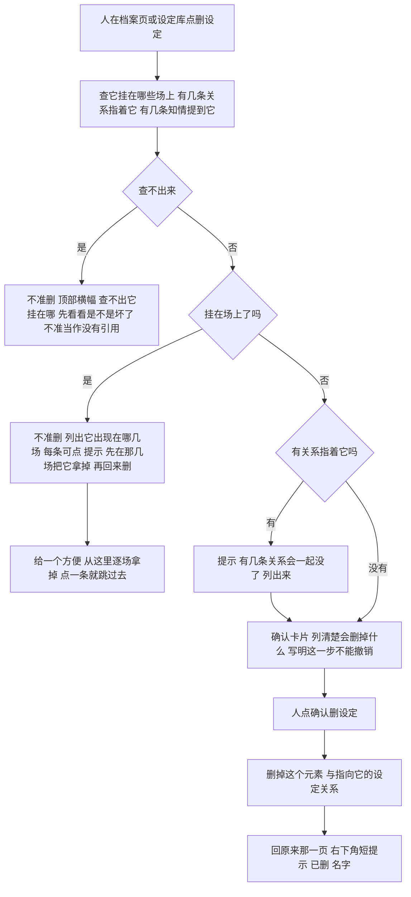

---

### U14 写下一场 <a id="u14"></a>

规则不变：默认追加在现有最后一列 / 最后一场之后；没有本场任务不准写下一场。改的是**这条不准怎么表达**——现在是页面上一句静态文字，真正的拦截在后端，报错是一行 Rust 串。

新的做法：「写下一场」按钮点下去先出一个小面板，里面第一格就是本场任务，填了才亮起「开这一场」。规定情境六块在这个面板里同时列出来——人是看着规定情境写本场任务的，不该是写完才看见。

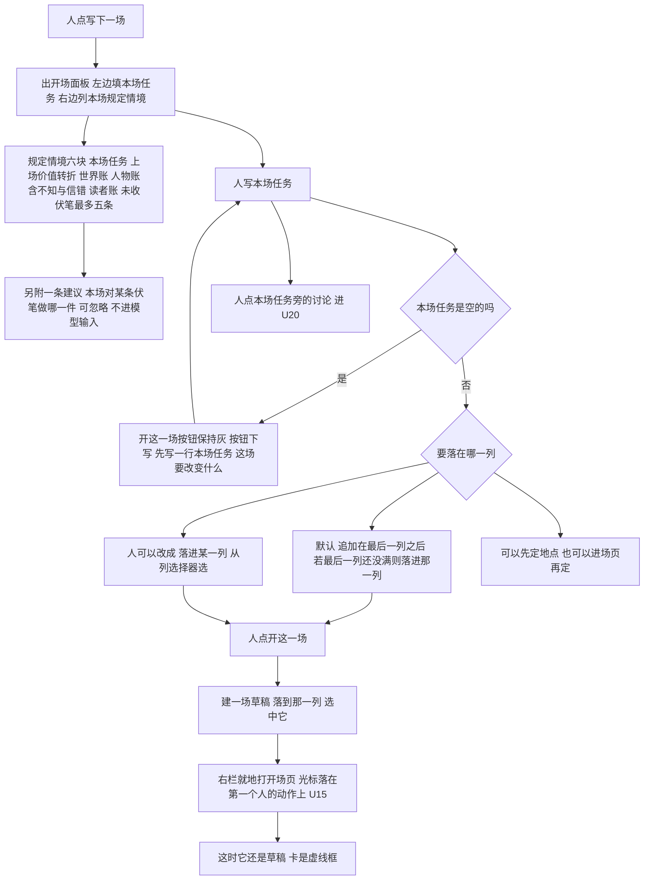

---

### U15 场页填空 <a id="u15"></a>

**这是本次重构里改动最大的一块。** 现在是 380 像素栏里三个两行高的文本域加一个折叠区；新的场页是 Notion 页面的形状：**上半属性区、下半分轨正文区**，三种打开方式（就地 / 侧开 / 整页）内容一样。

#### 属性区（上半）

左标签右值，值就地可改。必填项标签后带一点。条件字段按上一格的值决定显不显示。

| 属性 | 控件 | 必填 | 备注 |
|---|---|---|---|
| 场次 | 大字标题，直接改 | 否 | 空就显示本场任务当标题。**后端 `title` 字段一直有，前端从没写过** |
| 状态 | 只读徽标：草稿 / 正史 / 省略场 / 预场 | — | 正史的徽标旁写「第几次写入正史」 |
| 本场任务 | 单行 | **是** | 空则「写入正史」变灰 |
| 价值转折 | 单行，带「从 → 到」两格的提示 | 否 | 空则标黄不挡 |
| 地点 | 元素选择器（只列地点） | **是** | 不能清空，只能换成另一个地点 |
| 出场 | 元素多选（人物 / 道具 / 组织 / 伏笔，规则不出现在候选里） | 否 | 至少留一个人物或改成省略场 |
| 故事时间 | 故事时间选择器，起止两格 | 否 | 默认继承所在列；改窄了就是列内多场（U23） |
| 因为哪一场 | 场选择器 | 否 | 见 U24 |
| 在读者眼前 | 两选一：当众 / 私下。选私下才出现「私下谁会看见」 | 否 | **现在这个单选框是全局的，会影响所有卡；改成每一场自己的** |
| 读序 | 数字 | 否 | 空则跟列序 |
| 本场变化 | 见 U17 | 否 | |
| 知情 | 见 U18 | 否 | |
| 伏笔 | 见 U19 | 否 | |

空属性默认折起，「展开全部」出来。

#### 正文区（下半）

一个在场人物一块。块头是色点 + 名字 + 一个「只填这个人」的标。每块三格：动作 / 对白 / 内心。

四条硬要求，都是修现在的坏处：

1. **自适应高度**，最小 3 行，写多少长多少。不再是 `rows="2"`。
2. **不用 `innerHTML` 重建。** 文本域是一次创建、之后只改值的稳定节点。**人正在打字时任何刷新都不许动到这个节点**——这是现在会丢焦点的根因。
3. **每 800 毫秒存一次**，标题旁显示「保存中 / 已存」。不再只在失焦时存。
4. **`@` 与 `/`**：`@` 出元素选择器，选中后插入名字并**把这个元素加进本场在场**（右下角短提示带撤销）；`/` 出命令：加一条本场变化、加一条知情、埋一条伏笔、和模型讨论这一段、插一个省略。

每块右上有「讨论」，只讨论这一个人的这一格。**讨论结果按「哪一场 + 哪个格子」分开存，不再是一个全局变量**——现在人讨论了两个格子，第一个的结果会被覆盖。

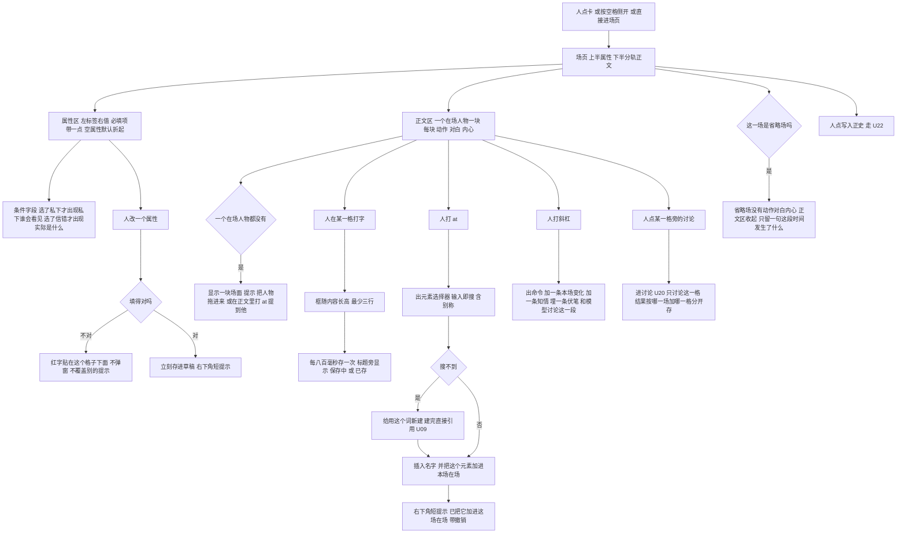

---

### U16 改在场 <a id="u16"></a>

现在只有拖拽一条路。补两条：正文里 `@` 提到，和键盘。

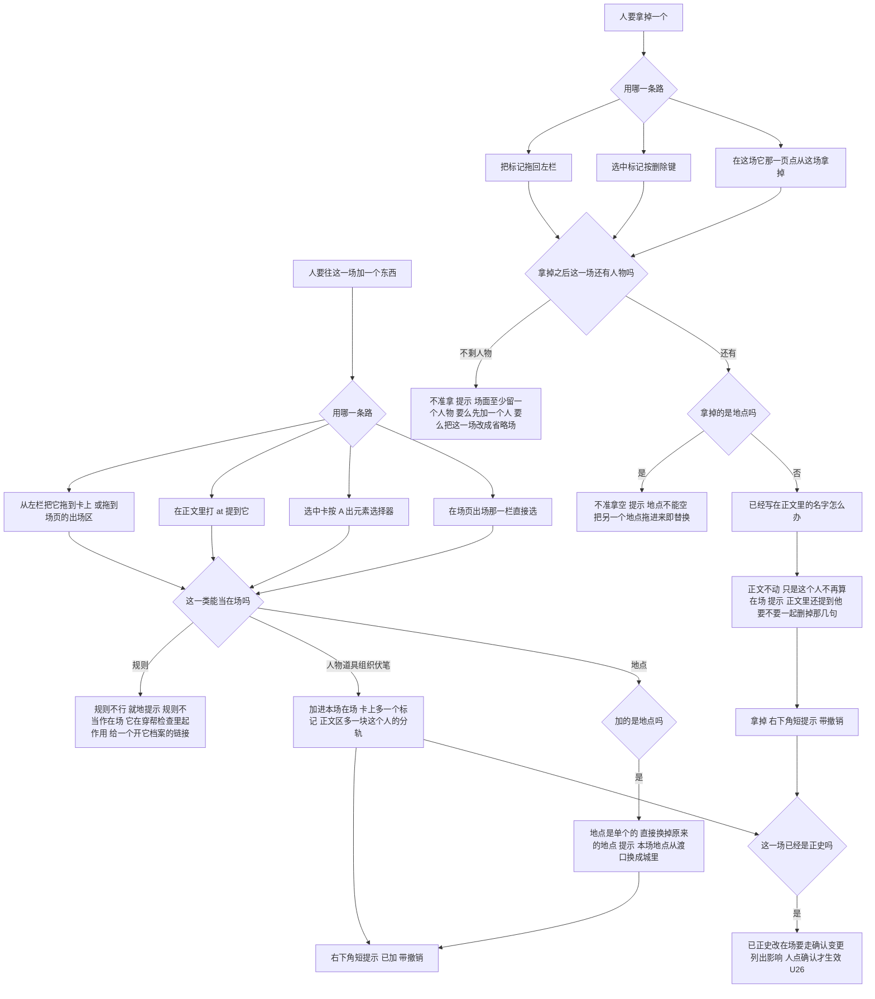

---

### U17 本场变化 <a id="u17"></a>

现在是四个裸输入框，要人手打元素 id、手打英文属性名、手打分钟整数，填完只存在浏览器内存里。全部推翻。

新的一条变化是四格，**每一格都是选，不是打**：

| 格 | 控件 | 候选从哪来 |
|---|---|---|
| 谁 / 什么 | 元素选择器 | **只列本场在场的元素**。不在场的选不了——不在场就改不了它，这是规则本身 |
| 哪一样 | 属性选择器 | 按元素类型给候选，末尾一项「自定义」 |
| 变成什么 | 跟着上一格变：属性是「在哪」就出地点选择器；「在谁手上」出人物选择器；「受伤」「状态」出自由文本 | |
| 从什么时候起 | 故事时间选择器，默认本场开始 | 改早了就是晚到的事实——指回它为真的那个故事时间，不动旧场的动作对白内心 |

属性候选：

| 元素类型 | 候选属性 |
|---|---|
| 人物 | 在哪、受伤、拿着、属于、状态、自定义 |
| 地点 | 状态、进出、自定义 |
| 道具 | 在谁手上、在哪、状态、自定义 |
| 组织 | 成员、首领、状态、自定义 |
| 伏笔 | （不走本场变化，走 U19 的伏笔四件事） |

加完显示成一行人话：**「刀 从 第 1 天 20:30 起 在 阿莲 手上」**，右边一个 ×。不再打印 `阿福.where=渡口`。

**每加一条立刻存进草稿**（`PatchDraft` 本来就收 `deltas`）。刷新不丢。

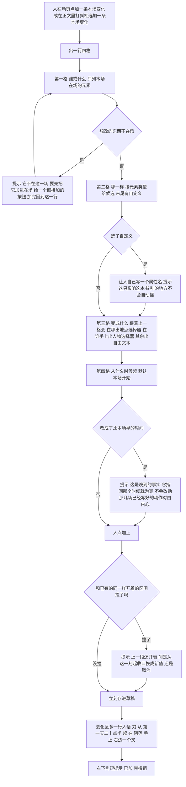

---

### U18 知情 <a id="u18"></a>

现在是六个控件平铺，「谁」要手打，条件字段不会隐藏，填完只存内存。同样推翻。

**先给一个默认。** 这一场的动作和对白写完，界面自动列出「本场默认谁会看见」（同场同地的人）。人只需要**收窄**它（谁没看见、谁其实是被告诉的），不必从零开始一个个填。这是把现在的「六个空框」倒过来做。

一条知情四段：

| 段 | 控件 | 条件 |
|---|---|---|
| 谁 | 从本场在场的人物里多选 | 可以一次给几个人 |
| 知道什么 | 两种来源：从本场变化里挑一条（「刀在阿莲手上」），或自己写 | |
| 确定性 | 知道 / 信错 / 怀疑 | **选「信错」才出现「实际是什么」** |
| 怎么知道的 | 看见 / 听见 / 被告诉 / 推断 / 发现 | **选「被告诉」才出现「谁告诉的」** |

加完人话一行：**「阿莲 信错 铜牌在城里（实际：铜牌在抽屉）· 被阿福告诉」**。

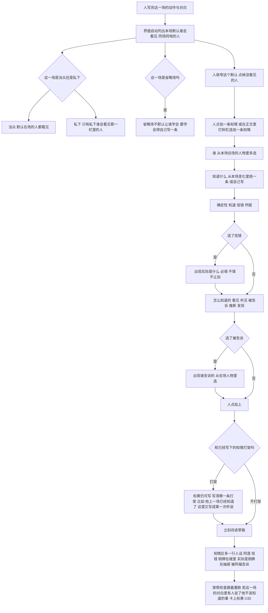

---

### U19 伏笔四件事 <a id="u19"></a>

现在顶栏「埋伏笔」是一个写死《渡口》数据的测试桩，除此之外界面上没有任何伏笔操作。后端 `PatchDraft` 收 `promise_ops`，一直闲着。

伏笔有两处入口，分工要清楚：

- **建一条伏笔**（这本书欠读者什么）：左栏新建，类型选伏笔 → 档案页填「欠读者什么 / 种类 / 期限 / 关联」。**建了不等于埋了。**
- **在某一场对它做一件事**（埋设 / 推进 / 兑现 / 作废）：场页的伏笔区。这一件事跟着这一场写入正史才成立。

侧栏「相关未收伏笔最多 5 条」保持不变，每条旁边加一个「在这一场做一件」的快捷。

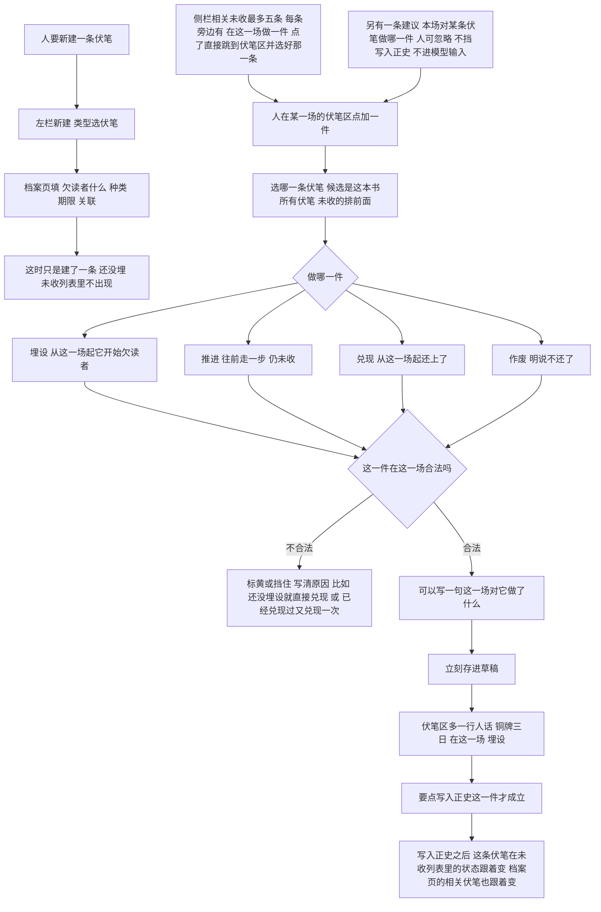

---

### U20 讨论 <a id="u20"></a>

规则不变：讨论不是历史，点「写入此框」才进那个输入框。改两处：

1. **讨论结果按「哪一场 + 哪个格子」分开存。** 现在是一个全局字符串变量，讨论第二个格子会覆盖第一个。
2. **讨论面板要说清它在讨论什么。** 面板顶上一行：「正在讨论：阿禾 · 对白 · 第 4 列 · 阿禾在城里等信」。

```mermaid
flowchart TD
  in[人点某一个格子旁边的讨论]
  need{这一场有本场任务吗}
  no[提示 先写一行本场任务 再讨论 讨论要知道这场想改变什么]
  open[右栏切到讨论 顶上写清 正在讨论哪一个人的哪一格 哪一列哪一场]
  send[把这一格现在的内容 加上本场规定情境 一起交给模型]
  wait[按钮原地变成正在想 可中断]
  fail{失败了}
  showErr[写清是超时还是被拒 原样保留人已经写的东西 给一个再试]
  back[模型给回一段话 加上几条关切]
  concern[每条关切写清它锚在哪 比如 锚在 阿莲不知道刀在抽屉]
  pickC[人点其中一条 或直接用整段回复]
  ready[写入此框亮起来]
  notice[面板上常驻一句 讨论不是历史]
  tapIt[人点写入此框]
  where[只写进刚才那一个格子 别的格子不动]
  stillDraft[这一场仍然是草稿 要另点写入正史]
  keep[讨论记录留在这一场这一格下面 换个格子讨论不会覆盖它]
  in --> need
  need -->|没有| no
  need -->|有| open --> send --> wait --> fail
  fail -->|是| showErr
  fail -->|否| back --> concern --> pickC --> ready
  open --> notice
  ready --> tapIt --> where --> stillDraft
  back --> keep
```

---

### U21 模型填下一场 <a id="u21"></a>

规则不变：模型填的仍是草稿，人改人补，点「写入正史」才算历史。改的是**过程可见**——现在点下去界面毫无反应，直到返回。

```mermaid
flowchart TD
  in[人点模型填这一场]
  need{有本场任务吗}
  no[挡住 按钮灰 按钮下写 先写一行本场任务]
  build[把本场规定情境与本场任务交给模型 结构建议与伏笔建议都不进去]
  run[按钮原地变成 正在填 旁边一个中断标]
  stop[人点中断 立刻停 已经写的东西一点不动]
  fail{失败了}
  err[写清原因 没配密钥 超时 还是被拒 给一个再试 人写的东西一点不动]
  back[模型给回按人分轨的内容 与一句价值转折]
  preview[以待确认的样子显示在各块上 底色不同 每块旁边有 用这一块 和 不要这一块]
  each[人可以逐块决定 也可以一次全用]
  none[人一块都不用 点丢掉 界面回到人自己写的样子]
  apply[人点用这一块 内容进那个格子 仍是草稿]
  stale[若这一场是按旧世界生成的 卡上挂一个小标 按旧世界生成 旁边有 按现在的世界重填]
  never[任何情况下都不自动写入正史]
  in --> need
  need -->|没有| no
  need -->|有| build --> run
  run --> stop
  run --> fail
  fail -->|是| err
  fail -->|否| back --> preview --> each
  each --> apply --> never
  each --> none
  preview --> stale
```

---

### U22 写入正史 <a id="u22"></a>

规则不变：人点了才算历史；穿帮检查挡住的写不进去，标黄的可以写。改的是**按钮要提前说话**——现在人点了才知道被挡，报错是一行后端串。

「写入正史」按钮的三种样子：

| 样子 | 什么时候 | 按钮下写什么 |
|---|---|---|
| 亮 | 该填的都填了、没有挡住的穿帮 | 「点了才进历史」 |
| 亮 + 黄点 | 有标黄的穿帮 | 「有 2 处标黄，仍然可以写入」 |
| 灰 | 缺必填，或有挡住的穿帮 | 逐条写清是哪一条，每条可点，点了跳到那个格子 |

```mermaid
flowchart TD
  edit[人在场页改东西]
  live[每次改完 穿帮检查跟着重跑 只读 不写库]
  state{现在能不能写入正史}
  miss[缺必填 本场任务空 或 地点空 或 场面一个人物都没有]
  strict[有挡住的穿帮 比如 同一个人同一时刻在两个地方]
  warn[有标黄的 比如 价值转折空 或 说了他不该知道的事]
  clean[都没有]
  gray[按钮灰 下面逐条写清是哪一条 每条可点 点了跳到那个格子]
  yellow[按钮亮 带黄点 下面写 有几处标黄 仍然可以写入]
  ok[按钮亮 下面写 点了才进历史]
  tapIt[人点写入正史]
  tx[先跑一遍穿帮检查 再一笔写进去 在场 知情 本场变化 伏笔操作一起落]
  txFail{中途失败}
  rollback[整笔回退 这一场仍然是草稿 不分配第几次写入正史 写清是哪一步坏了]
  done[这一场变成正史 卡从虚线变实线 徽标写上第几次写入正史]
  after[跟着更新 这一刻的世界 相关未收伏笔 后面场的规定情境 相关元素的档案页]
  next[右下角短提示 已写入正史 旁边一个 接着写下一场]
  noUndo[提示里写清 写入正史不能撤销 要改这一场请打开它 要删走删已正史]
  edit --> live --> state
  state --> miss --> gray
  state --> strict --> gray
  state --> warn --> yellow
  state --> clean --> ok
  yellow --> tapIt
  ok --> tapIt
  tapIt --> tx --> txFail
  txFail -->|是| rollback
  txFail -->|否| done --> after --> next --> noUndo
```

---

### U23 单列多场 <a id="u23"></a>

用户问的「单列怎么填多场、列里怎么增加场」，答案是：**一列是一段故事时间，这段时间里可以有几场同时或先后发生。** 后端一直支持，界面没做完。

补四件：

1. **列头写清有几场**：「第 3 列 · 50–60 · 2 场」
2. **卡上写清列内位置和自己的钟**：卡右上角「1 / 2」，卡头写这一场自己的故事时间（可以窄于列）
3. **列底常驻一个加场位**：一条虚线的「＋ 在这一列再写一场」，**用的是这一列**，不是本页最左那一列
4. **列内可排**：按每一场自己的起点钟排；两场起点相同就是并列，卡上标「同时」；拖卡上下即改起点钟（草稿直接改，正史走确认变更）

```mermaid
flowchart TD
  col[一列是一段故事时间]
  head[列头写清 第几列 起止钟 这一列几场]
  cards[列里每一场一张卡]
  mark[卡右上角写 第几场 共几场 卡头写这一场自己的故事时间]
  narrow{这一场的钟比列窄吗}
  showN[卡上把自己的那一段画出来 让人看出它只占这一列的一部分]
  order[列内按每一场自己的起点钟排]
  same{两场起点一样吗}
  para[标同时 两张卡并排画 表示同时发生]
  seq[起点不同就上下排 上面的先发生]
  add[列底常驻一条虚线 加号 在这一列再写一场]
  which[用的是这一列 不是本页最左那一列]
  toWrite[走写下一场 U14 但落点固定成这一列]
  clock[新场默认继承这一列的钟 人可以改窄]
  drag[人上下拖一张卡]
  isC{这一场已经是正史吗}
  dc[草稿 直接改它的起点钟 立刻生效]
  cc[已正史 走确认变更 列出影响与建议 U26]
  tip[提醒 同一列全部在场都算进算出这一刻 不是按一个人一条线走]
  col --> head
  col --> cards --> mark --> narrow -->|是| showN
  cards --> order --> same
  same -->|是| para
  same -->|否| seq
  col --> add --> which --> toWrite --> clock
  cards --> drag --> isC
  isC -->|否| dc
  isC -->|是| cc
  col --> tip
```

---

### U24 场与场的关系 <a id="u24"></a>

用户问的「场和场的关系」，现在前端一行代码都没有，后端 `cause_beat` 一直空着。

关系只做一种：**因果**（这一场因为哪一场才发生）。理由：v1 的场上栏位只定义了 `causes[]`，多做一种就是造新概念；而且已拍板不做跨章因果网络图当主面。

三处露出：

| 处 | 长什么样 |
|---|---|
| **场页属性区** | 一栏「因为哪一场」（场选择器，可空），下面一栏只读的「导致了哪几场」（反向自动列出，可点） |
| **卡上** | 有因果的卡左边缘一条竖线；指针停上去出「因为：阿福发现刀在抽屉（第 1 列）」 |
| **因果透镜** | 选中一场，按 `C` 或点卡上的因果标，把它的上游和下游用连线画在分场条上。**只画、只导航，不能拖边改** |

闪回单列一条：闪回场必须指明它闪回到哪一段故事时间（不然读者和穿帮检查都对不上）。

```mermaid
flowchart TD
  in[人在场页点 因为哪一场]
  pick[出场选择器 按列分组 每条写 列号 故事时间 场次]
  limit{选的那一场在这一场之后吗}
  no[挡住 提示 因为的那一场要在这一场之前发生 换一个]
  save[存进草稿 立刻生效]
  showA[本场属性区显示 因为 那一场 可点跳过去]
  showB[那一场的属性区 导致了哪几场 自动多一行 指回本场 不用人再填一遍]
  cardMark[两张卡左边缘各出一条竖线 指针停上去出人话]
  lens[人按 C 或点卡上的因果标]
  draw[在分场条上把这一场的上游与下游用连线画出来]
  ro[只画只导航 拖边不能改正史 要改回场页那一栏]
  off[再按一次 C 收起]
  flash{这一场是闪回吗}
  need[闪回必须指明闪回到哪一段故事时间 不指就标黄]
  del[人把因为那一栏清空]
  bothOff[两边的竖线一起没了 对方那一行也一起没了]
  delCanon{被指着的那一场要被删已正史}
  impact[它进删已正史的影响清单 写清 有几场说因为这一场 每条可点]
  in --> pick --> limit
  limit -->|是| no
  limit -->|否| save --> showA --> showB --> cardMark
  cardMark --> lens --> draw --> ro --> off
  in --> flash -->|是| need
  showA --> del --> bothOff
  showB --> delCanon -->|是| impact
```

---

### U25 省略场与闪回 <a id="u25"></a>

规则不变：省略场有时长、不演；省略场不默认让谁学会。改的是**怎么建**——现在「省略场」是「更多」菜单里的一个按钮，把当前草稿改成省略场，人不知道自己在干什么。

```mermaid
flowchart TD
  need[人发现两段戏之间有一段路要赶 或一段时间要跳过]
  how{怎么建}
  fromCol[在列底的加场位上选 加一段省略]
  fromScene[在已有的草稿上 把这一场改成省略场]
  fromSlash[在正文里打斜杠选 插一个省略]
  make[建成一段省略场 卡画成斜纹]
  ask[要填的只有两样 这段时间发生了什么 一句话 与 占多长故事时间]
  body[正文区收起 省略场没有动作对白内心]
  who[在场仍可填 谁在这段时间里挪了地方]
  know[提示 省略场不默认让谁学会 要学会得自己写一条知情]
  where[常见用法 有人从渡口到了城里 就在这里写一条本场变化 在哪 变成城里]
  commit[仍要点写入正史才算历史]
  back[要改回场面 在属性区把省略场改回场面 正文区重新展开]
  flash[闪回是另一件事 不是省略场]
  fmake[把一场标成闪回]
  fneed[闪回必须指明闪回到哪一段故事时间]
  fcard[卡向右缩进 徽标写闪回 齿条上讲述序与列序不同的那道色跟着亮]
  fread[闪回的读序通常和列序不同 在读序那一栏改]
  need --> how
  how --> fromCol --> make
  how --> fromScene --> make
  how --> fromSlash --> make
  make --> ask --> body --> who --> know --> where --> commit
  make --> back
  need --> flash --> fmake --> fneed --> fcard --> fread
```

---

### U26 结构编辑总入口 <a id="u26"></a>

规则不变：加列 / 减列 / 合并 / 换位 / 拖列侵入 / 删已正史，全部先预览、列出全部建议、人点「确认变更」才写库。改三处：

1. **入口从顶栏菜单挪到操作点旁边。** 列缝上悬停出「＋」；列头右键出「减这一列 / 和右边合并 / 和右边换位置」。顶栏「更多」不再是这些功能的唯一入口。
2. **全部用当前那一列**，不是本页最左那一列（现在的三个按钮都取错了）。
3. **确认卡片浮在操作点旁**，不是屏幕中间的原生弹窗；影响清单在上（红字），建议在下（选一条），删已正史时必须滚到底才能点确认。

```mermaid
flowchart TD
  where{人从哪里发起}
  gap[指针停在两列之间 出加号]
  headMenu[人在列头上点右键 出 减这一列 和右边合并 和右边换位置]
  dragEdge[人拖列右缘 走 U27]
  more[顶栏更多里仍保留同样几项 但用的是当前选中的列]
  op[定下要做哪一件]
  which[对哪一列做 一律是当前那一列 不是本页最左那一列]
  calc[整列重新算一遍 算出会有什么后果]
  fail{算不出来}
  block[不准往下走 顶部横幅写清哪一步坏了 不准当作没有影响]
  card[确认卡片浮在操作点旁 上面影响清单 下面全部建议]
  impacts[影响用人话红字写 比如 后面五场的故事时间会往前挪一小时]
  sugs[全部建议列出来 人选一条 不预选 也不藏起来]
  preview[界面上先按选中的建议画一遍 库一点不改]
  cancel[人点取消 预览作废 界面回到原样 库仍一点没改]
  go[人点确认变更]
  tx[一笔写进去 改钟 改列序 该作废的作废 补洞的新场建出来]
  txFail{中途失败}
  rb[整笔回退 界面回到确认前 写清是哪一步坏了]
  done[生效 跟着重算这一刻的世界与后面场的规定情境]
  toast[右下角短提示 已确认变更 提示这一步不能撤销]
  where --> gap --> op
  where --> headMenu --> op
  where --> dragEdge --> op
  where --> more --> op
  op --> which --> calc --> fail
  fail -->|是| block
  fail -->|否| card --> impacts --> sugs --> preview
  preview --> cancel
  preview --> go --> tx --> txFail
  txFail -->|是| rb
  txFail -->|否| done --> toast
```

---

### U27 拖列改故事时间 <a id="u27"></a>

规则不变：列宽不变、时长变；允许侵入邻列；不允许两列钟重叠当正式状态；空出与侵入是同一个对话框，侵入是空出的超集。改的是**拖的时候看得见什么**。

```mermaid
flowchart TD
  grab[人按住列右缘的手柄]
  live[边拖边显示 这一列现在是多长 和 拖到哪个钟点 用人话不是分钟数]
  dir{拖出去还是拖进来}
  out[往右拖 这一列变长 侵入右边那一列]
  in2[往左拖 这一列变短 空出一段故事时间]
  ghost[被影响的那一列同时画出它会变成什么样]
  drop[人松手]
  calc[整列重新算 列出全部建议]
  outSug[侵入的建议 被侵入那一列压缩 或整体往后挪 或两列合并 或重叠那段变空场次 或变省略场 或变成同列多场]
  inSug[空出的建议 后面所有列往前挪 或这一段并进下一列 或插一列空场次]
  same[两种走同一个卡片 侵入是空出的超集 不做两套]
  pickS[人选一条]
  prev[界面先按这条画一遍 库不改]
  ok[人点确认变更]
  never[任何时候都不允许两列的钟重叠当正式状态 若选的那条会造成重叠 就挡住并写清]
  esc[人按 Esc 或点取消 拖动作废 一切回原样]
  grab --> live --> dir
  dir --> out --> ghost
  dir --> in2 --> ghost
  ghost --> drop --> calc
  calc --> outSug --> same
  calc --> inSug --> same
  same --> pickS --> prev --> ok --> never
  prev --> esc
```

---

### U28 删草稿场 <a id="u28"></a>

规则不变：草稿走轻路径（缺口建议），已正史禁止走这条。改的是提示要写清「缺的是什么」。

```mermaid
flowchart TD
  in[人在场页或卡的右键菜单点删这一场]
  is{这一场是正史吗}
  refuse[挡住 提示 这一场已经是正史 删它要列影响和补洞 给一个跳到删已正史的按钮 U29]
  empty{这一场是空的吗 没写任何东西}
  quick[直接删 右下角短提示 带撤销 八秒内可撤]
  gap[算一算删了会缺什么 这一列会不会空掉 有没有别的场说因为这一场]
  card[缺口卡片 列出缺什么 与几条补法]
  sugs[补法 这一列留成空场次 或 把这一列并进下一列 或 把后面的列往前挪]
  none{这一列删完还有别的场吗}
  keep[有 就只删这一场 列不动 不用问补法]
  go[人点确认删草稿]
  del[删掉 按选中的补法处理这一列]
  toast[右下角短提示 已删 带撤销]
  in --> is
  is -->|是| refuse
  is -->|否| empty
  empty -->|是| quick
  empty -->|否| none
  none -->|有| keep --> go
  none -->|没有| gap --> card --> sugs --> go
  go --> del --> toast
```

---

### U29 删已正史 <a id="u29"></a>

规则不变：必须列出缺口与影响、给补洞建议、人确认变更后才删、第几次写入正史不重编号、禁止静默删。改的是**影响清单要全，且每条可点**。

影响清单必须覆盖八类（第七类和第八类是这次新加的，因为界面上刚有了因果和关系）：

| # | 影响 | 写成什么样 |
|---|---|---|
| 1 | 故事时间空洞 | 「第 3 列会没有戏，50–60 这一段空出来」 |
| 2 | 后面场的规定情境 | 「后面 4 场的规定情境会变，其中 2 场原来靠这一场的价值转折」 |
| 3 | 知情 | 「阿莲原来在这一场知道了铜牌在抽屉，删了之后她不知道；后面 2 场她说过这件事」 |
| 4 | 伏笔状态 | 「铜牌三日在这一场埋设，删了之后它变成没埋过；后面有一场推进它」 |
| 5 | 在场连续性 | 「阿禾原来在这一场从渡口到了城里，删了之后他在下一场的位置对不上」 |
| 6 | 这一刻的世界 | 「问第 4 列这一刻，刀不再在阿莲手上」 |
| 7 | **因果**（新） | 「有 2 场说因为这一场」，每条可点 |
| 8 | 第几次写入正史 | 「这一次写入作废，序号不重编」 |

```mermaid
flowchart TD
  in[人在场页或卡右键点删已正史]
  count[逐类算影响 八类都要算]
  fail{哪一类算不出来}
  block[不准删 顶部横幅写清哪一类查不出 不准当作没有影响]
  card[确认卡片占满中栏宽度 上半影响清单 下半补洞建议]
  list[影响清单八类 每类写人话 每条可点 点了跳过去看]
  scroll[必须滚到底才让点确认 上面还有没看的就让按钮保持灰]
  fix[补洞建议 这一列留成空场次 或 并进下一列 或 后面往前挪 或 把这一场改成省略场保住时长]
  pickF[人选一条补法]
  go[人点确认变更]
  tx[一笔做完 这一次写入作废 按补法处理这一列 序号不重编]
  txFail{中途失败}
  rb[整笔回退 这一场仍然是正史 写清哪一步坏了]
  after[跟着重算 这一刻的世界 后面场的规定情境 相关元素档案页 未收伏笔 因果反向那几行]
  toast[右下角短提示 已确认变更 提示这一步不能撤销]
  in --> count --> fail
  fail -->|是| block
  fail -->|否| card --> list --> scroll --> fix --> pickF --> go
  go --> tx --> txFail
  txFail -->|是| rb
  txFail -->|否| after --> toast
```

---

### U30 改已正史 <a id="u30"></a>

后端 `POST /api/beats/{id}/revise` 一直在，前端从来没接过。改已正史不新分配「第几次写入正史」，这一点要在界面上说清。

```mermaid
flowchart TD
  open[人打开一场已经是正史的场]
  ro[属性与正文默认是只读的样子 顶上一行写 这一场已经是正史 第几次写入]
  btn[旁边一个 改这一场]
  tapIt[人点改这一场]
  edit[进可改状态 顶上换成 正在改一场正史 改完要再点一次存进正史]
  what{改的是哪一类}
  text[文字类 场次 本场任务 价值转折 动作 对白 内心]
  struct[结构类 换列 改故事时间 改在场]
  structGo[结构类不走这条 提示 那要走确认变更 给一个跳过去的按钮 U26]
  live[边改边跑穿帮检查 挡住的就把存按钮变灰并写清哪一条]
  save[人点存进正史]
  seq[不新分配第几次写入正史 顶上那一行的序号不变]
  after[跟着重算 这一刻的世界 后面场的规定情境]
  conflict{和后面的场打架了吗}
  showC[列出打架的那几场 每条可点 标黄不挡 人自己决定要不要跟着改]
  cancel[人点放弃 一切回到改之前]
  open --> ro --> btn --> tapIt --> edit --> what
  what --> text --> live --> save --> seq --> after --> conflict
  what --> struct --> structGo
  conflict -->|有| showC
  edit --> cancel
```

---

### U31 这一刻的世界 <a id="u31"></a>

现在点列头出的是一段人话加一行 `{"playing":[...],"where":{...}}` 的原始数据。原始数据那一行要去掉，人话那一段要补全。

「这一刻」分四块，全部人话，每条可点：

| 块 | 写什么 |
|---|---|
| 时间 | 「第 1 天 20:00 到 20:50，这一列 50 分钟，这一列有 2 场」 |
| 谁在哪 | 「阿福在渡口。阿禾在城里。阿莲在渡口。」每个名字可点，跳档案 |
| 什么正开着 | 「刀在阿福手上（第 1 场起）。阿禾的伤还没好（第 1 天 20:10 起）。」每条可点，跳到造成它的那一场 |
| 谁知道什么 | 按人列：「阿福知道刀在抽屉（第 1 场看见的）。阿莲信错铜牌在城里，实际在抽屉（第 2 场被阿福告诉的）。」 |

```mermaid
flowchart TD
  in[人点列头 或点标尺上某一处]
  ask[问这一刻世界上为真什么]
  cache{手边有算好的吗}
  quick[先用算好的画出来 跟手]
  full[没有就整个算一遍]
  check{算好的和正史对不上}
  drop[丢掉算好的 以整个算一遍为准]
  show[四块人话]
  b1[时间 第几天几点到几点 这一列多长 这一列几场]
  b2[谁在哪 名字可点 跳档案]
  b3[什么正开着 每条写清从哪一场起 可点跳过去]
  b4[谁知道什么 按人列 含信错与出处 每条可点跳到学会的那一场]
  empty{这一列一场戏都没有}
  emptyC[写 这段故事时间没有戏 空场次不等于省略场 世界仍按上一场的样子]
  lens{开着人物透镜吗}
  lensC[顶上写清 现在只看阿禾看到的 提示 透镜只改看法 不改算出来的世界]
  noJson[界面上不再出现原始数据行 要看原始数据去导出]
  in --> ask --> cache
  cache -->|有| quick --> check
  cache -->|没有| full --> show
  check -->|对不上| drop --> full
  check -->|对得上| show
  show --> b1
  show --> b2
  show --> b3
  show --> b4
  show --> empty -->|是| emptyC
  show --> lens -->|开着| lensC
  show --> noJson
```

---

### U32 穿帮检查的呈现 <a id="u32"></a>

规则不变：挡写入正史 / 标黄仍可写 / 只记，三级。改的是**在哪看得见**——现在只有右栏一块黄色文字。

三处同时显示，一处改好三处一起消失：

| 处 | 长什么样 |
|---|---|
| 卡上 | 挡住的卡红边 + 红徽标；标黄的卡黄边 + 黄点。指针停上去出这一条的原文 |
| 场页 | 「写入正史」按钮上方一块清单，每条：级别 + 人话 + 「跳到那个格子」 |
| 齿条 | 有挡住的那一列的齿描红边 |

```mermaid
flowchart TD
  edit[人在场页改了什么]
  run[跑一遍穿帮检查 只读 不写库]
  none{有问题吗}
  clean[三处都干净 写入正史按钮亮]
  level{哪一级}
  info[只记 不在界面上打扰 只在场页折叠区里能查到]
  warn[标黄 卡黄边加黄点 场页清单里一条黄的 写入正史按钮仍亮 旁边写有几处标黄]
  strict[挡写入 卡红边加红徽标 齿条上那一列的齿描红边 场页清单里一条红的 写入正史按钮变灰]
  text[每一条都写成人话 说清是什么事 涉及谁 在哪一场 比如 阿莲在这一场说了刀在抽屉 可是她还没看见过]
  jump[每条旁边有 跳到那个格子 点了光标直接落到该改的地方]
  fix[人改好了]
  rerun[跟着重跑 三处一起消失]
  commitQ{人硬要写入正史}
  blocked[挡住的写不进去 按钮就是灰的 按钮下写清是哪一条]
  yellowOK[标黄的写得进去 写完这条黄的留在卡上 提醒它还没解决]
  edit --> run --> none
  none -->|没有| clean
  none -->|有| level
  level --> info
  level --> warn --> text
  level --> strict --> text
  text --> jump --> fix --> rerun
  warn --> commitQ --> yellowOK
  strict --> commitQ --> blocked
```

---

### U33 讲述序透镜 <a id="u33"></a>

规则不变：只改中栏排列和导出顺序，不算进算出这一刻。改的是**要能看出错位在哪**——现在切过去就只是列重排了一遍。

```mermaid
flowchart TD
  in[人点顶栏 按读序排]
  reorder[中栏按读序重排 列头上同时写两个号 第几列 与 读者第几个看到]
  diff[两个号不一样的列 列头号码标成另一个色 齿条上那一齿的第二道色也亮]
  count[顶上写清 有几列的读序和故事序不一样]
  tip[提示 这只改怎么排 不改算出来的世界 也不改哪一场先发生]
  set[人要改某一场的读序]
  where[在场页读序那一栏改 或在总表里批量拖]
  auto{改了列序之后读序怎么办}
  ask[问一次 读序跟着新列序走 还是保持原来的数字]
  export[导出时按读序出 导出里仍标清每一场的故事时间]
  back[人再点一次回到按故事时排 选中的场不变]
  in --> reorder --> diff --> count --> tip
  reorder --> set --> where --> auto --> ask
  reorder --> export
  reorder --> back
```

---

### U34 出场表 <a id="u34"></a>

规则不变：只读矩阵，点格跳列，不是默认主面。改的是**表格要能看**——现在打出来的是 `阿福 | col0 | true`。

```mermaid
flowchart TD
  in[人从视图下拉点出场表 或在标尺旁点出场]
  build[画一张矩阵 行是元素 列是故事列]
  rows[行按类分组 人物 地点 道具 组织 伏笔 每行带色点与名字]
  cols[列头写 列号 与 故事时间人话 有章界的地方画竖线]
  cell{这一格什么样}
  on[在场 画实心块 用这个元素的类色]
  mention[只是被提到 画空心块]
  off[不在场 留空]
  ell[这一列是省略场 整列画斜纹底]
  hover[指针停在一格上 出小卡 谁 第几列 在这一列的哪几场]
  tapIt[人点一格]
  jump[跳到那一列 并选中那一场 出场表关掉]
  edit[人想在这里改在场]
  refuse[挡住 提示 这张表只看不改 改在场回分场条拖标记 给一个跳过去的按钮]
  filter[可以只看某一类 或只看某几个人 行数多的时候有用]
  gap[连续几列都不在场的行 用浅色贯通线画出来 一眼看出谁消失了多久]
  in --> build --> rows
  build --> cols
  build --> cell
  cell --> on
  cell --> mention
  cell --> off
  cols --> ell
  build --> hover
  build --> tapIt --> jump
  build --> edit --> refuse
  build --> filter
  build --> gap
```

---

### U35 关系图 <a id="u35"></a>

规则不变：选中才画、只读、只导航、不是默认主面。改的是**图要有信息**——现在是一圈没有标签的圆点。

现在的边是从共场推出来的。U12 之后要分两种边画：

| 边 | 画法 |
|---|---|
| 从故事起点就成立的关系（U12 建的） | 实线，边上写关系名（属于 / 拿着 / 和…有关系 / 在…之内） |
| 场上变过的（本场变化写出来的） | 虚线，边上写「第 5 场起」 |
| 同场出现过（推出来的） | 极淡的细线，不写字，只表示这两个人碰过面 |

```mermaid
flowchart TD
  in[人从视图下拉点关系图 或在某人档案页点看他的关系]
  need{选中人了吗}
  ask[提示 先选一个人 给一个人物选择器 不再要求先去改人物透镜]
  draw[以这个人为中心画 一层一层往外]
  edges{这一条边是哪一种}
  e1[从故事起点就成立 实线 边上写关系名]
  e2[场上变过 虚线 边上写第几场起]
  e3[同场出现过 极淡细线 不写字]
  nodes[节点用类色 圈里写名字 大小按出场次数]
  time[顶上有一个时间点 可以问 到第几列为止 关系图跟着变]
  clickN[人点一个节点]
  toDoss[跳那个人的档案页]
  clickE[人点一条边]
  toScene[虚线边跳到造成它的那一场 实线边跳到写着它的那个档案页]
  depth[可以调看几层 默认两层 免得整本书都画出来]
  tryEdit[人想拖一条边改关系]
  refuse[挡住 提示 这张图只看不改 改设定关系去档案页 改戏里发生的去那一场]
  in --> need
  need -->|没有| ask --> draw
  need -->|有| draw
  draw --> edges
  edges --> e1
  edges --> e2
  edges --> e3
  draw --> nodes
  draw --> time
  draw --> clickN --> toDoss
  draw --> clickE --> toScene
  draw --> depth
  draw --> tryEdit --> refuse
```

---

### U36 导出 <a id="u36"></a>

规则不变：导出默认含草稿并标清正史与草稿；导出文件改了不写回。改的是**能选、能预览、能拿走**——现在是把 Markdown 塞进页面底部一个 `<pre>`。

```mermaid
flowchart TD
  in[人从书名下拉或视图下拉点导出]
  page[导出页 左边选项 右边预览]
  scope[选范围 全书 或 某几回 或 从第几列到第几列 或 只选中的几场]
  draft[选含不含草稿 默认含 且必须标清哪些是草稿]
  order[选按故事序还是按读序 默认跟当前视图]
  extra[选要不要带 本场变化摘要 知情摘要 未收伏笔清单 在场清单]
  chap[有回目就按回分节 没有就按列分节]
  preview[右边实时出预览 改选项就跟着变]
  count[顶上写清 这次会导出几场 其中几场是草稿]
  out{怎么拿走}
  copy[复制到剪贴板]
  down[下载成一个 md 文件 文件名用书名加日期]
  warn[页面上常驻一句 这份文件改了不会写回正史 要改回来改分场条]
  in --> page --> scope
  page --> draft
  page --> order
  page --> extra
  scope --> chap --> preview --> count --> out
  draft --> preview
  order --> preview
  extra --> preview
  out --> copy
  out --> down
  page --> warn
```

---

### U37 丢一段草稿 <a id="u37"></a>

规则不变：辅助入口，不是主路；建议落到哪几个格子，人点「写入此框」才进；一贴即正史是禁止的。改的是**要有个粘贴的地方**——现在它读的是「动作」文本域的值，空的时候用一段写死的《渡口》台词。

```mermaid
flowchart TD
  in[人从命令面板或更多里点丢一段草稿]
  panel[出一个大粘贴框 上面一句 贴一段你已经写好的东西 我来猜它该放到哪几个格子]
  paste[人贴一段进去]
  empty{贴的是空的}
  no[挡住 提示 先贴点东西进来 不再拿别的框的内容顶上]
  target{往哪一场落}
  cur[默认落到当前选中的这一场]
  pick[也可以选别的场 或选 新开一场]
  parse[拆成几段 每段猜一个格子 动作 对白 内心 本场任务 价值转折]
  show[一条一条列出来 每条写 猜的是哪个格子 与 原文]
  who{对白猜得出是谁说的吗}
  guess[猜出来就标上是谁 人可以改]
  noGuess[猜不出就让人选一个在场人物 或落到场面那一块]
  each[每条旁边一个 写入此框 与 不要这一条]
  apply[人点写入此框 那一条进对应格子 仍是草稿]
  all[也可以一次全用 但仍是一条一条写进各自的格子]
  never[任何情况下都不自动写入正史 也不自动决定写哪一场]
  after[写完仍要人自己改 自己补 再点写入正史]
  in --> panel --> paste --> empty
  empty -->|是| no
  empty -->|否| target
  target --> cur --> parse
  target --> pick --> parse
  parse --> show --> who
  who -->|猜得出| guess --> each
  who -->|猜不出| noGuess --> each
  each --> apply --> never --> after
  each --> all --> never
```

---

### U38 铺场建议 <a id="u38"></a>

规则不变：建议不进历史；落下来是预场（仍是草稿）；中间插场要先确认结构变更。改的是**建议要看得懂**——现在是把整个返回的数据打成 JSON 扔进 `<pre>`。

```mermaid
flowchart TD
  in[人选一场当目标 点让系统建议这一段怎么铺]
  need{目标场有本场任务吗}
  no[挡住 提示 先写一行本场任务 系统才知道要铺向哪]
  span[看目标场和它前面已有的正史之间 有多少故事时间可以铺]
  room{有地方铺吗}
  noRoom[提示 两列之间没有故事时间可铺 给两条路 先加一列 或 把前面那一列拉长 都走确认变更]
  ask[把这一段的规定情境交给模型]
  wait[按钮原地变成 正在想 可中断]
  back[给回一串骨架 每条 这一场做什么 谁在 为什么必要 是串着来还是并列]
  show[一条一条画成卡的样子 不是一坨数据]
  edit[每条可改 可删 可调顺序 也可以自己加一条]
  where{落在哪}
  tail[落在最后 直接落成预场 仍是草稿]
  mid[落在中间 要先插列 走确认变更 卡片里写清 后面已有的细稿会标上 按旧世界生成]
  drop[落下来 每一场画成预场卡 和草稿卡同形 多一个 预 字标]
  still[预场仍是草稿 要一场一场写 一场一场点写入正史]
  never[建议本身不进历史 也不算进算出这一刻]
  in --> need
  need -->|没有| no
  need -->|有| span --> room
  room -->|没有| noRoom
  room -->|有| ask --> wait --> back --> show --> edit --> where
  where --> tail --> drop
  where --> mid --> drop
  drop --> still --> never
```

---

### U39 命令面板与搜索 <a id="u39"></a>

现在搜索只有左栏一个搜元素的框，`/api/search` 也只搜元素。补一个 `⌘K`：一个入口搜全部、跑全部命令。

```mermaid
flowchart TD
  in[人按 Cmd K]
  panel[出命令面板 一个输入框加一个结果列表]
  empty{没输入的时候显示什么}
  recent[最近去过的几场 与 几条常用命令]
  type[人开始打字]
  kind{打的像什么}
  scene[像场次或本场任务 就出场 每条写 列号 故事时间 场次 是正史还是草稿]
  ent[像人名地名 就出元素 每条写 类 名字 别称 出场几次]
  col[打的是数字 就出跳到第几列]
  cmd[打的是动作词 就出命令 写下一场 导出 切时间轴 开出场表 书的设定]
  pre[也可以用前缀直接限定 井号搜场 at 搜元素 大于号跑命令]
  none{什么都没搜到}
  new[给两条路 用这个词新建一个元素 或 用这个词开一场]
  pick[人选一条]
  go{选的是什么}
  toScene[跳到那一场 并侧开场页]
  toEnt[打开那个元素的档案页]
  toCol[窗口跳到那一列]
  runCmd[跑那条命令]
  kb[全程键盘 上下选 回车确认 Esc 关]
  in --> panel --> empty -->|没输入| recent
  panel --> type --> kind
  kind --> scene
  kind --> ent
  kind --> col
  kind --> cmd
  type --> pre
  type --> none -->|是| new
  scene --> pick
  ent --> pick
  col --> pick
  cmd --> pick
  pick --> go
  go --> toScene
  go --> toEnt
  go --> toCol
  go --> runCmd
  panel --> kb
```

---

### U40 撤销 <a id="u40"></a>

现在完全没有撤销。加，但**只加在草稿层**——这是九条守着的界限，必须在界面上说清。

```mermaid
flowchart TD
  act[人做了一件事]
  layer{这件事在哪一层}
  draft[草稿层 改字段 加减在场 加减本场变化 加减知情 加减设定关系 删草稿场]
  canon[正史层 写入正史 确认变更 删已正史 改已正史]
  push[进撤销栈 每本书一条栈 最多五十步 关掉页面就清空]
  toast[右下角短提示带一个撤销 八秒]
  undo[人按 Cmd Z 或点提示上的撤销]
  pop[退回上一步 界面立刻跟着变 并且把这一步存回草稿]
  redo[人按 Cmd Shift Z 重做]
  noUndo[不进撤销栈]
  why[点了撤销时 提示 写入正史和确认变更不能撤销 要改这一场请打开它 要删走删已正史]
  cross{中间切了书或切了场}
  clear[切书清空栈 切场不清 因为人常在几场之间来回改]
  act --> layer
  layer --> draft --> push --> toast
  layer --> canon --> noUndo --> why
  push --> undo --> pop --> redo
  push --> cross --> clear
```

---

## 7. 接口缺口

分三类。**第一类不用改后端**，是本次最划算的部分。

### 7.1 后端已有、前端没接（改前端就行）

| 能力 | 后端在哪 | 前端现状 | 要接到哪 |
|---|---|---|---|
| 场与场的因果 | `PatchDraft.cause_beat`（`setting_api.rs:158`）、`setting_beat.cause_beat` | 一处都没用 | U24 |
| 伏笔四件事 | `PatchDraft.promise_ops`（157 行） | 只有一个写死的测试桩 | U19 |
| 场次标题 | `PatchDraft.title`（144 行） | 从不写，一律拿本场任务当标题 | U15 |
| 本场变化存草稿 | `PatchDraft.deltas`（155 行） | 只在写入正史时随请求体发，中途丢 | U17 |
| 知情存草稿 | `PatchDraft.knowledge_writes`（156 行） | 同上 | U18 |
| 档案十四键 | `POST /api/dossier/{id}` 收任意 profile 键 | 只发 `desire` | U10 |
| 改已正史 | `POST /api/beats/{id}/revise` | 从不调用 | U30 |
| 列覆盖度 | `GET /api/coverage` | 从不调用 | 列头覆盖点可以直接用它，不必前端自己数 |
| 讨论记录 | `GET /api/talk?id=` | 只从整份状态里读 | U20 讨论按场按格子分开存 |

### 7.2 要改后端的（小改）

| # | 改什么 | 为什么 | 给谁用 |
|---|---|---|---|
| 1 | `BookCraft` 加 `clock_origin_label` `clock_origin_minute` `minutes_per_tick` `clock_format` | 故事时间现在是分钟整数，**没有任何地方定义零点**，时间轴就做不出来 | U02 U03 U08，以及全界面所有钟的显示 |
| 2 | `BookCraft` 加 `export_defaults`（含不含草稿、按哪个序、带哪些摘要） | 导出偏好要能记住 | U36 |
| 3 | `POST /api/entities` 收 `aliases` 和 `profile` | 现在硬写 `profile: Default::default()`（1195 行），建完只能再发一次 dossier 才能填 | U09 |
| 4 | `GET /api/books` 每本带上主脑、列数、正史场数、草稿场数、上次打开时间 | 书架卡上要显示这些 | U01 |
| 5 | `POST /api/books` 收 `premise` 和故事时间起点 | 建书表单一次填完 | U02 |
| 6 | `PATCH /api/books/{名}`（改书名与书的设定） | 现在书名建了就不能改 | U03 |
| 7 | `DELETE /api/books/{名}`（要带确认参数） | 现在删书只能手动删目录 | U04 |
| 8 | `POST /api/write-parallel` 收 `clock_from` / `clock_to` | 列内多场要能各占自己的一段时间 | U23 |
| 9 | `GET /api/search` 除了元素也搜场（场次、本场任务、正文） | 命令面板要一个入口搜全部 | U39 |
| 10 | 删已正史的影响清单加「有几场说因为这一场」 | 有了因果就有了这条影响 | U29 |
| 11 | `GET /api/scenes/{id}` 单场详情 | 现在要看一场只能拉整份状态 | U15 整页打开场页 |
| 12 | `GET /api/export` 收 `from_col` `to_col` `chapter` `order` `include` | 导出要能选范围 | U36 |

### 7.3 要新加的（元素与元素的关系）

这是唯一一处真正的新能力。设计上必须守住「不造第二份真源」：

- **只存「从故事起点就成立」的那一种。** 它属于身份层，和小传同一级，写入序号 0，不进「第几次写入正史」。
- **「场上变过」的那一种一条都不存这里**，它走本场变化，真源仍是已正史的场。档案页把它列出来时是从算出来的世界读的，只读。

| 接口 | 做什么 |
|---|---|
| `POST /api/entities/{id}/relations` `{kind, target, note}` | 建一条设定关系。`kind` 限定四种：`related` `member` `holds` `contains`；两端类型不合法就拒绝 |
| `DELETE /api/entities/{id}/relations/{rid}` | 删一条 |
| `GET /api/dossier/{id}` 的返回里加 `relations_setup[]`（正反两向）与 `relations_from_scenes[]`（只读，从世界算出） | 档案页关系区的两块 |

`POST /api/relations` 仍然拒绝（它是关系图的读接口，图仍然只读）。新接口挂在元素下，路径上就分得开。

---

## 8. 分期

红线：每一期做完界面都还能用；不做完不动下一期。

| 期 | 内容 | 动不动后端 | 为什么排这个顺序 |
|---|---|---|---|
| **一期 · 止血** | 修 1.10 表里「会丢数据 / 会误删 / 会写错 / 假数据」八条：本场变化与知情存草稿、打字不丢焦点、删已正史不回退到第一场、加列减列在本列再写一场取当前列、拿掉两个写死的测试桩、卡上「不在读者眼前」不再读全局单选框 | 不动 | 这些是错，不是不好看。先修 |
| **二期 · 把闲着的能力接上** | 档案页全键表、场次标题、场与场的因果、伏笔四件事、改已正史、讨论按场按格子分开存 | 不动 | 后端全有，纯前端，性价比最高 |
| **三期 · 填空重做** | 场页（属性区 + 分轨正文 + 三种打开方式）、元素选择器与属性选择器、本场变化与知情的新填法、`@` 与 `/`、自适应文本域与自动保存 | 不动 | 这是人天天用的那块 |
| **四期 · 页面** | 书架、新建书、书的设定、设定库、导出页、删书 | 改后端 7.2 的 1–7、12 | 故事时间起点定了，五期的时间轴才做得出来 |
| **五期 · 视图** | 时间轴、全高出场表、关系图重做、总表、全书细条重做、单列多场 | 改后端 7.2 的 8 | 依赖四期的故事时间起点 |
| **六期 · 关系与系统** | 元素与元素的关系、命令面板、撤销、反馈体系统一、响应式布局、键盘全通路 | 加后端 7.3 | 新能力放最后 |

一期二期加起来是「把现在这套修对」，三期是「让它好用」，四五六期是「把缺的补上」。**如果只能做一半，做到三期，产品就已经不难用了。**

---

## 9. 验收

不做点击数、不做覆盖率。找一个没用过的人（或自己隔三天），计时不教，走完这九条：

1. 打开应用，建一本新书，给它写一句主脑，定下故事时间从「第一天 20:00」开始。
2. 建人物「阿禾」「船娘」、地点「渡口」、道具「密信」；给阿禾填上欲望、秘密、说话方式三样。
3. 在阿禾的档案页建一条关系：阿禾属于渡口帮（先把渡口帮建出来）。回到渡口帮的档案页，看见反向那一行。
4. 写第一场，本场任务「把信交出去」，把人、物、地点放进这一场，在正文里打 `@` 提到密信，写三句对白，写入正史。
5. 在同一列再写一场（并列），让它和第一场同时发生。
6. 写第三场，说它是因为第一场才发生的。回到第一场，看见「导致了哪几场」里有第三场。
7. 给第二场写一条本场变化（密信从阿禾手上到了船娘手上），再写一条知情（船娘看见了，阿禾以为信还在自己身上——信错）。
8. 切到时间轴，说出这本书现在跨了多少故事时间，哪一段没有戏。
9. 删掉第一场（已正史），说出确认卡片列了哪几类影响，其中因果那一条指的是哪一场。

九条全过算及格。任何一条卡住，对应那一区回炉。另跑一遍只用键盘（不碰鼠标）完成第 4、5、7 条。

---

## 10. 明确不做

- **不引前端框架和构建链。** 单文件、无 CDN 的形态保留。文件会变大，按页面分区注释、样式集中在变量区即可。
- **不把主面换成表格或时间轴。** 九条第 4 条：默认是分场条，一行一场，按故事时排。时间轴、总表、出场表、关系图都是看法。
- **不做块可以随便嵌套的自由编辑。** 场有固定结构，穿帮检查要挂在固定的格子上。
- **不做人物泳道当默认主面。** 已拍板。
- **不做情绪分、张力仪表盘、主题课、弧疗程。** 九条第 8 条。
- **不做自动推断关系。** 关系图里那种「同场出现过」的淡线只是导航提示，不当关系存下来。
- **不为好看动任何一处必须人点的地方。** 「写入正史」和「确认变更」的触发位置、确认步骤，一步不少。
- **不做云同步、协作、评论、账号。** 已拍板单用户、本机。
- **不做一贴即正史、不做丢整章猜格子当主路。** 丢一段草稿仍是辅助入口。
- **不在界面上打印内部数据。** 不再出现 `阿福.where=渡口`、`{"playing":[...]}`、`col0`、`true` 这类东西。要看原始数据去导出。

---

## 附录 A：现在的控件 → 重构后去哪

| 现在在哪 | 现在是什么 | 重构后去哪 |
|---|---|---|
| 顶栏 书名输入框 + 创建书 + 打开书 + 下拉 | 四个控件 | 书架（U01）+ 新建书（U02）+ 顶栏面包屑第一段 |
| 顶栏 疏 / 中 / 密 + − ＋ + ‹ › | 七个控件做两件事 | 一个窗口件 `‹ 4 列 ▾ ›`（U06） |
| 顶栏 写下一场 | 主按钮 | 留在顶栏，点了出开场面板（U14） |
| 顶栏 书页 | 弹窗，只有主脑和回目 | 书的设定整页（U03） |
| 更多 › 中间➕加列 / 减列 / 合并列 / 换列位置 | 四个按钮，取错列 | 列缝上的「＋」+ 列头右键菜单（U26），命令面板里也能跑 |
| 更多 › 在本列再写一场 | 按钮，取错列 | 列底常驻加场位（U23） |
| 更多 › 省略场 | 按钮，把当前草稿改成省略场 | 加场位里的一项 + 场页属性区里改（U25） |
| 更多 › 出场 | 只读飞出层 | 全高出场表视图（U34） |
| 更多 › 人物透镜 | 下拉，兼做关系图的选人 | 视图栏里的透镜开关（U31）；关系图自己有选人器（U35） |
| 更多 › 关系 | 弹窗 | 关系图视图（U35） |
| 更多 › 按读序排 | 切换 | 视图栏里的排序开关（U33） |
| 更多 › 导出 | 塞进页面底部的 `<pre>` | 导出整页（U36） |
| 更多 › 丢一段草稿 | 读别的框的值，无粘贴框 | 粘贴面板（U37） |
| 更多 › 埋伏笔 | **写死的测试桩，删掉** | 新建元素选伏笔（U09）+ 场页伏笔区（U19） |
| 顶栏 主题 | 明暗切换 | 收进命令面板与书的设定 |
| 左栏 新建 + 删设定 | 两个按钮 | 新建留在左栏（U09）；删设定挪到档案页与设定库（U13） |
| 左栏 搜 | 按钮 | 输入即搜，按钮去掉；全局搜进命令面板（U39） |
| 右栏 本场任务 + 讨论 | 在「写下一场」模式里 | 场页属性区第一栏（U15） |
| 右栏 价值转折 | 单行 | 场页属性区（U15） |
| 右栏 动作 / 对白 / 内心 | 三个两行高的框 | 场页正文区，按人分轨，自适应高度（U15） |
| 右栏 折叠区「地点、读序、本场变化、知情」 | 十个裸输入框 | 拆成四处：地点与读序进属性区；本场变化走 U17；知情走 U18 |
| 右栏 当众 / 私下单选 | **全局的，影响所有卡** | 场页属性区，每一场自己的（U15） |
| 右栏 写入正史 | 按钮 | 留在场页底部，按钮会提前说话（U22） |
| 右栏 模型填下一场 / 假模型填场 | 两个按钮 | 场页正文区顶上一个（U21）；假模型只留给检验，不进界面 |
| 右栏 删草稿场 / 删已正史 | 两个按钮，一个会误删 | 场页右上角「⋯」菜单里，各走各的确认（U28 / U29） |
| 右栏 本场按来源分组 | 折叠区 | 场页底部一个折叠区，保留 |
| 右栏 这一刻（世界 JSON） | 一段人话加一行原始数据 | 四块人话，原始数据行删掉（U31） |
| 右栏 铺场建议 / 落为预场 | 两个按钮 + 一坨 JSON | 骨架卡片清单（U38） |
| 弹窗 档案 | 只有「欲望」 | 档案页整页（U10） |
| 弹窗 确认变更 / 缺口建议 | 原生弹窗 | 浮在操作点旁的确认卡片（U26 / U28 / U29） |
| 页面底部 `<pre>` 导出 | 一坨文本 | 导出页（U36） |

## 附录 B：键盘

| 键 | 做什么 |
|---|---|
| `⌘K` | 命令面板：搜场、搜元素、跳列、跑命令 |
| `⌘Z` / `⌘⇧Z` | 撤销 / 重做（只管草稿层） |
| `[` `]` | 窗口往左 / 往右一列 |
| `⌥1`–`⌥6` | 本页看几列 |
| `←` `→` | 在同一列的场之间上下选；到头跳邻列 |
| `↑` `↓` | 在列之间左右选 |
| `回车` | 打开选中的场（就地） |
| `空格` | 侧开选中的场 |
| `Esc` | 逐级退回：整页 → 侧开 → 就地 → 关掉 |
| `N` | 写下一场 |
| `A` | 给选中的场加一个在场（出元素选择器） |
| `Delete` | 选中标记时：从这场拿掉；选中卡时：删这一场（走各自的确认） |
| `C` | 开 / 关因果透镜 |
| `T` | 切时间轴 / 分场条 |
| `⌘Enter` | 在正文里：存这一格并跳下一格 |
| `@` | 在任何输入框里：出元素选择器 |
| `/` | 在正文里：出命令 |

## 附录 C：本文引用的证据位置

| 说的是什么 | 在哪 |
|---|---|
| 前端全部实现 | `apps/stripboard/index.html`（2378 行） |
| 路由与接口 | `vendor/narra/src/bin/setting_api.rs`（约 4000 行） |
| `PatchDraft` 五个闲置字段 | `setting_api.rs:141-161` |
| `add_entity` 硬写空档案 | `setting_api.rs:1183-1199` |
| 书的设定只有主脑与回目 | `vendor/narra/src/services/craft.rs:8-26` |
| 关系写入被拒 | `setting_api.rs:1803-1807` |
| 关系边是推出来的 | `setting_api.rs:1845` |
| 档案页只绑一个键 | `index.html:2099-2133` |
| 三处写死的测试数据 | `index.html:1776, 2008, 2086` |
| 取错列的三个按钮 | `index.html:1770, 2014, 2019` |
| 分轨用 `innerHTML` 重建 | `index.html:1535-1541` |
| 变化与知情只存内存 | `index.html:690-691, 1920-1921` |
| 讨论只有一份待写入内容 | `index.html:672` |
| 「不在读者眼前」读全局单选框 | `index.html:1379` |
| 细条窗口框硬编码 16 像素 | `index.html:1268` |
| 布局最小宽度 1100 | `index.html:91` |
| 卡有 `role="button"` 但无键盘处理 | `index.html:1389-1390, 1472` |

