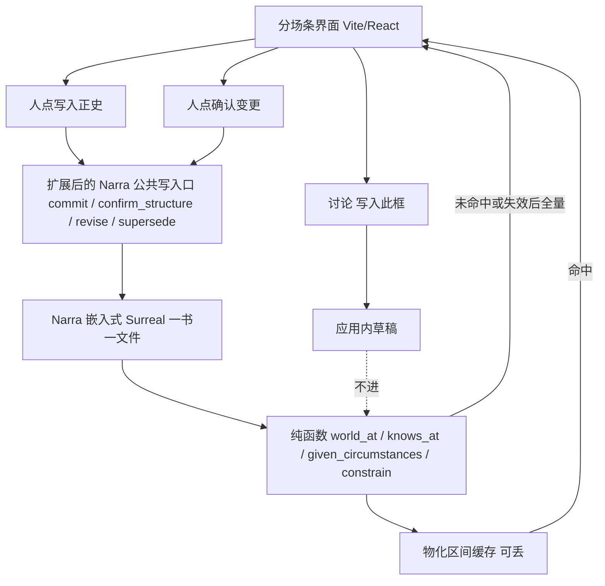
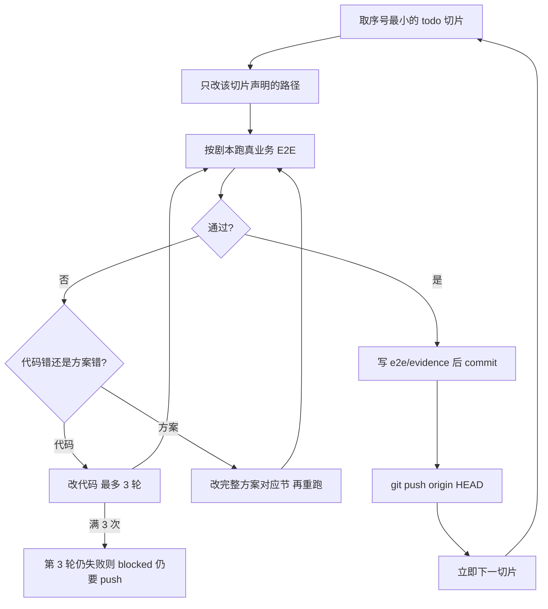

# 设定图 · 建设循环

综合阅读入口仍是 [`设定图-完整方案.md`](../设定图-完整方案.md)。本文是 **v1 建设切片矩阵**：别人合盖后只看本文就能按切片实现并证伪。不推翻三份真源：[`设定图-v1.md`](../设定图-v1.md) 九条与用语、[`plans/2026-08-30-设定图-Narra底座.md`](./2026-08-30-设定图-Narra底座.md) 唯一库、[`世界引擎.md`](../世界引擎.md) 算出这一刻。

产品代码未开工时本文全部切片 `status: todo`。后做（全高出场表、连线图）**不编进切片**。

对人说话用 v1「用语」右列。

---

## 完成定义

同时满足才允许宣布建设完成：

1. 本文每个切片 `status: done`，且指向 `e2e/evidence/<切片id>/`（`SCRIPT.md`、`ASSERT.md`、`PROF.md`、`log.txt`）。
2. v1 主面能走通完整方案 **F40 作家总闭环**（见文末逐步剧本）。
3. 后做项（全高出场表、连线图）明确标后做，不假装做完，也不算未完成。
4. 产品路径零命中：`import scribe3`、`SCRIBE3_`、`s3_`、连铜炉 Surreal、vis-timeline 当主面、Graphiti/EverOS/Semantica/HyperMem/TiMem 当真源、复制 NarrativeNode 源码。

未满足 1–4，禁止写「已完成」。`4.3-live` 缺 `SETTING_LLM_*` 时允许 `blocked`，不挡 `4.3`。

---

## 硬边界

- 仓：`/Users/miaoma/Downloads/写作设定项目`。远程：`https://github.com/liuwenpinghaher-commits/she-ding-tu`。每切片 done（含 blocked 现场、阶段 A）必须 commit 并 `git push origin HEAD`。不要 `--force`、不要 `--no-verify`、不要 amend 已推送的。不要提交 `.env`、本机世界文件、`vendor/narra/target/`、`*_autosave.nnz`。
- 改 `vendor/narra` 达到 v1。禁止仓外 Python `fold` 当真源。禁止前端再算一遍算出这一刻。
- 禁止 `import scribe3`，禁止读铜炉 Surreal，禁止 `SCRIBE3_*` / `s3_*`。
- 禁止 Graphiti / EverOS / Semantica / HyperMem / TiMem 当世界真源。
- 禁止复制 NarrativeNode 源码；主面不绑 vis-timeline。
- 写入正史 / 确认变更必须人点。MCP mutate 不当写入正史。
- 算出这一刻、穿帮、规定情境禁止调模型。
- 产品填场用 `.env` 变量名：`SETTING_LLM_BASE_URL`、`SETTING_LLM_MODEL`、`SETTING_LLM_API_KEY`（见仓库根 `.env.example`，无真实 key）。
- 演示页 `demos/stripboard-v1.html` 不是真源；E2E 不准以它充数。
- 主循环用 `/goal`，不用 `/loop` 当建设。

---

## 架构图

落点（实现时不得改到 `temporal.rs` 弧/阶段聚类）：

| 模块 | 路径 |
|---|---|
| 算出这一刻 | `vendor/narra/src/services/world.rs` |
| 规定情境 | `vendor/narra/src/services/circumstances.rs` |
| 穿帮检查 | `vendor/narra/src/services/constrain.rs`（或扩展 `consistency.rs` 只加 v1 规则） |
| 写入正史 / 确认变更 | `vendor/narra/src/services/canon.rs` |
| 物化 | `vendor/narra/src/services/materialize.rs` |
| 钟 / 边 / 全文迁移 | `vendor/narra/src/db/migrations/020_setting_canon.surql` 与 `021_setting_fulltext.surql` |
| 分场条 | `apps/stripboard/` |
| 薄 HTTP | `apps/stripboard-api/`（`GET /world?t=` 必须走物化→world_at） |
| 渡口夹具 | `e2e/fixtures/ferry.rs` |
| 故事检验 | `vendor/narra/tests/setting_*.rs`（真实嵌入式库，不 mock 被测函数） |

---

## 循环图

波次 1：公共写入口提交渡口戏 → 问算出这一刻 / 知情 / 规定情境 / 穿帮。可以没有浏览器，不能没有场。Rust 检验是辅证，不能单独过关。

波次 2–6：Playwright 像作家一样点，断言 UI 与 Narra 一致。截图不能代替 `ASSERT.md`。

不算过关：只有 `cargo test` 全绿；只有 HTTP 200；只截图；演示页假数据；mock `world_at`；向量「看起来像」规定情境；查询语句自己滤一遍当这一刻。

---

## F01–F64 覆盖表

后做只允许：全高出场表（F37 飞出层已做、全高表不做）、连线图。

| 编号 | 切片 | 编号 | 切片 |
|---|---|---|---|
| F01 | 2.1, 2.3 | F02 | 2.4 |
| F03 | 3.2 | F04 | 3.4 |
| F05 | 3.5 | F06 | 1.6, 4.8 |
| F07 | 4.1, 3.2 | F08 | 4.3, 4.3-live, 1.10 |
| F09 | 3.3 | F10 | 5.5, 2.2, 5.6 |
| F11 | 4.2, 5.1 | F12 | 1.15 |
| F13 | 5.2 | F14 | 3.1 |
| F15 | 3.6 | F16 | 4.10 |
| F17 | 4.11 | F18 | 3.7 |
| F19 | 1.18 | F20 | 1.16 |
| F21 | 1.17 | F22 | 1.9, 4.2 |
| F23 | 1.2 | F24 | 1.2, 1.11 |
| F25 | 1.20 | F26 | 1.9, 4.2 |
| F27 | 1.7 | F28 | 1.5, 3.3 |
| F29 | 2.2 | F30 | 1.5, 4.8 |
| F31 | 1.7, 1.19, 4.11 | F32 | 0.2, 4.7 |
| F33 | 1.6, 1.4 | F34 | 2.1 |
| F35 | 1.2, 3.1 | F36 | 2.5, 2.3 |
| F37 | 5.3（全高出场表=后做） | F38 | 2.4 |
| F39 | 1.9, 4.2 | F40 | 6.1 |
| F41 | 4.9, 1.5 | F42 | 5.1 |
| F43 | 1.16, 1.17 | F44 | 1.1 |
| F45 | 1.10, 1.14, 3.4 | F46 | 4.4 |
| F47 | 4.5 | F48 | 4.5 |
| F49 | 4.5 | F50 | 1.8, 4.6 |
| F51 | 2.1, 5.4, 0.1 | F52 | 4.7 |
| F53 | 2.2 | F54 | 1.11 |
| F55 | 1.12, 3.2 | F56 | 1.2 |
| F57 | 1.8, 1.14 | F58 | 1.7 |
| F59 | 1.11 | F60 | 1.3, 1.2 |
| F61 | 1.14 | F62 | 1.4 |
| F63 | 1.13, 5.4 | F64 | 1.12 |

连线图：后做，不在 v1 切片。

---

## 世界引擎第一批检验映射表

禁止用「跑某 cargo test 名字」代替。每行必须在对应切片断言里用渡口故事跑出来。

| 用例 | 期望 | 切片断言 |
|---|---|---|
| 两场已写入正史，只算到第一场 | 问第二列看不到第二场的变化 | 1.2 |
| 草稿场 | 不出现在正在演的场 / 情状里 | 1.1 |
| 同列两人两地（平行戏） | 通过 | 1.5 |
| 同列同一人两地 | 挡写入正史 | 1.5, 1.15 |
| 省略场换地 | 人在哪变了；不演动作对白内心合法 | 1.6, 4.8 |
| 晚到：第 5 场变化的窗口指回第 3 列 | 问第 3 列、算到含第 5 场时看得到新情状；第 3 场动作对白内心不变 | 1.7 |
| 甲的内心写进乙的对白 | 标黄，仍可写入正史 | 1.15 |
| 在场动作 | 同地他人默认看见 | 1.4, 1.6, 5.1 |
| 列出相关未收伏笔 | 无关地点的不进；最多 5；期限到/过期排在埋点近之前 | 1.9 |
| 因果指向草稿 | 挡写入正史 | 1.15 |
| 叠的顺序 | 同一列先写入的先算 | 1.20 |
| 规定情境：出场人物空 | 知情差为空；伏笔建议为空 | 1.9 |
| 规定情境：知情差 | 只含本场相关情状 | 1.9 |
| 规定情境：上场无价值转折 | 该栏空 | 1.9 |
| 规定情境：默认同地目击 | 列表可断言 | 1.9, 5.1 |
| 规定情境：上场价值转折 | 只取最近已正史场面，草稿转折不算 | 1.9 |
| 伏笔建议 | 不进 ScenePacket；障眼法不建议兑现；人不采纳仍可写入正史 | 1.9, 4.2 |
| 作废写入 | superseded 后问这一刻看不见该场变化；其他场 commit_seq 不重编号 | 1.8 |
| 结构建议 | 不进 ScenePacket；未确认变更则 fold 仍是旧轴 | 1.10 |
| 两列钟重叠 | 正式状态拒绝；不得当作 committed 列钟 | 1.14, 3.4 |
| 全量折 vs 增量折 | 同一正史、同一 T、同一 as_of 观察等价 | 1.11 |
| 物化 vs 全量 | 命中则等于全量；改场/作废后旧物化不得继续命中 | 1.12 |
| 删已正史再算 | superseded 后换历史再跑同一 world_at | 1.8 |
| knows_at 与 world_at | `knows_at` 等于 `world_at.knows[person]` | 1.20 |
| 建议一件 | 不进 given_circumstances 的输入、不进 ScenePacket | 1.9 |

---

## 切片矩阵总表

| id | 一句话能力 | 依赖 | 覆盖 F | status |
|---|---|---|---|---|
| 0.1 | 渡口夹具与空世界探测 | （无） | F51 | done |
| 0.2 | 仓库闸：铜炉 / 第二真源 / vis-timeline / NN 源码 | 0.1 | F32, F34 | done |
| 1.1 | 草稿不进算出这一刻 | 0.1 | F44, F35 | done |
| 1.2 | 写入正史之后算出看见；commit_seq 递增且不因插列而改 | 1.1 | F35, F60, F23, F24, F56 | done |
| 1.3 | 写入正史事务：RELATE 失败则整笔回滚 | 1.2 | F60 | done |
| 1.4 | 在场 vs 被提及：被点名不算目击 | 1.2 | F62, F33 | done |
| 1.5 | 同一列两人两地合法 / 同人不能两地；黄点只亮已正史在场 | 1.4 | F28, F30, F41 | done |
| 1.6 | 知情挂这场；墙钟不当学会时；省略场知情不默认补 | 1.4 | F06, F33 | done |
| 1.7 | 晚到事实投影到故事时间；第几次与横轴分开 | 1.2 | F27, F31, F58 | done |
| 1.8 | 作废写入 superseded：不重编号；fold 不再叠这场 | 1.2 | F50, F57 | done |
| 1.9 | 规定情境：未收最多 5 先排期限；建议一件不进 ScenePacket | 1.2 | F11, F26, F39, F22 | done |
| 1.10 | 结构建议不进 ScenePacket；未确认则算出仍是旧轴 | 1.2, 1.9 | F45, F08 | done |
| 1.11 | 全量 world_at 与增量折观察等价 | 1.2 | F59, F54, F24 | done |
| 1.12 | 物化与正史不一致则丢掉物化，全量重折 | 1.11, 1.8 | F64, F55 | done |
| 1.13 | 中文全文只给左栏；一书一文件不串书 | 0.1, 1.2 | F63, F51 | done |
| 1.14 | 确认变更事务：预览不写库；禁止同 id 删建；两列钟重叠拒绝 | 1.10 | F61, F45 | done |
| 1.15 | 查穿帮分级：挡 vs 标黄 | 1.5, 1.4 | F12 | done |
| 1.16 | 道具易手：旧窗收口新窗开；草稿仍旧持有 | 1.2 | F20, F43 | done |
| 1.17 | 组织成员：本场变化才进算出；改档案不冒充入伙 | 1.2 | F21, F43 | done |
| 1.18 | 规则：可无戏新建；不当在场；破规则走穿帮分级 | 1.15 | F19 | done |
| 1.19 | 改已正史：不新分配 commit_seq；晚到窗口指回为真的故事时间 | 1.7, 1.8 | F31 | done |
| 1.20 | knows_at 等于 world_at.knows[person]；同列先写入的先算 | 1.4, 1.6 | F25, F33 | done |
| 2.1 | 创建书：本机一份世界文件；进分场条；N=1 | 0.1, 0.2 | F51, F01, F34 | done |
| 2.2 | 通用 entity+kind：新建人物地点规则；身份层进算出不必先写一场 | 2.1, 1.2 | F53, F10, F29 | done |
| 2.3 | 打开已有书：读已正史；草稿不是正史齿色 | 2.1, 1.1, 1.2 | F01, F36 | done |
| 2.4 | 本页列数 1–6；疏中密=2/4/6；卡上密度随 N | 2.1 | F02, F38 | done |
| 2.5 | ‹ › 与全书细条只改窗口起点，不改场、不写入正史 | 2.3, 2.4 | F36 | done |
| 3.1 | 讨论 → 写入此框 → 仍是草稿 | 2.1, 1.1 | F14, F35 | done |
| 3.2 | 点写入正史：有边有钟；标尺色点亮；点列看见这一刻 | 3.1, 1.2, 1.12 | F03, F07, F55 | done |
| 3.3 | 左栏拖入拖回改在场；未正史细轨不亮 | 2.2, 1.4 | F09, F28 | done |
| 3.4 | 拖列侵入：建议全列出；取消钟不变；确认后钟不重叠 | 1.14, 2.4 | F04, F45 | done |
| 3.5 | 已挂在场上的设定不能从设定里删 | 3.3 | F05 | done |
| 3.6 | 点卡 / 点在场标记：本场按来源分组 | 3.2, 3.3 | F15 | done |
| 3.7 | 删草稿场 / 空场次：缺口建议；已正史禁止走轻路径 | 3.1 | F18 | done |
| 4.1 | 写下一场默认追加在最后；没有本场任务不准写 | 3.2 | F07 | done |
| 4.2 | 侧栏规定情境可见上场已正史；伏笔建议可忽略、不进模型 | 4.1, 1.9 | F08, F11, F39 | done |
| 4.3 | 模型填整场（确定性档） | 4.2, 3.1 | F08 | done |
| 4.3-live | 真调档：只断言结构且未自动正史 | 4.3 | F08 | blocked |
| 4.4 | 中间加列：空列/空场/后移/借时间；顶栏 + 不是这一步 | 3.4, 2.4 | F46 | done |
| 4.5 | 减列 / 合并列 / 换列位置：有正史禁止只减列丢掉历史 | 4.4, 1.14 | F47, F48, F49 | done |
| 4.6 | 删已正史：影响清单 + 补洞建议 + 确认后重算 | 1.8, 3.7 | F50 | done |
| 4.7 | 丢一段草稿：建议拆场；逐条写入此框；禁止一贴即正史 | 4.1, 3.1 | F52, F32 | done |
| 4.8 | 省略场：有时长不演；知情只手写 | 1.6, 4.1 | F06 | done |
| 4.9 | 在本列再写一场 = 并列同时；写下一场仍默认最后 | 4.1, 1.5 | F41 | done |
| 4.10 | 讲述序 ≠ 列序：读序标记；切按读序排不算进算出 | 2.5, 3.2 | F16 | done |
| 4.11 | 拖场卡换列：草稿可预览；已正史走确认变更 | 4.5, 3.4 | F17, F31, F49 | done |
| 5.1 | 侧栏他知道什么；当众 / 私下收窄谁会看见 | 4.2, 1.6 | F42, F11 | done |
| 5.2 | 导出 Markdown：默认含草稿；标注正史/草稿；改了不写回 | 4.10, 3.1 | F13 | done |
| 5.3 | 出场飞出层只读；点格跳列；改格拒绝 | 2.5, 3.3 | F37 | done |
| 5.4 | 切换书：不串世界；草稿不串书 | 2.1, 1.13 | F51, F63 | done |
| 5.5 | 档案页：基本设定可填；出场与情状窗口只读 | 2.2, 3.5 | F10 | done |
| 5.6 | 档案「场」只看有它的场；不是出场表 | 5.5, 5.3 | F10, F09 | done |
| 6.1 | F40 作家总闭环全路径 | 5.1, 5.2, 5.3, 5.4, 4.6, 4.8, 4.9, 4.10 | F40 | done |
| 6.2 | 文学教授抽查 | 6.1 | F41, F12, F36, F10, §8.13.8 | done |

共 **54** 个切片。id 顺序：0.1、0.2、1.1、1.2、1.3、1.4、1.5、1.6、1.7、1.8、1.9、1.10、1.11、1.12、1.13、1.14、1.15、1.16、1.17、1.18、1.19、1.20、2.1、2.2、2.3、2.4、2.5、3.1、3.2、3.3、3.4、3.5、3.6、3.7、4.1、4.2、4.3、4.3-live、4.4、4.5、4.6、4.7、4.8、4.9、4.10、4.11、5.1、5.2、5.3、5.4、5.5、5.6、6.1、6.2。

---

## 切片详节

### 切片 0.1：渡口夹具与空世界探测

- status: done
- 覆盖流程图: F51
- 依赖: （无）
- 改哪些路径: `e2e/fixtures/ferry.rs`；`vendor/narra/tests/setting_empty_world.rs`；`e2e/evidence/0.1/`
- 文学业务流: 建设者准备固定短篇「渡口」：人物阿禾、阿福、阿莲，地点渡口，道具铜牌、刀。先跑「空世界可创建」：新建一书对应一份空 Narra 文件，问算出这一刻，正在演的场为空。夹具此时不写入正史。
- 不做会写错什么: 若夹具直接把阿福看见刀写成正史，后面切片会把演示数据当历史；阿莲会「已经知道刀在抽屉」。
- E2E 剧本:
  1. 调用空书工厂，得到一书一文件路径。
  2. 用公共查询入口问 t=故事起点 的算出这一刻。
  3. 确认实体表尚无阿禾（设定还没新建）。
  4. 把路径与查询输出写入证据目录。
- 断言:
  1. 世界文件存在。
  2. 算出这一刻：正在演的场=[]，情状窗口=[]。
  3. 未走写入正史。
- 证据目录: e2e/evidence/0.1/
- 文学教授闸:
  1. 空书能不能只存在、还不发生任何事？
  2. 有没有人没点写入正史，世界里却已有场？

### 切片 0.2：仓库闸：铜炉 / 第二真源 / vis-timeline / NN 源码

- status: done
- 覆盖流程图: F32, F34
- 依赖: 0.1
- 改哪些路径: `scripts/boundary_scan.sh`；扫描根（排除 `vendor/{graphiti,EverOS,semantica,HyperMem,TiMem,NarrativeNode,novalist,obsidian-storyline,vis-timeline,yggsii}` 与 `docs/references`）
- 文学业务流: 建设者对产品路径跑边界扫描。作家路径不经过铜炉、不经过 vis-timeline 主面。
- 不做会写错什么: 若产品 `import scribe3`，写入正史会连到铜炉库，渡口的刀会串进另一套正典。
- E2E 剧本:
  1. 对产品路径跑 rg：`import scribe3`、`SCRIBE3_`、`s3_`、连铜炉 Surreal、主面 vis-timeline、复制 NN 源码。
  2. 把扫描命令与命中写入证据。
- 断言:
  1. 产品路径零命中。
  2. vendor/narra 仍是唯一世界库源码。
- 证据目录: e2e/evidence/0.2/
- 文学教授闸:
  1. 正史会不会写进铜炉？
  2. 主面是不是分场条而不是 vis-timeline？

### 切片 1.1：草稿不进算出这一刻

- status: done
- 覆盖流程图: F44, F35
- 依赖: 0.1
- 改哪些路径: `vendor/narra/src/services/canon.rs`；`vendor/narra/src/services/world.rs`；`vendor/narra/tests/setting_draft_excluded.rs`
- 文学业务流: 作家写「阿莲来渡口找东西」进格子，只写入此框，不点写入正史。再问这一刻。
- 不做会写错什么: 若草稿进算出，阿福会在下一场「记得」阿莲已经来过，圈套还没演就像演完了。
- E2E 剧本:
  1. 空书。身份可空。
  2. 经公共草稿入口写入一场：阿莲在渡口，本场任务=来找东西；status=draft。
  3. 不调用 commit。
  4. world_at(canon, 该列钟) 。
- 断言:
  1. Narra 正史查询：该场 status≠committed。
  2. world_at 正在演的场不含阿莲来找东西。
  3. 情状窗口无「阿莲在渡口」。
- 证据目录: e2e/evidence/1.1/
- 文学教授闸:
  1. 下一场的人看见的世界，有没有这场没点写入正史的戏？
  2. 有没有哪一次没人点写入正史世界却变了？

### 切片 1.2：写入正史之后算出看见；commit_seq 递增且不因插列而改

- status: done
- 覆盖流程图: F35, F60, F23, F24, F56
- 依赖: 1.1
- 改哪些路径: `vendor/narra/src/services/canon.rs`；`vendor/narra/src/db/migrations/020_setting_canon.surql`；`vendor/narra/tests/setting_commit_seq.rs`
- 文学业务流: 作家点写入正史：阿福在渡口看见刀在抽屉。再问这一刻。之后在中间插一列（仅预览或确认加空列），阿福这场的第几次写入正史不得改号。
- 不做会写错什么: 若插列把 commit_seq 重排，晚到窗口会指错「第几次」；若没点写入正史就算进世界，草稿成了历史。
- E2E 剧本:
  1. 写入此框：阿福在渡口，动作=打开抽屉看见刀；本场任务=阿福发现刀。
  2. 调用公共 commit。
  3. world_at 该列钟。
  4. 再 commit 第二场阿莲来找；断言 commit_seq 为 2。
  5. confirm_structure 在两场之间插入空列（或不插入，只验证 seq 不因列号而改）。
  6. 再 world_at 只算到第一场的钟。
- 断言:
  1. 第一场 committed，commit_seq=1。
  2. world_at 看见刀在抽屉、阿福在渡口。
  3. 只算到第一场钟时看不见阿莲来找。
  4. 插列后两场 commit_seq 仍为 1 和 2。
- 证据目录: e2e/evidence/1.2/
- 文学教授闸:
  1. 点写入正史后下一场能不能看见刀在抽屉？
  2. 列号是不是被当成了第几次写入正史？

### 切片 1.3：写入正史事务：RELATE 失败则整笔回滚

- status: done
- 覆盖流程图: F60
- 依赖: 1.2
- 改哪些路径: `vendor/narra/src/services/canon.rs`；`vendor/narra/tests/setting_commit_rollback.rs`
- 文学业务流: 作家点写入正史时在场边故意失败（夹具注入 RELATE 错误）。场不得变成正史。
- 不做会写错什么: 半场历史：卡上已是正史，库里没有阿福在场边，算出这一刻当他不在渡口，知情差全错。
- E2E 剧本:
  1. 准备一场完整渡口戏（阿福在场 role=present）。
  2. 夹具让 participates_in RELATE 失败。
  3. 调用 commit，期望错误。
  4. 查询场 status 与边。
- 断言:
  1. commit 返回失败。
  2. 场 status 仍为草稿或记录不存在于 committed。
  3. participates_in 无残边。
  4. world_at 无该场变化。
- 证据目录: e2e/evidence/1.3/
- 文学教授闸:
  1. 失败时世界上有没有半场历史？
  2. 人看见的成功提示会不会是假的？

### 切片 1.4：在场 vs 被提及：被点名不算目击

- status: done
- 覆盖流程图: F62, F33
- 依赖: 1.2
- 改哪些路径: `vendor/narra/src/services/canon.rs`；`vendor/narra/src/services/world.rs`；`vendor/narra/tests/setting_present_vs_mentioned.rs`
- 文学业务流: 阿福在渡口打开抽屉。对白里点名「阿莲」。阿莲 role=mentioned。阿莲不得默认看见刀。
- 不做会写错什么: 点名当目击：阿莲没到场却「看见」刀，知情差戏没了。
- E2E 剧本:
  1. commit 一场：阿福 present 在渡口，动作=开抽屉；阿莲 mentioned。
  2. world_at；knows_at(阿莲)；knows_at(阿福)。
- 断言:
  1. participates_in 阿福 role=present，阿莲 role=mentioned。
  2. 阿福知道刀在抽屉。
  3. 阿莲不知道刀在抽屉。
  4. 同地目击名单不含阿莲。
- 证据目录: e2e/evidence/1.4/
- 文学教授闸:
  1. 被点名的人会不会被写成看见了动作？
  2. 算出这一刻吃的是边还是 JSON 袋？

### 切片 1.5：同一列两人两地合法 / 同人不能两地；黄点只亮已正史在场

- status: done
- 覆盖流程图: F28, F30, F41
- 依赖: 1.4
- 改哪些路径: `vendor/narra/src/services/constrain.rs`；`vendor/narra/tests/setting_parallel_place.rs`
- 文学业务流: 同列：阿福在渡口、阿莲在城里（两场平行）。合法。再让阿福同时在城里：挡写入正史。草稿在场不亮标尺细轨。
- 不做会写错什么: 同人静默两地：阿福既在渡口又在城里，穿帮戏没法挡。草稿亮黄点：作家以为已正史。
- E2E 剧本:
  1. commit 阿福在渡口。
  2. 同列再 commit 阿莲在城里（不同地点）。期望通过。
  3. 尝试 commit 阿福同列在城里。期望挡。
  4. 再写一场草稿：阿禾在渡口在场，不 commit。查细轨/在场列表。
- 断言:
  1. 平行戏 constrain 通过。
  2. 同人两地 constrain 为挡写入正史。
  3. 草稿阿禾不出现在已正史在场/黄点。
- 证据目录: e2e/evidence/1.5/
- 文学教授闸:
  1. 并列场会不会被误挡？
  2. 同人两地会不会静默进算出？

### 切片 1.6：知情挂这场；墙钟不当学会时；省略场知情不默认补

- status: done
- 覆盖流程图: F06, F33
- 依赖: 1.4
- 改哪些路径: `vendor/narra/src/services/world.rs`；`vendor/narra/tests/setting_knowledge_scene.rs`
- 文学业务流: 阿福在渡口开抽屉（当众默认）。另写省略场：阿莲从城里走到渡口，时长推进，不演对白。省略场不得让阿莲学会刀在抽屉。知情边挂 scene_id，不用 created_at。
- 不做会写错什么: 墙钟当学会时：闪回场变成「今天写入才学会」。省略场默认补知情：旅途把秘密广播给全世界。
- E2E 剧本:
  1. commit 场面：阿福开抽屉，刀被阿福看见。
  2. commit 省略场：阿莲换地到渡口，不写动作对白内心、不手写知情。
  3. knows_at(阿莲, 省略场终点)。
  4. 查 knows 边带 scene_id。
- 断言:
  1. 阿莲人在渡口。
  2. 阿莲仍不知道刀在抽屉。
  3. knows 边有 scene_id，不以 created_at 当学会那场。
- 证据目录: e2e/evidence/1.6/
- 文学教授闸:
  1. 省略场会不会把秘密说给全世界听？
  2. 闪回时会不会变成写入当天学会？

### 切片 1.7：晚到事实投影到故事时间；第几次与横轴分开

- status: done
- 覆盖流程图: F27, F31, F58
- 依赖: 1.2
- 改哪些路径: `vendor/narra/src/services/world.rs`；`vendor/narra/tests/setting_late_fact.rs`
- 文学业务流: 第 5 次写入正史才写出「刀其实一直在抽屉」，窗口指回第 3 列。问第 3 列、算到含第 5 次时看得到；第 3 场动作对白内心字面不变。
- 不做会写错什么: 把晚到写进旧场嘴巴：第 3 场阿莲会「早知道」；或用列号当分钟。
- E2E 剧本:
  1. commit 列1–列3 的场（列3 阿莲在渡口，对白不含刀）。
  2. 第 5 次 commit：本场变化=刀在抽屉从列3 起点为真（晚到窗口）。
  3. world_at(列3钟, as_of=含第5次)。
  4. 读取列3 场的动作对白内心原文。
- 断言:
  1. 问列3 且 as_of 含第5次：刀在抽屉为真。
  2. 列3 对白原文仍无「刀」。
  3. commit_seq 与 clock_from 不是同一个字段。
- 证据目录: e2e/evidence/1.7/
- 文学教授闸:
  1. 晚到会不会改掉旧场已经演过的台词？
  2. 三时钟是不是同一份正史算出来的？

### 切片 1.8：作废写入 superseded：不重编号；fold 不再叠这场

- status: done
- 覆盖流程图: F50, F57
- 依赖: 1.2
- 改哪些路径: `vendor/narra/src/services/canon.rs`；`vendor/narra/tests/setting_supersede.rs`
- 文学业务流: 已正史「阿福看见刀」。确认变更删这场并补洞。该次写入作废。其他场 commit_seq 不重编号。
- 不做会写错什么: 静默删正史：后面的场假装刀从没被看见。同 id 删建：3.x 失败或幽灵场。
- E2E 剧本:
  1. commit 场A seq=1 阿福看见刀；场B seq=2 阿莲来找。
  2. confirm_structure 删场A（supersede），补洞新 id。
  3. world_at 场A 的钟。
  4. 读场B commit_seq。
- 断言:
  1. 场A status=superseded。
  2. world_at 看不见「阿福看见刀」。
  3. 场B commit_seq 仍为 2。
  4. 补洞场是新 id，不是删再建同一 id。
- 证据目录: e2e/evidence/1.8/
- 文学教授闸:
  1. 删了之后下一场还会不会当这件事发生过？
  2. 第几次写入正史有没有被重排？

### 切片 1.9：规定情境：未收最多 5 先排期限；建议一件不进 ScenePacket

- status: done
- 覆盖流程图: F11, F26, F39, F22
- 依赖: 1.2
- 改哪些路径: `vendor/narra/src/services/circumstances.rs`；`vendor/narra/tests/setting_circumstances.rs`
- 文学业务流: 写下一场阿莲来渡口。侧栏列出相关未收最多 5。先排「铜牌三日后到期」再排埋点近的闲笔。建议一件可出现在侧栏附加，但不进 ScenePacket。出场人物空则知情差空、建议空。
- 不做会写错什么: 用向量把「更像」的旧枪挤掉到期的铜牌，期限戏消失。建议进模型等于指定写哪一场。
- E2E 剧本:
  1. 正史：埋铜牌（期限落在本场）、另埋无关城里的枪、再埋 4 条近点闲笔。
  2. 草稿下一场：阿莲+渡口，本场任务=来找东西。
  3. given_circumstances(world, draft)。
  4. 另测出场人物空的草稿。
  5. 上场无价值转折时该栏空；上场有已正史转折则只取最近已正史，草稿转折不算。
- 断言:
  1. 相关未收 ≤5。
  2. 铜牌期限条排在闲笔之前。
  3. 无关城里的枪不进。
  4. ScenePacket 无建议一件字段/值为空。
  5. 出场空：知情差=[]，建议不出现。
  6. 草稿价值转折不进上场价值转折栏。
- 证据目录: e2e/evidence/1.9/
- 文学教授闸:
  1. 到期的枪会不会被语义近的旧枪挤出？
  2. 建议一件有没有进模型输入？

### 切片 1.10：结构建议不进 ScenePacket；未确认则算出仍是旧轴

- status: done
- 覆盖流程图: F45, F08
- 依赖: 1.2, 1.9
- 改哪些路径: `vendor/narra/src/services/circumstances.rs`；`vendor/narra/src/services/canon.rs`；`vendor/narra/tests/setting_structure_preview.rs`
- 文学业务流: 拖列侵入出现建议目录。不点确认变更。问算出这一刻与规定情境。
- 不做会写错什么: 预览变正史：人还在犹豫，世界上钟已经重叠。结构建议进模型=替人改结构。
- E2E 剧本:
  1. 两列已正史。
  2. preview 侵入（不 confirm）。
  3. world_at 旧钟。
  4. given_circumstances 下一场草稿。
- 断言:
  1. Narra 列钟未改。
  2. world_at 仍按旧轴。
  3. ScenePacket 不含结构建议清单。
- 证据目录: e2e/evidence/1.10/
- 文学教授闸:
  1. 没点确认变更，世界变了没有？
  2. 模型会不会看见「请把两列合并」这类选题？

### 切片 1.11：全量 world_at 与增量折观察等价

- status: done
- 覆盖流程图: F59, F54, F24
- 依赖: 1.2
- 改哪些路径: `vendor/narra/src/services/world.rs`；`vendor/narra/src/services/materialize.rs`；`vendor/narra/tests/setting_fold_equiv.rs`
- 文学业务流: 同一份渡口正史、同一 T、同一 as_of：全量从创世叠，与增量折，世界上为真必须相同。
- 不做会写错什么: 两套 fold：删正史后检验预言机与产品路径分叉，刀还在或已不在各说各的。
- E2E 剧本:
  1. 写入至少三场正史（含易手或换地）。
  2. 对三个 T 分别跑全量 world_at 与增量折。
  3. 比较正在演的场、情状、知情。
- 断言:
  1. 三处 T 观察相等（结构化比较，不是字符串金样手写第二套）。
  2. 增量路径调用的仍是同一 world_at 语义。
- 证据目录: e2e/evidence/1.11/
- 文学教授闸:
  1. 换一份历史再跑，两套路径还一致吗？
  2. 有没有查询语句自己滤一遍当这一刻？

### 切片 1.12：物化与正史不一致则丢掉物化，全量重折

- status: done
- 覆盖流程图: F64, F55
- 依赖: 1.11, 1.8
- 改哪些路径: `vendor/narra/src/services/materialize.rs`；`vendor/narra/tests/setting_materialize_invalidate.rs`
- 文学业务流: 点列命中物化。然后删已正史或改场。旧物化不得继续命中。lookup 未命中则全量 world_at 再 put。
- 不做会写错什么: 缓存里人还在渡口：刚删的场仍从物化冒出来。
- E2E 剧本:
  1. commit 阿福在渡口；lookup/put 物化。
  2. supersede 该场。
  3. lookup 该区间。
  4. world_at 该 T。
- 断言:
  1. 作废后旧物化不得命中。
  2. world_at 与全量一致，不见阿福这场变化。
  3. 物化不是正史写入入口。
- 证据目录: e2e/evidence/1.12/
- 文学教授闸:
  1. 刚删过正史，点列会不会还从缓存里把人放回渡口？

### 切片 1.13：中文全文只给左栏；一书一文件不串书

- status: done
- 覆盖流程图: F63, F51
- 依赖: 0.1, 1.2
- 改哪些路径: `vendor/narra/src/db/migrations/021_setting_fulltext.surql`；`vendor/narra/tests/setting_search_book.rs`
- 文学业务流: 书A 有阿禾。书B 有同名无关角色。左栏搜「阿禾」只中书A。中文名可搜，不用英文词干。
- 不做会写错什么: work_id 混多书：搜到别人的书。snowball(english)：中文人名搜空。
- E2E 剧本:
  1. 创建书A 写入设定阿禾并 commit 一场。
  2. 创建书B 另世界文件，无阿禾。
  3. 在书A 搜「阿禾」。
  4. 在书B 搜「阿禾」。
- 断言:
  1. 书A 命中阿禾。
  2. 书B 零命中。
  3. 两书两个文件。
  4. 搜索实现不是 HNSW 排规定情境。
- 证据目录: e2e/evidence/1.13/
- 文学教授闸:
  1. 会不会搜到另一本书的人？
  2. 中文名会不会搜空？

### 切片 1.14：确认变更事务：预览不写库；禁止同 id 删建；两列钟重叠拒绝

- status: done
- 覆盖流程图: F61, F45
- 依赖: 1.10
- 改哪些路径: `vendor/narra/src/services/canon.rs`；`vendor/narra/tests/setting_confirm_tx.rs`
- 文学业务流: 拖钟预览。取消。库不变。确认变更一笔提交。禁止两列钟重叠落库。作废用 superseded + 新 id。
- 不做会写错什么: 预览落库：人点取消世界已改。同 id 删建：幽灵场。重叠钟当正式状态：并列变成事故。
- E2E 剧本:
  1. 两列正史。preview 改钟。读库钟。
  2. 取消。再读库钟。
  3. confirm 合法压缩。
  4. 尝试 confirm 重叠钟，期望拒绝。
  5. 尝试同 id 删建，期望拒绝。
- 断言:
  1. 预览期间 Narra 钟不变。
  2. 确认后一笔事务可见。
  3. 重叠钟不得 committed。
  4. 无同 id DELETE+CREATE。
- 证据目录: e2e/evidence/1.14/
- 文学教授闸:
  1. 取消之后钟回去了没有？
  2. 两列钟重叠有没有落库？

### 切片 1.15：查穿帮分级：挡 vs 标黄

- status: done
- 覆盖流程图: F12
- 依赖: 1.5, 1.4
- 改哪些路径: `vendor/narra/src/services/constrain.rs`；`vendor/narra/tests/setting_constrain_grades.rs`
- 文学业务流: 历史只查穿帮，不指定写哪一场。同人两地挡；知情穿帮（阿莲说出她不可能知道的刀）标黄仍可写；价值转折空标黄；因果指向草稿挡；场面既无动作对白内心也无本场变化挡。
- 不做会写错什么: 全挡则作家不敢留空价值转折；该挡不挡则阿莲两地。
- E2E 剧本:
  1. 同人两地草稿 → constrain。
  2. 阿莲对白写出刀（她不知情）→ constrain。
  3. 价值转折空 → constrain。
  4. 因果指向一场 draft → constrain。
  5. 空场面无变化 → constrain。
- 断言:
  1. 同人两地=挡。
  2. 知情穿帮=标黄可写。
  3. 价值转折空=标黄可写。
  4. 因果指向草稿=挡。
  5. 空场面=挡。
  6. 挡则不分配 commit_seq。
- 证据目录: e2e/evidence/1.15/
- 文学教授闸:
  1. 历史有没有替人决定写哪一场？
  2. 该标黄的有没有被做成挡写入正史？

### 切片 1.16：道具易手：旧窗收口新窗开；草稿仍旧持有

- status: done
- 覆盖流程图: F20, F43
- 依赖: 1.2
- 改哪些路径: `vendor/narra/src/services/world.rs`；`vendor/narra/tests/setting_item_hand.rs`
- 文学业务流: 刀原在阿禾。本场变化：收到本场起点、阿福从本场开持有。未写收口禁止静默双持有。未写入正史则问这一刻仍是阿禾持有。
- 不做会写错什么: 档案数组从头即真：还没演易手，刀已经在阿福身上。双持有：两人同时握同一把刀。
- E2E 剧本:
  1. 正史：刀持有=阿禾（身份或一场变化）。
  2. 草稿：易手到阿福但未收口旧窗 → 期望禁止静默并存。
  3. 草稿写明收口+新窗，不 commit → world_at 仍阿禾。
  4. commit → world_at 阿福持有，阿禾窗口已收。
- 断言:
  1. 未收口双持有被拒。
  2. 草稿问这一刻仍阿禾持有。
  3. 正史后阿福持有、阿禾窗口终点=本场起点。
- 证据目录: e2e/evidence/1.16/
- 文学教授闸:
  1. 没点写入正史刀会不会已经易手？
  2. 会不会两人静默各持同一把刀？

### 切片 1.17：组织成员：本场变化才进算出；改档案不冒充入伙

- status: done
- 覆盖流程图: F21, F43
- 依赖: 1.2
- 改哪些路径: `vendor/narra/src/services/world.rs`；`vendor/narra/tests/setting_faction_join.rs`
- 文学业务流: 档案写阿福「渡口帮」。从第 N 场起入伙必须本场变化打在所属上并写入正史。拖组织到卡上 ≠ 改成员名单。
- 不做会写错什么: 改小传冒充从开书即会员。拖组织当入伙。
- E2E 剧本:
  1. 新建组织渡口帮，档案 ties/setup 写阿福（不 commit 场）。
  2. world_at：阿福所属不含从第 N 场起的成员窗。
  3. commit 一场本场变化：阿福入伙，窗口从本场开。
  4. 拖组织到另一场草稿卡上不 commit。
- 断言:
  1. 只改档案：算出无入伙窗口。
  2. commit 后从该场起阿福是成员。
  3. 只拖组织在场 ≠ 成员名单变化。
- 证据目录: e2e/evidence/1.17/
- 文学教授闸:
  1. 改档案会不会让世界上从第 0 场起就是会员？
  2. 在场出现组织等于改了名单吗？

### 切片 1.18：规则：可无戏新建；不当在场；破规则走穿帮分级

- status: done
- 覆盖流程图: F19
- 依赖: 1.15
- 改哪些路径: `vendor/narra/src/services/constrain.rs`；`vendor/narra/tests/setting_rule.rs`
- 文学业务流: 没戏先建规则「渡口夜间不得开船」。规则不当在场拖到卡上。破规则按分级挡或标黄，不另开情节表。
- 不做会写错什么: 规则当成人物拖进场。破规则只记在档案里，穿帮检查看不见。
- E2E 剧本:
  1. 新建规则，不写场。
  2. 尝试把规则当在场 RELATE，期望拒绝或不进入在场列表。
  3. commit 一场夜间开船（破规则）。看 constrain。
- 断言:
  1. 无戏可建规则。
  2. 规则不出现在 participates_in 在场。
  3. 破规则走 F12 分级，不另写情节表。
- 证据目录: e2e/evidence/1.18/
- 文学教授闸:
  1. 没戏能不能先写规矩？
  2. 规矩会不会被当成在场人物？

### 切片 1.19：改已正史：不新分配 commit_seq；晚到窗口指回为真的故事时间

- status: done
- 覆盖流程图: F31
- 依赖: 1.7, 1.8
- 改哪些路径: `vendor/narra/src/services/canon.rs`；`vendor/narra/tests/setting_revise.rs`
- 文学业务流: 改已正史场的本场变化（晚到或勘误）走 revise，不新分配第几次。结构/换列升级走确认变更。旧场动作对白内心可保留。
- 不做会写错什么: 每次改都新 seq：三时钟搅成墙钟。改结构却当 revise 偷偷换列。
- E2E 剧本:
  1. commit 场 seq=1。
  2. revise 本场变化窗口，不改对白。
  3. 读 commit_seq 与 clock。
- 断言:
  1. commit_seq 仍为 1。
  2. world_at 新窗口为真。
  3. 对白原文不变。
  4. 换列不走这条，须 F45。
- 证据目录: e2e/evidence/1.19/
- 文学教授闸:
  1. 改已正史有没有变成「又写入了一次正史」？
  2. 旧场演过的字被改了没有？

### 切片 1.20：knows_at 等于 world_at.knows[person]；同列先写入的先算

- status: done
- 覆盖流程图: F25, F33
- 依赖: 1.4, 1.6
- 改哪些路径: `vendor/narra/src/services/world.rs`；`vendor/narra/tests/setting_knows_eq.rs`
- 文学业务流: 同列两场：先写入阿福开抽屉，后写入阿莲进门。叠的顺序按写入先后。knows_at(阿福) 必须等于 world_at.knows[阿福]。
- 不做会写错什么: 按列号倒着叠：阿莲先进门再开抽屉。两套知情函数分叉。
- E2E 剧本:
  1. 同列先 commit 阿福开抽屉，再 commit 阿莲进门。
  2. world_at 该列终点。
  3. knows_at 阿福、阿莲。
- 断言:
  1. 叠序=写入先后。
  2. knows_at(canon,T,阿福)==world_at(...).knows[阿福]（结构化相等）。
- 证据目录: e2e/evidence/1.20/
- 文学教授闸:
  1. 同列两场谁先发生，是不是谁先写入正史？
  2. 知情有没有第二套算法？

### 切片 2.1：创建书：本机一份世界文件；进分场条；N=1

- status: done
- 覆盖流程图: F51, F01, F34
- 依赖: 0.1, 0.2
- 改哪些路径: `apps/stripboard/src/App.tsx`；`apps/stripboard/src/api/books.ts`；`apps/stripboard-api/src/books.rs`（或 TS 薄包）
- 文学业务流: 作家点创建书「渡口」。本机新建 Narra 文件。打开分场条，本页列数=1。无登录。
- 不做会写错什么: 空书进 N=0 清空舞台。多书共一个库文件串世界。
- E2E 剧本:
  1. 启动真分场条入口（不是 demos/stripboard-v1.html）。
  2. 点创建书，名=渡口。
  3. 看见分场条一列。
  4. 文件系统出现该书世界文件。
- 断言:
  1. N=1。
  2. 一书一文件。
  3. 未写入正史。
  4. 页面不是演示假数据。
- 证据目录: e2e/evidence/2.1/
- 文学教授闸:
  1. 打开是不是分场条？
  2. 有没有账号登录挡在前面？

### 切片 2.2：通用 entity+kind：新建人物地点规则；身份层进算出不必先写一场

- status: done
- 覆盖流程图: F53, F10, F29
- 依赖: 2.1, 1.2
- 改哪些路径: `vendor/narra/src/models/` 扩展通用实体；`apps/stripboard/src/LeftRail.tsx`
- 文学业务流: 左栏新建阿禾、渡口、规则。保存基本设定。身份层序号 0 进入算出这一刻，不必先写一场。
- 不做会写错什么: 没戏不能建人。每种设定一张死表。小传冒充情状窗口。
- E2E 剧本:
  1. 创建书。
  2. 左栏新建人物阿禾、地点渡口、规则夜间不得开船。
  3. world_at 故事起点。
  4. 不点写入正史。
- 断言:
  1. 三实体 kind=person/place/rule。
  2. 身份层含阿禾小传类字段。
  3. 无情状窗口冒充入伙/持有。
  4. 无戏可建。
- 证据目录: e2e/evidence/2.2/
- 文学教授闸:
  1. 没戏打开还有没有用？
  2. 基本设定是不是被写成了本场变化？

### 切片 2.3：打开已有书：读已正史；草稿不是正史齿色

- status: done
- 覆盖流程图: F01, F36
- 依赖: 2.1, 1.1, 1.2
- 改哪些路径: `apps/stripboard/src/api/books.ts`；`apps/stripboard/src/Minimap.tsx`
- 文学业务流: 书里一场正史一场草稿。关掉再打开。正史齿一色，草稿另一色，空场次/省略场再分色。
- 不做会写错什么: 草稿齿色做成正史，作家以为已经发生。
- E2E 剧本:
  1. 书内 commit 一场，另留一场草稿。
  2. 关闭打开该书。
  3. 看分场条与全书细条齿色。
- 断言:
  1. 正史场可见且齿色=有正史。
  2. 草稿场可见且齿色=只有草稿。
  3. Narra 中草稿未 committed。
- 证据目录: e2e/evidence/2.3/
- 文学教授闸:
  1. 打开书会不会把草稿显示成已经发生？

### 切片 2.4：本页列数 1–6；疏中密=2/4/6；卡上密度随 N

- status: done
- 覆盖流程图: F02, F38
- 依赖: 2.1
- 改哪些路径: `apps/stripboard/src/TopBar.tsx`；`apps/stripboard/src/Board.tsx`
- 文学业务流: 疏=2、中=4、密=6。−/+ 每次±1，到 1 或 6 灰掉。禁止 N=0 与 N>6。N=1–2 展开动作对白内心；3–4 可见价值转折与本场变化摘要；5–6 只留场次、在场、黄点。
- 不做会写错什么: N=0 清空。N>6 卡小到不能写戏。档位做成第二套密度状态。
- E2E 剧本:
  1. 默认中档，可见 4 列。
  2. 点密 → 6；再点 + 仍 6 且 + 灰。
  3. 点疏 → 2；− 到 1 灰。
  4. 分别截/读卡上字段可见性。
- 断言:
  1. N∈[1,6]。
  2. 疏/中/密 只设 N=2/4/6。
  3. 边界按钮 disabled。
  4. 密度随当前 N，不是第二套状态。
- 证据目录: e2e/evidence/2.4/
- 文学教授闸:
  1. 会不会把舞台清空成 0 列？
  2. 顶栏 + 会不会被当成加故事列？

### 切片 2.5：‹ › 与全书细条只改窗口起点，不改场、不写入正史

- status: done
- 覆盖流程图: F36
- 依赖: 2.3, 2.4
- 改哪些路径: `apps/stripboard/src/Minimap.tsx`；`apps/stripboard/src/Board.tsx`
- 文学业务流: 故事列很多。点齿或拖窗口框跳本页。‹ › 平移。细条不能改场。
- 不做会写错什么: 细条当第二编辑器：点齿把正史删了或挪了。
- E2E 剧本:
  1. 造 ≥8 列（可空场次）。
  2. 点第 7 齿。窗口起点变，N 不变。
  3. ‹ › 再移。
  4. 查 Narra 场与钟未变。
- 断言:
  1. 只改窗口起点。
  2. N 不变。
  3. 无 commit / confirm_structure 调用。
  4. 细条拒绝改场操作。
- 证据目录: e2e/evidence/2.5/
- 文学教授闸:
  1. 跳窗口有没有改世界上为真什么？

### 切片 3.1：讨论 → 写入此框 → 仍是草稿

- status: done
- 覆盖流程图: F14, F35
- 依赖: 2.1, 1.1
- 改哪些路径: `apps/stripboard/src/TalkToBox.tsx`；应用草稿存储（非 Narra 正史）
- 文学业务流: 每个可填处可讨论。点写入此框才进对应输入框。仍是草稿。确定性假模型即可。
- 不做会写错什么: 讨论直接进正史。一改即历史。
- E2E 剧本:
  1. 打开一场。
  2. 点动作旁「讨论」，假模型返回一句。
  3. 不点写入此框：框仍空。
  4. 点写入此框：框有字。
  5. 查 Narra committed 无此场或未变。
- 断言:
  1. 未点写入此框则框不变。
  2. 写入此框后应用内草稿有字。
  3. Narra 正史未变。
- 证据目录: e2e/evidence/3.1/
- 文学教授闸:
  1. 没点写入正史世界变了没有？
  2. 讨论有没有绕过写入此框？

### 切片 3.2：点写入正史：有边有钟；标尺色点亮；点列看见这一刻

- status: done
- 覆盖流程图: F03, F07, F55
- 依赖: 3.1, 1.2, 1.12
- 改哪些路径: `apps/stripboard/src/CommitButton.tsx`；`GET /world?t=` 薄包
- 文学业务流: 人点写入正史。标尺色点亮已正史在场。点该列看这一刻（物化→world_at→回填）。前端不算这一刻。
- 不做会写错什么: 前端自己 fold。点列空白或假数据。
- E2E 剧本:
  1. 填本场任务+动作，写入此框。
  2. 点写入正史。
  3. 点该列 / 点标尺。
  4. 对照 Narra world_at。
- 断言:
  1. UI 这一刻与 Narra 一致。
  2. 标尺色点亮。
  3. GET /world?t= 不在浏览器里重算 fold。
- 证据目录: e2e/evidence/3.2/
- 文学教授闸:
  1. 点列看见的和库里是不是同一轴？

### 切片 3.3：左栏拖入拖回改在场；未正史细轨不亮

- status: done
- 覆盖流程图: F09, F28
- 依赖: 2.2, 1.4
- 改哪些路径: `apps/stripboard/src/LeftRail.tsx`；`apps/stripboard/src/Board.tsx`
- 文学业务流: 把阿莲拖进这场卡。未写入正史：卡上有标记，细轨不亮，不算进算出。拖回左栏即从这场拿掉。
- 不做会写错什么: 拖一下就算正史在场。
- E2E 剧本:
  1. 草稿场拖入阿莲。
  2. world_at 不含阿莲在场。
  3. 细轨不亮阿莲。
  4. 写入正史后细轨亮。
  5. 拖回左栏再写入正史（或草稿拿掉）。
- 断言:
  1. 未正史：算出无此在场。
  2. 正史：RELATE 边存在。
  3. 拖回后该场不再有阿莲。
- 证据目录: e2e/evidence/3.3/
- 文学教授闸:
  1. 拖标记有没有在没点写入正史时改了世界？

### 切片 3.4：拖列侵入：建议全列出；取消钟不变；确认后钟不重叠

- status: done
- 覆盖流程图: F04, F45
- 依赖: 1.14, 2.4
- 改哪些路径: `apps/stripboard/src/ColumnResize.tsx`；`apps/stripboard/src/ConfirmChangeDialog.tsx`
- 文学业务流: 拖列右缘侵入邻列。同一对话框列出压缩/后移/合并/变空场或省略场/变同列多场/取消。确认变更后两列钟不得重叠。
- 不做会写错什么: 拖完立刻改钟。两套缺口对话框。重叠落库。
- E2E 剧本:
  1. 两列正史。拖侵入。
  2. 对话框列出全部建议。
  3. 取消：钟与 Narra 不变。
  4. 再拖，选压缩，确认变更。
  5. 读两列 clock_from/to。
- 断言:
  1. 建议目录齐全。
  2. 取消不写库。
  3. 确认后无重叠 committed 钟。
  4. 顶栏 + 不出现在此对话框。
- 证据目录: e2e/evidence/3.4/
- 文学教授闸:
  1. 取消后世界上钟变了没有？
  2. 正式状态有没有两列钟重叠？

### 切片 3.5：已挂在场上的设定不能从设定里删

- status: done
- 覆盖流程图: F05
- 依赖: 3.3
- 改哪些路径: `apps/stripboard/src/Dossier.tsx`；`vendor/narra/src/services/canon.rs`
- 文学业务流: 阿禾已挂在正史场上。档案点删 → 拒绝，须先从分场条拿掉。查询失败不准假装 0 引用。
- 不做会写错什么: 从设定里删掉还在场上的人，后面的场幽灵出场。
- E2E 剧本:
  1. 阿禾在正史场在场。
  2. 档案点删。期望拒绝。
  3. 从该场拿掉并确认/写入正史后可删。
  4. 模拟引用查询失败 → 仍挡住。
- 断言:
  1. 挂在场上时删设定失败。
  2. 拿掉后可删。
  3. 查询失败≠0 引用。
- 证据目录: e2e/evidence/3.5/
- 文学教授闸:
  1. 还在场上的人能不能从设定里消失？

### 切片 3.6：点卡 / 点在场标记：本场按来源分组

- status: done
- 覆盖流程图: F15
- 依赖: 3.2, 3.3
- 改哪些路径: `apps/stripboard/src/SceneCard.tsx`；`apps/stripboard/src/Inspector.tsx`
- 文学业务流: 点卡打开本场。点阿福标记，本场按来源分组（动作/对白/内心/在场来源）。不是按人物一条线主面。
- 不做会写错什么: 点人变成人物泳道往下走。
- E2E 剧本:
  1. 一场含阿福阿莲。
  2. 点卡：见本场任务、动作对白内心。
  3. 点阿福标记：分组来自这场。
  4. 主面仍是分场条。
- 断言:
  1. 本场按来源分组可见。
  2. 主面未切成实体泳道。
- 证据目录: e2e/evidence/3.6/
- 文学教授闸:
  1. 点一个人会不会把主面改成按人物一条线？

### 切片 3.7：删草稿场 / 空场次：缺口建议；已正史禁止走轻路径

- status: done
- 覆盖流程图: F18
- 依赖: 3.1
- 改哪些路径: `apps/stripboard/src/GapDialog.tsx`
- 文学业务流: 删草稿场或空场次：给缺口建议。已正史禁止走这条，须 F50。
- 不做会写错什么: 已正史走轻删，后面假装没发生。
- E2E 剧本:
  1. 删一场草稿。见缺口建议。确认后草稿消失，Narra 正史未变。
  2. 对已正史场点同一删按钮。期望拒绝并指向删已正史。
- 断言:
  1. 草稿可走轻路径。
  2. 已正史拒绝轻路径。
  3. Narra committed 未被静默删。
- 证据目录: e2e/evidence/3.7/
- 文学教授闸:
  1. 删草稿会不会把正史一起带走？

### 切片 4.1：写下一场默认追加在最后；没有本场任务不准写

- status: done
- 覆盖流程图: F07
- 依赖: 3.2
- 改哪些路径: `apps/stripboard/src/WriteNext.tsx`
- 文学业务流: 点写下一场，追加在现有最后一列/最后一场之后。本场任务空则不准。不是落到选中列。
- 不做会写错什么: 落到选中列：中间被插入一场，结构被悄悄改。无任务就填场：没有这场要改变什么。
- E2E 剧本:
  1. 已有两列。选中第 1 列。点写下一场。
  2. 新草稿在最后。
  3. 本场任务空时写入正史/填下一场按钮不可用。
- 断言:
  1. 新场在最后。
  2. 选中列未被插入。
  3. 本场任务空不准写下一场。
- 证据目录: e2e/evidence/4.1/
- 文学教授闸:
  1. 写下一场有没有掉进选中的中间列？

### 切片 4.2：侧栏规定情境可见上场已正史；伏笔建议可忽略、不进模型

- status: done
- 覆盖流程图: F08, F11, F39
- 依赖: 4.1, 1.9
- 改哪些路径: `apps/stripboard/src/Sidebar.tsx`
- 文学业务流: 写下一场时侧栏列出五项规定情境。建议一件附加可忽略。不进模型填下一场输入。
- 不做会写错什么: 建议变成必须兑现。建议进 prompt。
- E2E 剧本:
  1. 上场已正史含刀与知情差。
  2. 写下一场，看侧栏。
  3. 忽略建议，仍可写入正史（本场任务有）。
  4. 抓模型输入（确定性档）确认无建议字段。
- 断言:
  1. 侧栏可见上场已正史规定情境。
  2. 建议可忽略。
  3. 模型输入无建议、无结构建议。
- 证据目录: e2e/evidence/4.2/
- 文学教授闸:
  1. 规定情境有没有指定写哪一场？

### 切片 4.3：模型填整场（确定性档）

- status: done
- 覆盖流程图: F08
- 依赖: 4.2, 3.1
- 改哪些路径: `apps/stripboard/src/fakeModel.ts`；`apps/stripboard/src/FillScene.tsx`
- 文学业务流: 假模型固定 JSON 格子。只吃已正史+本场任务+规定情境。人改后再写入此框。不自动正史。
- 不做会写错什么: 一填即正史。吃整份世界或吃建议。
- E2E 剧本:
  1. 本场任务=阿莲来找东西。
  2. 点模型填下一场。框被建议填满但仍是草稿。
  3. 人改一字。写入此框。
  4. 查 Narra 未 committed。
- 断言:
  1. 输出含动作/对白/内心结构。
  2. 仍草稿。
  3. 输入不含建议一件、不含结构建议。
- 证据目录: e2e/evidence/4.3/
- 文学教授闸:
  1. 模型填完有没有人没点写入正史就进算出？

### 切片 4.3-live：真调档：只断言结构且未自动正史

- status: blocked
- 覆盖流程图: F08
- 依赖: 4.3
- 改哪些路径: `apps/stripboard/src/liveModel.ts`；读环境变量 SETTING_LLM_*（不入库）
- 文学业务流: 环境变量齐才跑。真打一次 API。只断言返回结构字段存在且未自动正史。不断言文采。缺密钥则 blocked，不挡 4.3。
- 不做会写错什么: 缺密钥把确定性档也标失败。把 key 写进 git。
- E2E 剧本:
  1. 读 SETTING_LLM_BASE_URL / MODEL / API_KEY。缺则 status=blocked，写证据说明缺密钥。
  2. 若齐：本场任务非空，真调一次。
  3. 断言 JSON 有动作或对白或内心之一。
  4. Narra 未自动 committed。
- 断言:
  1. 缺密钥：本切片 blocked，4.3 仍可 done。
  2. 有密钥：结构存在且草稿。
  3. 仓库无真实 key。
- 证据目录: e2e/evidence/4.3-live/
- 文学教授闸:
  1. 真调有没有自动写入正史？

### 切片 4.4：中间加列：空列/空场/后移/借时间；顶栏 + 不是这一步

- status: done
- 覆盖流程图: F46
- 依赖: 3.4, 2.4
- 改哪些路径: `apps/stripboard/src/AddColumn.tsx`
- 文学业务流: 选中列缝点中间加号。建议：空列、空场、后移、借时间、取消。确认变更后新列上场仍是草稿。顶栏 + 只改 N。
- 不做会写错什么: 顶栏 + 插入故事列。加列自动正史。
- E2E 剧本:
  1. 点顶栏 +：N+1，列总数不变。
  2. 点中间加号：对话框建议目录。
  3. 取消不加列。
  4. 确认插入空列，Narra 列钟按选定建议改，新场未 committed。
- 断言:
  1. 顶栏 + ≠ 加故事列。
  2. 中间加列走确认变更。
  3. 新场草稿。
- 证据目录: e2e/evidence/4.4/
- 文学教授闸:
  1. 加列有没有在没确认时改钟？
  2. 顶栏 + 是不是被当成中间加号？

### 切片 4.5：减列 / 合并列 / 换列位置：有正史禁止只减列丢掉历史

- status: done
- 覆盖流程图: F47, F48, F49
- 依赖: 4.4, 1.14
- 改哪些路径: `apps/stripboard/src/StructureMenu.tsx`
- 文学业务流: 无场可减列。仅草稿：建议如何处置草稿。有已正史：禁止只减列丢掉历史，须补洞/合并/走 F50。合并列、换列位置走确认变更。
- 不做会写错什么: 有正史直接减列，历史蒸发。
- E2E 剧本:
  1. 空列减列确认后列消失。
  2. 仅草稿列：给出处置建议。
  3. 有正史列点减列：拒绝只丢历史，给出合并或删已正史。
  4. 合并两列确认后钟与场落点符合建议。
- 断言:
  1. 有正史不能只减列丢掉。
  2. 未确认 Narra 不变。
  3. 确认后无重叠钟。
- 证据目录: e2e/evidence/4.5/
- 文学教授闸:
  1. 减列会不会静默删正史？

### 切片 4.6：删已正史：影响清单 + 补洞建议 + 确认后重算

- status: done
- 覆盖流程图: F50
- 依赖: 1.8, 3.7
- 改哪些路径: `apps/stripboard/src/DeleteCanonDialog.tsx`
- 文学业务流: 删除前必须列出缺口与影响（故事时间空洞、后续规定情境、知情、伏笔、在场连续性、算出这一刻、commit_seq 不重编号/该次作废）。没有则写「无」。人确认变更才删并按选定建议补洞。
- 不做会写错什么: 静默删。清单查询失败当无影响。
- E2E 剧本:
  1. 删阿福看见刀这场。
  2. 对话框列出影响；查询失败则挡住。
  3. 选补洞建议，确认变更。
  4. world_at 与侧栏下一场规定情境。
- 断言:
  1. 未确认不删。
  2. 确认后 superseded。
  3. 其他场 seq 不重编号。
  4. 影响清单失败即挡。
- 证据目录: e2e/evidence/4.6/
- 文学教授闸:
  1. 删了之后后面的场还当这件事发生过吗？

### 切片 4.7：丢一段草稿：建议拆场；逐条写入此框；禁止一贴即正史

- status: done
- 覆盖流程图: F52, F32
- 依赖: 4.1, 3.1
- 改哪些路径: `apps/stripboard/src/PasteDraft.tsx`
- 文学业务流: 贴一段渡口草稿。建议落到哪几场/哪几个格子。人逐条点写入此框。写入正史另点。不是主路。
- 不做会写错什么: 一贴即正史。自动指定写哪一场。铜炉主编 ingest。
- E2E 剧本:
  1. 贴两段对白。
  2. 看见建议场次，未进框。
  3. 点写入此框进对应框，仍草稿。
  4. 不点写入正史。Narra 不变。
- 断言:
  1. 未点写入此框则框空。
  2. 未点写入正史则算出不变。
  3. 不是主入口替代写下一场。
- 证据目录: e2e/evidence/4.7/
- 文学教授闸:
  1. 一贴会不会变成正史？

### 切片 4.8：省略场：有时长不演；知情只手写

- status: done
- 覆盖流程图: F06
- 依赖: 1.6, 4.1
- 改哪些路径: `apps/stripboard/src/EllipsisBeat.tsx`
- 文学业务流: 创建省略场：阿莲从城里到渡口，时长推进。不演动作对白内心合法。知情不默认补，只能手写。
- 不做会写错什么: 省略场把旅途说给全世界听。
- E2E 剧本:
  1. 写省略场，填时长，写入正史。
  2. 人在哪变为渡口。
  3. 阿莲不知刀（除非手写知情并写入正史）。
- 断言:
  1. 时长推进。
  2. 无动作对白内心仍可正史。
  3. 知情不默认。
- 证据目录: e2e/evidence/4.8/
- 文学教授闸:
  1. 省略场会不会广播秘密？

### 切片 4.9：在本列再写一场 = 并列同时；写下一场仍默认最后

- status: done
- 覆盖流程图: F41
- 依赖: 4.1, 1.5
- 改哪些路径: `apps/stripboard/src/AddParallel.tsx`
- 文学业务流: 选中列用「在本列再写一场」。同列两场=同时。写下一场仍追加最后。同一人两地挡写入正史。
- 不做会写错什么: 靠两列钟重叠表达同时。写下一场掉进选中列。
- E2E 剧本:
  1. 选中列1，点在本列再写一场（本场任务非空）。
  2. 点写下一场，新场在最后。
  3. 同人两地写入正史被挡。
- 断言:
  1. 同列多场故事时间相同。
  2. 写下一场不落到选中列。
  3. 同人两地挡。
- 证据目录: e2e/evidence/4.9/
- 文学教授闸:
  1. 同时是不是用同列多场，而不是重叠钟？

### 切片 4.10：讲述序 ≠ 列序：读序标记；切按读序排不算进算出

- status: done
- 覆盖流程图: F16
- 依赖: 2.5, 3.2
- 改哪些路径: `apps/stripboard/src/ReadingOrder.tsx`
- 文学业务流: 较早列写闪回。卡上标读序 n。细条第二道色。切按读序排只改中栏与导出顺序。算出仍按故事时间。
- 不做会写错什么: 按读序去叠世界：闪回变成「现在才发生」。
- E2E 剧本:
  1. 列1 故事早、读序 2；列2 故事晚、读序 1。
  2. 切按读序排：中栏顺序变。
  3. world_at 仍按故事时间叠。
  4. 导出顺序随透镜（见 5.2）。
- 断言:
  1. 算出与列钟一致，与读序无关。
  2. 卡上有读序。
  3. 细条第二道色。
- 证据目录: e2e/evidence/4.10/
- 文学教授闸:
  1. 切读序会不会改世界上为真什么？

### 切片 4.11：拖场卡换列：草稿可预览；已正史走确认变更

- status: done
- 覆盖流程图: F17, F31, F49
- 依赖: 4.5, 3.4
- 改哪些路径: `apps/stripboard/src/DragBeat.tsx`
- 文学业务流: 拖草稿卡到另一列可预览。拖已正史卡必须重算+建议+确认变更。
- 不做会写错什么: 拖一下正史就换列，后面规定情境错轴。
- E2E 剧本:
  1. 拖草稿：预览，Narra 不变；放下仍草稿。
  2. 拖已正史：对话框，取消则回去。
  3. 确认变更后落点与钟符合建议。
- 断言:
  1. 草稿拖列不写正史。
  2. 已正史必须确认变更。
  3. 未确认算出仍旧轴。
- 证据目录: e2e/evidence/4.11/
- 文学教授闸:
  1. 拖卡有没有在没确认时改了正史？

### 切片 5.1：侧栏他知道什么；当众 / 私下收窄谁会看见

- status: done
- 覆盖流程图: F42, F11
- 依赖: 4.2, 1.6
- 改哪些路径: `apps/stripboard/src/KnowsList.tsx`
- 文学业务流: 侧栏去分列出他知道什么。当众=默认同地动作看见对白听见。私下=收窄本场默认谁会看见。内心仅本人。
- 不做会写错什么: 分数仪表盘。私下却全员听见。
- E2E 剧本:
  1. 当众场：阿福开抽屉，阿莲在场 → 阿莲默认看见。
  2. 收窄为私下仅阿福阿禾 → 阿莲默认看不见。
  3. 写入正史后侧栏列表与 knows_at 一致。
- 断言:
  1. 列表无分数。
  2. 私下后阿莲不在目击默认。
  3. 内心不进他人知道什么。
- 证据目录: e2e/evidence/5.1/
- 文学教授闸:
  1. 当众私下有没有写错知情差？

### 切片 5.2：导出 Markdown：默认含草稿；标注正史/草稿；改了不写回

- status: done
- 覆盖流程图: F13
- 依赖: 4.10, 3.1
- 改哪些路径: `apps/stripboard/src/ExportMd.ts`；`vendor/narra/src/services/export_setting.rs`（薄）
- 文学业务流: 导出普通 Markdown。默认含草稿。每场标注状态。切讲述序只改导出顺序。改导出文件不能写回正史。
- 不做会写错什么: 混成一篇正史。Obsidian 写回。
- E2E 剧本:
  1. 一书含正史+草稿。
  2. 默认导出两场，文首或标题有状态：正史/草稿。
  3. 切读序后再导出，顺序变、算出不变。
  4. 修改导出文件，再打开书，Narra 未变。
- 断言:
  1. 默认含草稿。
  2. 标注清楚。
  3. 导出不能写回。
- 证据目录: e2e/evidence/5.2/
- 文学教授闸:
  1. 给人看的文件会不会被当成正史写回？

### 切片 5.3：出场飞出层只读；点格跳列；改格拒绝

- status: done
- 覆盖流程图: F37
- 依赖: 2.5, 3.3
- 改哪些路径: `apps/stripboard/src/OccupancyFlyout.tsx`
- 文学业务流: 标尺旁「出场」打开只读矩阵。点格跳到该列。改格拒绝。全高出场表后做。
- 不做会写错什么: 飞出层当第二正史路径。
- E2E 剧本:
  1. 打开出场。
  2. 点阿福×列2 跳窗口。
  3. 尝试改格：拒绝。
  4. Narra 在场边未因飞出层改变。
- 断言:
  1. 只读。
  2. 点格只跳列。
  3. 改在场仍须拖标记+写入正史。
- 证据目录: e2e/evidence/5.3/
- 文学教授闸:
  1. 出场表会不会变成第二份库？

### 切片 5.4：切换书：不串世界；草稿不串书

- status: done
- 覆盖流程图: F51, F63
- 依赖: 2.1, 1.13
- 改哪些路径: `apps/stripboard/src/BookSwitcher.tsx`
- 文学业务流: 书A 渡口。书B 另一城。切换后搜全书搜不到另一本。未写入正史的草稿随该书走。
- 不做会写错什么: 串书：阿莲出现在另一本。
- E2E 剧本:
  1. 书A 正史阿禾+草稿阿莲。
  2. 切到书B。搜阿禾空。
  3. 切回书A，草稿阿莲仍在，未进 B。
- 断言:
  1. 搜不串书。
  2. 算出不串书。
  3. 草稿不串书。
  4. 无登录。
- 证据目录: e2e/evidence/5.4/
- 文学教授闸:
  1. 会不会搜到另一本书的人？

### 切片 5.5：档案页：基本设定可填；出场与情状窗口只读

- status: done
- 覆盖流程图: F10
- 依赖: 2.2, 3.5
- 改哪些路径: `apps/stripboard/src/Dossier.tsx`
- 文学业务流: 点阿禾开档案。F10 键可空可填。出场的场、情状窗口、他知道什么只读。要改世界上发生的事须进分场条。
- 不做会写错什么: 在档案改持有窗口。纵轴行当第二份档案。
- E2E 剧本:
  1. 打开阿禾档案，填欲望=守住铜牌，保存。
  2. 情状窗口只读。
  3. 点出场的场跳分场条。
- 断言:
  1. 基本设定可保存。
  2. 情状窗口控件只读。
  3. 正史仍只在分场条改。
- 证据目录: e2e/evidence/5.5/
- 文学教授闸:
  1. 改档案会不会冒充情状窗口？

### 切片 5.6：档案「场」只看有它的场；不是出场表

- status: done
- 覆盖流程图: F10, F09
- 依赖: 5.5, 5.3
- 改哪些路径: `apps/stripboard/src/DossierBeats.tsx`
- 文学业务流: 档案里「场」只列出有阿禾的场。不是全高出场表，不是飞出层。
- 不做会写错什么: 做成可编辑出场表。
- E2E 剧本:
  1. 阿禾在列1 不在列2。
  2. 档案「场」只有列1。
  3. 不可在此改在场。
- 断言:
  1. 列表过滤正确。
  2. 只读跳转。
  3. 不是出场矩阵。
- 证据目录: e2e/evidence/5.6/
- 文学教授闸:
  1. 档案场列表会不会变成第二份出场表？

### 切片 6.1：F40 作家总闭环全路径

- status: done
- 覆盖流程图: F40
- 依赖: 5.1, 5.2, 5.3, 5.4, 4.6, 4.8, 4.9, 4.10
- 改哪些路径: `e2e/playwright/f40.spec.ts`
- 文学业务流: 一条脚本：空书→新建设定→本场任务→写入此框→写入正史→看这一刻→下一场规定情境看见上场历史→改在场→省略场→改已正史→伏笔→查穿帮→全书细条跳走再回来→写下一场追加最后。中途不断开重灌假数据。
- 不做会写错什么: 分段假数据拼接冒充闭环。页面能打开就算完。
- E2E 剧本:
  1. 见下文「最终综合 E2E」逐步按钮清单，按序点完。
  2. 每步后 Narra 查询与 UI 一致。
- 断言:
  1. F40 图上每一跳都执行到。
  2. 中途无重灌。
  3. 结束时下一场规定情境含上场已正史。
- 证据目录: e2e/evidence/6.1/
- 文学教授闸:
  1. 从头到尾是不是同一条故事轴？

### 切片 6.2：文学教授抽查

- status: done
- 覆盖流程图: F41, F12, F36, F10, §8.13.8
- 依赖: 6.1
- 改哪些路径: `e2e/playwright/prof.spec.ts`；`scripts/forbidden_scan.sh`
- 文学业务流: 抽查：闪回/并列同列多场；期限将到的枪不被更像挤出 5 条；细条不能改场；档案改小传不能冒充情状；LIVE/向量排规定情境/JSON 袋/同 id 删建均不存在。
- 不做会写错什么: 技术漂亮但写错戏的优化混进 v1。
- E2E 剧本:
  1. 并列+闪回走一遍。
  2. 埋到期铜牌+语义近闲笔，规定情境仍先到期。
  3. 细条尝试改场失败。
  4. 改小传后 world_at 持有/入伙不变。
  5. 扫描禁止清单。
- 断言:
  1. 抽查全过。
  2. 8.13.8 每条在产品路径不存在。
- 证据目录: e2e/evidence/6.2/
- 文学教授闸:
  1. 教授随便抽一场，会不会挑出结构错？

---

## 最终综合 E2E（F40 作家总闭环）

夹具人名：阿禾、阿福、阿莲；地点渡口、城里；道具铜牌、刀。一条 Playwright 脚本从头走到尾，中途不断开、不重灌假数据。每步后 UI 与 Narra 查询一致。

1. 启动真分场条（不是 `demos/stripboard-v1.html`）。
2. 点「创建书」，名=渡口。进入分场条，本页列数=1。
3. 左栏「新建」人物阿禾、阿福、阿莲，地点渡口、城里，道具刀、铜牌。身份进入算出（序号 0），不点写入正史。
4. 本场任务空时点「写下一场」→ 不准。
5. 填本场任务=「阿福发现刀在抽屉」。
6. 点动作旁「讨论」，假模型给一句；未点「写入此框」则框空。
7. 点「写入此框」：动作=阿福打开抽屉看见刀。仍是草稿。标尺细轨不亮阿福（或仅草稿色）。`world_at` 无刀在抽屉。
8. 把阿福拖进在场。未写入正史：卡上有标记，算出不含在场。
9. 点「写入正史」。Narra 有边有钟，`commit_seq=1`。标尺色点亮。点该列看见刀在抽屉、阿福知道、阿莲不知道。
10. 点「写下一场」：追加在最后。侧栏规定情境看见上场刀与知情差。建议一件可忽略。
11. 本场任务=「阿莲来找东西」。模型填整场（假模型）→ 仍草稿。人改一字，写入此框。点写入正史。
12. 第二场规定情境含上场已正史。阿莲对白不能合法写成「想起抽屉里的刀」（标黄可写；作家选择不写）。
13. 拖阿莲进第二场在场，写入正史。
14. 「在本列再写一场」做并列：城里同时有一场（不是阿莲，避免同人两地）。写下一场仍追加最后。
15. 省略场：阿莲从城里到渡口，时长推进，知情不手写 → 阿莲仍不知刀。
16. 改已正史：晚到窗口「刀其实一直在」指回更早列；旧场对白不变；`commit_seq` 不新分配。
17. 伏笔铜牌：埋设、期限将到排进规定情境前 5；人不兑现仍可写入正史。
18. 查穿帮：尝试同人两地 → 挡住。价值转折空 → 标黄仍可写。
19. 全书细条点远齿跳走，‹ › 回来。场与正史未改。
20. 再点写下一场，仍追加在最后。
21. 中间加列 → 确认变更。顶栏 + 只改本页列数。
22. 减列有正史 → 拒绝只丢历史。
23. 删已正史：影响清单 + 补洞 + 确认变更；seq 不重编号。
24. 导出 Markdown：含草稿并标注。改导出文件，书内正史不变。
25. 出场飞出层只读，点格跳列。
26. 切「按读序排」：中栏变，算出不变。

失败任一步：本切片未过，不得用分段重灌拼接。

---

## 方案可改边界

E2E 暴露方案空洞时必须改方案再测。

| 可以改 | 不准改 |
|---|---|
| 完整方案里未写死的交互细节、建议目录缺项、索引/事务实现落点 | 九条 |
| 建设循环切片的拆法、E2E 剧本（改完要重跑） | Narra 是唯一世界库 |
| 世界引擎检验表增补（与纯函数合同一致） | 写入正史必须人点；确认变更必须人点 |
| Surreal 用法（仍须对上写戏，禁止为用而用） | 规定情境/历史不指定写哪一场 |
| | 与铜炉无关；禁止第二份 fold |

改了方案：在完整方案对应节写「因切片 \<id\> E2E：…」，并改本文件该切片剧本，然后重跑该切片 E2E。

---

## 8.13.8 禁止清单（实现时出现即切片失败）

| 删掉的优化 | 看起来像什么 | 教授会挑的错 |
|---|---|---|
| 用 HNSW / `search::rrf` 给规定情境或未收伏笔排序 | 「检索用满了」 | 期限将到的枪被语义近的旧枪挤出；算出这一刻不再是纯函数 |
| `LIVE` / `CHANGEFEED` / `DEFINE EVENT` 自动改场或自动写入正史 | 「实时」 | 人没点写入正史 / 确认变更，世界上自己变了 |
| Surreal 原生版本时态代替三时钟 | 「少自建字段」 | 省略场时长、闪回、晚到窗口、第几次写入搅成插入墙钟 |
| `fn::world_at` 或 `DEFINE TABLE AS SELECT` 当这一刻 | 「算力下推」 | 与 Rust `world_at` 两套 fold；删正史后视图与检验预言机分叉 |
| Graph RAG 注入模型填下一场 | 「上下文更聪明」 | 历史指定写哪一场（九条第 6 条） |
| 同一库 `work_id` 混多书 | 「少开文件」 | 搜全书搜到别的书；算出串书 |
| 在场/知情放 `option<string>` JSON 袋 | 「绕过 SCHEMAFULL 嵌套」 | 库内查不出谁在场；当众私下无法穿帮检查 |
| 左栏继续 `snowball(english)` | 「已有全文」 | 中文人名搜空 |
| 用 `knows.learned_at` 当知情时间 | 「字段现成」 | 闪回场变成「写入当天学会」 |
| 删正史 `DELETE` 后同 id `CREATE` | 「原地替换」 | 3.x 同事务同 id 重建失败；或后面的场仍指向幽灵场 |
| 查询失败当 0 引用 | 「删得干净」 | 把还在场上的人从设定里删掉 |
| 级联删除场（CASCADE scene）当「省确认」 | 「引用完整」 | 静默删正史，后面的场假装没发生过 |
| 连线图递归遍历上 v1 | 「图用满了」 | 连线图后做；主面仍是分场条 |
| 铜炉主编 / 设定圣经 / 五表 / ingest 抽正文 | 「现成写路径」 | 丢整章当正史；一改即历史 |

---

## 冲突

无硬冲突。完整方案流程图与九条 / Narra 底座 / 世界引擎一致。演示页 `demos/stripboard-v1.html` 若仍允许 N=0 或拖列立刻改钟，以完整方案与本文为准，不按演示实现。

---

## 阶段 A 自检

- [x] ≥48 切片，下限目录都在，没有把 prompt 下限里相邻两项合并（4.5 在下限里本就是「减列/合并/换位」一项；另增 3.7=F18、4.11=F17，准增）
- [x] 每个切片有文学业务流 + 不做会写错什么 + 可证伪断言 + 逐步 E2E 剧本
- [x] F01–F64 覆盖表无漏号；后做只标全高出场表、连线图
- [x] 世界引擎第一批检验表每一行都映射到切片断言
- [x] 第 12.3 节文学操作：并列场=4.9、闪回=4.10、当众私下=5.1、道具易手=1.16、组织成员=1.17、只改设定不写戏=2.2
- [x] 没有「跑 cargo test 即过」的验收句
- [x] 依赖顺序：无界面故事 → 空壳 UI → 可写 → 写下一场 → 综合
- [x] 8.13.8 禁止清单抄入本文
