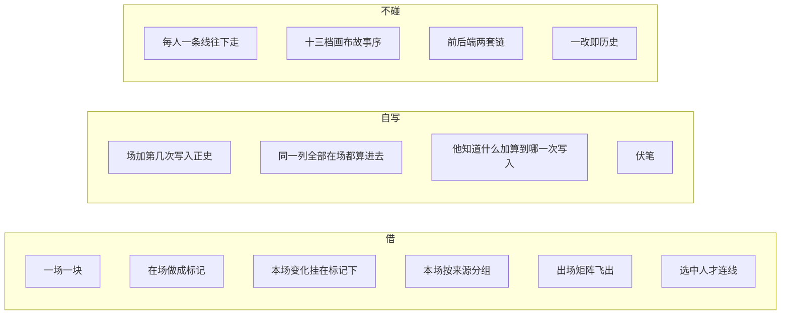

# NarrativeNode 可借鉴对照

对照对象：本仓 `vendor/NarrativeNode/`（只读，不当产品真源）。  
产品真源：[`../设定图-v1.md`](../设定图-v1.md)。怎么算世界：[`../世界引擎.md`](../世界引擎.md)。

**结论：借怎么点、怎么看，不借他们怎么算出每一刻。** 规划文里写过「借他们的演算 + 双时序」——那句作废。NN 是每人一条连线往下走，和设定图「全部已写入正史的场，按故事时间叠进去」不是同一件事。

许可证：`vendor/NarrativeNode/README.md`「Licence」——source-available，**禁止把代码复用进另一款软件**。本文件只记问题形状和界面合同，不贴源码、不拷组件。

---

## 三层深度

| 层 | 深度 | NN 依据 | 设定图落点 |
|---|---|---|---|
| 交互 | 整套形状可对齐 | 场景块、实体标记、变更挂在标记下、按来源分组的本场、occupancy 飞出、章结构导航 | 分场条（v1）；卡上在场；本场按来源分组；连线不当主面。全书细条 / 出场飞出层已拍板，见完整方案第 11 节 |
| 问题形状 | 借问题，不借数据结构 | 知情、关系、知识、同场多人 | 知情 = 他知道什么；伏笔单独一类；关系 = 边 |
| 怎么算世界 | 零 | 每人一条线、出线优先、一改即历史、画布坐标参与故事序 | [`世界引擎.md`](../世界引擎.md) |

打开默认是分场条，见 v1。demo [`../../demos/stripboard-v1.html`](../../demos/stripboard-v1.html) 已有一场一块 + 在场标记。全书细条、出场飞出层已拍板上 v1（只导航；全高出场表作法必有、打开仍不是默认主面）。

---

## 借：交互

「借」= 产品里用同一类界面合同。字段名、组件、怎么往下走一律自写。

### 1. 一场一块，标记是在场

一场戏是一块容器。人 / 地 / 物 / 组织贴在块上，表示这场碰了谁，不是每人一条横向时间轴。

| NN | 设定图 |
|---|---|
| `frontend/src/components/nodes/SceneNode.jsx` | 分场条一行（或戏卡一块）= 一场 |
| `frontend/src/utils/entityHelpers.js` 的 `ENTITY_BUCKETS`：`characters, locations, items, factions, customs` | 这场碰了谁从地点、出场人物、本场变化、伏笔操作算出来，见 v1「纵轴」 |
| 连线默认不是网格 | 看全在场用标尺色点 + 点一列（v1）；出场飞出层只读矩阵已拍板；全高出场表与连线图作法必有、打开不是默认主面 |

### 2. 变更挂在标记下，不是另开台账

相对上一站变了什么挂在标记底下。点标记看这一刻情状，点场景看这一场汇总。

| NN | 设定图 |
|---|---|
| `computeChangeSubChips`（`narrativeChain.js`） | 本场变化 + 上场价值转折；卡上能看见多少靠顶栏 − / +（少则宽、更细）；不做情绪分、不做全页伏笔台账 |
| `components/ui/change-subchips/` | 本场里展示差，不拷这套组件 |
| `SceneChangesView.jsx`：按来源一张卡（实体 / 关系 / 知识） | 点一列 / 点一行：按来源列出这一刻；改内容仍回分场条那一行 |

### 3. 本场钻到「这个实体在这一场」

`SceneChangesView.jsx` 文件头写的合同：一张卡一个来源，点进去钻到该实体在这一场。侧栏「他知道什么」只读这一刻，不当行。

设定图对齐：选中在场标记 → 这一刻情状，并默认打开「他知道什么」；选中块 → 按来源汇总；知情用侧栏。左栏设定不被本场顶掉。

### 4. 连线只解释路径，不当成怎么算世界

NN 把关系线从叙事链里开除（`is_relationship` 不是 chain link）。设定图更彻底：连线后做；就算做了，改世界仍走同一套写入正史，不是第二份库。选中人才画线，可以学这个显示策略。

### 5. 出场矩阵是飞出层，不是默认主面

NN 有实体×场 occupancy 飞出。设定图 v1：**看全在场用标尺色点 + 点一列**；出场飞出层（只读矩阵，点格跳列）已拍板；全高出场表后做。不把全高泳道当打开默认。

### 6. 全书怎么跳

NN 有章结构飞出、点条目平移画布。设定图 v1 用全书细条（列齿 + 窗口框，点/拖跳窗口）加 ‹ › 一次一列。细条是列序号不是画布坐标，也不是按分钟缩放。只改窗口起点，不改场。

---

## 借问题、不借存法

### 知情

NN：`awareness` 三形状（`null` / 扁 dict / `{entries, sources, history}`），还可从关系再算一层。形状探测写在 `narrativeChain.js` 文件头。

设定图：他知道什么是一条边；查询要说明算到第几次写入。确定性 / 来源枚举认 v1，枚举思路可对照 Narra，不对照 NN wrapper。

要借的是：**点这场、点这个人，立刻看到他此刻知道什么。** 不要借 wrapper 和关系再算一层。

### 知识 vs 伏笔

NN：`KnowledgeChip.jsx` —— 画布上可接线的设定条目。

设定图：读者欠账是伏笔（枪在抽屉 = 情状；故事欠一响 = 伏笔）。写下一场侧栏列出相关未收最多 5 条（和这场人/地有关、埋点近优先）。不要建议本场必须埋/推/收哪一件。不要把 Knowledge 节点当伏笔表。

### 关系

NN：关系自己有 `history` + `getRelationshipNodeOrder`，和实体链分开走。

设定图：关系是边，随本场变化开窗/关窗。不需要「关系也是一条可走的链」。

### 变更粒度

NN `extractChangeSet` 叠的是档案字段：`name_change`、`colour_change`、`description_change`、`profile_image_change`、`alias_changes`、`attribute_changes`、`tag_changes`。

设定图一场还有：地点在场、规则怎么拦、价值转折、动作 / 对白 / 内心、省略场、本场任务必填。这些 NN 没有，不要从标记字段去补成一条往下走的链。

---

## 不借：他们怎么算世界

下列路径只用来证明「不要学」，实现时不要对照抄。

### 每人一条叙事链

`frontend/src/utils/narrativeChain.js` 的 `getEntityNarrativeChain`（约 738 行）：从 origin `EntityNode` 出发，沿 `sourceHandle === entityId` 且 `!is_relationship` 的出线往下走。出线冲突用 `find` —— **第一条合格出线赢**。主链走不到锚点时，再沿 `source_entity_id` 往回补孤儿支（`computeEffectiveState` 约 1233 行，注释写明 2026-05-18 的洞）。

后端平行实现：`backend/services/narrative_chain.py`。文件头写明与前端 **必须锁步、没有自动化对拍**。设定图：一份演算，问这一刻只有一个读口。

### 一改即历史

标记上的变更立刻进入后续场景的 `computeEffectiveState`。没有草稿 / 第几次写入正史。设定图：点「写入正史」才进入算出这一刻。

### 故事序掺画布

`frontend/src/utils/storyOrder.js`：13 档约束图。第 6、7 档仍是画布 x/y。拖节点不应改叙事 —— 他们因此堆了很多档，但横轴真源仍不是场上栏位。设定图列号写在场的故事时间上。

### 帮助文案里的「entity chain」

`frontend/src/components/panels/help/tours/entity-chain.js`：把「同一人穿过各场、带着上一场状态」讲成产品概念。这个**现象**设定图也有（人在哪、情状惯性），机制是同一列全部在场都算进去，不是接线。不要把帮助文案里的链当成数据模型。

---

## 对照表（实现时用）

| 要做的事 | 学 NN 的 | 用设定图的 |
|---|---|---|
| 主面一场戏 | 一块容器 + 标记表示在场 | 一场；默认分场条 |
| 看见这场碰了谁 | 块上标记 | 地点、出场人物、变化里的道具组织、伏笔操作 |
| 看见变了什么 | 标记下的差 | 本场变化 + 价值转折；密度靠疏/中/密与 − / + |
| 这一刻 | 点场景汇总 | 标尺点列 → 问这一刻 |
| 他知道什么 | 点人看 awareness | 点在场标记默认打开侧栏 |
| 谁在哪几场 | occupancy 飞出 | 标尺色点 + 点一列；飞出层只读矩阵已拍板；全高出场表后做 |
| 长篇定位 | 章结构飞出 | 全书细条点齿/拖框 + ‹ ›；细条不改场 |
| 算出世界 | **不要学按人一条线** | 全部已写入正史的场叠进去，再按所问故事时间取出 |
| 写入 | **不要学立刻生效** | 写入正史，分配第几次 |
| 伏笔 | **不要学 Knowledge 节点** | 伏笔；相关未收最多 5 |

---

## 看过就知道不要学的坑

- 主链只跟第一条出线 → 必须另写回溯补孤儿支。
- 前端 JS / 后端 Python 两套链，靠注释锁步。
- 标记接线触发大规模重渲染，后来才用 `entityChainIndex.js` 按实体 digest 限流 —— 这是画布链的代价。
- awareness 三形状兼容，是格式改过多次留下的，不是能力。

---

## 和早期规划的差

[`../plans/2026-08-29-world-graph-setting.md`](../plans/2026-08-29-world-graph-setting.md) 仍写过「借他们的演算 + 双时序」「NN 对上怎么算世界」。以本文和 v1 为准：

- 借的是「变更发生在一场戏上、向后能看出此刻状态」这个**交互**。
- 双时序：NN 是画布故事时 vs POV 讲述序；设定图是场上的故事时间 vs 讲述序，另加第几次写入正史。讲述序是透镜和导出顺序，**不参与算出这一刻**。不借 POV 链来算世界。
- 对上的是自写的「算出这一刻」，不是 `getEntityNarrativeChain`。
