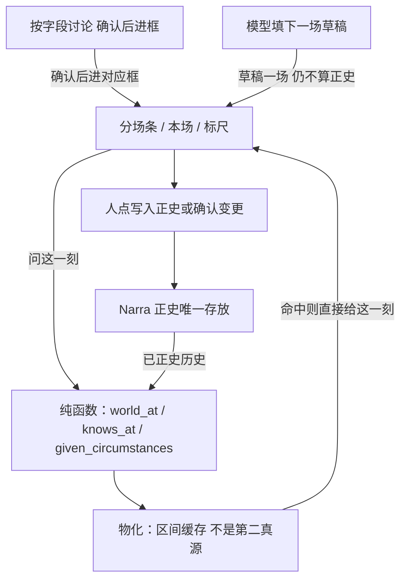
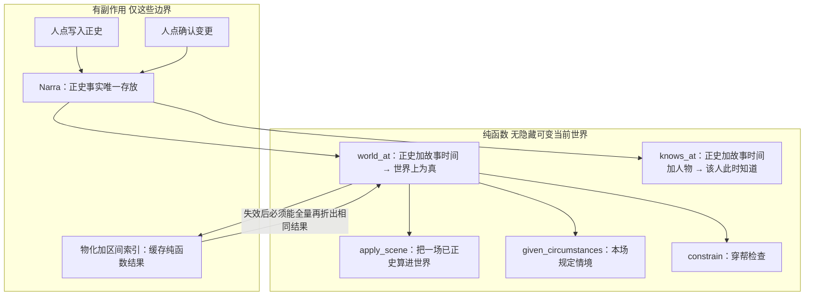
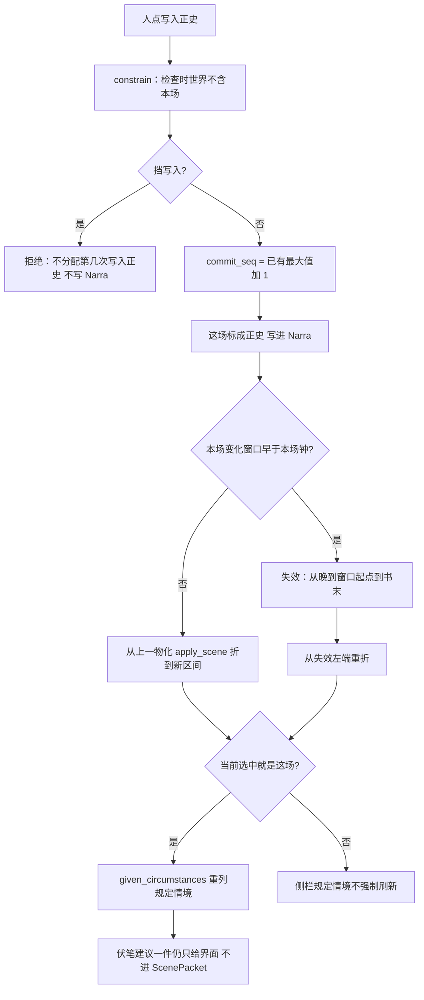
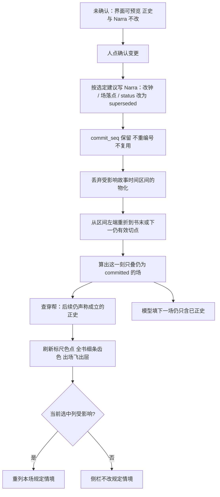
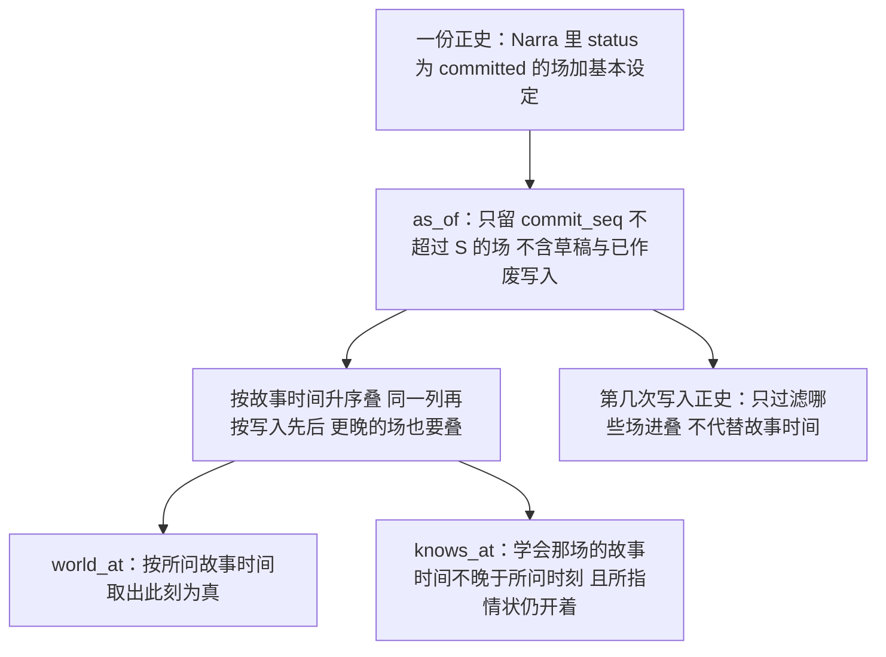
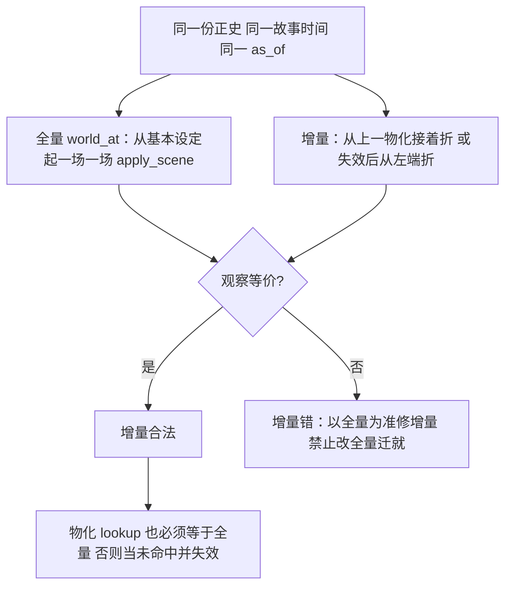
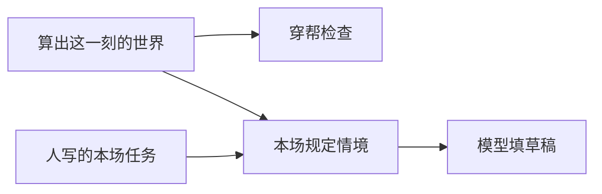

# 世界引擎

产品面、场上有哪些栏、穿帮怎么分级，以 [`设定图-v1.md`](./设定图-v1.md) 为准。世界存在哪、代码落在哪，以 [`plans/2026-08-30-设定图-Narra底座.md`](./plans/2026-08-30-设定图-Narra底座.md) 为准：演算在扩展后的 Narra 里跑，不另写一份 Python `fold` 当第二真源。产品合同冲突时认 v1。

本文回答：世界引擎做什么、怎么算、写下一场时列出什么、**最优架构**（纯函数必须有，光靠函数不够）。函数名、检验用例只在文末「实现附录」。目录以 Narra 底座文为准。架构图 F54–F59。Surreal 事务 / 图边 / 搜全书合同见完整方案 §8.13（F60–F64）；纯函数读的仍是 Narra 里的正史。

世界引擎做两件事：

1. **算出这一刻的世界**：按已经写入正史的场，问到某个故事时间，世界上为真什么、谁在哪、谁知道什么、哪些伏笔还开着。
2. **列出本场规定情境**：写下一场时，从这一刻的世界里取出这场用得上的那一截（知情差、当场利害、相关未收伏笔、上场价值转折、本场默认谁会看见）。

不替人决定写哪一场。不是分场条界面，也不调用模型。

**光函数可以吗：** 算出这一刻、列出规定情境、把一场算进世界、穿帮检查——这些**必须是纯函数**（最优，因为要换一份历史再跑同一套）。整个世界引擎**不能只有内存里的函数**：正史事实只存放在 Narra；人点「写入正史」「确认变更」才有写入；点列要跟手，还要把纯函数结果按故事时间区间写下来（物化），失效后必须能从 Narra 全量再算出同一结果。物化不是第二真源。**纯函数读的是 Narra 嵌入式 Surreal 里已写入正史的记录，不是第二份库、不是物化快照、不是应用里的草稿。** 图边 / 事务 / 搜全书合同见完整方案 §8.13 与 F60–F64。



---

## 架构结论：纯函数必须有，光靠函数不够

先结论，再依据，最后风险。

**结论。** 算出这一刻的函数必须是纯函数：给定「当前这本书里已写入正史的历史 + 查询的故事时间（及人物，若问他知道什么）」→ 确定的这一刻的世界。同一输入同一输出。没有隐藏的可变「当前世界」。删已正史 / 确认变更之后重算 = 换一份历史，再跑同一函数。这是最优，因为要重放、要删正史后仍正确、三时钟不能混成一列序号。

整个世界引擎不能「只有内存里的函数」。最优还要有且仅有这些有副作用的边界：

1. **Narra**：正史事实的唯一存放（含该次写入作废、情状有效区间、他知道什么、第几次写入正史）。fork `vendor/narra`，改它来达到这些函数，禁止仓外再写一套 Python `fold` 当真源。
2. **人点「写入正史」「确认变更」** 才把新事实或作废写进 Narra。MCP mutate 不当写入正史。草稿不进算出这一刻。
3. **物化 + 区间索引**：把纯函数结果按故事时间区间写下来，点列时先查这里。失效后必须能从 Narra 全量再折出相同结果。物化不是第二真源。

语义上，全量从创世叠、与增量 / 物化，必须观察等价：对同一份正史、同一故事时间、同一「算到第几次写入」，两种路径给出同一份这一刻的世界。全量路径是检验预言机；产品路径走增量 / 物化，因为几百列仍要跟手。

每书一份 Narra 世界（完整方案 F51：创建 / 打开 / 切换书；单用户）。`world_at` 的历史以当前打开的这本书为界，不串书。设定物理上是通用 `entity`+`kind`（完整方案 F53）；档案键见 F10。算出这一刻按 kind 过滤在场，不按分表。

**依据。** v1 九条第 5 条：下一场吃全部已写入正史的历史。第 7 条：故事时间、谁在哪一场学会、第几次写入正史，三件分开。第 9 条：正史只在应用里改。世界引擎职责：算出某一故事时间世界上为真什么；写下一场时列出本场规定情境。完整方案 F45：确认变更之后必须重跑受影响故事时间区间的算出这一刻。F50：删已正史后该次写入作废、序号不重编号、算出只叠仍为 committed 的场。Narra 底座：演算在扩展后的 Narra 里跑。

**风险。** 物化与 Narra 不一致时，丢掉这段物化，以 Narra 上的全量 `world_at` 为准。禁止把物化写回当成正史。禁止查询语句自己滤一遍当「这一刻」而不走同一份 `world_at`。

### 光函数：内核可以，整体不行

| 范围 | 可以是纯函数吗 | 为什么 |
|---|---|---|
| `world_at` / `fold`、`apply_scene`、`knows_at`、`given_circumstances`、`constrain` | **必须是** | 同一历史同一时刻必须得到同一世界；删正史 = 换历史再跑；检验才能用全量当预言机 |
| 整个世界引擎（含存放、写入、点列跟手） | **不能只有函数** | 正史要持久；写入必须人点；几百列每次从创世全量叠且不物化，点列会卡；就地改一行「当前世界」则无法换历史重算 |

「内核」在本文 = 上表那些纯函数，不是另开一份仓外模块。代码落在 fork 的 `vendor/narra`，查询语义以本文为准。

### 最优架构清单（模块要对上文件 / 函数）

官方 Narra 没有这些函数。写在 fork 里，**不要**塞进现成的 `vendor/narra/src/services/temporal.rs`（那是弧 / 阶段聚类，产品不接，见 Narra 底座「产品面不接」）。

| 模块（拟新增） | 函数 | 纯函数？ | 做什么 |
|---|---|---|---|
| `vendor/narra/src/services/world.rs` | `world_at(canon, t, as_of=S) -> World` | 是。附录名 `fold`，同一函数 | 已正史历史 + 故事时间 → 这一刻的世界 |
| 同上 | `apply_scene(world, scene) -> World` | 是。附录名 `apply_beat` | 把一场已正史场算进世界（顺序不得调换） |
| 同上 | `knows_at(canon, t, person, as_of=S)` | 是 | 该人此时认为 / 知道。必须等于 `world_at(...).knows[person]` |
| `vendor/narra/src/services/circumstances.rs` | `given_circumstances(world, draft) -> ScenePacket` | 是 | 本场规定情境。**不含**伏笔建议一件、**不含**结构建议 |
| 同上 | `select_open_promises(world, draft) -> Promise[≤5]` | 是 | 相关未收最多 5：先期限到 / 过期，再埋下更近 |
| `vendor/narra/src/services/constrain.rs`（或扩展 `consistency.rs` 只加 v1 规则，不把分数当真源） | `constrain(world, scene)` | 是（只读世界 + 本场草稿） | 穿帮检查：挡写入 / 标黄仍可写 |
| `vendor/narra/src/services/canon.rs` | `commit` / `revise` / `supersede` / `confirm_structure` | 否 | 人点之后才 mutate Narra |
| `vendor/narra/src/services/materialize.rs` | `lookup_interval` / `put` / `invalidate_interval` | `lookup` 只读；`put` / `invalidate` 有副作用 | 物化 `world_at` 结果；不是第二真源 |
| HTTP 薄包 | `GET /world?t=` | 读 | 必须走物化 → 未命中则 `world_at` → 回填。禁止前端再算一遍 |

情状表（写入正史时把本场变化记成窗口，已见下文「写入正史」第 5 步）和物化快照是**同一缓存层的两种查法**：按实体查窗口；按故事时间区间取这一刻。真源仍是这场的本场变化。改场、作废、确认变更之后，受影响区间必须失效并重折。

`GET /world?t=` 的 `t` 是故事时间。`as_of` 是第几次写入正史；v1 主写只用最新一次，`as_of` 先给检验用。

### 禁止当最优的省钱做法

| 做法 | 为什么不采用 |
|---|---|
| 就地改一行 `current_world` | 删已正史 / 晚到窗口无法换历史重算；隐藏可变「当前世界」，与纯函数合同相反 |
| 用模型当世界引擎 | 算出这一刻、规定情境、穿帮检查都不调用模型（v1 / 本文）。同一输入不能保证同一输出 |
| 每次点列都从创世全量折、且不物化 | 语义可当检验预言机；产品路径几百列会卡。最优是增量 + 物化，并用全量做等价测试 |
| 把三时钟合成一列序号 | 九条第 7 条：晚到事实指回故事时间，不改旧场动作 / 对白 / 内心；列号会因插列而变，不能当分钟 |
| 仓外再写 Python `worldgraph/kernel` 当第二真源 | Narra 是唯一世界库；两套 `fold` 会分叉 |
| Graphiti 等当世界真源，或用它们的记录时间冒充第几次写入正史 | AGENTS 硬边界；三时钟不加第四套墙钟 |

### 三时钟 = 三个纯函数，一份正史

不是三套库。一份 committed 场（加基本设定），三个问法：

```
world_at(正史, 故事时间, as_of)  →  世界上为真（情状、人在哪、正在演的场、伏笔状态）
knows_at(正史, 故事时间, 人物, as_of)  →  该人此时认为 / 知道
as_of 过滤  →  只叠 status=committed 且 commit_seq ≤ S 的场；已作废写入不叠；序号不重编号
```

| 时钟 | 问什么 | 落点 | 不代替什么 |
|---|---|---|---|
| 故事时间 | 世界上何时为真 | `event.clock_from/to`；情状窗口同一套钟 | 不代替第几次写入 |
| 知情 | 谁在哪一场学会 | `KnowledgeState` 挂这场；学会那场的故事时间不晚于所问时刻 | 不代替世界上为真 |
| 第几次写入正史 | 晚到事实、作废 / 写入次序 | `scene.commit_seq` | 不代替故事时间；不因删除重编号 |

先按 `as_of` 把该算的场全部叠进去（更晚故事时间的场也要叠，因为晚到窗口可能指回过去），再按所问故事时间取出此刻为真的。算法仍见下文「怎么算」。讲述序不算进这三个函数。

### 规定情境也是纯函数

```
given_circumstances(world, draft) -> ScenePacket
```

输入 = 本场在场（**仅已正史在场**进入 `world`；草稿框里的地点 / 出场人物只用来从已正史世界里过滤这场用得上的一截）+ `world_at` + `knows_at` + 未收伏笔规则（最多 5，先期限到 / 过期）。

**建议本场对伏笔做哪一件不进入该函数，不进入 `ScenePacket`，不进入模型填场。** 结构建议清单同样不进。没有本场任务仍不准点写下一场——那是入口拦截，不是 `world_at` 的事。

### 增量策略（最优，不是偷懒）

| 发生了什么 | 物化怎么做 |
|---|---|
| 在时间轴**末尾**写入正史，且本场变化窗口不早于本场钟 | 从上一物化 `apply_scene` 折到新区间，再 `put` |
| 轴末尾写入，但有**晚到**窗口（`t_from` 早于本场钟） | `invalidate` 从晚到窗口起点到书末，再从该左端重折 |
| 删已正史 / 拖列侵入整列重规划 / 合并 / 换位搬钟 / 改已正史的场 | `invalidate` 受影响区间；从区间左端重折到书末，或到下一仍有效的物化切点 |
| 本页 − / +、疏中密、全书细条跳窗口 | 不写 Narra，不失效物化 |

任何增量必须可用「全量 `world_at`」做等价测试。不等则以全量为准，修增量，禁止改全量去迁就增量。

### 流程图

<a id="f54-纯函数与副作用边界"></a>

**F54 纯函数 vs 有副作用边界**



<a id="f55-点列看这一刻物化"></a>

**F55 点列「看这一刻」：读物化 → 未命中则 `world_at` → 回填**

```mermaid
flowchart TD
  click[点某一列或该列色块]
  t[取该列故事时间起点]
  read[唯一读口 GET /world?t=]
  idx{区间索引命中且未失效?}
  hit[返回物化里的这一刻]
  miss["world_at：从 Narra 取 committed 全量或从左端物化接着折"]
  put[回填物化]
  side[侧栏列出这一列在场 / 可再问他知道什么]
  noFront[禁止前端自己叠场]
  click --> t --> read --> idx
  idx -->|是| hit --> side
  idx -->|否| miss --> put --> side
  read --> noFront
```

产品步骤仍是 F03（点列 → 侧栏列出）。本图是读口内部。草稿在场仍不进这一刻。

<a id="f56-写入正史后增量折"></a>

**F56 写入正史后：写 Narra → 增量折 / 失效 → 侧栏规定情境**



<a id="f57-确认变更删正史重折"></a>

**F57 确认变更 / 删已正史：写 supersede → 区间失效 → 重折 → 查穿帮**



未确认不失效物化、不写 Narra。结构建议不进 `ScenePacket`。

<a id="f58-三时钟同一正史"></a>

**F58 三时钟如何从同一正史算出来（不要三套库）**



<a id="f59-全量折与增量折等价"></a>

**F59 测试：全量折 vs 增量折必须一致（架构流程，不是空话）**



无界面、无模型。失败 = 约定破了。

---

## 什么算引擎，什么不算

| 算 | 不算 | 依据 |
|---|---|---|
| 已写入正史的场，按故事时间叠进「这一刻的世界」 | 按人物一条线只走一个人 | v1「三个时间」；禁止 NarrativeNode 那种每人一条出线 |
| 草稿不算正史 | 一改在场标记就算历史 | v1 草稿 / 正史 |
| 同一列全部在场都算进去（人物、地点、道具、组织、伏笔） | 每人只有一条有效态 | v1 九条第 5 条 |
| 穿帮检查只拦不许写的 | 用历史替人决定写哪一场 | v1 九条第 6 条 |
| 相关未收伏笔最多 5 条 | 伏笔全页台账；用建议指定写哪一场 | v1「伏笔」；建议只给人看 |
| 人在哪、在场、他知道什么，都从这一刻的世界列出来 | 再开一份出场库 | v1「纵轴」从场上栏位算 |

每个可填处：讨论 → 点「写入此框」才进那个框。模型填下一场整场，也是其中一种，不能绕过确认。算出这一刻、列出规定情境、穿帮检查，都不调用模型。不搬铜炉主编。

这一刻的世界是全知的（里面带着每个人「他知道什么」）。本场任务用全知加知情差来定写什么；每人的动作、对白、内心只用该人已经知道的。不要把「填下一场」做成只喂某一个角色的限知（那是铜炉写章正文的办法，不是这场）。详见 v1 九条后刀与抽屉的例子。

界面不许再写一套「算出这一刻」。问这一刻只有一个读口。NarrativeNode 的坑是前端、后端两套叙事链人手锁步；设定图不买这个。

---

## 这一刻的世界里有什么

算出这一刻，不是「把场播完就结束」。先按**写入正史的先后**把该算的场全部叠进去（晚到的事实，变化可能写在故事时间更晚的场上），再按**你问的那个故事时间**取出此刻为真的样子。

问的时候能看见：

- 所问的故事时间、算到第几次写入正史
- 人物、地点、道具、组织、规则（身份，来自设定）
- 此刻仍开着的情状
- 人在哪
- 这一刻正在演的场（分场条上这场占了谁、在哪）
- 此刻各人已经知道的（学会那场的故事时间不晚于所问时刻）
- 算到这一次写入时的伏笔（未收、已兑现、作废都在，写下一场只用未收）
- 结构关系（所属、包含、持有等），以及从场上列出的地点、出场、因果

三件事不要合成一栏：

| 问什么 | 晚到的事实能不能改 |
|---|---|
| 这一列演了谁、在哪（分场条上的在场） | 不能。改在场走「改已写入正史的场」 |
| 这个人在故事里此刻人在哪 | 能。本场变化里开一条所在地窗口，窗口起点可以早于本场 |
| 枪在不在抽屉、伤、立场 | 能。同样走情状窗口 |

「第 3 场的动作、对白、内心不改」管的是那一场已经写下的表演，不是禁止后来把情状、所在地的窗口指回第 3 场那个故事时间。

---

## 怎么算

这就是 `world_at(正史, T, as_of=S)` / 附录 `fold`。纯函数。输入是当前这本书里已写入正史的历史，不是可变的「当前世界」。

```
某一故事时间、算到某一次写入正史 =
  基本设定
  + 所有 status=committed、且不超过这一次写入的场
    （不含草稿、不含已作废写入）
    按所在列故事时间升序，同一列再按写入正史的先后
    一场一场算进去
```

必须分两步，否则晚到的事实和「问过去某一列」会互相踩：


1. **叠（不按所问时刻丢掉更晚的场）。** 取出 `status=committed`、且不超过这一次写入的场（不含草稿、不含已作废写入），按（所在列故事时间起、写入正史先后）排好，从基本设定起一场一场算进去。故事时间晚于你问的那一刻的场也要叠：它的本场变化可能给更早的时刻开窗。列号不是分钟。
2. **取此刻。**
   - 情状：窗口盖住所问时刻（终点空 = 仍开着），且这条不超过这一次写入
   - 正在演的场：场的故事时间窗口含所问时刻
   - 他知道什么：学会那场的故事时间不晚于所问时刻；所指情状此刻仍开着，才算「此刻他握着这条」
   - 人在哪：见下一节

基本设定：人物、地点、规则没有戏也能存在。建设定时写入一条身份类情状，从故事起点一直开着，写入序号为 0（不占「第几次写入正史」）。不造一场假戏当第 0 场。

没点「写入正史」的草稿，问这一刻看不见。该次写入已作废（删已正史之后 `status=superseded`）的场，问这一刻也看不见。第几次写入正史不因删除而重编号。

结构预览（加列 / 减列 / 合并 / 换位 / 拖列侵入 / 拟删正史）在人点「确认变更」之前不写 Narra，问这一刻仍是旧轴。结构建议清单不进入 `ScenePacket`，不指定写哪一场。

---

## 把一场算进世界

只处理已写入正史的场。草稿只存在场的记录里。这就是纯函数 `apply_scene`（附录亦作 `apply_beat`）。

顺序固定，检验按此断言：

1. **在场。** 本场地点和出场人物记入「这一列谁在」。省略场出场人物可空，仍可记换地（有地点和本场变化即可）。
2. **所在地惯性。** 每个出场人物，从本场故事时间起，人在本场地点，直到被后面的场或所在地窗口改掉。
3. **本场变化 → 情状。** 开窗 / 关窗。同一人同一属性若已有开着的窗口且与新窗口重叠：必须写明旧窗收到新窗起点，禁止静默并存两条开着的。新窗起点可以早于本场（晚到）。
4. **知情。** 先吃本场变化里手写的「他知道什么」；再按 v1「在场怎么推出知情」补默认（可被手写覆盖）：同一列、同一地点，动作 → 在场者看见；对白 → 在场者被告知或听见；内心 → 只有本人
5. **伏笔操作。** 改伏笔状态。算出这一刻时读的是操作之后的伏笔，不另算一套。
6. **因果。** 只校验，不另造因果图。前置场必须已经在这次叠进去的正史里。

场面：动作、对白、内心或世界变化至少有一样，不能只存没拆开的散文。省略场：不演这三样，允许换地等变化。

把一场算进世界时，不跑穿帮检查。检查在「写入正史 / 改已写入正史的场」入口跑，避免重算旧稿时被当年的标黄拦住。

---

## 人在哪

```
某人在所问时刻、算到某一次写入 =
  若有所在地情状窗口盖住这一刻
    → 取写入正史更晚的那条（再比窗口起点）
  否则在已写入正史、此人出过场、场的起点不晚于所问时刻的场里
    → 取（故事时间起、写入先后）最晚那场的地点
  否则
    → 无（人还没上过场，不是错误）
```

**同一人同一列两个地点**才叫穿帮，不是「同一列有两场戏、两个地点」。平行戏合法。判定看该列所有已写入正史的场（加上正在写入的这一场）里，同一人是否出现在不同地点，以及所在地是否被两条未收口的窗口同时指到两个地点。

换地：必须另有一场（场面或省略场）。旅行用省略场。空单元格 ≠ 省略场。

---

## 穿帮检查、写入正史、改已写入正史的场、删已正史

检查时用的「这一刻的世界」**不含本场**。本场还是草稿。

必须覆盖的检查：

| 情况 | 怎么处理 | 在哪拦 |
|---|---|---|
| 没有本场任务 | 不准点写下一场 | 填下一场的入口；不是写入正史才拦 |
| 同一人同一列两个地点 | 挡写入正史 | 上一节 |
| 知情穿帮 | 标黄，仍可写入正史 | 动作/对白/内心写了别人不可能知道的；或把甲的内心写进乙的说/想 |
| 价值转折空 | 标黄，仍可写入正史 | |
| 因果指向还不是正史的场 | 挡写入正史 | 前置不在这次算出的世界里 |
| 因果指向已作废写入的场 | 挡写入正史 | 删已正史后前置不再 committed |
| 场面既无动作对白内心也无本场变化 | 挡写入正史 | v1「场面要演」 |

写入正史：

1. 本场任务为空 → 拒绝（写下一场已拦；这里再拦一次直接写入）
2. 穿帮检查；有挡写入的 → 拒绝，不分配第几次写入正史
3. 第几次写入正史 = 已有最大值加一（还没有正史场则为 1；基本设定的 0 不占这个序号；已作废写入的序号仍占着，不填补空洞、不重编号）
4. 标成正史，写回这场
5. 把本场变化记成情状行（方便按人查；**不是第二份真源**，真源仍是这场）
6. 地点、出场人物列成关系，方便按人/地查找
7. 物化：无晚到窗口则从上一物化增量折到新区间；有晚到则失效从窗口起点到书末再重折（F56）。增量必须与全量 `world_at` 等价（F59）

改已写入正史的场：改该场栏位 → 从该场故事时间起，对所有更晚（及同一列写入更晚）的正史场重跑穿帮检查，冲突列表返回给人。不静默改后面场的动作、对白、内心。晚到窗口继续走「新场变化的窗口起点更早」，不要用改旧场冒充。结构手势（换列 / 换位 / 拖列改钟）须人先点「确认变更」，再落到本段写 Narra。

删已正史：不走「改栏位」。这场 `status` 改为 superseded，`commit_seq` 保留、不重编号、不复用。算出这一刻只叠 committed。情状表按受影响列起重放。确认前必须列出影响（空洞、后续正史是否仍成立、知情、伏笔状态、在场连续性、须从下一刻起重算、该次写入作废）并选定补洞建议。禁止静默删除让后面的算出这一刻假装没发生过。

情状表是「把一场算进世界」的缓存。改过或作废之后按该列起重放并重写窗口。检验只打这份演算，不经过「查询语句自己滤一遍」。问这一刻必须走同一套 `world_at`（可先读物化；未命中或失效则从 Narra 重折）。禁止查询语句自己滤一遍当答案。物化与 Narra 不一致时，丢掉这段物化，以 Narra 上的全量 `world_at` 为准。

确认变更之后必须重跑的范围（结构或删正史）：受影响故事时间区间的算出这一刻（先 `invalidate_interval`，再从区间左端重折，见 F57）；若当前选中列受影响则重列本场规定情境（伏笔建议一件仍不进模型）；标尺色点、全书细条齿色、出场飞出层由界面按同一故事轴刷新；查穿帮针对仍声称成立的后续正史。模型填下一场仍只含已正史。增量路径必须与全量 `world_at` 观察等价（F59）。

---

## 本场规定情境（只列，不另存）

换看法不改场上写下的正史。全高出场表后做。v1 主面是分场条加标尺上的在场色点；全书细条只跳窗口；出场飞出层只读。

写下一场时，从这一刻的世界列出**本场规定情境**。`given_circumstances` 是纯函数。入参：这一刻的世界（`world_at` + `knows_at`），加当前草稿里已有的本场任务、地点、出场人物（后两项可空）。不打分。**建议一件不进该函数、不进 `ScenePacket`、不进模型填场。**

- **本场任务**：原样带回（人写的，不算出来）。
- **当场利害**：这场人物和地点上、此刻仍开着的情状（伤、所在、期限等）；地点或出场人物未定则空。
- **知情差**：上述情状里，在场者不知道或以为错的。不自动替人推理没写明的。
- **本场默认谁会看见**：若这场写下动作或对白，按「同场同地」默认谁会看见或听见。给人收窄反讽。
- **相关未收伏笔**：仍未兑现，且与这场人物或地点有关，最多 5 条。先排期限落在本场故事时间或已过期的，再排埋下更近的。障眼法可出现，标「不必收」。
- **上场价值转折**：最近一场已写入正史的场面里那一行；可空。草稿场的价值转折不算上场。

侧栏可**附加**「建议本场对伏笔做哪一件」（埋设 / 推进 / 兑现 / 作废）。这不是规定情境的必填项，不指定写哪一场，不挡写入正史，**不进入**模型填下一场的输入。选取规则见下「伏笔建议（给人看）」；人为空或改掉都合法。没有本场任务仍不准点写下一场。

地点和出场人物还没定：只保证本场任务和上场价值转折能列出；当场利害、知情差、相关伏笔为空，建议也为空。定了再刷新，再让模型填。避免还没定谁在场就把全世界塞进模型。

侧栏「他知道什么」：此人在这一刻知道什么、人在哪、开着的情状。知情不当成纵轴一行。

### 伏笔建议（给人看，不进模型填场）

从已经列出的相关未收（最多 5）里，侧栏可再显示**一条**建议：对本场做埋设 / 推进 / 兑现 / 作废中的哪一件、打在哪一条上。可空。

选取（确定、可检验，不调用模型）：

1. 相关未收里有期限落在本场故事时间或已过期、且不是障眼法 → 建议兑现该条（多条则取期限更早的）。
2. 否则相关未收非空 → 建议推进列表里排最前的那条（即期限优先之后、埋下更近的那条）。
3. 相关未收为空 → 建议为空（可以埋设，但不替人指定埋什么）。
4. 障眼法不进入「建议兑现」。

人不采纳、改成别的操作、本场不动伏笔，都合法。不挡写入正史。不写入本场任务。`propose` 吃的 `ScenePacket` **不含**这条建议。

---

## 能算清世界，不能替你写出下一场

能演进的是世界上为真什么，不是下一场戏。依据：v1 九条第 6 条「不许穿帮，不等于指定写哪一场」；讨论纪要 08-30「作为设定仪器是对的，作为完整小说作法不够」。



算出这一刻，保证下一场吃得到不穿帮的世界。模型填草稿时吃的是本场规定情境，不是整份世界再另塞两样。把整份世界塞进模型，常见结果是复述情状，不是一场有转折的戏。

好戏要的和现在怎么处理：

| 好戏要什么 | 现在有没有 | 会不会要求 |
|---|---|---|
| 这一场改变一个价值 | 价值转折一行 | 空只标黄，仍可写入正史 |
| 在场的人知情不一致 | 他知道什么 | 默认同地动作→全员看见，反讽要人手收窄 |
| 这场对读者欠账做一件事（埋/推/收） | 伏笔操作 + 列出相关未收最多 5 + 侧栏可建议一件 | 建议不挡写入、不进模型输入、不指定写哪一场；列表先排期限到/过期，再排埋点近 |
| 这场要改变什么 | 本场任务必填 | 不检验是不是转折，只检验非空 |

因此：按当前约定跑，稳定产出的是**不穿帮的场**，不是**好的场面**。人把本场任务写成转折、再改动作对白内心，可以出好戏；引擎既不代替这一步，也不用仪表盘来催。

不要用情绪分、人物弧仪表盘、伏笔全页台账来补（v1「不做」）。模型更容易写出有转折的戏，靠的是规定情境里那几样必须带上，不是去改「怎么算出这一刻」。

出处（只写在这里，不进界面）：规定情境是话剧/影视说法；场面与省略是叙述时长的选择；知情差才能写反讽和圈套；枪在抽屉是情状，读者欠一响才是伏笔。

---

## 和 NarrativeNode / 组 3 的差

交互对照见 [`references/narrative-node.md`](./references/narrative-node.md)。实现时会踩的差：

| 他们 | 设定图世界引擎 |
|---|---|
| 沿第一条出线走出一个人的链 | 全部已写入正史的场，按故事时间、再按写入先后 |
| 改在场标记立刻变成后面能用的状态 | 草稿；人点「写入正史」才有第几次写入 |
| 故事序掺画布坐标 | 列号写在场上 |
| Graphiti 墙上的有效时/记录时 | 故事时间 + 第几次写入正史 + 谁在哪一场学会 |
| 前端、后端两套链 | 一份演算，问这一刻只有一个读口 |

打开默认是分场条还是戏卡，是界面，不是引擎。

---

## 实现附录

下列名称只给写代码用。正文和界面用上一节的中文。字段和穿帮分级仍以 v1 为准。

### 目录

实现进 fork 后的 `vendor/narra`（Rust 检验覆盖下表）。HTTP / 分场条薄包，不复制算出这一刻。模块怎么拆见上文「最优架构清单」与 [`plans/2026-08-30-设定图-Narra底座.md`](./plans/2026-08-30-设定图-Narra底座.md)。不要把 `world_at` 写进现成的 `services/temporal.rs`（弧 / 阶段聚类，产品不接）。

禁止：`import scribe3`；读铜炉库；把 Graphiti 当情状；复制 `vendor/NarrativeNode/**`；另写 Python `worldgraph/kernel` 当第二真源；前端再写一套叙事链；就地改一行 `current_world`；用模型当 `world_at`。

### 函数

纯函数（无 IO、无隐藏可变当前世界）：

```
world_at(canon, T, as_of=S) -> world     # 即 fold；canon 从 Narra 取 committed
fold(beats, T, as_of=S) -> world         # 与 world_at 同一函数
apply_scene(world, scene) -> world       # 附录亦作 apply_beat
knows_at(canon, T, person, as_of=S)      # 必须等于 world_at(...).knows[person]
constrain(world, beat) -> {info, warn, strict}
select_open_promises(world, draft) -> Promise[≤5]
given_circumstances(world, draft) -> ScenePacket
```

有副作用（仅人点写入正史 / 确认变更之后，或物化缓存）：

```
commit(draft) -> Beat
revise(beat, patch) -> Beat + 冲突[]
supersede(beat) -> Beat
confirm_structure(op, chosen) -> 列钟 / 正史落点
lookup_interval(T) -> world | miss
put_interval(span, world) -> ()
invalidate_interval(span) -> ()
```

`lookup_interval` 命中必须等于全量 `world_at`；不等则视为 miss 并 `invalidate`。

`World`：

```
t, as_of, nodes, states, where, covering, knows, promises, edges
```

`ScenePacket`：intent、当场利害 states、知情差、本场默认谁会看见、open_promises、上场 value_shift。不含伏笔建议。不含结构建议清单。

`propose(packet)` 写在调模型的代码里，吃 `given_circumstances` 的返回值。算出这一刻的代码文件禁止 `import` 模型 SDK。侧栏伏笔建议只给界面，不并进 `packet`。结构确认变更的建议只给确认对话框，不并进 `packet`。

`fold` 只叠 `status=committed` 的场。`superseded` 保留 `commit_seq`，不进入叠。

`GET /world?t=` 必须走 F55：物化命中则返回；否则调用同一份 `world_at` / `fold` 并回填。禁止查询语句自己滤一遍当答案。

`knows_at` 禁止另开一份知情库；从同一份正史切。讲述序不参与。

### 第一批检验（无界面、无模型）

每条都要能在文件名里对上。失败 = 约定破了，不是「以后再加」。

| 用例 | 期望 |
|---|---|
| 两场已写入正史，只算到第一场 | 问第二列看不到第二场的变化 |
| 草稿场 | 不出现在正在演的场 / 情状里 |
| 同列两人两地（平行戏） | 通过 |
| 同列同一人两地 | 挡写入正史 |
| 省略场换地 | 人在哪变了；不演动作对白内心合法 |
| 晚到：第 5 场变化的窗口指回第 3 列 | 问第 3 列、算到含第 5 场时看得到新情状；第 3 场动作对白内心不变 |
| 甲的内心写进乙的对白 | 标黄，仍可写入正史 |
| 在场动作 | 同地他人默认看见 |
| 列出相关未收伏笔 | 无关地点的不进；规定情境里相关未收最多 5；期限到/过期排在埋点近之前 |
| 因果指向草稿 | 挡写入正史 |
| 叠的顺序 | 同一列先写入的先算 |
| 规定情境：出场人物空 | 知情差为空；伏笔建议为空 |
| 规定情境：知情差 | 只含本场相关情状 |
| 规定情境：上场无价值转折 | 该栏空 |
| 规定情境：默认同地目击 | 列表可断言 |
| 规定情境：上场价值转折 | 只取最近已正史场面，草稿转折不算 |
| 伏笔建议 | 不进 ScenePacket；障眼法不建议兑现；人不采纳仍可写入正史 |
| 作废写入 | 已正史场 superseded 后问这一刻看不见该场变化；其他场 commit_seq 不重编号 |
| 结构建议 | 不进 ScenePacket；未确认变更则 fold 仍是旧轴 |
| 两列钟重叠 | 正式状态拒绝；不得当作 committed 列钟 |
| 全量折 vs 增量折 | 同一正史、同一 T、同一 as_of：`world_at` 全量与增量观察等价（F59） |
| 物化 vs 全量 | `lookup_interval(T)` 命中则等于全量 `world_at`；改场 / 作废后旧物化不得继续命中 |
| 删已正史再算 | superseded 后换历史再跑同一 `world_at`；该场变化看不见；其他场 commit_seq 不重编号 |
| knows_at 与 world_at | `knows_at(canon, T, person)` 等于 `world_at(canon, T).knows[person]` |
| 建议一件 | 不进 `given_circumstances` 的输入、不进 ScenePacket |
