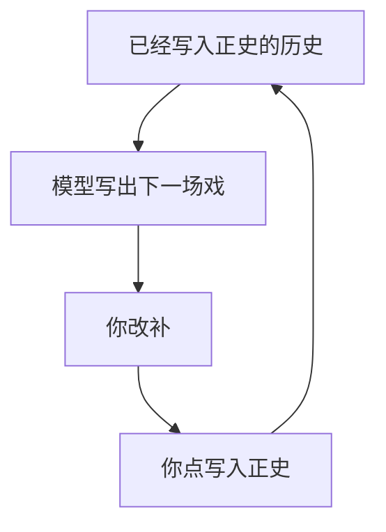

# 讨论纪要 · 2026-08-29

## 结论

设定图是独立新产品，讨论和代码都在本仓。打开是一张分场条：横着是故事里的时间，一行一场戏。模型根据已经写入正史的历史填下一场；你改、你补；你点了「写入正史」才变成后面能用的历史。和铜炉先各做各的。

还没写代码。写入已拍板：正史只在应用里改。Obsidian 不当产品面。后来主面收成一行一场，不是默认实体泳道。

## 这场讨论从哪来

原对话在写作 3.0 仓里：[小说设定系统](4e280192-cfe7-4eaa-814a-f5a58fe1e815)。云端同题：[小说设定系统](bc-13b9e948-b109-4853-863f-1e46effb1249)。你在那轮末尾说「直接起一个新项目，我们在新项目里边讨论吧」；建 `/Users/miaoma/Downloads/设定图` 时请求被中止，随后开了本仓。

完整正文：[`archive/2026-08-29-对话摘录.md`](./archive/2026-08-29-对话摘录.md)  
原始 jsonl：[`archive/2026-08-29-小说设定系统.jsonl`](./archive/2026-08-29-小说设定系统.jsonl)  
规划正文：[`plans/2026-08-29-world-graph-setting.md`](./plans/2026-08-29-world-graph-setting.md)

## 你提出来、后来被收进规划的点

1. 第一性目标是单独写设定，不是铜炉再加一页。
2. 主画面按故事时排戏；格子里是情节（动作 / 对白 / 内心）。后来收成打开是分场条，实体泳道不是默认。
3. 下一场由到这一刻为止的全部历史演出来，不是只接着上一个人。
4. 格子由模型写，你改和补。
5. NarrativeNode、Narra、StoryLine 三种交互都觉得好。
6. 库要能明文看见；在别的软件里改再写回，不好整可以不要。后来拍板：Obsidian 不当产品面。
7. 和铜炉不要有关系，两个独立项目，以后再决定怎么整合。

## 判断：哪些对、哪三处按原话会做砸

站得住的：

- 小说的骨头就是什么时间、什么地方、谁在做什么。用按故事时排的场当主画面，比对人物卡分类夹对。
- 下一场必须看着到这一刻为止的全部历史。
- 模型先填、你改补，长篇才活得下去。
- 「写入正史」必须你点。模型写完就自动进历史，一场写坏，后面全脏。
- 和铜炉分开做。铜炉是写章；这是世界那张表。

按原话会做错的三处：

1. **不能每一句做、说、想都占一场。** 必须是一场戏。做、说、想写在场里面，可以只填一样。
2. **没有戏也要能写设定。** 人物、地点、规则没有一场戏，打开仍然要有用。否则这只是分镜，不是写设定的系统。
3. **模型的正经工作是根据已发生的历史写下一场戏。** 丢整章进去猜场次只能当辅助。先把分场条做对；连线图后做；侧栏问「他知道什么」值得做。

## 底座为什么不是 EverOS / Graphiti 那一套

层不对。那四套是给 Agent 记对话、再检索。设定图要的是作者写世界，图就是作品。

铜炉先写正文再猜设定已经走过这条弯路。Graphiti 的 episode 是拿去抽的原料；我们的场本身就是写下的增量。只借「旧情状关掉、新的另开一条」，不把场存进 Graphiti。

NarrativeNode、Narra、StoryLine 是三种看法收进自写的世界引擎，不是三个软件并排开。

## 开源对照（借什么，不当宿主）

| 项目 | 借 | 不当 |
|------|----|------|
| NarrativeNode | 在情节上记变更，向后算出每一刻状态；故事时 vs 讲述序 | 不当宿主；缺分场条和动作 / 对白 / 内心 |
| Narra | 他知道什么、穿帮检查怎么分级 | 不当后端；不要 MCP 当主写 |
| Obsidian StoryLine | 横时间、竖可换道 | 不当真源；v1 不在那边改库 |
| vis-timeline | 铜炉时间线已经验证过的泳道控件 | 不当数据模型；v1 不绑 |
| EverOS / Graphiti / Semantica / HyperMem / TiMem | 失效不删、开新窗口；导出可读文本 | 不当世界真源 |

## 和铜炉的关系

已拍板：**没有关系。** 两套独立开发。不要 `import scribe3`，不要把这张表嵌回 Codex / Atlas / Timeline。

铜炉对照快照在 [`references/`](./references/README.md)，用来提醒不要再做成「只读表 + 对话改设定」。

## 写入（已拍板）

正史只在应用里改。两个界面都能改同一份故事时间，「写入正史」会和草稿争真源——所以 Obsidian 不当产品面。

后来补的：本场任务、省略场、三个时间、伏笔侧栏、本场规定情境。见 [`讨论纪要-2026-08-30.md`](./讨论纪要-2026-08-30.md)、[`设定图-v1.md`](./设定图-v1.md)。
