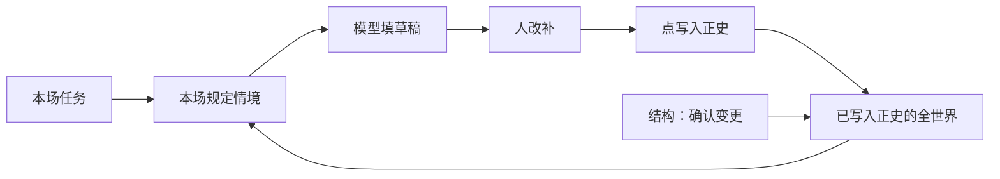
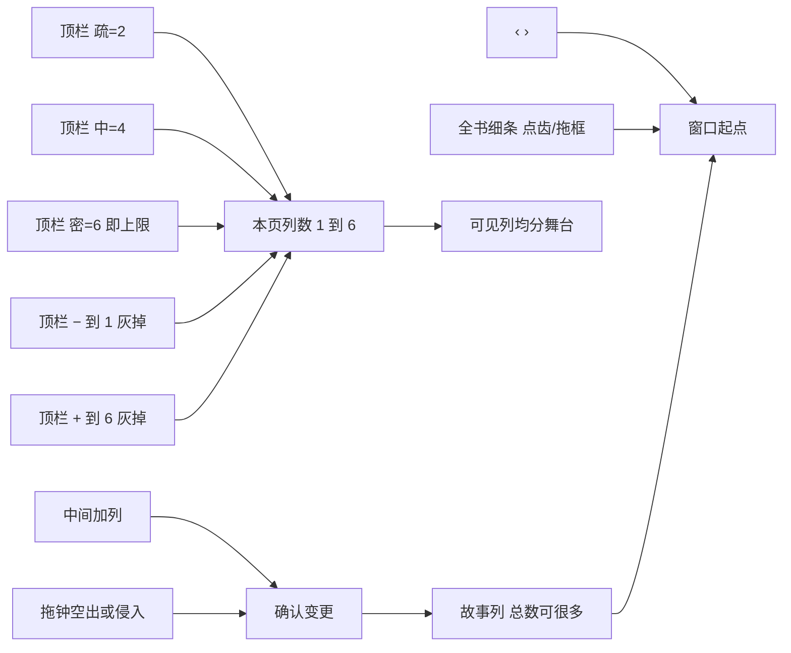

# 设定图 v1

独立产品。打开是按故事时排的一场戏一张条目。讨论过程见 [`plans/2026-08-29-world-graph-setting.md`](./plans/2026-08-29-world-graph-setting.md)。**产品面、九条、栏位、穿帮分级只认本文。** 世界存在哪、演算跑在哪认 [`plans/2026-08-30-设定图-Narra底座.md`](./plans/2026-08-30-设定图-Narra底座.md)。函数名、逻辑栏位键只在本文「用语」和文末「实现附录」。算出这一刻做什么，见 [`世界引擎.md`](./世界引擎.md)。

和铜炉（`/Users/miaoma/Downloads/写作 3.0`）无关。禁止 `import scribe3`、读铜炉库、复用 `SCRIBE3_*` / `s3_*`。禁止把 Graphiti / EverOS / Semantica / HyperMem / TiMem 当世界库。禁止复制 NarrativeNode 源码进产品。

---

## 打开看到什么

横轴有两层：**列**是展示序号；**本页列数 N**是当前屏幕同时显示几列（顶栏疏 / 中 / 密把 N 设为 2 / 4 / 6，− / + 每次 ±1，**下限 1、上限 6**；到 1 时 − 灰掉，到 6 时 + 灰掉；禁止 N=0），可见列均分舞台（少则宽、卡上更细）。**故事列总数仍可很多**（全书细条定位几百列）。**故事时间**是这一列占的真实时长（可以一列一小时、下一列两分钟）。主面**不是 vis-timeline，也不默认做成实体泳道**。打开是一张**分场条**：一行一场戏（或一段省略场）。时间轴是同级可选看法，按旧世界生成，打开书不默认切过去。顶上一根时间标尺，每列写清起止钟点，点某一列看「这一刻」。标尺上方（或品牌行下）有**全书细条**（列齿），点齿或拖窗口框跳本页窗口。顶栏 − / + **不是**中间 ➕加列。

拖一列右边界上的故事时间（例如把 10:00 拖开或拖进邻列）：列宽不变，这一列的时长变了。允许进入邻列故事时间（侵入）。不允许两列钟重叠当正式状态。空出或侵入后进入**整列重规划**：列出全部建议，人点「确认变更」才生效；取消则拖动作废。空出时建议仍含：后面所有列往前移、把这段融进下一列、或插入一列空场次。侵入时额外含：被侵入列压缩、被侵入列整体后移、两列合并、重叠变空场或省略场、重叠变同列多场。侵入是空出的超集，同一对话框，不要两套。不绑 vis-timeline。详细目录见 [`设定图-完整方案.md`](./设定图-完整方案.md) F04。

1. 可以先只写：有哪些人物、地点、规则。没有戏，打开仍然有用。
2. 点「写下一场」，**默认追加在现有最后一列 / 最后一场之后**。先写一行**本场任务**（这场要改变什么）。每个可填处都能和模型讨论；**点「写入此框」才进那个输入框**。侧栏列出本场规定情境，顺序固定：本场任务、上场价值转折、世界账（当场利害）、人物账（知情差：不知 / 信错；本场默认谁会看见附在下面）、读者账、未收伏笔最多 5 条；可附加「建议本场对伏笔做哪一件」，人可忽略，不指定写哪一场。中间加列 / 减列 / 合并 / 换位走「确认变更」，不是写下一场。
3. 模型可以填动作 / 对白 / 内心（仍须你确认进框）。你改、你补。
4. 你点「写入正史」，这场才变成后面能用的历史。
5. 再写别人的下一场时，吃的是**全部**已写入正史的历史，不是只接着上一个人。

正史只在分场条上改。结构改动（加列 / 减列 / 合并 / 换位 / 拖列侵入 / 删已正史）点「确认变更」才写库。导出的 Markdown 给人看，改了不写回；**默认包含草稿场**，须标清已正史 vs 草稿。Obsidian 不当产品面。连线图作法必有：选中人才画、只读；改边仍走写入正史或确认变更，不是第二份库，不是默认主面。



---

## 九条

1. 人物、地点、规则没有戏也能写。场是戏，不是设定的替代。无戏设定只进档案身份层，不替代本场任务；左栏新建后仍引导「写一场让它出场」。
2. 模型填下一场，人改补。每个可填处可讨论；确认后才写入该框。点了「写入正史」才算历史。
3. 一场一场写，或一场一段省略。不能每句话一场。
4. **主面按故事时排戏。** 打开书默认是分场条（一行一场），不是实体泳道，不绑 vis-timeline。时间轴是可选看法，按旧世界生成，**不是**打开默认主面。拖已正史条改钟走「确认变更」，不即时写库；草稿条可即时改钟并用撤销收回。问答在侧栏。连线图是看法，不是默认主面。
5. 下一场吃全部已写入正史的历史。这是不许穿帮：不能只顺着一个人往下写。
6. 不许穿帮，不等于指定写哪一场。没有本场任务不准点「写下一场」。
7. 故事时间、谁在哪一场学会、第几次写入正史，三件分开。晚到的事实指回它为真的那个故事时间，不改旧场的动作/对白/内心。对人只讲故事钟和谁在这场学会；第几次写入正史收在「写入正史 / 改这一场」按钮角标，不当第三根文学时钟。
8. 主题、弧疗程、文句、情绪分数不进主面。章法主脑、章界、回目只挂在书页，不进每一场，不指定写哪一拍。弧光/主题可挂书页主脑；不要在场卡上开「情绪」列。书页允许可选结构备忘（三幕可用），永不进算出这一刻，永不指定写哪一场。
9. **正史只在应用里改。** 改的是分场条上的那一场。导出文件不能写回正史。时间轴改已正史的钟，仍须确认变更后才写库。

第 5 条「吃全部历史」用一场戏说明：

世界上已经为真：刀在抽屉。阿福看见过。阿莲没看见。

- **你决定下一场写什么**：可以写「阿莲来找东西」。你（和模型定这场时）看得到刀在、阿莲不知道。只看阿莲知道的事，想不出这场圈套。
- **填这一场的动作 / 对白 / 内心**：阿莲不能「想起抽屉里的刀」。阿福可以想「别让她开抽屉」。这是每人自己已经知道的。
- **系统查穿帮**：阿莲不能同一时刻既在屋里又在渡口。这要看全部已写入正史的场，不能只沿着阿福一条线。

本场任务用全世界；嘴巴和脑子用各人知道的；查穿帮用全部场。不是「下一场只喂一个人的限知世界」。

---

## 存什么

五类，不要每种设定一张宽表，不要再开一张情节表。设定类优先通用 `entity`+`kind`（人物 / 地点 / 道具 / 组织 / 规则 / 伏笔共用同一套通用实体），只有查询或约束真需要才加专用列。键清单见完整方案 F10。

- **设定**：人物、地点、道具、组织、规则。没戏也能写。物理上是 `entity`+`kind`，不另开 `thing` / `faction` 死表。
- **关系**：所属、持有、包含、地点、出场、因果、他知道什么。地点和出场以场上写的为准，点「写入正史」时列成关系，方便按人/地查找。
- **情状**：某实体某属性在哪段故事时间为真。带窗口起点、终点、第几次写入正史。
- **场**：草稿和正史同一处，用状态区分。
- **伏笔**：对读者的欠账。不是世界上的情状。档案页与设定共用通用实体（`kind=promise`）；未收查询若必须才加专用列。

键名见文末附录与完整方案 F10。

---

## 一场戏里有什么

- **草稿还是正史**
- **场面还是省略场**
- **本场任务**：这场要改变什么；省略场写跨过多长
- **价值转折**：一行，例如 信任→破裂；空则标黄，不挡写入正史
- **故事时间**起止（分钟，半开）；默认等于所在列的故事时间
- **列序号**：当前屏幕上第几列；插入空场次会变，不算分钟
- **给人看的时间称呼**（「第三日黄昏」）；算出这一刻时不读
- **讲述序**：默认等于列序号。不等于列序时，卡上标「读序 n」。顶栏切「按读序排」只改中栏排列和导出 Markdown 的顺序，**不算进这一刻的世界**。全书细条上，讲述序不等于列序的齿有第二道色（只导航窗口，不改场）。
- **第几次写入正史**：草稿没有
- **地点**：场面、省略场都必填
- **出场人物**：场面至少一人；省略场可空
- **动作 / 对白 / 内心**：每人可填；省略场为空
- **本场变化**：情状开窗/关窗、知情；窗口可以早于本场故事时间
- **伏笔操作**：埋设 / 推进 / 兑现 / 作废
- **因果**：前置必须是已写入正史的场
- 场次、本场叙述：可选

- **场面**：要演。必须有动作/对白/内心或世界变化，不能只存没拆开的散文。
- **省略场**：时间在走、不当场演。必须有本场任务。可带换地等本场变化。空单元格 = 没场，不等于省略场。
- 换地必须另有一场（场面或省略场）。旅行用省略场，不必演成假戏。
- 同列 = 同时。人所在地由最近已写入正史的场的地点继承。

栏位键见附录。

---

## 列透镜（故事时间）

列号是**展示序号**，不是用来当分钟去算世界的。本页可见列等宽；每列有半开的故事时间（分钟）。一列 9:00–10:00、下一列 10:00–10:02 合法：屏上一样宽，时间密的那列被压得更紧。

场落在一列上。这场的故事时间窗口默认等于该列的钟。给人看的「第三日黄昏」只是称呼。算出这一刻：按列的故事时间起点升序，同一列再按写入正史的先后。

拖列与列之间的钟边界：不改变列宽。**拖列可以侵入邻列。** 不允许两列钟重叠当正式状态。空出与侵入走同一套「整列重规划」：列出全部建议，人点「确认变更」才生效。

| 拖完发生的几何 | 建议（全部给出，人勾选 / 选一） |
|---|---|
| 缩短、空出一段时间 | 后续往前移；融进下一列；变成空场次；取消 |
| 拉长进入邻列（侵入） | 被侵入列压缩到剩余未侵占时间；被侵入列整体后移（后续连锁后移）；两列合并；重叠时段变空场或省略场；重叠时段变成同列多场（并列，须人确认）；取消 |
| 末列向未来延长 | 接受新时长；取消 |

侵入是空出的超集，不是第二套对话框。确认后列钟不再两列重叠。同列多场 = 同时并列戏。空场次不是省略场。省略场是一场戏、有本场任务、不演动作/对白/内心。空场次是这段故事时间还没写戏。

**本页列数**是当前屏幕同时显示几列，不是故事轴上有几列。顶栏**疏 / 中 / 密**把本页列数分别设为 2 / 4 / 6；**6 就是上限**。**− / +** 每次 ±1，钳在 1–6：N=1 时 − 灰掉不可点；N=6 时 + 灰掉不可点。禁止 N=0 清空状态。档位不是第二套状态：卡上显示什么只看当前本页列数。N=1 或 2 列：展开价值转折和动作/对白/内心。3–4 列：必须能看见价值转折和本场变化摘要（最多 3 条）。5–6 列：只留场次、在场标记、黄点。默认打开为 4 列。空书进入分场条时 N=1。故事列多于本页列数时，‹ › 平移窗口（一次一列）；**全书细条**点齿或拖窗口框也可改窗口起点（细条不改 N）。本页 − / + / 疏中密只改显示，不增删故事列，不写入正史，**不走**确认变更。顶栏 − / + **不是**中间 ➕：中间 ➕ 在选中列缝插入一列故事列（可空列 / 空场），必须确认变更。



晚到事实的情状窗口用故事时间，不是列号。列号因插入空场次会变，故事时间不变。

---

## 三个时间

| 时间 | 问什么 |
|---|---|
| 故事时间 | 世界上何时为真（列上的起止钟点；场默认跟所在列） |
| 知情时间 | 谁在哪一场学会 |
| 写入时间 | 你何时点的写入正史（第几次）。界面收成按钮角标，不单独讲成第三根文学钟 |

```
某一故事时间、算到某一次写入正史 =
  设定的基本设定
  + 所有已写入正史、且不超过这一次写入的场
    （不含草稿、不含已作废写入）
    按所在列故事时间升序，同一列再按写入正史的先后
    一场一场算进去
```

主写只用最新一次写入。v1 不做「回到当时那一次写入」的界面。晚到事实：本场变化里情状窗口的起点，早于本场所在列的故事时间；第 3 场的动作/对白/内心不改。列号变了故事时间可以不变。

「他知道什么」的确定性、来源，枚举封闭，不自动替人推理没写明的。键名见附录。

---

## 在场怎么推出知情

同一列、同一地点：

- 动作 → 在场者默认看见
- 对白 → 在场者默认被告知或听见（可改成只有对谈双方）
- 内心 → 只有本人。写进别人的说/想 = 标黄，不挡写入正史

「他知道什么」指向一条情状或一句手写事实。边上还要记下：是谁告诉的（`source_character`）、误信时实际是什么（`truth_value`）、推出来用了哪几条（`premises`）。知情只追加，改确定性另写一条。栏位与 Narra 对齐，见 [`plans/2026-08-30-设定图-Narra底座.md`](./plans/2026-08-30-设定图-Narra底座.md)。

---

## 伏笔（对读者的欠账）

枪在抽屉 = 情状。读者见过枪、故事欠一响 = 伏笔。算出这一刻吃情状；写下一场吃未收的伏笔。

一条伏笔：欠读者什么；种类（枪 / 悬疑 / 人物 / 期限 / 障眼法）；哪一场埋下、哪些场推进、哪一场兑现；未收 / 已兑现 / 作废；关联的人/地/物。

喂给模型的未收（规定情境里列出，模型填下一场只吃这份列表，不吃「必须做哪一件」）：

- 仍未兑现
- 且与这场出场人物或地点有关
- 上限 5
- 先排期限落在本场故事时间或已过期的，再排埋下的列更近的
- 障眼法可出现，标「不必收」
- 侧栏底部写「另有 N 条未收，见各档案页」，避免第 6 条枪从规定情境蒸发
- 本场故事时间已过某条期限且本场未兑现/作废：标黄「期限已过，读者还欠这一响」，仍不挡写入正史，仍不指定写哪一场

侧栏可**附加**「建议本场对伏笔做哪一件」（埋设 / 推进 / 兑现 / 作废）。人可忽略；不挡写入正史；不指定写哪一场；没有本场任务仍不准点写下一场。建议不写入本场任务，不进入模型填下一场的输入。

场上可标这次是埋设 / 推进 / 兑现 / 作废。不是每场都必须动伏笔。切到出场表「伏笔」时，伏笔是行，不是第二份库。全高出场表作法必有，打开仍不是默认主面。

---

## 三个操作

| 操作 | 做什么 | 不是什么 |
|---|---|---|
| 写入此框 | 讨论稿进对应输入框，仍是草稿 | 不是历史 |
| 写入正史 | 草稿变正史，分配第几次写入，跑穿帮检查 | 不改更早场的动作/对白/内心；加列不会自动走这条 |
| 确认变更 | 结构：加列 / 减列 / 合并 / 换位 / 拖列侵入重规划 / 删已正史 / 时间轴拖已正史条改钟。重新算、列出全部建议，人点才写 Narra | 不是本页 −/+；不是写入此框；不是时间轴草稿条即时改钟 |
| 改已写入正史的场 | 改该场，从该列起重算后面，冲突标出来 | 不是晚到事实；结构手势须先确认变更 |
| 状态从更早为真 | 本场变化的窗口起点更早 | 不另开一套库 |
| 删已正史 | 列出影响与补洞建议，确认后该次写入作废（序号不重编号），按选定建议补洞 | 不是静默删掉让算出这一刻假装没发生过 |

检查分级：只记；标黄仍可写入正史；挡写入正史。

v1：同一人同一列两个地点 = 挡；知情穿帮 = 标黄；价值转折空 = 标黄；连续两场空转 = 可点黄条，仍不挡；没有本场任务 = 不准点写下一场。信错的人「想起」实际真值 = 挡。规则 `enforcement=挡` 且本场违反 `scope` = 挡；规则仅标黄则标黄仍可写。本页 − / +、疏 / 中 / 密不走确认变更。时间轴拖已正史改钟走确认变更。

---

## 写下一场怎么接到模型

算出这一刻、把一场算进世界、穿帮检查、列出相关未收伏笔、列出本场规定情境、写入正史、改已写入正史的场——这些都不调用模型。怎么拆见 [`世界引擎.md`](./世界引擎.md)。

**每个可填字段**（本场任务、场次、价值转折、动作/对白/内心、当场情状/本场变化、基本设定、下一场整场）走同一条：讨论 → 点「写入此框」只写入该框（仍是草稿）。

模型填下一场整场，吃的是**本场规定情境六块**（本场任务、上场价值转折、世界账、人物账、读者账、未收伏笔），不是整份世界再另塞本场任务和伏笔。禁止把 `world_at` 全量 JSON 拼进嘱咐。没有本场任务不准确认下一场整场。点「写入正史」才变成后面能用的历史。不搬铜炉主编流水线。


单用户：无登录、无权限、无协作、无账号。本机一个人，多书是一个人的多本书。界面：独立 Vite/React。v1 主面用列表/表格即可，不绑 vis-timeline。接口见附录。

---

## 纵轴：一场戏碰到的维度都能看见

纵轴不是世界的分类夹，是同一场换个看法。换轴不改库。先前写「v1 只有人和地点」是怕表太高，不是场只能挂这两样。

**一场戏能碰到的行（封闭，从场上栏位算出来，不另填一套）**

| 维度 | 从哪算 | 适合当行吗 |
|---|---|---|
| 地点 | 这场地点 | 是 |
| 人物 | 出场人物 | 是 |
| 道具 | 本场变化里的道具 | 是 |
| 组织 | 出场人物所属组织，或变化打在组织上 | 是 |
| 伏笔 | 伏笔操作 | 是 |
| 规则 | 变化打在规则上，或本场触发的穿帮检查 | 不当行。规则是检查，不是占位。写在本场 |
| 知情 | 他知道什么 | 不当行。问的是「他知道什么」，用侧栏 |

**怎么展示**

打开默认**不是**实体泳道，也**不**绑 vis-timeline。

1. **分场条（主写）**：一行一场。高度只跟场次数走。同列号的行视觉成一组 = 同时。点行打开本场改动作/对白/内心。
2. **场上永远列出在场**（地点、人物、道具、组织、伏笔的标记）。不换轴也能看见这场碰了谁。
3. **时间标尺 + 在场条**：顶上本页可见列等宽。每列写起止钟点和时长。尺上五条细轨——地点 / 人物 / 道具 / 组织 / 伏笔。该列有在场就亮。点色块或点列 → 「这一刻」。列右缘拖故事时间，见「列透镜」。细轨上不放可编辑卡片。
4. **点一列看这一刻**：侧栏列出这一列在场的全部维度（谁在哪、动了哪件道具、哪条伏笔）。要改内容，点进分场条那一行，不在清单里另开一套编辑。
5. **出场表（可选看法，不是打开默认）**：要「这个人物/这个地点的全部戏」时才切。一场戏仍可能画在多行，点哪一行都是同一场。只显示当前窗口里有戏的行。后做；做的时候也不必用 vis-timeline。

不做：用户自建无限纵轴（「按情绪」「按主题」）。没有栏位就没有行。

---

## 用语（界面中文 · 代码键不动）

对外称**场**（场面或省略场）。代码里这场仍用英文键，不是麦基那种场内节拍。分场条是产品名，对应制片的分场表。

| 代码键 / 内部 | 界面或正文 |
|---|---|
| `Beat` kind=scene | 场面 |
| `Beat` kind=ellipsis | 省略场 |
| 空列 spare | 空场次（有故事时间、没戏） |
| `title` | 场次 |
| `intent` | 本场任务 |
| `value_shift` | 价值转折 |
| `at` | 地点 |
| `involves` | 出场人物 |
| `tracks.do / say / think` | 动作 / 对白 / 内心 |
| 这一格 `state` | 当场情状 |
| `delta` | 本场变化 |
| `node.setup` | 基本设定（人可称小传） |
| kind 人 / 地 / 物 / 势力 / 规矩 | 人物 / 地点 / 道具 / 组织 / 规则 |
| `promise` | 伏笔（释义：对读者的欠账） |
| plant / advance / payoff / discard | 埋设 / 推进 / 兑现 / 作废 |
| open / paid | 未收 / 已兑现 |
| red_herring | 障眼法 |
| `commit` | 写入正史 |
| `committed` | 正史 |
| `draft` | 草稿 |
| `superseded` | 该次写入作废 |
| 确认变更 | 确认变更 |
| 顶栏 − / + | 本页显示几列 |
| 中间 ➕ | 在选中列缝插入一列故事列 |
| `clock_from/to` | 故事时间 |
| `knows` 侧栏 | 他知道什么 |
| `fold` | 算出这一刻的世界 |
| `apply_beat` | 把这一场算进世界 |
| `constrain` | 穿帮检查 |
| `given_circumstances` / ScenePacket | 本场规定情境 |
| `propose` | 模型填下一场 |
| `world` | 这一刻的世界 |
| `select_open_promises` | 列出相关未收伏笔 |
| `revise` | 改已写入正史的场 |
| `commit_seq` | 第几次写入正史 |
| `strict` / `warn` | 挡写入正史 / 标黄仍可写 |
| 左栏 | 设定 |
| 一条 node 的页 | 档案 |
| 丢一段草稿 | 丢一段草稿（辅助入口，不是主路） |
| 书 | 书（一本对应一份 Narra 世界） |
| 检查器 | 本场 |
| 在场标记 | 在场 |
| occupancy | 出场表（全高表与飞出层都是作法必有，打开不是默认主面；飞出层只读） |

**规定情境**：这场写戏的给定条件（话剧/影视通用说法）。六块顺序：本场任务、上场价值转折、世界账、人物账、读者账、未收伏笔。**知情差**：在场者之间知道的不一样，含不知和信错。**当场利害**：伤、秘密、期限等此刻仍开着的情状。**读者账**：沿讲述序，读者应当已经看见、而本场某在场者还不知道的事实；不算进算出这一刻。**本场默认谁会看见**：同场同地写下动作或对白时，默认谁会看见或听见。**人物透镜**：只改看法，禁止当 fold。

正文、纪要、交接文件禁止用下面左列当说明（实现附录和本表可以写右列）：

| 不要写 | 改成 |
|---|---|
| L1 / L2 / L3、演进核、内核、应用层 | 直接说在做什么 |
| 账本、出戏机、场景包 | 正史；算出这一刻的世界；不代写下一场；本场规定情境 |
| replay、切片、World 快照 | 按写入先后把场叠进去；问到某一故事时间时世界上为真的样子 |
| 闸、闸级 | 穿帮检查；挡写入正史 / 标黄仍可写 |
| 投影（当软件词）、物化、初值 | 换个看法；把本场变化记成情状；基本设定 |
| 三轨、芯片、walker、覆盖（当在场） | 动作 / 对白 / 内心；在场；按人物一条线往下走（禁止）；这场碰了谁 |
| 合法性、选题、意图、债（当主标签）、算进后面、故事钟 | 不许穿帮；写哪一场；本场任务；伏笔；写入正史；故事时间 |

不要对人说：节拍（当一场用）、检查器、势力、规矩、物。

---

## 界面

```mermaid
flowchart TB
  overview[全书细条 列齿]
  strip[分场条 一行一场]
  ruler[顶栏标尺 列号]
  fly[出场 只读]
  graph[关系 只读]
  inspector[本场 动作对白内心]
  nodePage[档案 基本设定]
  dyn[出场与情状窗 只读]
  moment[这一刻清单]
  next[写下一场 本场任务加规定情境]
  know[侧栏 他知道什么]
  overview -->|只改窗口起点| strip
  fly -->|点格跳列| strip
  graph -->|选中人才画| strip
  strip --> inspector
  strip --> nodePage
  nodePage --> dyn
  dyn --> strip
  ruler --> moment
  moment --> strip
  inspector --> strip
  next --> strip
  know --> inspector
```

- 空态：「先建一个人物、一个地点」或「写下一场」。左栏新建成功后引导「写一场让它出场」；档案在还没有已正史在场时标「尚未出场」。
- 主面：分场条（一行一场）。本页可见列等宽 + 每列故事时间 + 在场色点。顶栏疏 / 中 / 密把本页列数设为 2 / 4 / 6（6 即上限）；− / + 每次 ±1，钳在 1–6。拖列右缘改故事时间，侵入后整列重规划并确认变更。点一列看这一刻。点一行改动作 / 对白 / 内心。中间 ➕ 在列缝加故事列，不是顶栏 +。时间轴页签标注「按旧世界生成」，打开仍落在分场条。
- **全书细条**：标尺上方（或品牌行下）一条列齿。点齿或拖窗口框 = 改本页窗口起点。‹ › 仍一次一列。细条不改场、不写入正史。
- 筛选：左栏默认只列**当前本页列**里出现过的人物/地点/道具/组织/伏笔（从可见场的地点、出场人物、道具、组织、伏笔算出，含草稿在场）。输入搜全书设定。点名字打开档案。行上「场」才只看有它的场，不是出场表。
- 设定增删：左栏「新建」写入设定（人物 / 地点 / 道具 / 组织 / 伏笔 / 规则），不进正史演算。没戏也能建。已挂在场上的不能从设定里删，先从分场条拿掉在场。删设定 ≠ 从这场拿掉在场标记。
- **出场飞出层 / 全高出场表**：标尺旁「出场」打开矩阵（行=当前搜/滤后的实体，列=故事列，格=有无在场）。只读。点格跳到该列。改在场仍拖标记。不是打开默认主面。全高出场表作法必有，打开仍不是默认主面。
- **关系**：选中人后打开只读连线。边来自已正史的在场 / 所属 / 知情。拖边不能改正史。不是第二份库，不是默认主面。
- **人物透镜**：顶栏可切「只看某人」。中栏和侧栏可滤成该人知情；算出这一刻仍是全知。本场任务仍全知。禁止透镜写回正史。
- **书页**：主脑（一句前提）、章界、回目挂在书上。不算进算出这一刻。不指挥每一场对应哪一拍。导出可按回分段。允许可选结构备忘（三幕/七步勾选），明确不挡写入、不进本场规定情境、不指定写哪一场。
- **档案**（不是纵轴行另开一套档案）：每个人物 / 地点 / 道具 / 组织 / 规则一页，填基本设定（没戏也能写）；一条伏笔一页。动态相关（出场的场、情状窗口、相关伏笔、他知道什么）只读，从算出的这一刻列出。要改世界上发生了什么，点进分场条那一场。换纵轴不新开档案。
- 写下一场侧栏：本场规定情境六块顺序不得乱（本场任务、上场价值转折、世界账、人物账、读者账、未收伏笔最多 5）+ 附加「建议本场对伏笔做哪一件」（可空、可忽略）。任务框和整场草稿都有「讨论」；确认后才进框。读者账不算进算出这一刻。
- 本场：每个可填处（场次、本场任务、价值转折、动作/对白/内心、在场上的当场情状/本场变化）有「讨论」。基本设定在档案页写，在场标记上只读。确认写入该框。增减在场仍是拖进拖出。动作对白内心可直接改。点写入正史才变成后面能用的历史。
- 侧栏问答「他知道什么」：只读这一刻在此人上的样子。知情不当纵轴。
- 顶栏可切「按读序排」：只改中栏排列和导出顺序，不算进算出这一刻。导出默认含草稿场，每场标清正史 / 草稿。
- **多书**：顶栏或门厅可创建书、打开书、切换书。每书一份 Narra 世界。单用户、本机、无登录。空书进入分场条（本页 1 列）。
- **丢一段草稿**（辅助，不是主路）：粘贴一段 → 建议拆成哪些场 / 写入哪些框 → 人逐条点「写入此框」→ 「写入正史」仍须另点。禁止一贴即正史。丢整章猜格子仍禁止当主路。

张力不另存分数。张力 = 这场本场任务还没落地 + 当场利害（伤、秘密、期限、未收的伏笔）+ 知情差。界面只把这几项列出来，不画曲线、不打 0–1 分。情绪 / 价值转折 = 场上的价值转折一行（例如 信任→破裂）；空则标黄，不挡写入正史。3–4 列密度下必须能看见价值转折和当场利害/本场变化摘要。连续两场价值转折空：侧栏上场那一行下加可点黄条「连续空转」，仍不挡写入正史。不做雷达图。

---

## 不做（v1）

- 铜炉任何代码、库、流水线、质量仪表盘、情绪分、伏笔全页台账；不把铜炉主编当设定图的讨论实现
- Graphiti / EverOS 等当世界真源，或拿它们的记录时间冒充第几次写入正史
- 复制 NarrativeNode 源码。StoryLine 当第二份库或 Obsidian 宿主。Narra 是唯一世界库（fork 后改），落地见 [`plans/2026-08-30-设定图-Narra底座.md`](./plans/2026-08-30-设定图-Narra底座.md)；交互对照 NN 见 [`references/narrative-node.md`](./references/narrative-node.md)
- Obsidian 当产品面或写回
- 无本场任务只按历史续「下一件合理的事」
- 读者知情全页台账、主题课、人物弧仪表盘、连线图当默认主面（读者账在规定情境第五块；连线图只读飞出层）
- 人物透镜当 fold / 限知世界
- 章法主脑指挥每一场必须对应哪一拍
- 自由拖拽关系网当主画面
- 按人物一条线往下算，丢掉同一列其他在场
- 用户自建无限纵轴（情绪、主题等没有栏位的行）
- 把「他知道什么」当成纵轴的一行一种秘密
- 五段全高泳道当「看全部」的默认界面；出场飞出层不得改成打开默认主面
- vis-timeline 当 v1 必选控件；实体泳道当打开默认主面；全书细条按真实分钟缩放
- 影视分场条按拍摄日重排（我们按故事时排，只借「一行一场」）
- 把伏笔建议写成挡写入正史，或用建议指定写哪一场 / 写入本场任务 / 喂给模型当命令
- 本页列数做成 0 或大于 6；把疏/中/密当成与 1–6 无关的第二套状态
- 两列故事时间重叠当正式状态
- 加列自动当成写入正史
- 静默删已正史
- 结构建议进入模型填下一场
- 顶栏 − / + 做成中间 ➕加列
- 丢一段草稿一贴即正史，或自动指定写哪一场而不经「写入此框」
- 登录、账号、权限、多人协作
- 为道具 / 组织各开一张与 `entity` 并列的死表当第二真源

---

## 开工顺序

每一步结束必须能打开分场条。禁止嵌铜炉、禁止复制 NarrativeNode。**改 `vendor/narra`。** 不绑 vis-timeline。落地顺序见 [`plans/2026-08-30-设定图-Narra底座.md`](./plans/2026-08-30-设定图-Narra底座.md)「开工顺序」。

1. 无界面检验（在扩展后的 Narra 上）：算出这一刻、第几次写入正史、同一人同一列两地、知情标黄、晚到窗口、省略场换地、本场规定情境（出场空则知情差空）
2. 通用 `entity`+`kind` + 接口；浏览器打开空分场条（HTML 表即可）；每书一份世界
3. 行上可改动作/对白/内心，点写入正史；顶栏标尺 + 在场色点 + 点一列；全书细条跳窗口；疏/中/密与 − / +（本页列数 1–6）
4. 写下一场：默认追加在最后；本场任务 + 本场规定情境 + 讨论确认进框 + 模型填整场；草稿不算正史；侧栏可附加伏笔建议一件（不进模型输入）；中间加列 / 减列 / 合并 / 换位 / 删已正史走确认变更
5. 侧栏问他知道什么；可选导出 Markdown（默认含草稿、标清正史/草稿）；出场飞出层（只读矩阵）；人物透镜；关系只读；书页章法；多书切换；丢一段草稿辅助入口。全高出场表与连线图作法必有，打开不是默认主面

---

## 实现附录

下列只给写代码用。正文和界面用「用语」右列。

### 五类（逻辑模型）

物理表是扩展后的 Narra，见 [`plans/2026-08-30-设定图-Narra底座.md`](./plans/2026-08-30-设定图-Narra底座.md)。下面是逻辑上有哪几类，不是要求再开一套 Surreal。

| 类 | 存什么 |
|---|---|
| `entity` | 人物 / 地点 / 道具 / 组织 / 规则 / 伏笔。`kind` = person \| place \| thing \| faction \| rule \| promise。稀疏档案键在 `profile`。官方 Narra 的 `character` / `location` 收成同一套，按 kind 过滤，不另开 `thing` / `faction` 死表 |
| `edge` | `related` `member` `holds` `contains` `at` `involves` `causes` `knows` |
| `state` | `entity, attr, value, t_from, t_to, commit_seq` |
| `beat` | 场。`status` = draft \| committed \| superseded |
| `promise` | 伏笔的查询视图（未收列表）。真源是 `entity` kind=promise + 场上 `promise_ops`；仅当列出相关未收必须走专用列时才物化 `status` / `kind` / `deadline` |

### 场上栏位

```
id
status            draft | committed | superseded
kind              scene | ellipsis
intent
value_shift?
t_from, t_to
col
t_label?
narrative_order
commit_seq
committed_at
at
involves[]
tracks[]
delta
promise_ops[]     {promise_id?, op: plant|advance|payoff|discard, text?}
causes[]
title?
prose?
```

知情确定性：`knows / suspects / believes_wrongly / uncertain / assumes / denies / forgotten`。来源：`told / overheard / witnessed / discovered / deduced / read / remembered / initial`。无逻辑闭包。

`knows` 边：`{person, fact_ref, certainty, method, beat_id, source_character?, premises[]?, truth_value?}`。只追加。

Promise：`kind` = gun \| mystery \| character \| clock \| red_herring；`status` = open \| paid \| discarded。

### 函数

```
fold(beats, T, as_of=S) -> world
apply_beat(world, beat) -> world
constrain(world, beat) -> {info, warn, strict}
select_open_promises(world, draft) -> Promise[≤5]
given_circumstances(world, draft) -> ScenePacket
commit(draft) -> Beat
revise(beat, patch) -> Beat + 冲突[]
confirm_structure(op, chosen) -> 列钟 / 正史落点（人点确认变更之后）
supersede(beat) -> Beat  # status=superseded；commit_seq 保留；fold 不再叠这场
```

```
discuss(target, world, current) -> 对话 + 待确认稿
confirm(target, proposal) -> 只写入 target 对应输入框（仍是草稿）
propose(packet) -> 草稿 Beat
```

`propose` 吃 `given_circumstances` 的返回值。没有 `intent` 不准 confirm 下一场整场。算出这一刻的代码文件禁止 `import` 模型 SDK。`ScenePacket` 不含伏笔建议，不含结构建议清单。`fold` 只叠 `status=committed`，不含草稿与已作废写入。

拆法、`World` / `ScenePacket` 字段、叠与按故事时间取出，见 [`世界引擎.md`](./世界引擎.md) 实现附录。穿帮分级仍以本文「三个操作」为准。

### 接口

`PUT /nodes` `PUT /edges` `POST /beats` `POST /beats/:id/commit` `POST /beats/:id/revise` `POST /beats/:id/supersede` `POST /structure/confirm` `POST /propose` `GET /world?t=` `GET /beats?from=&to=` `GET /coverage?from=&to=` `GET /promises?open=1&person=&place=`。`GET /swimlane` 后做。存扩展后的 Narra（其嵌入式 Surreal），见 [`plans/2026-08-30-设定图-Narra底座.md`](./plans/2026-08-30-设定图-Narra底座.md)。

```
lanes(beat, axis):
  place    → [at]
  person   → involves
  thing    → delta 里的 thing
  faction  → involves 的所属组织 ∪ delta 里的 faction
  promise  → promise_ops
  coverage → 五条细轨的有无，不是五行实体
```
