# 设定图 · 完整方案

综合阅读入口。产品代码未开工。本文把已拍板合同、世界库落地、算出这一刻、文学主面改造、以及全部逐步流程写在一处，**不推翻**下列三份真源：

| 认什么 | 认哪份 |
|---|---|
| 产品面、九条、栏位、穿帮分级、用语 | [`设定图-v1.md`](./设定图-v1.md) |
| 世界存在哪、演算跑在哪、物理表 | [`plans/2026-08-30-设定图-Narra底座.md`](./plans/2026-08-30-设定图-Narra底座.md) |
| 算出这一刻做什么、本场规定情境字段、叠与取的算法 | [`世界引擎.md`](./世界引擎.md) |

文学目标、主面改造动机、填场与人改、一场一块的产品与流程，以 [`plans/2026-08-30-文学主面改造.md`](./plans/2026-08-30-文学主面改造.md) 为一等源全文吸收；仅当某条与上表三份或 [`../AGENTS.md`](../AGENTS.md)「已拍板」硬冲突时丢弃，并在文末 superseded 清单标明。原未拍板五项（用户编号 1–5）已于 2026-08-30 拍板上 v1，规则与流程图见第 11 节；同日夜拍板的结构编辑（拖列侵入整列重规划、下一场默认最后追加、已正史可删须补洞）见第 11.6 节与 F45–F50；**「本页列数无上下限」已被同日更正覆盖为 1–6**（第 11.6 更正 + 第 11.7 节）；导出含草稿、多书单用户、丢一段草稿、档案键、通用实体见 F13 / F51–F53 / F10；文学审查与闭环补丁见第 12 节。Surreal 用满与铜炉对照（机制可迁、产品不合并）见第 8.13 节与 F60–F64；文学教授对照见 8.13.7 / 12.6。

对人说话只用本文「用语」右列。代码键、路径、库名可英文。

---

## 1. 结论与范围

设定图是独立产品：作者在**故事时**上一场一场写世界。打开是**分场条**（一行一场，或一段省略场）。人写**本场任务**；侧栏列出**本场规定情境**；模型填草稿；人改、补；点了「写入正史」才进入**算出这一刻**，才变成后面能用的**历史**。格子内容用「写入此框」；一场成为历史仍用「写入正史」；加列 / 减列 / 合并 / 换位 / 拖列侵入 / 删已正史用「确认变更」（未确认则界面可预览，正史与 Narra 不改）。正史只在应用里改（分场条那一行）。Narra（fork `vendor/narra`）是唯一世界库。与铜炉（scribe3）无关。

文学上要做成的不是一张不穿帮的空表。界面必须让人看见三件事：**这场转了什么、谁知道谁不知道、读者还欠哪一响**。依据：[`plans/2026-08-30-文学主面改造.md`](./plans/2026-08-30-文学主面改造.md) 结论段。v1 作为设定仪器是对的；作为完整小说作法不够——能算清世界，并不能替人写出下一场好戏。算出这一刻怎么算，不动；主面可以再补；不替人决定写哪一场。

最优改造不是改成 NarrativeNode 画布，也不是改成剪辑软件。主面仍是分场条。

范围：本文覆盖产品流程、世界库、世界引擎、模型填场、硬边界、已拍板五项、结构编辑与确认变更、文学审查闭环与风险。不写代码。`demos/stripboard-v1.html` 只用来核对已演示的点击步骤（假数据，刷新即丢，不是真源；旧 `gapMenu` 三选一立刻生效已过期）。

---

## 2. 文档地图（流程图索引）

每张图覆盖一条产品规则或一条演算合同。节点为中文；专有名词 Narra、Markdown、Vite/React 可保留。原 F36–F39 已从「到此为止」改为 v1 路径。文学审查补进 F40–F44。结构编辑与确认变更补进 F45–F50；与本次冲突的 F02 / F04 / F05 / F07 / F17 / F18 / F31 / F36 / F38 / F40 已改写，不留过期分支。

### 产品 / 界面

| 编号 | 流程 | 节 |
|---|---|---|
| [F01](#f01-打开一本书) | 打开 / 创建 / 切换书 → 分场条（空书 1 列）；详见 F51 | 6.1 |
| [F02](#f02-本页窗口) | 本页列数 1–6：疏/中/密、− / + 到边界灰掉、‹ › | 6.2 |
| [F03](#f03-看这一刻) | 点列 / 点标尺看这一刻（含标尺色点） | 6.3 |
| [F04](#f04-拖列改故事时间) | 拖列右缘：空出或侵入 → 整列重规划 → 全部建议 → 确认变更 | 6.4 |
| [F05](#f05-插入场与拿掉) | 插入场、删除场、从这场拿掉在场、删设定（已正史走 F50） | 6.5 |
| [F06](#f06-省略场) | 省略场的创建与写入正史（时长推进、知情不默认） | 6.6 |
| [F07](#f07-写下一场主路径) | 写下一场：默认追加在最后；本场任务 → 规定情境 → 写入此框 → 写入正史 | 6.7 |
| [F08](#f08-模型填下一场) | 模型根据正史历史 + 本场任务填下一场（不含伏笔建议） | 6.8 |
| [F09](#f09-左栏) | 左栏：本页列出场、搜全书、档案、场、新建、拖进拖出 | 6.9 |
| [F10](#f10-档案) | 档案：基本设定可填（键表）；出场与情状窗口只读 | 6.10 |
| [F11](#f11-侧栏规定情境) | 侧栏规定情境五项 + 附加伏笔建议一件 + 知情不当行 | 6.11 |
| [F12](#f12-查穿帮) | 查穿帮（历史只挡穿帮，不指定写哪一场） | 6.12 |
| [F13](#f13-导出-markdown) | 导出普通 Markdown：默认含草稿；正史/草稿标注；改了不写回 | 6.13 |
| [F14](#f14-讨论写入此框) | 每个可填处：讨论 → 写入此框（仍是草稿） | 6.14 |
| [F15](#f15-点卡与点在场标记) | 点卡 / 点在场标记：本场按来源分组 | 6.15 |
| [F16](#f16-按读序排) | 切「按读序排」（主面必有；不算进算出这一刻） | 6.16 |
| [F17](#f17-拖场卡换列) | 拖场卡换列（草稿可预览；已正史走重算+建议+确认变更，对齐 F31 / F49） | 6.17 |
| [F18](#f18-删一场缺口合上) | 删草稿场 / 空场次：缺口建议；已正史禁止走这条轻路径 | 6.18 |

### 设定类型专流（不并进人物）

| 编号 | 流程 | 节 |
|---|---|---|
| [F19](#f19-规则) | 规则：新建、档案、不当在场、穿帮检查 | 7.1 |
| [F20](#f20-道具) | 道具：新建、拖入在场、本场变化、算出这一刻 | 7.2 |
| [F21](#f21-组织) | 组织：新建、所属、变化打在组织、算出这一刻 | 7.3 |
| [F22](#f22-伏笔) | 伏笔：埋设 / 推进 / 兑现 / 作废；≠ 情状 | 7.4 |

### 世界 / 演算 / 数据

| 编号 | 流程 | 节 |
|---|---|---|
| [F23](#f23-世界存在哪) | 应用 → 写入正史 → Narra → 算出这一刻；侧栏只读 | 8.1 |
| [F24](#f24-算出这一刻) | 某一故事时间世界上为真什么 | 8.2 |
| [F25](#f25-把一场算进世界) | 把一场算进世界（固定六步） | 8.3 |
| [F26](#f26-列出规定情境) | 写下一场时列出本场规定情境（不指定写哪一场） | 8.4 |
| [F27](#f27-三时钟) | 三时钟、晚到事实、重叠开区间须显式收口 | 8.5 |
| [F28](#f28-同一列全部在场) | 同一列全部在场都进入算出这一刻 | 8.6 |
| [F29](#f29-新建设定与在场) | 左栏新建设定 vs 挂到场上成为在场 | 8.7 |
| [F30](#f30-人在哪与换地) | 人在哪、换地、省略场旅行 | 8.8 |
| [F31](#f31-改已写入正史的场) | 改已写入正史的场 vs 晚到窗口；结构/换列升级走确认变更 | 8.9 |
| [F32](#f32-禁止路径) | 丢整章猜格子当主路、一贴即正史、铜炉主编、一改即历史、按人物泳道当主面 | 8.10 |
| [F33](#f33-知情默认) | 同列同地：动作 / 对白 / 内心如何推出知情 | 8.11 |
| [F54](#f54-纯函数与副作用边界) | 世界引擎：纯函数 vs 有副作用边界 | 8.12 |
| [F55](#f55-点列看这一刻物化) | 点列看这一刻：读物化 → `world_at` → 回填 | 8.12 |
| [F56](#f56-写入正史后增量折) | 写入正史后：写 Narra → 增量折 / 失效 → 规定情境 | 8.12 |
| [F57](#f57-确认变更删正史重折) | 确认变更 / 删已正史：supersede → 区间失效 → 重折 → 查穿帮 | 8.12 |
| [F58](#f58-三时钟同一正史) | 三时钟从同一份正史算出（不要三套库） | 8.12 |
| [F59](#f59-全量折与增量折等价) | 检验：全量 `world_at` 与增量折观察等价 | 8.12 |
| [F60](#f60-写入正史事务) | 写入正史事务：穿帮检查 → 一笔提交或整笔回滚 | 8.13 |
| [F61](#f61-确认变更事务) | 确认变更事务：supersede / 改钟 / 补洞新 id，禁止同 id 删建 | 8.13 |
| [F62](#f62-relate-在场) | RELATE 在场：拖标记 → 写入正史落边 → 算出这一刻吃边 | 8.13 |
| [F63](#f63-搜全书) | 左栏搜全书：当前书全文索引；草稿另标；不串书 | 8.13 |
| [F64](#f64-物化与正史不一致) | 物化与正史不一致：丢掉物化，以全量算出这一刻为准 | 8.13 |

### 架构与状态

| 编号 | 流程 | 节 |
|---|---|---|
| [F34](#f34-总架构) | 总架构与数据流 | 9.1 |
| [F35](#f35-写入正史状态机) | 草稿 / 已写入此框未正史 / 已正史 | 9.2 |

### 原未拍板五项（2026-08-30 已拍板上 v1）

| 编号 | 流程 | 节 |
|---|---|---|
| [F36](#f36-全书总览条) | 全书细条：点齿 / 拖框跳本页窗口（只导航） | 11.1 |
| [F37](#f37-出场飞出层) | 出场飞出层：只读矩阵，点格跳列；全高出场表后做 | 11.2 |
| [F38](#f38-本页列数档位) | 本页列数：疏/中/密 = 2/4/6，6 即上限；与 F02 同一套 N | 11.3 |
| [F39](#f39-伏笔建议一件) | 建议本场对伏笔做哪一件（侧栏附加，不进模型） | 11.4 |

### 文学审查补进的闭环与文学操作

| 编号 | 流程 | 节 |
|---|---|---|
| [F40](#f40-作家总闭环) | 空书到跳回接着写：含最后追加 / 中间改结构 / 删正史补洞 | 12.2 |
| [F41](#f41-并列场与闪回) | 并列场、闪回、一场一主地点 | 12.3 |
| [F42](#f42-当众私下) | 当众 / 私下与知情差对戏 | 12.3 |
| [F43](#f43-道具易手与组织) | 道具易手、组织成员变化 | 12.3 |
| [F44](#f44-草稿与正史边界) | 写入此框未正史；结构预览也不进算出 | 12.2 |

### 结构编辑与确认变更（2026-08-30 夜拍板）

| 编号 | 流程 | 节 |
|---|---|---|
| [F45](#f45-结构变更确认) | 结构变更总入口：重新算 → 全部建议 → 确认变更 → 写 Narra / 不写 | 6.19 |
| [F46](#f46-中间加列) | 中间 ➕加列（建议目录：空列 / 空场 / 后移 / 借时间 / 取消） | 6.20 |
| [F47](#f47-减列) | 减列（无场 / 仅草稿 / 有已正史三分支） | 6.21 |
| [F48](#f48-合并列) | 合并列 | 6.22 |
| [F49](#f49-改变列位置) | 改变列的位置（只改列序 / 连钟一起搬） | 6.23 |
| [F50](#f50-删已正史) | 删已正史：影响清单 → 补洞建议 → 确认 → 重算 | 6.24 |

### 2026-08-30 夜更正后新拍板（原待确认 1–6 + 列数纠正）

| 编号 | 流程 | 节 |
|---|---|---|
| [F51](#f51-多书单用户) | 多书：创建 / 打开 / 切换；每书一份 Narra 世界；单用户本机无登录 | 6.25 |
| [F52](#f52-丢一段草稿) | 丢一段草稿：粘贴 → 建议拆场/落框 → 写入此框 → 不自动正史 | 6.26 |
| [F53](#f53-通用实体) | 通用 `entity`+`kind`：枚举、稀疏档案键、何时才加专用列 | 9.3 |

共 **64** 条独立流程（F01–F64），**65** 张图（F35 含状态机流程图 + 写入正史时序图各一张）。F36–F39 是 v1 路径。F45–F50 是结构编辑路径。F51–F53 是 2026-08-30 夜更正后新拍板。F54–F59 是世界引擎架构（纯函数 + Narra + 物化）。F60–F64 是 Surreal 用满（写入正史 / 确认变更事务、RELATE 在场、搜全书、物化失效）。

---

## 3. 产品是什么 / 九条

转写自 [`设定图-v1.md`](./设定图-v1.md)「打开看到什么」与「九条」，不扩写成新决策。

打开：横轴有两层。**列**是展示序号；**本页列数 N**（顶栏疏 / 中 / 密把 N 设为 2 / 4 / 6，− / + 每次 ±1）是当前屏幕同时显示几列，**下限 1、上限 6**（到边界按钮灰掉；禁止 N=0）。可见列均分舞台（少则宽、卡上更细）。**故事列总数仍可很多。****故事时间**是这一列占的真实时长（可以一列一小时、下一列两分钟）。主面不是 vis-timeline，也不默认做成实体泳道。打开是一张分场条。顶上一根时间标尺，每列写清起止钟点，点某一列看「这一刻」。标尺上方有全书细条（列齿），点齿或拖窗口框跳本页窗口。顶栏 − / + **不是**中间 ➕加列：前者只改本页显示几列，不走确认变更；后者在选中列缝插入一列故事列，必须确认变更。

1. 可以先只写人物、地点、规则。没有戏，打开仍然有用。
2. 点「写下一场」，先写一行本场任务。每个可填处都能和模型讨论；点「写入此框」才进那个输入框。侧栏列出本场规定情境。
3. 模型可以填动作 / 对白 / 内心（仍须人确认进框）。人改、人补。
4. 人点「写入正史」，这场才变成后面能用的历史。
5. 再写别人的下一场时，吃的是**全部**已写入正史的历史，不是只接着上一个人。

正史只在分场条上改。导出的 Markdown 给人看，改了不写回；**默认包含草稿场**，须标清已正史 vs 草稿。Obsidian 不当产品面。连线图作法必有、只读、选中人才画，不是默认主面。

### 九条（不改字义）

1. 人物、地点、规则没有戏也能写。场是戏，不是设定的替代。
2. 模型填下一场，人改补。每个可填处可讨论；确认后才写入该框。点了「写入正史」才算历史。
3. 一场一场写，或一场一段省略。不能每句话一场。
4. 主面按故事时排戏。默认是分场条（一行一场），不是实体泳道，不绑 vis-timeline。问答在侧栏。连线图是看法，不是默认主面。
5. 下一场吃全部已写入正史的历史。这是不许穿帮：不能只顺着一个人往下写。
6. 不许穿帮，不等于指定写哪一场。没有本场任务不准点「写下一场」。
7. 故事时间、谁在哪一场学会、第几次写入正史，三件分开。晚到的事实指回它为真的那个故事时间，不改旧场的动作 / 对白 / 内心。
8. 主题、弧疗程、文句、情绪分数不进主面。
9. 正史只在应用里改。改的是分场条上的那一场。导出文件不能写回正史。

第 5 条用一场说明（v1 原文，不改）：

世界上已经为真：刀在抽屉。阿福看见过。阿莲没看见。

- **人决定下一场写什么**：可以写「阿莲来找东西」。人（和模型定这场时）看得到刀在、阿莲不知道。只看阿莲知道的事，想不出这场圈套。
- **填这一场的动作 / 对白 / 内心**：阿莲不能「想起抽屉里的刀」。阿福可以想「别让她开抽屉」。这是每人自己已经知道的。
- **系统查穿帮**：阿莲不能同一时刻既在屋里又在渡口。这要看全部已写入正史的场，不能只沿着阿福一条线。

本场任务用全世界；嘴巴和脑子用各人知道的；查穿帮用全部场。不是「下一场只喂一个人的限知世界」。

---

## 4. 文学目标与主面改造（一等源）

本节全文吸收 [`plans/2026-08-30-文学主面改造.md`](./plans/2026-08-30-文学主面改造.md)。与 v1 / AGENTS 已拍板重复的，标明「已写入 v1」。用户编号 1–5 已拍板，规则与流程图在第 11 节，文学审查在第 12 节。

### 4.1 要做成什么

作者在故事时上一场一场写世界；人决定这场改变什么；模型填场；点「写入正史」才进入算出这一刻。

界面必须让人看见：

1. 这场转了什么（价值转折；空则标黄，不挡写入正史——v1「三个操作」）
2. 谁知道谁不知道（知情差；侧栏「他知道什么」）
3. 读者还欠哪一响（相关未收伏笔最多 5 条——v1「伏笔」；侧栏可附加「建议本场对伏笔做哪一件」，人不采纳合法）

写下一场吃本场规定情境，不把整份世界塞进模型。依据：文学主面改造结论；世界引擎「能算清世界，不能替你写出下一场」。

### 4.2 用来判断每一条改不改的目标

| 目标 | 依据 | 界面必须能干什么 |
|---|---|---|
| 单独写设定，不是铜炉再加一页 | 讨论纪要 08-29 | 没戏也能建人物 / 地点 / 规则 |
| 骨头是何时何地谁在做什么 | 同上 | 打开就是按故事时排的场 |
| 下一场吃全部已写入正史的历史 | 九条第 5 | 同一列全部在场都算进去，不沿一个人 |
| 模型填、人改补；人点才进历史 | 九条第 2、9 | 讨论 → 写入此框 → 写入正史 |
| 人定写哪一场，历史只挡穿帮 | 九条第 6 | 没有本场任务不准写下一场 |
| 写哪一场用全知 + 知情差；嘴巴脑子用各人已知 | 九条后「阿莲找刀」 | 规定情境里同时有知情差和全知对照 |
| 不靠分数写小说 | v1「张力不另存分数」 | 明文列出当场利害，不打 0–1 |

**验收（文学，不是像素）：** 作者能在一屏内回答「下一场我该让谁、为了什么、对读者做什么」；模型填出来的草稿至少带一个价值转折或一次伏笔动作或一处知情差，而不是复述这一刻的世界。依据：文学主面改造「目标」节。此验收不改变算出这一刻的算法，也不把价值转折空改成挡写入正史。

### 4.3 改了就不再是设定图（不动）

依据：文学主面改造「不动」；与 v1 / AGENTS / 世界引擎一致，全部保留：

- 逻辑五类、场不另开情节表、伏笔 ≠ 情状；物理上通用 `entity`+`kind`（F53），不各开死表
- 算出这一刻时同一列全部在场都算进去；禁止按人物一条线
- 草稿不算正史；人点「写入正史」才有第几次写入
- 故事时间 / 谁在哪一场学会 / 第几次写入正史，三件分开；晚到事实改窗口、不改旧场动作对白内心
- 算出这一刻不调模型；禁止 `import scribe3`、禁止 Graphiti 等当世界真源
- 禁止复制 NarrativeNode 源码；Obsidian 不当产品面
- 正史只在应用里改
- 不做情绪分、弧仪表盘、伏笔全页台账、主题课主面
- 不绑 vis-timeline 当数据模型；实体泳道不当打开默认主面
- 不按拍摄日重排（只借「一行一场」）
- 本场规定情境只列出条件，不指定写哪一场

九条第 8 条保持。规定情境不是主题课。

### 4.4 已写入 v1 的文学合同

- 本场规定情境（本场任务、相关未收伏笔最多 5、当场利害、知情差、本场默认谁会看见、上场价值转折）
- 侧栏可附加「建议本场对伏笔做哪一件」；不进模型填下一场；不指定写哪一场
- 模型填下一场吃规定情境，不另塞整份世界
- 每人的对白 / 内心只允许用该人已经知道的；全知对照只进本场任务和作者可见侧栏
- 默认同地动作 → 看见保持；规定情境里列出本场默认谁会看见
- 三栏：左设定、中分场条、右本场。左栏设定不被本场顶掉
- 讨论钉在字段上：「讨论」→「写入此框」→ 仍是草稿
- 讲述序栏位 + 切「按读序排」只改中栏排列和导出顺序，不算进算出这一刻；细条第二道色（用户 5）
- 全书细条 + 本页窗口（用户 1）；疏/中/密与 − / +（用户 2）；出场飞出层只读（用户 3）

### 4.5 用户 1–5 对齐（2026-08-30 已拍板）

对照完整方案原 4.5 编号、AGENTS 原未拍板、文学主面改造原待拍板。用户原话「1.全书细条 + 本页窗口做。2.做。3.做。4.做。5.做。」

| 用户编号 | 条目 | 现规则（一句话） | 图 |
|---|---|---|---|
| 1 | 全书细条 + 本页窗口 | 全书细条（列齿，点/拖跳窗口）与本页窗口（疏/中/密、− / +、‹ ›、可见列等宽）都上 v1，用来定位几百列。细条只改窗口起点，不改场、不写入正史。本页窗口本来已拍板，现与细条一起做。 | F02、F36 |
| 2 | 本页列数疏/中/密档 | 疏/中/密把本页列数设为 2/4/6；− / + 仍每次 ±1。卡上显示只看当前本页列数。默认 4 列。两套不打架。 | F38 |
| 3 | 出场飞出层（矩阵） | 上 v1：只读矩阵，点格跳列；改在场仍拖标记。全高出场表 2026-08-31 升为作法必有、打开仍不是默认主面。 | F37 |
| 4 | 建议本场对伏笔做哪一件 | 上 v1：侧栏附加一件（埋设/推进/兑现/作废）。相关未收仍最多 5。人不采纳合法。不挡写入正史。不指定写哪一场。不进入模型填下一场的输入。 | F39、F11、F26 |
| 5 | 讲述序透镜升格 + 细条第二道色 | 顶栏「按读序排」为主面必有。讲述序不等于列序时细条齿上第二道色。读序不算进算出这一刻。 | F16、F36 |

文学主面改造里与已拍板不冲突的流程（点卡 / 点在场标记分组）仍在第 6 节。拖场卡换列、删一场：2026-08-30 夜已升级为确认变更（F17 / F18 / F45–F50），不再静默改正史。

全高出场表**没有**编进用户 1–5，仍后做。

### 4.5.1 结构编辑四条（2026-08-30 夜已拍板）

对照文末原待确认 1–4。四条必须写入方案，不再标待确认。详细规则第 11.6 节；流程图 F02 / F04 / F07 / F45–F50。

| 条 | 一句话 | 图 |
|---|---|---|
| ~~本页列数无上下限~~ → **已更正：本页 1–6** | 疏/中/密 = 2/4/6，6 即上限；−/+ 钳在 1–6，到边界灰掉；禁止 N=0。故事列总数仍可很多 | F02、F38 |
| 拖列可以侵入，要整列重规划 | 拖列右缘可进入邻列故事时间；不允许两列钟重叠当正式状态；受影响整列重算并给出全部建议，人点确认变更才生效 | F04、F45 |
| 下一场默认在最后起 | 写下一场追加在现有最后一列/最后一场之后；中间加列/减列/合并/换位全部重新算、全部建议、确认变更 | F07、F46–F49 |
| 已正史可以删，但要补齐缺陷 | 删除前必须列出缺口与影响并给出补洞建议；确认后才删并按选定建议补洞；禁止静默删正史让算出这一刻假装没发生过 | F50、F18 |

### 4.5.2 原待确认 1–6 与列数纠正（2026-08-30 夜已拍板）

对照文末原待确认 1–6 加用户第 7 条纠正。七条必须写入方案，不再标待确认。详细规则第 11.7 节。

| 条 | 一句话 | 图 |
|---|---|---|
| 1 导出含草稿 | 默认包含草稿场；导出里标清已正史 vs 草稿，不混成一篇正史；人可选范围 | F13 |
| 2 做多书 | 创建 / 打开 / 切换书；每书一份 Narra 世界；单用户多书 | F51、F01 |
| 3 丢一段草稿 | 做辅助入口：贴一段 → 建议落场/落框 → 写入此框 → 写入正史另点。不是主路 | F52、F32 |
| 4 档案键清单 | 人物/地点/道具/组织/规则/伏笔各一张可执行键表；基本设定可填；出场与情状只读 | F10 |
| 5 道具组织尽量通用 | 优先 `entity`+`kind`，不各开死表；专用列仅查询/约束需要时才加 | F53、F20、F21 |
| 6 单用户 | 无登录、无权限、无协作、无账号；本机一个人 | F51 |
| 7 本页列数 1–6 | **覆盖**先前「列数没有上下限」；被纠正的只是本页窗口可见列数 | F02、F38 |

### 4.6 学谁、不学谁

依据：文学主面改造「学谁、不学谁」；NarrativeNode 对照 [`references/narrative-node.md`](./references/narrative-node.md)。

| 来源 | 学 | 不学 |
|---|---|---|
| NarrativeNode | 一场一块、在场标记、点标记看这一刻、出场矩阵飞出（F37）、选中人才连线（连线后做） | 画布当主面、按人一条线、一改即历史、本场顶掉设定栏 |
| Plottr | 场卡网格的密度感 | 情节线当打开默认纵轴 |
| Aeon Timeline | 钟点是一等公民 | 把主面做成可缩放真实时间轴 |
| StudioBinder | 一行一场、颜色编码场类 | 按拍摄日 / 场地重排 |
| 剪辑软件的双时间线 | 上面全书细条、下面工作区（F36） | 帧、轨道当产品概念 |
| Frame.io | 批注钉在「这一场这一框」（即讨论钉在字段上） | 全局评论流 |

影视只借「一行一场」和双时间线手势，不借拍摄序。NN 源码禁止进产品。

### 4.7 分期（产品代码未开工）

依据：文学主面改造「分期」。先改合同再动 demo。禁止先嵌铜炉。细条 / 飞出 / 档位 / 伏笔建议已拍板，实现时按第 11 节，不要当可选项丢掉。

- 第 0 期：规定情境与五项已写入 v1 / AGENTS / 世界引擎 / 本文。
- 第 1 期：无界面检验。算出这一刻原检验一条不能坏。规定情境检验见世界引擎附录（伏笔建议不进 ScenePacket）。
- 第 2 期：接口 + 真分场条 + 接模型。prompt 只吃规定情境 + 本场任务。细条 / 飞出 / 档位进界面。

明确后做：连线图当可编辑主面；情节线当默认行；读者知情总账、主题课、弧仪表盘；拍摄序；vis-timeline。

落地顺序的逐步图见 [`设定图-v1.md`](./设定图-v1.md)「开工顺序」与 Narra 底座「开工顺序」，两者一致：改 `vendor/narra`；每步结束能打开分场条。

---

## 5. 用语表

抄自 v1「用语」。正文、纪要、交接、**本文**禁止用左列当说明。实现附录可以写右列对应的代码键。

对外称**场**（场面或省略场）。分场条是产品名。

| 代码键 / 内部 | 界面或正文 |
|---|---|
| `Beat` kind=scene | 场面 |
| `Beat` kind=ellipsis | 省略场 |
| 空列 spare | 空场次（有故事时间、没戏） |
| `title` | 场次 |
| `intent` | 本场任务 |
| `value_shift` | 价值转折 |
| `at` | 地点 |
| `involves` | 出场人物 |
| `tracks.do / say / think` | 动作 / 对白 / 内心 |
| 这一格 `state` | 当场情状 |
| `delta` | 本场变化 |
| `node.setup` | 基本设定（人可称小传） |
| kind 人 / 地 / 物 / 势力 / 规矩 | 人物 / 地点 / 道具 / 组织 / 规则 |
| `promise` | 伏笔（释义：对读者的欠账） |
| plant / advance / payoff / discard | 埋设 / 推进 / 兑现 / 作废 |
| open / paid | 未收 / 已兑现 |
| red_herring | 障眼法 |
| `commit` | 写入正史 |
| `committed` | 正史 |
| `draft` | 草稿 |
| `clock_from/to` | 故事时间 |
| `knows` 侧栏 | 他知道什么 |
| `fold` | 算出这一刻的世界 |
| `apply_beat` | 把这一场算进世界 |
| `constrain` | 穿帮检查 |
| `given_circumstances` / ScenePacket | 本场规定情境 |
| `propose` | 模型填下一场 |
| `world` | 这一刻的世界 |
| `select_open_promises` | 列出相关未收伏笔 |
| `revise` | 改已写入正史的场 |
| `commit_seq` | 第几次写入正史 |
| `strict` / `warn` | 挡写入正史 / 标黄仍可写 |
| 左栏 | 设定 |
| 一条 node 的页 | 档案 |
| 检查器 | 本场 |
| 在场标记 | 在场 |
| occupancy | 出场表（全高表后做；飞出层已上 v1，只读） |
| 确认变更 | 确认变更（结构：加列 / 减列 / 合并 / 换位 / 拖列重规划 / 删已正史） |
| `superseded` | 该次写入作废（已正史被删后；第几次写入正史不重编号） |
| 顶栏 − / + | 本页显示几列（不增删故事列） |
| 中间 ➕ | 在选中列缝插入一列故事列 |
| 丢一段草稿 | 丢一段草稿（辅助入口，不是主路） |
| 书 | 书（一本对应一份 Narra 世界） |

**规定情境**：这场写戏的给定条件。**知情差**：在场者之间知道的不一样。**当场利害**：伤、秘密、期限等此刻仍开着的情状。**本场默认谁会看见**：同场同地写下动作或对白时，默认谁会看见或听见。

| 不要写 | 改成 |
|---|---|
| L1 / L2 / L3、演进核、内核、应用层 | 直接说在做什么（分场条界面；应用内草稿与列透镜；扩展后的 Narra；Narra 嵌入式 Surreal） |
| 账本、出戏机、场景包 | 正史；算出这一刻的世界；不代写下一场；本场规定情境 |
| replay、切片、World 快照 | 按写入先后把场叠进去；问到某一故事时间时世界上为真的样子 |
| 闸、闸级 | 穿帮检查；挡写入正史 / 标黄仍可写 |
| 投影（当软件词）、物化、初值 | 换个看法；把本场变化记成情状；基本设定 |
| 三轨、芯片、walker、覆盖（当在场） | 动作 / 对白 / 内心；在场；按人物一条线往下走（禁止）；这场碰了谁 |
| 合法性、选题、意图、债（当主标签）、算进后面、故事钟 | 不许穿帮；写哪一场；本场任务；伏笔；写入正史；故事时间 |

不要对人说：节拍（当一场用）、检查器、势力、规矩、物。

Narra 底座文里的 L4/L3/L2/L1 在本文一律改称：分场条界面（Vite/React）；应用（草稿、讨论确认、列透镜）；扩展后的 Narra（写入正史 / 把一场算进世界 / 按故事时间取出 / 穿帮检查）；Narra 嵌入式 Surreal。

---

## 6. 界面与对象，及全部产品流程

三栏：左栏设定、中栏分场条、右栏本场 / 规定情境 / 他知道什么。依据：v1「界面」；文学主面改造「三栏不动」。

| 对象 | 是什么 | 不是什么 |
|---|---|---|
| 分场条 | 一行一场；同列号视觉成一组 = 同时 | 实体泳道；vis-timeline |
| 列 | 展示序号；插入空场次会变 | 用来当分钟去算世界 |
| 本页列数 | 当前屏幕同时显示几列；疏/中/密=2/4/6；6 即上限；− / + 每次 ±1，钳在 1–6 | 故事轴上有几列；N=0；中间 ➕加列 |
| 中间 ➕ | 在选中列缝插入一列故事列（可空列 / 空场）；走确认变更 | 顶栏 + |
| 确认变更 | 结构改完后：重新算、列出全部建议、人点才写 Narra | 写入此框；写入正史；本页 −/+ |
| 全书细条 | 列齿；点齿或拖框改窗口起点 | 第二编辑器；按分钟缩放的时间轴 |
| 故事时间 | 该列半开分钟窗口；场默认跟所在列 | 给人看的「第三日黄昏」 |
| 场 | 场面或省略场；草稿和正史同一处，用状态区分 | 每一句话；空单元格 |
| 省略场 | 有时长、不演动作/对白/内心、必有本场任务 | 空场次 |
| 空场次 | 有故事时间、没戏 | 省略场 |
| 标尺 | 本页可见列等宽；起止钟点；五条在场细轨（只亮已正史在场） | 可编辑卡片；真实分钟宽度轴 |
| 出场飞出层 | 只读矩阵；点格跳列 | 第二份库；打开默认主面；全高出场表 |
| 左栏 | 默认本页列出场（含草稿在场）；搜全书；新建；拖进拖出 | 出场表 |
| 侧栏 / 本场 | 规定情境、伏笔建议（可忽略）、他知道什么、这场字段 | 第二份库；纵轴上的知情行 |
| 档案 | 每个人物/地点/道具/组织/规则一页、每条伏笔一页 | 纵轴行另开的第二份档案 |
| 在场 | 这场碰了谁：地点、出场人物、道具、组织、伏笔标记 | 规则占位（规则不当行） |
| 书 | 本机一个人的一本书；对应一份 Narra 世界 | 多用户账号；协作权限 |
| 丢一段草稿 | 辅助入口：建议拆场并落到格子 | 主路；一贴即正史；一句一场 |

演示页 [`../demos/stripboard-v1.html`](../demos/stripboard-v1.html) 已用假数据演示：− / +、‹ ›、拖右缘、空态、左栏新建/搜/档案/「场」、拖进拖出、规则不能拖进卡、讨论 → 写入此框、写下一场须本场任务、写入正史、点列。刷新即丢，不是真源。演示页若仍允许 N=0 或 N>6、或拖列三选一立刻改钟、无确认变更，以本文为准（本页列数现已拍板为 1–6）。

---

### 6.1 打开一本书 → 分场条主面

<a id="f01-打开一本书"></a>

这张图覆盖九条第 1、4 条与 v1「界面」空态，以及 2026-08-30 夜拍板「做多书」。创建 / 切换书的完整路径见 F51。空书仍有用：可以先建人物 / 地点 / 规则。已有历史则打开分场条，读已写入正史的场（草稿留在应用里，见 F23）。**空书进入分场条，本页列数 N=1**（至少一列，禁止 N=0）。故事轴若还没有列，给出一列空场次（有故事时间、没戏）作为初始结构，不走确认变更。

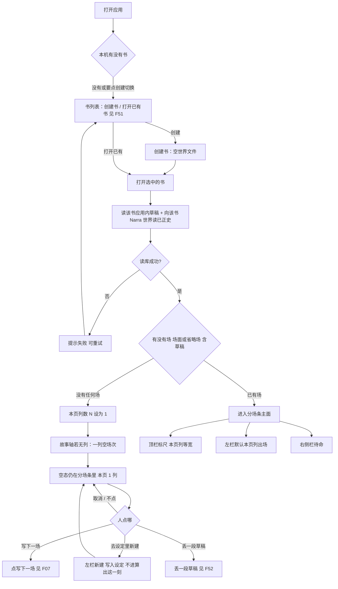

空态文案依据 v1：「先建一个人物、一个地点」或「写下一场」。可另有「丢一段草稿」。没有铜炉五问门厅。无登录。

---

### 6.2 本页窗口：列数 1–6、疏/中/密、− / +、‹ ›

<a id="f02-本页窗口"></a>

这张图覆盖 v1「列透镜」、用户编号 1–2，以及 2026-08-30 夜更正：**本页显示列数下限 1、上限 6**（覆盖先前「列数没有上下限」）。**本页列数 N** 是当前屏幕同时显示几列，不是故事轴上有几列。疏 / 中 / 密把 N 设为 2 / 4 / 6，**且 6 就是上限**。− / + 每次 ±1，钳在 1–6：N=1 时 − 灰掉不可点；N=6 时 + 灰掉不可点。禁止 N=0 清空状态。档位不是第二套密度状态：卡上显示什么只看当前 N。顶栏 − / + **不是**中间 ➕加列（F46）。本页 − / + / 疏中密 **不走**确认变更：不增删故事列，不写入正史，不写 Narra。全书细条也改同一窗口起点，见 F36。

实际画出的列数 = min(N, 从窗口起点起剩下的故事列数)。N 大于剩余故事列时，舞台上就是剩下那些列均分，**不**自动加故事列，**不**把多出来的空槽当成空场次。故事列可以有几百列；‹ › 与全书细条只改窗口起点，不改 N。

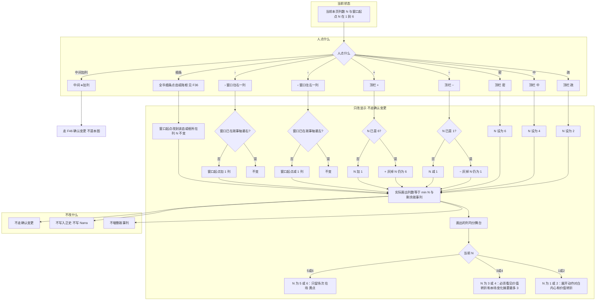

默认打开已有书 N=4。空书 N=1。点「疏」再点 + 得到 N=3：卡上按 3–4 列规则，不按「刚才点过疏」记忆。− / + 与档位都不改故事时间。依据：第 11.6 节更正与第 11.7 节。

---


### 6.3 点列 / 点标尺看这一刻

<a id="f03-看这一刻"></a>

这张图覆盖 v1「纵轴」第 3、4 点与九条第 4 条：看全在场用标尺上的色点 + 点一列。知情用侧栏，不当行。要改内容，点进分场条那一行，不在清单里另开一套编辑。

```mermaid
flowchart TD
  onStrip[人在分场条 / 标尺上]
  click{点了什么}
  col[点某一列 或点该列色块]
  chip[点卡上某个在场标记]
  row[点分场条那一行]
  cancel[点空白 / 取消] --> idle[侧栏回到待命]
  t[取该列故事时间起点]
  fold[向唯一读口问这一刻的世界]
  fail{问成功?}
  err[提示失败 侧栏可重试]
  list[侧栏列出这一列全部在场]
  dims[谁在哪 / 动了哪件道具 / 哪条伏笔 / 组织]
  know[侧栏可再问他知道什么 只读]
  edit[打开本场 改动作对白内心 见 F15]
  entity[打开该实体在这场 默认打开他知道什么]
  onStrip --> click
  click -->|列或色块| col --> t --> fold --> fail
  fail -->|否| err
  fail -->|是| list --> dims --> know
  click -->|在场标记| chip --> entity
  click -->|一行| row --> edit
  click -->|取消| cancel
```

标尺五条细轨：地点 / 人物 / 道具 / 组织 / 伏笔。该列**已正史场**有在场就亮。草稿在场只显示在卡上标记，细轨不亮，避免看起来已经进入算出这一刻。细轨上不放可编辑卡片。规则不当行，不占第五条以外的「规则轨」。依据：v1「一场戏能碰到的行」；文学审查 F44。

问这一刻只有一个读口（世界引擎）。读口内部走 F55：先查物化，未命中再 `world_at` 并回填。前端不许再算一遍（Narra 底座）。

---

### 6.4 拖列右缘：空出或侵入 → 整列重规划

<a id="f04-拖列改故事时间"></a>

这张图覆盖 v1「列透镜」旧表，并按 2026-08-30 夜拍板改写：**拖列右缘可以进入邻列的故事时间**。列宽（屏上均分）不变，这一列的时长变了。不允许两列钟重叠当正式状态。侵入发生后，对受影响的整列（侵入列 + 被侵入列，必要时后续列）进入重新规划：重算故事时间与场的落点，**给出全部建议**，人点「确认变更」后才生效。取消则拖动作废，库与正史不变。未确认时界面可预览重叠，正史 / Narra 仍是拖前。

**与旧「空出时间三选一」如何合并：** 空出（缩短）和侵入（拉长进入邻列）是**同一拖列右缘手势的两个方向**，不是两套产品、不要两套对话框。侵入是空出的**超集**：缺口出现时仍给出旧三条（前移 / 并入下一列 / 变空场次）；重叠出现时额外给出处理重叠的建议。对话框只有一个：「整列重规划」，走 F45。时长必须大于 0（半开区间）；拖成 0 或负则拒绝这次拖——这是区间合法，不是本页列数上下限。

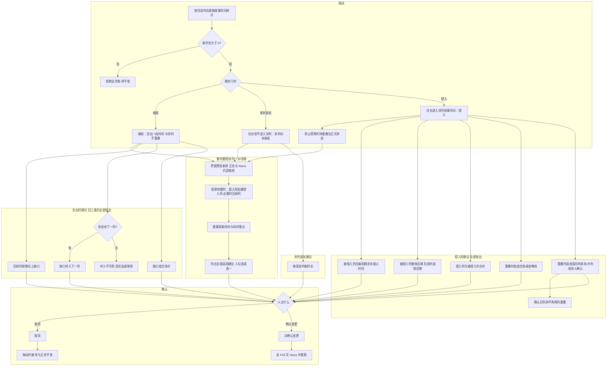

空场次不是省略场。省略场是一场戏、有本场任务、不演动作/对白/内心。空场次是这段故事时间还没写戏。同列多场 = 同时并列戏（F41）：确认后两列并成一列（或场都落到同一列钟），**不是**两列钟继续重叠。插入空场次仍改故事轴，不改本页列数 N。晚到事实的情状窗口用故事时间，不用列号。依据：第 11.6 节建议目录。

---

### 6.5 插入场、删除 / 拿掉场、删设定

<a id="f05-插入场与拿掉"></a>

这张图覆盖 AGENTS 已拍板「已挂在场上的不能从设定里删，先从分场条拿掉」；v1「设定增删」。插入场面：默认走 F07 写下一场（追加在最后）；要在中间插列走 F46，不是顶栏 +。插入空场次走 F04 / F46。插入省略场走 F06。已正史场删除走 F50，禁止走轻量缺口合上。

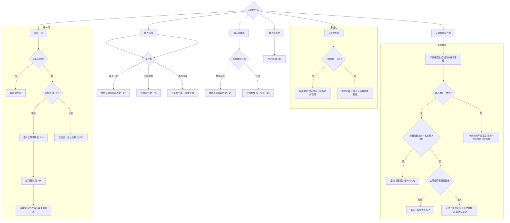

地点替换：演示页「把另一个地点拖进这张卡」。Narra `protect` 与「已出场不能从设定里删」同类，可直接用（Narra 底座）。已挂在场上的设定不能从设定里删：先从分场条拿掉/删场。

写下一场默认追加在现有最后一列 / 最后一场之后（F07），不是窗口末列、不是选中列。中间插入走 F46。在本列再写一场走 F41。

已写入正史的场可以删，必须走 F50：列出缺口与影响、给出全部补洞建议、人确认变更后才删并补洞。禁止静默删正史。

---

### 6.6 省略场的创建与写入正史

<a id="f06-省略场"></a>

这张图覆盖九条第 3 条、v1「场面还是省略场」、世界引擎省略场换地。省略场有时长、不演、必有本场任务。空场次 ≠ 省略场。

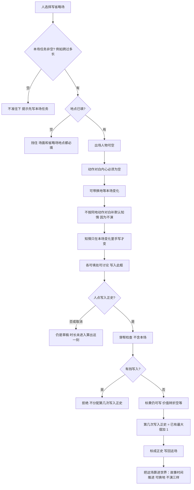

场面对照（同一套写入正史，栏位不同）：场面至少一人；必须有动作 / 对白 / 内心或世界变化，不能只存没拆开的散文。换地必须另有一场（场面或省略场）。旅行用省略场，不必演成假戏。省略场未写入正史时：分场条上可见草稿，算出这一刻的人在哪 / 他知道什么仍按上场已正史。要让某人换地，须在省略场的出场人物或本场变化的所在地窗口里写明是谁；出场全空且本场变化未指人，则无人移动。

---

### 6.7 写下一场主路径

<a id="f07-写下一场主路径"></a>

这张图覆盖九条第 2、6 条，v1 打开步骤 2–4，文学主面改造主路径，世界引擎「不替人决定写哪一场」，以及 2026-08-30 夜「下一场默认在最后起」。本场任务必填。点「写入正史」必须人点。未点之前不是历史。**默认落点：追加在现有最后一列 / 最后一场之后**（无列则成为第一列）。不是默认落到选中列，也不是默认落到本页窗口末列。加列不是写入正史：新列上的场仍是草稿，须人点写入正史。顶栏 + 不走本图。本页列数恒为 1–6，不存在空窗口不准写下一场。

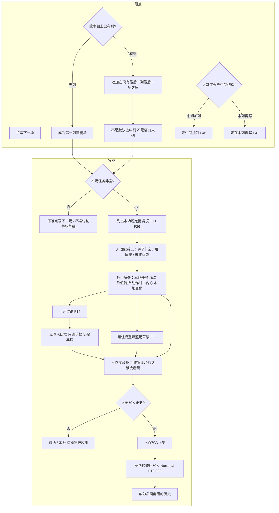

没有本场任务不准点「写下一场」，也没有本场任务不准确认下一场整场（v1「写下一场怎么接到模型」）。价值转折空 = 标黄，不挡写入正史。不是每场都必须动伏笔。追加在最后不走确认变更：新列钟接在上一列终点之后，旧正史不被改写；中间插列才会移动后续钟，必须走 F46。

文学验收（不改算法）：草稿应带一个价值转折或一次伏笔动作或一处知情差，而不是复述这一刻的世界。人不满意就改，或再讨论，不自动进正史。

---

### 6.8 模型根据正史历史 + 本场任务填下一场

<a id="f08-模型填下一场"></a>

这张图覆盖 v1「写下一场怎么接到模型」、世界引擎「模型填下一场吃规定情境」、文学主面改造「prompt 只吃规定情境 + 本场任务」。算出这一刻、穿帮检查、列出规定情境都不调用模型。算出这一刻的代码文件禁止 `import` 模型 SDK。

```mermaid
flowchart TD
  want[人要模型填下一场整场]
  task{本场任务非空?}
  stop[不准 提示先写本场任务]
  world[已写入正史的历史 经算出这一刻]
  packet[本场规定情境 不是整份世界 不含伏笔建议 不含结构建议]
  noSug[侧栏建议一件不进入这次调用]
  call[调用模型填下一场]
  fail{模型返回成功?}
  err[提示失败 草稿不改]
  draft[得到整场草稿]
  perPerson[每人动作对白内心只用该人已知道的]
  leak{稿里有别人不可能知道的?}
  yellow[标黄 仍可进框 不自动写入正史]
  wait[等人点写入此框]
  skip[人取消 不进框]
  box[写入对应输入框 仍是草稿]
  edit[人改补]
  commit{人点写入正史?}
  notHist[不是历史]
  go[走 F07 写入正史]
  want --> task
  task -->|否| stop
  task -->|是| world --> packet --> noSug --> call --> fail
  fail -->|否| err
  fail -->|是| draft --> perPerson --> leak
  leak -->|是| yellow --> wait
  leak -->|否| wait
  wait -->|取消| skip --> notHist
  wait -->|写入此框| box --> edit --> commit
  commit -->|否| notHist
  commit -->|是| go
```

禁止：把整份世界塞进模型（常见结果是复述情状）；无本场任务只按历史续「下一件合理的事」；铜炉主编流水线；丢整章进去猜格子当主路（F32）。

输入从哪来、输出写到哪：见第 10 节。

---

### 6.9 左栏

<a id="f09-左栏"></a>

这张图覆盖 AGENTS 已拍板左栏与 v1「筛选 / 设定增删」。不是出场表。规则不能拖进卡当在场（演示页与 v1「规则不当行」）。

```mermaid
flowchart TD
  open[左栏打开]
  default[默认只列当前本页列出现过的 人物地点道具组织伏笔]
  search{输入搜全书?}
  filter[按名字命中全书设定]
  emptyQ[清空搜索 回到本页列出场]
  click{人点什么}
  name[点名字] --> archive[打开档案 F10]
  appear[点行上「场」] --> only[中栏只看有它的场 不是出场表]
  appearOff[再点取消只看] --> default
  newBtn[点新建] --> newFlow[写入设定 不进算出这一刻 F29]
  dragOn[拖到卡上] --> onCard{目标场能挂这种?}
  ruleNo[拒绝 规则不当作出场]
  okOn[写入这场在场]
  dragOff[标记拖回左栏] --> rm[从这场拿掉 见 F05]
  open --> default
  default --> search
  search -->|有关键字| filter
  search -->|空| emptyQ
  default --> click
  filter --> click
  click --> name
  click --> appear
  click --> newBtn
  click --> dragOn
  click --> dragOff
  appear --> appearOff
  onCard -->|规则| ruleNo
  onCard -->|人物地点道具组织伏笔| okOn
```

已挂在场上的不能从设定里删，先从分场条拿掉（F05）。删设定 ≠ 从这场拿掉在场标记。没戏也能建。输入搜全书可看到本页未出场的（演示页「不在本页」）。左栏本页列表含草稿在场，便于把刚拖上去的人找回来；算出这一刻仍看不见这些草稿在场（F28、F44）。

---

### 6.10 档案

<a id="f10-档案"></a>

这张图覆盖 v1「档案」与 Narra 底座档案栏（aliases + 可选 profile 键 + 自由小传）。纵轴行不是第二份档案。正史仍只在分场条那一行改。

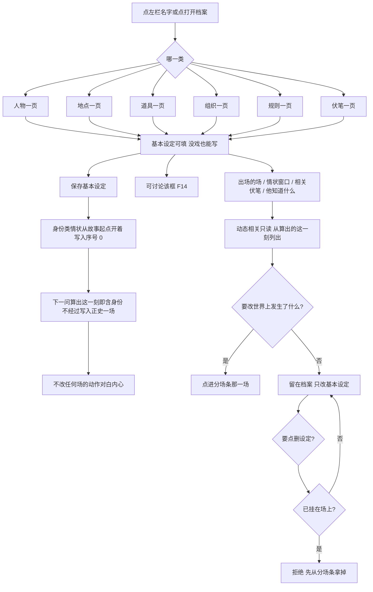

Narra 底座：档案键挂在通用 `entity.profile`（稀疏 HashMap，键可空）；`tension_level` 不进界面。`perceives` 的看法可进档案或侧栏，不打分。换纵轴不新开档案。存法见 F53。

基本设定进入算出这一刻的**身份**层（序号 0），不是「写入正史一场」。情状窗口、人在哪、他知道什么仍只来自已正史场的本场变化。依据：世界引擎「基本设定」；九条第 1 条。

**档案键表（界面中文；代码键英文；全部可空）。** 只列能在档案页找到的输入。出场的场、情状窗口、相关伏笔、他知道什么：**只读**，不进本表。来源与「本仓不采用」见第 18 节。

#### 人物 `kind=person`

| 界面 | 代码键 | 写什么 |
|---|---|---|
| 小传 | `setup` | 一段自由文字 |
| 别称 | `aliases` | 搜索用；专用列 |
| 身份 | `role` | 职业 / 社会位置 |
| 外观 | `appearance` | 能被看见的外形 |
| 说话方式 | `voice` | 口吻、口头禅；**不是**铜炉 VoiceProfile 九节 |
| 欲望 | `desire` | 此刻具体要什么 |
| 深层需要 | `need` | 抽象要什么 |
| 创伤 | `wound` | |
| 恐惧 | `fear` | |
| 秘密 | `secret` | 静态「藏着什么」；谁已知走侧栏只读 |
| 底线 | `limit` | 绝对不做 |
| 矛盾 | `contradiction` | |
| 关系摘要 | `ties` | 静态谁与谁；关系变化走分场条 |
| 能力与限制 | `capability` | |

#### 地点 `kind=place`

| 界面 | 代码键 | 写什么 |
|---|---|---|
| 小传 | `setup` | |
| 别称 | `aliases` | |
| 种类 | `place_kind` | 室内 / 户外 / 区域等；对应官方 `loc_type`，地点树查询要专用列 |
| 上级地点 | `parent` | 地点树；专用列 |
| 氛围 | `atmosphere` | |
| 感官 | `senses` | 视听嗅等，服务这场怎么写 |
| 功能 | `function` | 这地方在故事里干什么 |
| 进出 | `access` | 谁进得来 |

#### 道具 `kind=thing`

| 界面 | 代码键 | 写什么 |
|---|---|---|
| 小传 | `setup` | |
| 别称 | `aliases` | |
| 外形 | `appearance` | |
| 功能 | `function` | |
| 默认归属 | `owner_setup` | 静态默认持有者；**此刻谁拿着**是情状窗口只读 |
| 默认所在 | `place_setup` | 静态默认地点；此刻所在是情状只读 |
| 能力 | `capability` | |
| 限制 | `limit` | |
| 象征 | `symbol` | 对人意味着什么；读者欠一响走伏笔，不在本键当真源 |

#### 组织 `kind=faction`

| 界面 | 代码键 | 写什么 |
|---|---|---|
| 小传 | `setup` | |
| 别称 | `aliases` | |
| 宗旨 | `creed` | |
| 明面 | `public_face` | |
| 暗线 | `private_line` | |
| 层级 | `hierarchy` | 组织怎么分层 |
| 默认首领 | `leader_setup` | 静态；成员变化走关系 / 情状 |
| 成员资格 | `membership_rule` | 谁能进 |
| 对外关系摘要 | `ties` | 静态；外交变化走场上 |

#### 规则 `kind=rule`

| 界面 | 代码键 | 写什么 |
|---|---|---|
| 小传 | `setup` | 这条规矩是什么 |
| 别称 | `aliases` | |
| 能力 | `capability` | 允许做什么 |
| 代价 | `cost` | |
| 限制 | `limit` | |
| 例外 | `exception` | |
| 生效范围 | `scope` | 从哪场起、对谁；查询需要则专用列 |
| 检查分级 | `enforcement` | 只记 / 标黄 / 挡写入正史；穿帮检查要专用列 |

#### 伏笔 `kind=promise`

| 界面 | 代码键 | 写什么 |
|---|---|---|
| 欠读者什么 | `debt` | |
| 种类 | `promise_kind` | 枪 / 悬疑 / 人物 / 期限 / 障眼法；未收列表要专用列 |
| 期限 | `deadline` | 故事时间；可空 |
| 关联 | `related` | 相关人 / 地 / 物 |

只读不进键表：埋设 / 推进 / 兑现场、未收 / 已兑现 / 作废。那些从场上 `promise_ops` 算出。

---


### 6.11 侧栏规定情境

<a id="f11-侧栏规定情境"></a>

这张图覆盖 v1 写下一场侧栏与世界引擎「本场规定情境」。知情不当行。不做情绪分仪表盘，不做伏笔全页台账。建议本场对伏笔做哪一件是附加一行，见 F39。

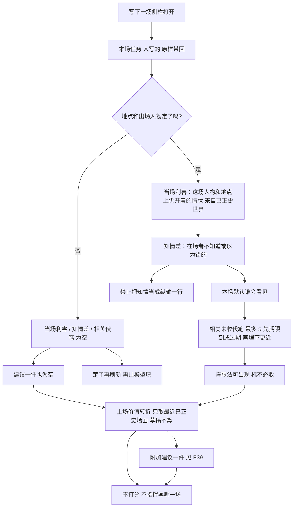

张力不另存分数。张力 = 这场本场任务还没落地 + 当场利害 + 知情差。界面只把这几项列出来。连续两场同向空转靠人看上场那一行，不做雷达图。

侧栏「他知道什么」：只读这一刻在此人上的样子。点在场人物标记时默认打开（文学主面改造 / NN 借交互）。

---

### 6.12 查穿帮

<a id="f12-查穿帮"></a>

这张图覆盖九条第 6 条、v1「三个操作」、世界引擎检查表。检查时用的「这一刻的世界」**不含本场**（本场还是草稿）。历史只用来查穿帮，不指定写哪一场。

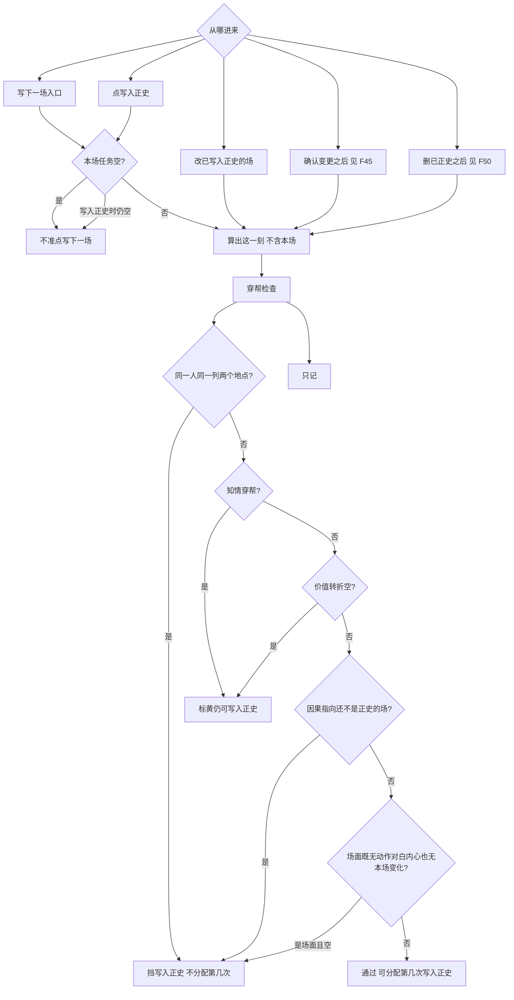

同一列两人两地（平行戏）合法。判定看该列所有已写入正史的场（加上正在写入的这一场）里，同一人是否出现在不同地点。把一场算进世界时不跑穿帮检查，避免重算旧稿时被当年的标黄拦住。

知情穿帮包括：动作 / 对白 / 内心写了别人不可能知道的；或把甲的内心写进乙的说 / 想。

---

### 6.13 导出普通 Markdown

<a id="f13-导出-markdown"></a>

这张图覆盖九条第 9 条、v1「正史只在应用里改」、文学主面改造「导出 Markdown 用读序」，以及 2026-08-30 夜拍板「导出包含草稿场」。Obsidian 不当产品面。不在那边改再写回。

**默认包含草稿场。** 导出里每一场必须标清「正史」或「草稿」，不要把草稿混进一篇看起来像正史的正文。人可在导出前改范围（例如只导出正史），默认是包含。

```mermaid
flowchart TD
  click[人点导出 Markdown]
  range[范围：默认含草稿场 人可去掉草稿]
  order{当前是否按读序排}
  byRead[按讲述序排场]
  byStory[按故事列序排场]
  mark[每场标明 正史 或 草稿]
  files[人一篇 / 地点一篇 / 每场一篇 普通 Markdown]
  notMix[正史与草稿不要合成一篇正史]
  out[写出文件给人看]
  editOut{人在 Obsidian 或其他编辑器改了文件?}
  noWriteback[改了不写回正史]
  onlyApp[要改正史 必须回分场条那一行]
  click --> range --> order
  order -->|是| byRead --> mark
  order -->|否 默认故事时| byStory --> mark
  mark --> files --> notMix --> out --> editOut
  editOut -->|是| noWriteback --> onlyApp
  editOut -->|否| onlyApp
```

不做按人物一条线导出。场文件标题或文首一行写状态，例如「状态：正史」/「状态：草稿」。设定篇（人 / 地）只导出基本设定，不把情状窗口写成可改正文。v1 开工顺序第 5 步：可选导出 Markdown。

---

### 6.14 每个可填处：讨论 → 写入此框

<a id="f14-讨论写入此框"></a>

这张图覆盖九条第 2 条与 v1 字段讨论合同。可填字段：本场任务、场次、价值转折、动作 / 对白 / 内心、当场情状 / 本场变化、基本设定、下一场整场。走同一条。确认后仍是草稿。

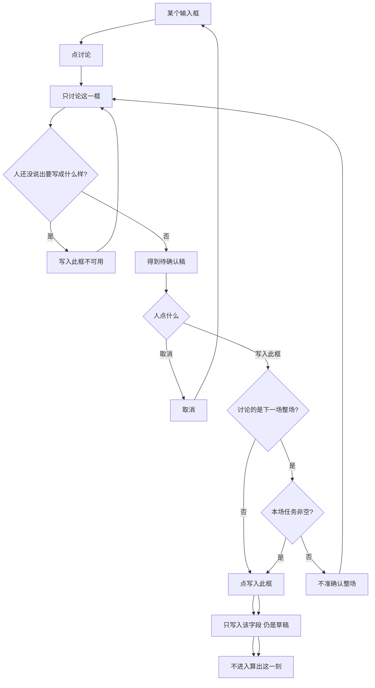

不是铜炉主编，不走那套流水线。演示页讨论面板文案与此一致。独立 `note` 表：讨论未确认稿可挂，不当正史（Narra 底座）。

---

### 6.15 点卡 / 点在场标记：本场按来源分组

<a id="f15-点卡与点在场标记"></a>

这张图覆盖文学主面改造「本场侧栏：按来源分组」与 NN 借交互（一场一块、点标记看这一刻）。v1 界面节已有点行打开本场、点列看这一刻；分组来自文学主面改造，与九条无硬冲突。左栏设定不被本场顶掉。

```mermaid
flowchart TD
  click{点了什么}
  card[点场卡 / 分场条那一行]
  mark[点某个在场标记]
  col[点列 见 F03]
  cancel[取消选中] --> idle[侧栏待命 左栏仍在]
  sum[侧栏这场汇总]
  groups[分组：在场 / 本场任务与价值转折 / 动作对白内心 / 本场变化]
  ent[这个实体在这场]
  know[点人时默认打开他知道什么]
  edit{要改内容?}
  back[仍回分场条这一行的字段 讨论钉在字段上]
  click --> card --> sum --> groups
  click --> mark --> ent --> know
  click --> col
  click --> cancel
  groups --> edit
  ent --> edit
  edit -->|是| back
  edit -->|否| groups
```

连线图作法必有：选中人才画、只读。改世界仍走同一套写入正史。不是默认主面，不是第二份库。

---

### 6.16 切「按读序排」

<a id="f16-按读序排"></a>

这张图覆盖 v1「讲述序」栏位与用户编号 5：顶栏切「按读序排」为主面必有。默认等于列序号；不等于列序时卡上标「读序 n」，全书细条齿上第二道色（F36）。切「按读序排」只改中栏排列和导出 Markdown 的顺序，**不算进这一刻的世界**。

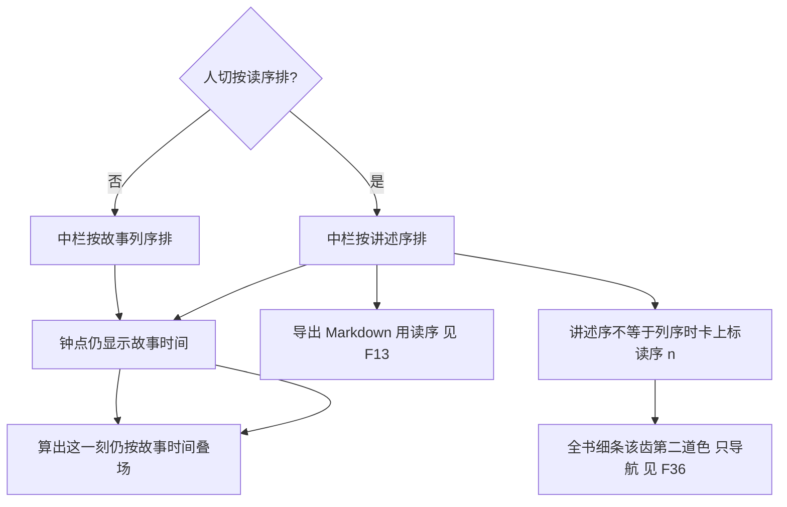

若把讲述序写进算出这一刻，会和「按故事时间叠场」打架。依据：文学主面改造风险节。

---

### 6.17 拖场卡换列

<a id="f17-拖场卡换列"></a>

这张图覆盖文学主面改造「拖场卡换列」，并按 2026-08-30 夜升级：已正史换列走**重算 + 全部建议 + 确认变更**，对齐 F31，禁止静默改钟。整列换位走 F49。草稿换列：界面可预览，不写 Narra；若换列造成该列只剩空洞，仍要走缺口建议。取消则放回原列。两列钟重叠不当正式状态（F04 / F41）。

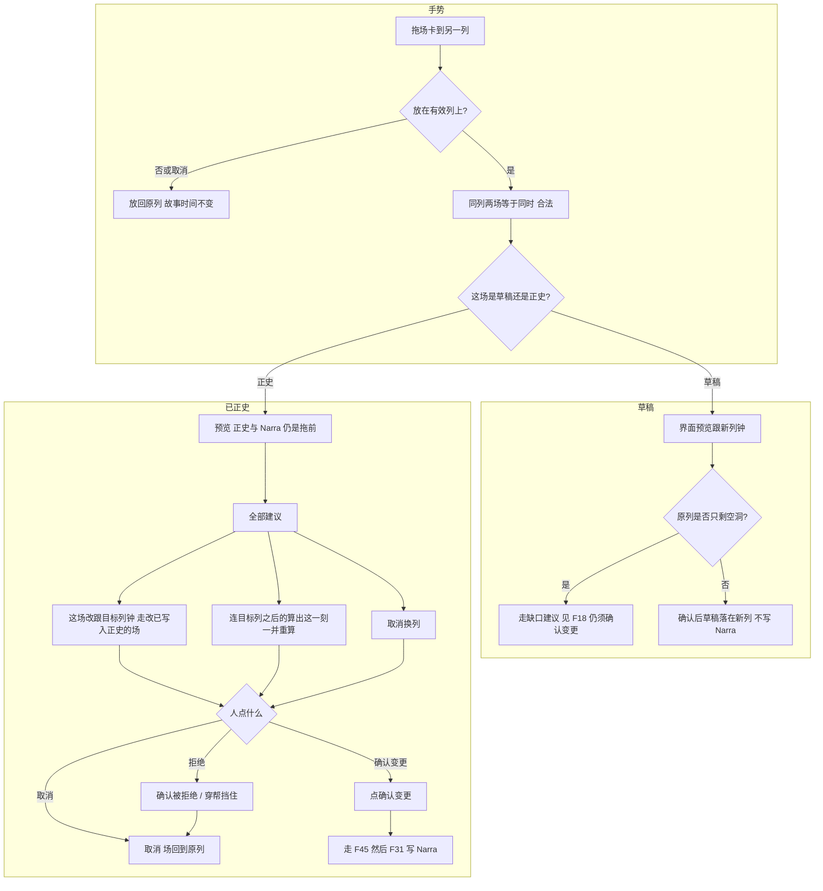

拖列右缘改列钟见 F04。拖场卡是场级手势；改变列的位置是列级手势（F49）。并列同时用同列多场，不靠两列钟重叠。

---

### 6.18 删草稿场 / 空场次：缺口建议

<a id="f18-删一场缺口合上"></a>

这张图只覆盖**空场次**和**草稿场**。已正史场禁止走这条轻路径，必须走 F50。空场次 ≠ 省略场。删完若该列只剩空洞，仍要走缺口建议并确认变更，不自动变成省略场。

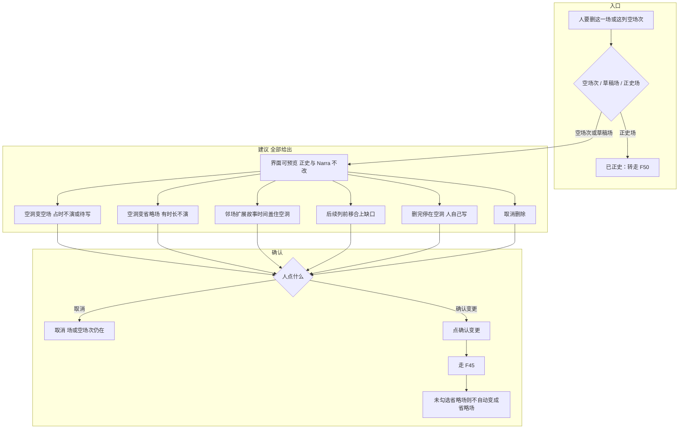

草稿场删掉后：全书细条齿数与本页窗口、Narra 里空场次的 `event` 钟窗口必须同一故事轴。已挂在这场上的设定不能从设定里删：先从分场条拿掉或删场（F05）。

---

### 6.19 结构变更总入口：重新算 → 建议清单 → 确认变更

<a id="f45-结构变更确认"></a>

这张图是结构编辑的总入口。必须与「写入此框」「写入正史」并列，不要搅在一起：

| 操作 | 改什么 | 何时写 Narra |
|---|---|---|
| 本页 − / +、疏 / 中 / 密 | 只改本页显示几列 | 不写；不走确认变更 |
| 写入此框 | 某个格子的草稿内容 | 不写 |
| 写入正史 | 一场成为后面能用的历史 | 人点之后写 |
| 确认变更 | 分场条故事结构或已正史（加列 / 减列 / 合并 / 换位 / 拖列侵入重规划 / 删已正史） | 人点之后写；未确认只预览 |

加列不会自动变成写入正史。结构建议清单不进入 `ScenePacket`，不指定写下一场写哪一场。

**确认变更之后必须重跑（写死）：**

1. 受影响故事时间区间的算出这一刻
2. 若当前选中列受影响：侧栏规定情境（伏笔建议一件仍不进模型、不指定写哪一场）
3. 标尺色点、全书细条齿色、出场飞出层
4. 查穿帮针对「删 / 合并 / 换位后仍声称成立」的后续正史
5. 模型填下一场的输入仍只含已正史；结构确认后新正史才进输入

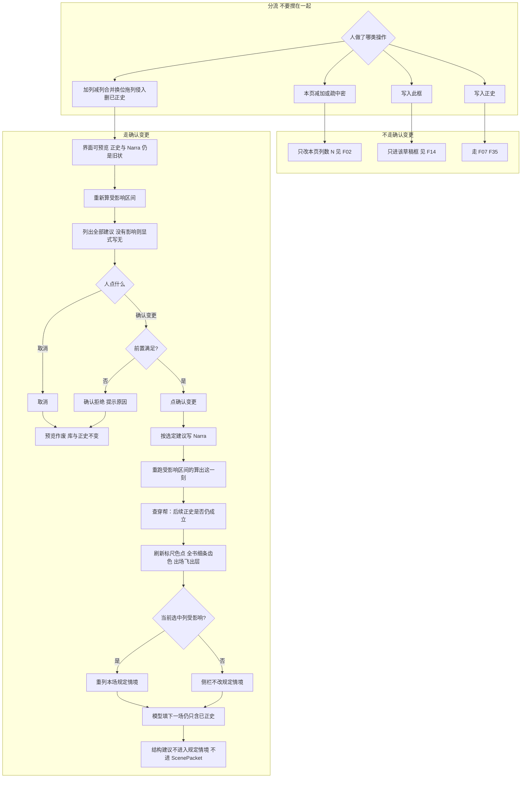

失败：读库失败则提示可重试，不写半套。穿帮挡住则确认拒绝，预览保留让人改建议或取消。

---

### 6.20 中间 ➕加列

<a id="f46-中间加列"></a>

顶栏 + **不是**本图。本图是在**选中列缝**插入一列故事列（可空列 / 空场）。依据：用户曾澄清 − / + 是本页显示列数；本次另加结构编辑。本页列数恒为 1–6，不存在 N=0 空窗口。未确认：界面可预览，正史 / Narra 不改。加列不会自动写入正史。

时长建议从邻列时长来；无邻列则用人可改的默认时长（实现可取 10 分钟，不是 vis-timeline 缩放）。人可改。

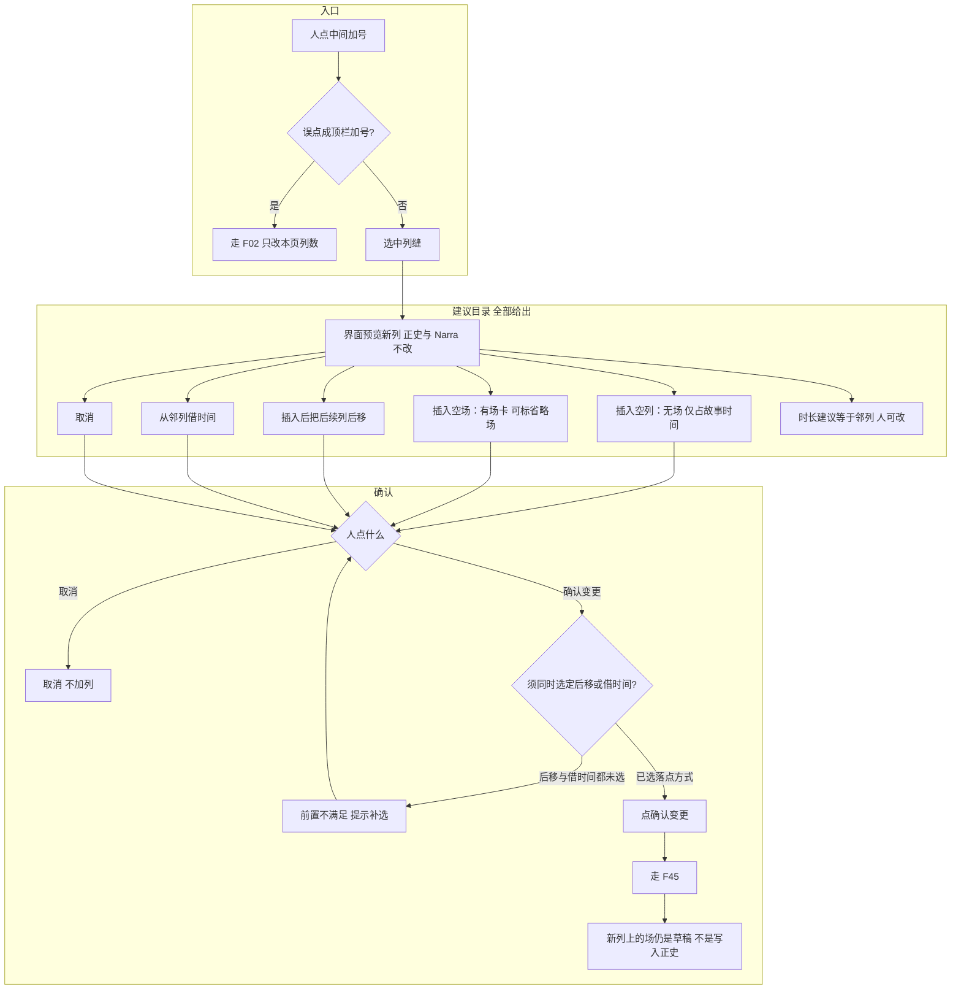

「后移」与「借时间」是落点方式，须与「空列 / 空场」组合勾选。只勾空列不选后移或借时间 → 前置不满足，确认拒绝。

---

### 6.21 减列

<a id="f47-减列"></a>

减列是去掉一列**故事列**，不是顶栏 −。无场、仅草稿、有已正史三条路都要确认变更；有已正史时禁止只减列丢正史。

```mermaid
flowchart TD
  subgraph 入口
    minus[人要减这一列]
    isView{误当成顶栏减号?}
    toF02[走 F02 只改本页列数]
    what{列上有什么}
  end
  subgraph 无场
    ePrev[预览合上缺口]
    e1[去掉列并合上缺口]
    e2[取消]
  end
  subgraph 仅草稿场
    dPrev[预览]
    d1[带走草稿]
    d2[并入邻列草稿]
    d3[取消]
  end
  subgraph 有已正史
    cPrev[禁止只减列丢正史]
    c1[转入删已正史 F50]
    c2[并入邻列并确认变更 见 F48]
    c3[取消]
  end
  subgraph 确认
    pick{人点什么}
    abort[取消 列仍在]
    ok[点确认变更]
    gate[走 F45]
  end
  minus --> isView
  isView -->|是| toF02
  isView -->|否| what
  what -->|无场| ePrev
  ePrev --> e1
  ePrev --> e2
  what -->|仅草稿| dPrev
  dPrev --> d1
  dPrev --> d2
  dPrev --> d3
  what -->|有已正史| cPrev
  cPrev --> c1
  cPrev --> c2
  cPrev --> c3
  e1 --> pick
  e2 --> pick
  d1 --> pick
  d2 --> pick
  d3 --> pick
  c1 --> pick
  c2 --> pick
  c3 --> pick
  pick -->|取消| abort
  pick -->|确认变更| ok --> gate
  pick -->|转入删已正史| to50[走 F50]
```

无场时建议可以很短，仍要确认。并入邻列若目标列也有已正史，合并后的落点走 F48 建议。

---

### 6.22 合并列

<a id="f48-合并列"></a>

两列并成一列。未确认只预览。确认后列钟取并集或人指定的新区间；不允许两列钟重叠残留为正式状态。

```mermaid
flowchart TD
  subgraph 入口
    merge[人要合并两列]
    adj{是相邻列或预览后可相邻?}
    noAdj[前置不满足 提示先换位或取消]
  end
  subgraph 建议目录 全部给出
    preview[界面预览 正史与 Narra 不改]
    m1[两列场都进合并后的一列 故事时取并集]
    m2[两列场都进合并后的一列 人指定新区间]
    m3[后一列变成前一列的后续场 同列多场]
    m4[取消]
  end
  subgraph 确认
    pick{人点什么}
    abort[取消 两列仍在]
    ok[点确认变更]
    gate[走 F45]
    parallel[同列多场等于同时 同一人两地仍挡住]
  end
  merge --> adj
  adj -->|否| noAdj
  adj -->|是| preview
  preview --> m1
  preview --> m2
  preview --> m3
  preview --> m4
  m1 --> pick
  m2 --> pick
  m3 --> pick
  m4 --> pick
  pick -->|取消| abort
  pick -->|确认变更| ok --> gate --> parallel
```

合并触及已正史时，查穿帮针对合并后仍声称成立的后续正史（F45 第 4 步）。

---

### 6.23 改变列的位置

<a id="f49-改变列位置"></a>

换位 / 拖整列卡换列。与 F17（拖**场**卡）分开。已正史换位走重算 + 建议 + 确认，不要静默。讲述序透镜：只改列序时算出这一刻不变；须写清读序怎么变。

```mermaid
flowchart TD
  subgraph 入口
    move[人拖整列或选换位]
  end
  subgraph 建议目录 全部给出
    preview[界面预览 正史与 Narra 不改]
    p1[只改列序 不搬故事时间]
    p1a[讲述序跟着新列序重排]
    p1b[讲述序保持原数字]
    p2[连故事时间一起搬]
    p3[取消]
    lens[按读序排：只改中栏排列和导出 不算进算出这一刻]
  end
  subgraph 只改列序的后果
    foldSame[算出这一刻不变 钟没动]
    badge[若讲述序保持原数字：列序不等于读序 细条第二道色]
    align[若讲述序跟着列序：读序与列序重新对齐]
  end
  subgraph 连钟一起搬的后果
    foldAll[后面的算出这一刻全受影响]
    f31[已正史走改已写入正史的场 升级为确认变更]
  end
  subgraph 确认
    pick{人点什么}
    abort[取消 列回到原位]
    ok[点确认变更]
    gate[走 F45]
  end
  move --> preview
  preview --> p1
  p1 --> p1a
  p1 --> p1b
  p1a --> lens
  p1b --> lens
  p1a --> align
  p1b --> badge
  p1 --> foldSame
  preview --> p2 --> foldAll --> f31
  preview --> p3
  p1 --> pick
  p2 --> pick
  p3 --> pick
  pick -->|取消| abort
  pick -->|确认变更| ok --> gate
```

只改列序且勾选「讲述序跟着新列序」：切「按读序排」与按列序排看起来重新一致。只改列序且勾选「讲述序保持原数字」：中栏按列序会换位置，按读序排仍按旧读序；细条第二道色更新。连钟一起搬：列序与故事时间都变，从受影响区间起重算。

---

### 6.24 删已正史：影响清单 → 补洞建议 → 确认 → 重算

<a id="f50-删已正史"></a>

提供删除已正史场的成功路径。删除前必须列出缺口与影响（没有影响则显式写「无」），并给出全部补洞建议；人确认后才删并按选定建议补洞。禁止静默删正史导致后面的算出这一刻假装没发生过。

**第几次写入正史：** 不重编号。该次写入作废（`status` 从 committed 变为 superseded）。算出这一刻只叠 `status=committed` 的场。不另开 Graphiti / Semantica 墙钟账，不搬铜炉 `supersede_fact`。情状表仍是缓存：确认后按受影响列起重放。知情边只追加：这场不再被叠进去，挂在这场上的知情不再进入这一刻。

```mermaid
flowchart TD
  subgraph 入口
    del[人要删一场已正史]
    list[列出影响清单 没有则写无]
  end
  subgraph 影响清单 每项都出现
    h1[该场故事时间变成空洞]
    h2[后续已正史场是否仍成立 穿帮]
    h3[知情是否仍成立]
    h4[伏笔埋设推进兑现作废是否失去依据]
    h5[在场连续性：人还在不在 道具在谁手里]
    h6[算出这一刻从下一刻起必须重算]
    h7[第几次写入正史不重编号 该次写入作废]
  end
  subgraph 补洞建议 全部列出
    f1[空洞变空场 占时不演或待写]
    f2[空洞变省略场 有时长不演]
    f3[邻场扩展故事时间盖住空洞]
    f4[后续列前移合上缺口]
    f5[手写补一场再写入正史 删完停在空洞]
    f6[取消删除]
  end
  subgraph 确认
    preview[界面可预览删除后世界 正史与 Narra 仍含这场]
    pick{人点什么}
    abort[取消 正史仍在]
    need{已选定至少一条补洞且不是取消?}
    refuse[前置不满足 提示先选补洞]
    ok[点确认变更]
    gate[走 F45]
    super[这场 status 改为作废写入 commit_seq 保留]
    replay[情状缓存按该列起重放]
    refold[从下一刻起重跑算出这一刻]
    check[查穿帮针对仍声称成立的后续正史]
  end
  del --> list
  list --> h1
  list --> h2
  list --> h3
  list --> h4
  list --> h5
  list --> h6
  list --> h7
  list --> preview
  preview --> f1
  preview --> f2
  preview --> f3
  preview --> f4
  preview --> f5
  preview --> f6
  f1 --> pick
  f2 --> pick
  f3 --> pick
  f4 --> pick
  f5 --> pick
  f6 --> pick
  pick -->|取消| abort
  pick -->|确认变更| need
  need -->|否| refuse --> pick
  need -->|是| ok --> gate --> super --> replay --> refold --> check
```

删完停在空洞（f5）合法：确认后场已作废，列上留下空洞，人再写一场并点写入正史——那是新的一次写入，新分配第几次，不复用已作废的序号。

---

### 6.25 多书与单用户

<a id="f51-多书单用户"></a>

这张图覆盖 2026-08-30 夜拍板：做多书；单用户。**不是**多用户协作。无登录、无权限、无账号。本机一个人，书列表就是全部。每书一份 Narra 世界（独立嵌入式 Surreal 文件 / 等价路径隔离），互不读写。Narra 仍是唯一世界库（一份 fork 代码，多份世界文件）。

空书进入分场条，本页列数 N=1。不走确认变更。

```mermaid
flowchart TD
  app[打开应用 无登录]
  list[本机书列表]
  act{人点什么}
  create[创建书：书名]
  file[新建该书 Narra 世界文件]
  enter[进入分场条 N 为 1]
  spare[故事轴若无列：一列空场次]
  open[打开已有书]
  switch[切换书]
  saveDraft[当前书未正史草稿留在该书旁]
  load[读目标书草稿加 Narra]
  delBook{删书?}
  warn[列出该书将丢掉的世界文件 须人确认]
  noPerm[没有分享 / 邀请 / 角色]
  app --> list --> act
  act -->|创建| create --> file --> enter --> spare
  act -->|打开| open --> load --> enter
  act -->|切换| switch --> saveDraft --> load --> enter
  act -->|删书| delBook --> warn
  list --> noPerm
```

失败：读世界文件失败则停在书列表，提示可重试，不进分场条。两本书不得指向同一世界文件。算出这一刻只读当前打开的书。

---

### 6.26 丢一段草稿（辅助入口）

<a id="f52-丢一段草稿"></a>

这张图覆盖 2026-08-30 夜拍板：辅助入口做。硬边界：丢整章猜格子**不是主路**（F32 / F07 仍是主路）。一场一块，不是一句一场。

交互：贴一段 → 建议拆成哪些场、写入哪些框 → 人可改粗细（合并过细 / 再拆过粗）→ 逐条点「写入此框」才进对应框（仍是草稿）→ 「写入正史」须另点。取消则什么都不进。禁止一贴即正史。禁止系统自动指定写哪一场；建议可以指向「追加在最后」或「已有空场」，人确认才落。

建议粒度（吸收剧本分场条，不搬产品）：按地点 / 故事时间 / 在场切换切开，对上 Fountain 场头（INT/EXT 或强制场头）和 Scrivener「按场拆开」——落到一场，不落到一句。小说没有场头时，按空行加换地 / 换人切；过细人合并，过粗人再拆。每场仍须能标出本场任务；没有任务不准把整场交给模型填（F07）。

```mermaid
flowchart TD
  open[人点丢一段草稿]
  paste[粘贴一段文字]
  cancel0[取消] --> none[什么都不进框 不正史]
  split[建议：拆成哪些场 一场一块]
  tooFine{人觉得过细?}
  merge[人合并若干条建议]
  tooCoarse{人觉得过粗?}
  resplit[人再拆某一条]
  target[建议落到：哪一列哪一场哪个框]
  retarget[人可改落到最后追加或已有空场]
  row{人逐条点什么}
  skip[跳过这条]
  write[点写入此框]
  box[只进该框 仍是草稿]
  allDone{还有未处理的建议?}
  later[人可再点写入正史 见 F07 F35]
  auto{系统想直接当正史或指定写哪一场?}
  refuse[拒绝]
  open --> paste
  paste --> cancel0
  paste --> split --> tooFine
  tooFine -->|是| merge --> tooCoarse
  tooFine -->|否| tooCoarse
  tooCoarse -->|是| resplit --> target
  tooCoarse -->|否| target --> retarget --> row
  row -->|取消全部| none
  row -->|跳过| skip --> allDone
  row -->|写入此框| write --> box --> allDone
  allDone -->|是| row
  allDone -->|否| later
  auto --> refuse
```

本场任务仍由人写或人把建议稿写入任务框。建议清单不进入 `ScenePacket`，不进入模型填下一场。结构建议也不进。

---

## 7. 设定类型专流

人物流程已含在 F09 / F10 / F28。下列不合并进人物。

### 7.1 规则

<a id="f19-规则"></a>

这张图覆盖 v1「规则不当行」、演示页「规则不当作出场，不能拖进卡」、Narra 底座 `universe_fact` + 检查分级 + `scope`。规则是穿帮检查，不是占位。变化打在规则上，写在本场。

```mermaid
flowchart TD
  new[左栏新建规则] --> setup[档案写基本设定 不进算出这一刻当在场]
  drag[试图拖到卡上] --> refuse[拒绝 打开档案写基本设定]
  trigger[本场变化打在规则上 或本场触发穿帮检查]
  write[写在本场字段 不是标尺一行]
  commit[写入正史后]
  validate[穿帮检查对照规则]
  level{分级}
  info[只记]
  warn[标黄仍可写]
  strict[挡写入正史]
  scope[规则可从哪场起、对谁生效]
  del{删规则}
  used{已被场引用或仍在检查中?}
  noDel[拒绝 先处理引用]
  new --> del
  setup --> drag
  trigger --> write --> commit --> validate --> level
  level --> info
  level --> warn
  level --> strict
  validate --> scope
  del --> used
  used -->|是| noDel
  used -->|否| setup
```

v1 纵轴表：规则不当行。标尺五条细轨无规则轨。

---

### 7.2 道具

<a id="f20-道具"></a>

这张图覆盖 v1 纵轴「道具从本场变化里的道具算」、左栏可建、可拖到卡上成为在场、通用 `entity` kind=thing（F53）。算出这一刻时道具在场要算进去（九条第 5 条 / AGENTS）。不另开 `thing` 死表。

```mermaid
flowchart TD
  new[左栏新建道具] --> node[写入设定 身份类情状从故事起点开着 序号 0]
  drag{拖到卡上?}
  on[这场在场标记出现道具]
  delta[本场变化可开窗关窗 例如持有 / 所在]
  overlap{同一道具同一属性已有开着的窗口且重叠?}
  must[必须写明旧窗收到新窗起点 禁止静默并存]
  commit[写入正史]
  fold[算出这一刻含该道具情状]
  archive[档案：基本设定可填 出场与情状窗口只读]
  hung{已挂在场上?}
  noDel[不能从设定里删 先从分场条拿掉]
  new --> archive
  new --> drag
  drag -->|是| on --> delta --> overlap
  drag -->|否| archive
  overlap -->|是| must --> commit
  overlap -->|否| commit
  commit --> fold
  archive --> hung --> noDel
```

枪在抽屉 = 情状（道具上的窗口）。读者欠一响 = 伏笔（F22），不是道具表的另一行真源。

---

### 7.3 组织

<a id="f21-组织"></a>

这张图覆盖 v1 纵轴「组织 = 出场人物所属组织，或变化打在组织上」、通用 `entity` kind=faction（F53）。不当成人物的别名。不另开 `faction` 死表。

```mermaid
flowchart TD
  new[左栏新建组织] --> node[写入设定]
  member[关系：人物所属组织]
  drag{拖到卡上?}
  on[这场在场出现组织]
  delta[本场变化打在组织上]
  lanes[换看法时组织行从所属并上变化算出 不另填一套]
  commit[写入正史]
  fold[算出这一刻含组织在场与情状]
  archive[档案一页 基本设定可填]
  hung{已挂在场上或仍有所属?}
  noDel[先从分场条拿掉 / 先处理所属]
  new --> member
  new --> drag
  drag -->|是| on
  drag -->|否| member
  on --> delta --> lanes --> commit --> fold
  member --> lanes
  new --> archive --> hung --> noDel
```

`perceives` / 对某人的看法可进档案或侧栏；`tension_level` 不进界面（Narra 底座）。

---

### 7.4 伏笔

<a id="f22-伏笔"></a>

这张图覆盖 v1「伏笔」、世界引擎列出相关未收、文学主面改造「v1 没有建议本场对伏笔做哪一件」。伏笔是对读者的欠账，不是世界上的情状。

```mermaid
flowchart TD
  new[左栏新建伏笔] --> page[伏笔一页档案]
  op{这场伏笔操作}
  plant[埋设]
  adv[推进]
  pay[兑现]
  disc[作废]
  none[本场可以不动伏笔]
  commit{写入正史?}
  stay[草稿操作不算读者欠账状态]
  status[改伏笔：未收 / 已兑现 / 作废]
  fold[算出这一刻读操作之后的伏笔]
  next[写下一场]
  sel[仍未兑现 且与这场人物或地点有关]
  top5[最多 5 条 先期限到或过期 再埋下更近]
  herring[障眼法可出现 标不必收]
  suggest[侧栏附加建议一件 见 F39 不进模型]
  new --> op
  op --> plant
  op --> adv
  op --> pay
  op --> disc
  op --> none
  plant --> commit
  adv --> commit
  pay --> commit
  disc --> commit
  none --> commit
  commit -->|否| stay
  commit -->|是| status --> fold
  fold --> next --> sel --> top5 --> herring --> suggest
```

切到出场表「伏笔」时，伏笔是行，不是第二份库。出场表后做。

---

## 8. 世界库与世界引擎

### 8.1 世界存在哪

<a id="f23-世界存在哪"></a>

这张图覆盖 Narra 底座结论与 AGENTS「正史只在应用里改」。点「写入正史」之后，账在 Narra 里。没点之前，草稿只在设定图应用里。侧栏只读。MCP mutate 不当写入正史。

```mermaid
flowchart TD
  ui[分场条 / 本场 / 档案]
  draft[应用内草稿]
  discuss[讨论未确认稿 可挂 note 不当正史]
  commit[人点写入正史]
  val[扩展后的 Narra 做穿帮检查]
  strict{挡写入?}
  no[不 mutate 不分配第几次写入正史]
  mut[validate 通过才写入 Narra]
  db[Narra 嵌入式 Surreal 唯一库]
  q[侧栏只读查询]
  mcp[MCP 只读可选 不是产品主路径]
  fold[算出这一刻只吃 committed 不含草稿与已作废写入]
  ui --> draft
  ui --> discuss
  ui --> commit --> val --> strict
  strict -->|是| no
  strict -->|否| mut --> db --> fold
  ui --> q
  q -->|HTTP 薄包或 CLI --json| db
  mcp --> db
```

禁止：官方 Narra 与设定图各开一份库并排写；另写 Python `fold` / 设定图五表当第二真源；前端再写一套算出这一刻；Graphiti / EverOS / Semantica / HyperMem / TiMem 当世界真源。

连线图若可改，仍走同一套写入正史或确认变更，不是第二份库。结构预览未确认前不 mutate Narra。写入正史 / 确认变更如何一笔提交、在场如何 RELATE、搜全书、物化失效：见 §8.13 与 F60–F64。

---

### 8.2 算出某一故事时间世界上为真什么

<a id="f24-算出这一刻"></a>

这张图覆盖世界引擎职责 1 与「怎么算」必须分两步。问这一刻只有一个读口。草稿看不见。

```mermaid
flowchart TD
  ask[问：某一故事时间 算到某一次写入正史]
  asof[主写只用最新一次写入]
  base[基本设定 身份类情状 写入序号 0 不占第几次]
  pick[取出已写入正史且不超过这一次写入的场 不含草稿与已作废写入]
  sort[按所在列故事时间升序 同一列再按写入正史先后]
  stack[一场一场叠进去 更晚的场也要叠]
  late[晚到的本场变化可能给更早时刻开窗]
  atT[再按所问故事时间取出此刻为真的]
  states[情状：窗口盖住所问时刻 终点空=仍开着]
  covering[正在演的场：场的故事时间窗口含所问时刻]
  knows[他知道什么：学会那场不晚于所问时刻 且所指情状仍开着]
  where[人在哪 见 F30]
  promises[算到这一次写入时的伏笔]
  ask --> asof --> base --> pick --> sort --> stack --> late --> atT
  atT --> states
  atT --> covering
  atT --> knows
  atT --> where
  atT --> promises
```

必须先叠后取。否则晚到的事实和「问过去某一列」会互相踩。列号不是分钟。v1 不做「回到当时那一次写入」的界面；`as_of` 先可只给检验用（Narra 底座）。

这一刻的世界是全知的（里面带着每个人「他知道什么」）。

---

### 8.3 把一场算进世界

<a id="f25-把一场算进世界"></a>

这张图覆盖世界引擎「把一场算进世界」固定顺序。Narra 底座写明不得调换。只处理已写入正史的场。草稿与已作废写入不叠进这一刻。

```mermaid
flowchart TD
  start[已写入正史的一场]
  s1[1 在场：地点和出场人物记入这一列谁在]
  ellipsis[省略场出场可空 仍可记换地]
  s2[2 所在地惯性：出场人物从本场故事时间起人在本场地点]
  s3[3 本场变化变成情状 开窗或关窗]
  ov{同一人同一属性已有开窗且与新窗重叠?}
  must[必须写明旧窗收到新窗起点]
  forbid[禁止静默并存两条开着的]
  early[新窗起点可以早于本场 晚到]
  s4a[4 先吃手写的他知道什么]
  s4b[再按同列同地补默认 手写覆盖默认]
  s5[5 伏笔操作改伏笔状态]
  s6[6 因果只校验 前置必须已在这次叠进去的正史里]
  noConstrain[这里不跑穿帮检查]
  start --> s1 --> ellipsis --> s2 --> s3 --> ov
  ov -->|是| must
  ov -->|未写收口| forbid
  ov -->|否| early
  must --> early --> s4a --> s4b --> s5 --> s6 --> noConstrain
```

场面：动作、对白、内心或世界变化至少有一样。省略场：不演这三样，允许换地等变化。

---

### 8.4 写下一场时列出本场规定情境

<a id="f26-列出规定情境"></a>

这张图覆盖世界引擎职责 2。不替人决定写哪一场。不打分。地点或出场未定则利害 / 知情差 / 伏笔为空，避免还没定谁在场就把全世界塞进模型。

```mermaid
flowchart TD
  in[入参：这一刻的世界 + 草稿里已有的本场任务地点出场人物]
  task[本场任务原样带回]
  loc{地点和出场人物已定?}
  empty[当场利害 知情差 相关伏笔 为空]
  stakes[当场利害]
  gap[知情差 不自动推理没写明的]
  see[本场默认谁会看见]
  pr[相关未收伏笔 最多 5 先期限到或过期 再埋下更近]
  vs[上场价值转折 最近一场已正史场面的那一行 草稿不算]
  packet[本场规定情境]
  sugUI[侧栏可附加建议一件 不进 packet]
  toUI[侧栏列出]
  toModel[模型填下一场只吃 packet]
  noPick[不指定写哪一场]
  in --> task --> loc
  loc -->|否| empty --> vs --> packet
  loc -->|是| stakes --> gap --> see --> pr --> vs --> packet
  packet --> toUI
  packet --> sugUI
  packet --> toModel
  packet --> noPick
```

---

### 8.5 三时钟、晚到事实、重叠须显式收口

<a id="f27-三时钟"></a>

这张图覆盖九条第 7 条、v1「三个时间」、Narra 底座「三个时间（不能砍）」、世界引擎晚到与重叠开窗。故事时间（横轴）和第几次写入正史分开。AGENTS：组 3（Graphiti / EverOS / Semantica / HyperMem / TiMem）不当这笔账。

```mermaid
flowchart TD
  clocks[三件分开]
  story[故事时间：世界上何时为真 列上起止钟点]
  know[知情时间：谁在哪一场学会]
  write[写入时间：第几次点写入正史]
  late[晚到事实]
  newDelta[新场本场变化的窗口起点早于本场所在列]
  oldPlay[旧场动作对白内心不改]
  query[查询：先按第几次写入把该算的场全部叠进去 再按所问故事时间切开]
  ov[重叠开区间]
  explicit[必须显式把旧窗收到新窗起点]
  silent[禁止静默并存两条开着的]
  notRevise[不要用改旧场冒充一直如此]
  clocks --> story
  clocks --> know
  clocks --> write
  late --> newDelta --> oldPlay --> query
  ov --> explicit
  ov --> silent
  late --> notRevise
```

落点（Narra 底座）：故事时间 → `event.clock_from/to`；知情 → `KnowledgeState` 挂这场；第几次写入正史 → `scene.commit_seq`。Narra 现成的 `event.sequence` + 墙钟 `learned_at` 不够，不能砍三时钟去迁就官方 Narra。

三件事不要合成一栏（世界引擎）：

| 问什么 | 晚到的事实能不能改 |
|---|---|
| 这一列演了谁、在哪（分场条上的在场） | 不能。改在场走「改已写入正史的场」 |
| 这个人在故事里此刻人在哪 | 能。本场变化里开一条所在地窗口，窗口起点可以早于本场 |
| 枪在不在抽屉、伤、立场 | 能。同样走情状窗口 |

「第 3 场的动作、对白、内心不改」管的是那一场已经写下的表演，不是禁止后来把情状、所在地的窗口指回第 3 场那个故事时间。

---

### 8.6 同一列全部在场都进入算出这一刻

<a id="f28-同一列全部在场"></a>

这张图覆盖九条第 5 条、AGENTS「场不另开一张情节表」、世界引擎「同一列全部在场」。不按人物一条线只走一条。禁止 NarrativeNode 那种每人一条出线。

```mermaid
flowchart TD
  col[同一列]
  all[该列全部已正史场的在场]
  draftChip[卡上草稿在场标记]
  notFold[草稿在场不进入算出这一刻]
  p[人物]
  loc[地点]
  th[道具]
  fa[组织]
  pr[伏笔]
  fold[全部进入算出这一刻]
  nn[禁止：沿第一条出线走出一个人的链]
  parallel[同列两人两地 = 平行戏 合法]
  same[同列同一人两地 = 挡写入正史]
  col --> all
  all --> p --> fold
  all --> loc --> fold
  all --> th --> fold
  all --> fa --> fold
  all --> pr --> fold
  col --> draftChip --> notFold
  fold --> nn
  fold --> parallel
  fold --> same
```

再写别人的下一场时，吃的是全部已写入正史的历史，不是只接着上一个人。规定情境过滤「这场人物/地点」时，读的是**当前草稿框**里的地点和出场人物，用来从已正史世界里取出利害和知情差；这不是把草稿在场算进「这一列全部在场」。依据：F44。

---

### 8.7 左栏新建设定 vs 挂到场上成为在场

<a id="f29-新建设定与在场"></a>

这张图覆盖九条第 1 条与 v1「设定增删」。两条路径必须分开：没戏的设定不进正史演算；挂到场上才成为这场在场，点写入正史后才进入算出这一刻。

```mermaid
flowchart TD
  new[左栏新建]
  kind{类型}
  n1[人物]
  n2[地点]
  n3[道具]
  n4[组织]
  n5[伏笔]
  n6[规则]
  ident[写入一条身份类情状 从故事起点开着 序号 0]
  noBeat[不造一场假戏当第 0 场]
  notFold[不进正史演算]
  drag{拖到某场卡上?}
  stay[只在设定 / 档案里]
  on[成为这场在场]
  ruleNo[规则拒绝拖入]
  commit{这场写入正史?}
  draftOnly[草稿在场 问这一刻看不见]
  inFold[进入算出这一刻]
  new --> kind
  kind --> n1 --> ident
  kind --> n2 --> ident
  kind --> n3 --> ident
  kind --> n4 --> ident
  kind --> n5
  kind --> n6
  ident --> noBeat --> notFold
  n5 --> notFold
  n6 --> notFold
  notFold --> drag
  drag -->|否| stay
  drag -->|规则| ruleNo
  drag -->|其余| on --> commit
  commit -->|否| draftOnly
  commit -->|是| inFold
```

---

### 8.8 人在哪与换地

<a id="f30-人在哪与换地"></a>

这张图覆盖世界引擎「人在哪」。空单元格 ≠ 省略场。

```mermaid
flowchart TD
  ask[某人在所问时刻 算到某一次写入]
  win{有所在地情状窗口盖住这一刻?}
  latest[取写入正史更晚的那条 再比窗口起点]
  hist{已正史且此人出过场 场的起点不晚于所问时刻?}
  inherit[取故事时间起与写入先后最晚那场的地点]
  none[无：人还没上过场 不是错误]
  travel[换地]
  needBeat{另有一场场面或省略场?}
  blockTravel[禁止无场换地]
  ellipsis[旅行用省略场]
  two{同一人同一列两个地点?}
  strict[挡写入正史]
  parallel[同列两场两地但不是同一人 = 合法]
  ask --> win
  win -->|是| latest
  win -->|否| hist
  hist -->|是| inherit
  hist -->|否| none
  travel --> needBeat
  needBeat -->|否| blockTravel
  needBeat -->|是| ellipsis --> onePlace
  latest --> two
  inherit --> two
  two -->|是| strict
  two -->|否| parallel
  onePlace[一场一个主地点]
  mention[被提及的第二地点可记 不算人同时在两地]
  onePlace --> mention
```

一场跨两地当「人同时在两处」：不提供。人从甲地到乙地必须另有一场。多人同时不同地：同列平行多场（F41），不是一场填两个主地点。Narra `secondary_locations` 只存被提及的地点。

---

### 8.9 改已写入正史的场 vs 晚到窗口

<a id="f31-改已写入正史的场"></a>

这张图覆盖 v1「三个操作」后两行与世界引擎对应节。两按钮不要合成一个。已正史换列 / 换位 / 结构改钟：先走 F45 确认变更，再落到本图的「改已写入正史的场」写 Narra，禁止静默。删已正史不走本图改栏位，走 F50 作废写入。

```mermaid
flowchart TD
  want{人要改的是什么}
  play[改旧场已经写下的动作对白内心或在场]
  fact[事实其实从更早故事时间就为真]
  struct[换列换位或拖列改了已正史的钟]
  revise[改已写入正史的场]
  confirmFirst[先走 F45 确认变更]
  recheck[从该场故事时间起 对所有更晚及同列写入更晚的正史场重跑穿帮检查]
  list[冲突列表返回给人]
  noSilent[不静默改后面场的动作对白内心]
  late[新场本场变化 窗口起点更早]
  noOld[不改旧场表演]
  cache[情状表是缓存 改过之后按该列起重放并重写窗口]
  ssot[真源仍是这场 不是情状表第二份库]
  want --> play --> revise --> recheck --> list --> noSilent --> cache --> ssot
  want --> fact --> late --> noOld --> cache --> ssot
  want --> struct --> confirmFirst --> revise
```

改已正史不新分配第几次写入正史：仍是那场，内容被改掉。从该列钟起重检查。全书细条齿色仍是「有正史」（不是草稿）。本页窗口与细条读同一故事轴，禁止细条另存一份列钟。晚到窗口继续走新场变化，不要用改旧场冒充一直如此。删场作废写入也不新分配、不重编号，见 F50。

---

### 8.10 禁止路径

<a id="f32-禁止路径"></a>

这张图覆盖 v1「不做」、AGENTS 硬边界、NN 对照「不借」、文学主面改造「不动」。这些不是产品功能，是必须拦住的入口。

```mermaid
flowchart TD
  try{有人走哪条}
  dump[丢整章进去猜格子]
  editor[铜炉主编流水线]
  instant[一改在场标记即历史]
  lane[按人物泳道当打开默认主面]
  graphiti[Graphiti 等当世界真源]
  pyfold[另写 Python 算出这一刻当第二真源]
  mcpw[MCP mutate 当写入正史]
  nncopy[复制 NarrativeNode 源码]
  stop[拒绝 提示正路]
  right1[主路仍是一场一场写 见 F07]
  right2[讨论钉在字段上 见 F14]
  right3[人点写入正史 见 F35]
  right4[打开是分场条 看全在场用标尺色点]
  right5[唯一库 Narra 见 F23]
  try --> dump --> stop --> right1
  try --> editor --> stop --> right2
  try --> instant --> stop --> right3
  try --> lane --> stop --> right4
  try --> graphiti --> stop --> right5
  try --> pyfold --> stop --> right5
  try --> mcpw --> stop --> right3
  try --> nncopy --> stop --> right4
```

08-29 曾写「丢一段草稿」当辅助入口。v1：丢整章进去猜格子**不是主路**。2026-08-30 夜拍板：辅助入口**做**，流程见 F52。本图仍拦住「一贴即正史 / 自动指定写哪一场 / 一句一场」。主路仍是 F07。

---

### 8.11 知情默认怎么推出

<a id="f33-知情默认"></a>

这张图覆盖 v1「在场怎么推出知情」。确定性 / 来源枚举封闭，不自动替人推理没写明的。知情只追加。栏位与 Narra 对齐：须补 `source_character` / `premises` / `truth_value`。

```mermaid
flowchart TD
  same{同一列且同一地点?}
  skip[不按同地默认补知情]
  do[动作] --> seen[在场者默认看见]
  say[对白] --> heard[在场者默认被告知或听见]
  narrow[可改成只有对谈双方]
  think[内心] --> self[只有本人]
  leak[写进别人的说或想] --> yellow[标黄 不挡写入正史]
  hand[手写的他知道什么优先]
  def[再补默认 可被手写覆盖]
  append[只追加 改确定性另写一条]
  same -->|否| skip
  same -->|是| hand --> def
  def --> do
  def --> say --> narrow
  def --> think --> leak
  seen --> append
  heard --> append
  self --> append
```

`participates_in.role` 须区分在场 / 被提及，否则默认知情会算错（Narra 底座）。无逻辑闭包。

---

### 8.12 世界引擎架构：纯函数 + Narra + 物化

真源仍是 [`世界引擎.md`](./世界引擎.md)「架构结论」。本节不推翻算出这一刻的叠与取、规定情境字段、F23–F28 / F34–F35 / F45 / F50。对人讲产品仍用「这一刻的世界」；`world_at` / 物化是实现名。

**结论。** 算出这一刻必须是纯函数（`world_at` / `fold`）：同一份已正史历史 + 同一故事时间 → 同一份这一刻的世界。删已正史 / 确认变更后重算 = 换一份历史再跑同一函数。整个世界引擎不能只有内存里的函数：正史只存放在 Narra；人点「写入正史」「确认变更」才写入；点列跟手靠物化（缓存纯函数结果，不是第二真源）。物化与 Narra 不一致时，丢掉这段物化，以 Narra 上的全量 `world_at` 为准。

每书一份 Narra 世界（F51）。`world_at` 的历史以当前打开的书为界，不串书。

**禁止当最优：** 就地改一行当前世界；用模型当世界引擎；每次点列从创世全量折且不物化（全量只当检验预言机）；把三时钟合成一列序号；仓外 Python `fold` 当第二真源。

模块落点见世界引擎「最优架构清单」：`vendor/narra/src/services/world.rs`（`world_at` / `apply_scene` / `knows_at`）、`circumstances.rs`、`constrain.rs`、`canon.rs`、`materialize.rs`。不要塞进现成 `temporal.rs`。

<a id="f54-纯函数与副作用边界"></a>

**F54 纯函数 vs 有副作用边界**

```mermaid
flowchart TB
  subgraph 纯函数 无隐藏可变当前世界
    worldAt["world_at：正史加故事时间 → 世界上为真"]
    knowsAt["knows_at：正史加故事时间加人物 → 该人此时知道"]
    applySc["apply_scene：把一场已正史算进世界"]
    given["given_circumstances：本场规定情境"]
    cons["constrain：穿帮检查"]
  end
  subgraph 有副作用 仅这些边界
    narra[Narra：正史事实唯一存放]
    personCommit[人点写入正史]
    personConfirm[人点确认变更]
    mat[物化加区间索引：缓存纯函数结果]
  end
  personCommit --> narra
  personConfirm --> narra
  narra --> worldAt
  narra --> knowsAt
  worldAt --> applySc
  worldAt --> given
  worldAt --> cons
  worldAt --> mat
  mat -->|失效后必须能全量再折出相同结果| worldAt
```

<a id="f55-点列看这一刻物化"></a>

**F55 点列「看这一刻」：读物化 → 未命中则 `world_at` → 回填**（产品步骤仍是 F03）

```mermaid
flowchart TD
  click[点某一列或该列色块]
  t[取该列故事时间起点]
  read[唯一读口 GET /world?t=]
  idx{区间索引命中且未失效?}
  hit[返回物化里的这一刻]
  miss["world_at：从 Narra 取 committed 全量或从左端物化接着折"]
  put[回填物化]
  side[侧栏列出这一列在场 / 可再问他知道什么]
  noFront[禁止前端自己叠场]
  click --> t --> read --> idx
  idx -->|是| hit --> side
  idx -->|否| miss --> put --> side
  read --> noFront
```

<a id="f56-写入正史后增量折"></a>

**F56 写入正史后：写 Narra → 增量折 / 失效 → 侧栏规定情境**

```mermaid
flowchart TD
  btn[人点写入正史]
  cons[constrain：检查时世界不含本场]
  block{挡写入?}
  no[拒绝：不分配第几次写入正史 不写 Narra]
  seq[commit_seq = 已有最大值加 1]
  write[这场标成正史 写进 Narra]
  late{本场变化窗口早于本场钟?}
  inc[从上一物化 apply_scene 折到新区间]
  inv[失效：从晚到窗口起点到书末]
  refold[从失效左端重折]
  sit{当前选中就是这场?}
  gc[given_circumstances 重列规定情境]
  skip[侧栏规定情境不强制刷新]
  sug[伏笔建议一件仍只给界面 不进 ScenePacket]
  btn --> cons --> block
  block -->|是| no
  block -->|否| seq --> write --> late
  late -->|否| inc
  late -->|是| inv --> refold
  inc --> sit
  refold --> sit
  sit -->|是| gc --> sug
  sit -->|否| skip
```

<a id="f57-确认变更删正史重折"></a>

**F57 确认变更 / 删已正史：写 supersede → 区间失效 → 重折 → 查穿帮**（产品入口仍是 F45 / F50）

```mermaid
flowchart TD
  ok[人点确认变更]
  prev[未确认：界面可预览 正史与 Narra 不改]
  write[按选定建议写 Narra：改钟 / 场落点 / status 改为 superseded]
  keepSeq[commit_seq 保留 不重编号 不复用]
  inv[丢弃受影响故事时间区间的物化]
  left[从区间左端重折到书末或下一仍有效切点]
  fold[算出这一刻只叠仍为 committed 的场]
  check[查穿帮：后续仍声称成立的正史]
  ui[刷新标尺色点 全书细条齿色 出场飞出层]
  side{当前选中列受影响?}
  gc[重列本场规定情境]
  skipSit[侧栏不改规定情境]
  model[模型填下一场仍只含已正史]
  prev --> ok --> write --> keepSeq --> inv --> left --> fold --> check --> ui --> side
  side -->|是| gc
  side -->|否| skipSit
  fold --> model
```

<a id="f58-三时钟同一正史"></a>

**F58 三时钟如何从同一正史算出来（不要三套库）**

```mermaid
flowchart TD
  canon[一份正史：Narra 里 status 为 committed 的场加基本设定]
  filter["as_of：只留 commit_seq 不超过 S 的场 不含草稿与已作废写入"]
  stack[按故事时间升序叠 同一列再按写入先后 更晚的场也要叠]
  story["world_at：按所问故事时间取出此刻为真"]
  know["knows_at：学会那场的故事时间不晚于所问时刻 且所指情状仍开着"]
  seq[第几次写入正史：只过滤哪些场进叠 不代替故事时间]
  canon --> filter --> stack
  stack --> story
  stack --> know
  filter --> seq
```

<a id="f59-全量折与增量折等价"></a>

**F59 测试：全量折 vs 增量折必须一致**

```mermaid
flowchart TD
  same[同一份正史 同一故事时间 同一 as_of]
  full["全量 world_at：从基本设定起一场一场 apply_scene"]
  inc[增量：从上一物化接着折 或失效后从左端折]
  eq{观察等价?}
  pass[增量合法]
  fail[增量错：以全量为准修增量 禁止改全量迁就]
  mat[物化 lookup 也必须等于全量 否则当未命中并失效]
  same --> full
  same --> inc
  full --> eq
  inc --> eq
  eq -->|是| pass --> mat
  eq -->|否| fail
```

规定情境 `given_circumstances` 也是纯函数。建议一件不进该函数、不进 `ScenePacket`、不进模型填场。

### 8.13 Surreal 用满与铜炉对照

**结论。** 现在（代码 + 已拍板方案）**没有用满** Surreal：Narra fork 已有 SCHEMAFULL、record link、RELATE、嵌入式、部分索引，但写入正史还没有事务合同，在场仍可能停在数组字段，搜全书仍是英文旧 `SEARCH`，三时钟字段还没落库。方案目标是**用满对写戏有用的能力**（图边、事务、可查询的钟、当前书全文、物化可丢），不是把官方清单勾完，也不是因为「还没写代码」先当 KV。铜炉只参考机制与踩坑，**不合并产品**。机制路径见 [`references/铜炉-Surreal与工程教训.md`](./references/铜炉-Surreal与工程教训.md)。Narra 交界见 [`plans/2026-08-30-设定图-Narra底座.md`](./plans/2026-08-30-设定图-Narra底座.md)「Surreal 必须用上的能力」。不改：Narra 唯一库、纯函数内核、本页列数 1–6、多书单用户、导出含草稿、确认变更。

硬边界仍有效：禁止 `import scribe3`，禁止连铜炉 Surreal，禁止把铜炉数据当正史，禁止 `SCRIBE3_*` / `s3_*`。

文学闸：每一条「将用 / 吸收」必须能走通空书 → 写一场 → 写入正史 → 点列看这一刻 → 下一场规定情境看见历史；以及删正史补洞、拖列侵入确认变更。教授挑得出错的已删，见 8.13.8。

#### 8.13.1 对照题

**1. 设定图 / Narra 现在用了哪些 Surreal 能力？哪些只是文档库 / JSON 桶？**

依据：`vendor/narra/src/db/migrations/001`–`019`、`schema.rs`、`src/db/connection.rs`、`models/scene.rs` / `knowledge.rs`。产品代码未开工；「现在」= vendor + 已拍板方案。

| 已用（vendor 真写进 Surreal） | 依据 | 对写戏 |
|---|---|---|
| SCHEMAFULL 表；`record<…>` 链接 | `001` `character`/`location`/`event`；`002` `scene.event`、`primary_location` | 场绑同时点、主地点 |
| RELATE 边：`participates_in`、`knows`、`relates_to`、`perceives`、`involved_in` | `002`/`003`；`scene.rs` / `knowledge.rs` | 在场、知情骨架已有，设定图写入正史必须走这些边，不能改回数组 |
| 部分索引；`REFERENCE ON DELETE CASCADE/REJECT/UNSET` | `008`；`idx_participates_character` | 已出场不能从设定里删（REJECT 地点）；删人级联知识行 |
| 嵌入式 RocksDB（默认可改远程） | `connection.rs` `DbConfig::Embedded` | 单用户本机；按书换 path（方案 F51，代码尚未切多文件） |
| 旧全文 `SEARCH ANALYZER` + `snowball(english)` | `004_phase4_search.surql` | **不够**：左栏搜中文名会空 |
| `datetime` `created_at` / `updated_at` / `knows.learned_at` | `001`/`003` | 墙钟。**不是**故事时间，也不是第几次写入正史 |
| embedding / annotation / phase / arc_snapshot | `007`–`019` | 产品不接（底座「产品面不接」） |

| 现在接近 JSON 桶 / 还没当图用 | 依据 | 写戏风险 |
|---|---|---|
| `knowledge.fact` TYPE string | `001` | 知情不指向情状，当众/私下对不上窗口 |
| `character.profile` HashMap；`annotation.output` FLEXIBLE object | `014`/`019` | 档案稀疏键可留；**在场/钟/伏笔状态**不许进这种袋 |
| `event.sequence` + 可选 `date` | `001` | 列号/墙钟，不够三时钟 |
| 无 `BEGIN`/`COMMIT` | vendor 全仓无匹配 | 写入正史多步不是一笔 |
| 方案里的 `involves[]` / `tracks[]` / `delta` | v1 附录逻辑栏 | 必须在写入正史时**展开成边与情状行**，数组只作草稿/校验输入 |

**2. 相对官方能力与铜炉实践，还缺哪些对算出这一刻 / 在场 / 知情 / 搜全书 / 确认变更有用的？**

| 缺 | 官方 / 铜炉依据 | 设定图将用在哪条业务流 |
|---|---|---|
| 手动事务包多步写 | 官方 `transactions-and-isolation.md`：单语句默认一笔事务 | F60 写入正史、F61 确认变更 |
| 3.x `FULLTEXT ANALYZER` + 中文 token | 官方 indexes；铜炉 `text_tokens.py`、`test_migrations_surreal3.py` | F63 左栏搜全书 |
| `clock_from/to`、`commit_seq`、`status` 及索引 | v1 三时钟；铜炉用章号 int 当故事时（`001_ontology.surql` `valid_from`） | 点列、晚到窗口、作废写入不进算出 |
| 写入正史时把在场写成边（role=在场\|被提及） | 铜炉 `013_event_graph.surql` `involves`；审计 F-S03 事后抽取常空 | F62；同一列全部在场（F28） |
| 知情边挂这场，只追加 | Narra `knows` 已有；铜炉 `knows.since_chapter` | 规定情境知情差；省略场不默认学会 |
| 物化表可在 Surreal，失效与正史同一笔 | 世界引擎 F54–F55 | F64 |
| 多语句逐条校验 | 铜炉 `connection.py` `_query_all_checked` | 禁止半截正史 |
| 按名查 id 再 MERGE | 铜炉 `add_faction` | 左栏新建 / 档案改键不丢行 |

**3. 铜炉踩过的亏，哪些会在设定图重演？方案里如何预先避开？**

写进 F60 / F61 步骤，见 8.13.5。短表：

| 亏 | 路径 | 设定图怎么避 |
|---|---|---|
| `query()` 只检查第一条 | `connection.py`；`test_store.py` | 包装器遍历全部 statement |
| DELETE+CREATE 清未传字段；同 id 重建 | `add_faction` 旧路径；P1-9 物品史 | 档案 MERGE；正史 `superseded`；补洞新 id |
| `UPSERT record(表, name)` 撞 UNIQUE | `facts_knowledge.py` `add_faction` 注释 | 先 SELECT name → 真 id |
| 无索引 → 知情/删边全表扫 | 诊断 P05；`idx_knows_in` | 开工就带钟与边索引 |
| 嵌套 object 改存 JSON 串，库内查不了 | `117_beats_meta.surql` 头注释 | 正史可问字段禁止进袋 |
| 先读 rev 再写无事务 → 后写覆盖 | `2026-08-23-tonglu-round2-spec.md` | `commit_seq` 在事务内分配，冲突整笔重试 |
| 影响计数失败当 0 | `_safe_count` | 清单查询失败 = 不准确认变更 |
| 图边建了但不在写时落、组装不用 | 审计 F-S03 / F-S04 | 人点写入正史当场 RELATE；算出这一刻只认边+`world_at` |
| `learned_at` / `time::now()` 当故事时 | Narra `003` 默认 now() | 知情时间 = 学会那场的 `clock_*` |
| 迁移第一句成功就标已应用 | `connection.py` 083 静默失败 | 失败不写迁移记录 |

**4. 除 Surreal 外，铜炉还有哪些工程 / 交互优点或教训该吸收？**

| 吸收 | 路径 | 分场条上的对应 |
|---|---|---|
| 失败让人看见哪一步，不许假成功 | `_safe_count`；`apply_schema` 失败不标迁移 | 写入正史失败：仍是草稿，文案写清挡在穿帮检查 / 写边 / 提交 |
| 删前影响预览，查询炸了不能当「无引用」 | `_safe_count` 注释；铜炉 `/impact` 审计 | F50 影响清单 |
| 档案部分更新，未传字段保留 | `test_codex_faction.py`；PATCH 语义 | F10 档案键可空，改一键不洗小传 |
| 本机库、按书隔离、备份按书 | `CURRENT_ARCHITECTURE.md`；`DEPLOY.md` backup | F51 一书一文件；不吸收登录 / `_reg` 账号 |
| 测试钉 schema 方言（禁止旧 `SEARCH`） | `test_migrations_surreal3.py` | Narra 检验加：事务回滚、边存在、中文搜、三时钟可查 |
| 已出场保护 | Narra `protect` + 008 REJECT | 左栏删设定：先从分场条拿掉 |

不把铜炉「设定圣经页 + 对话改设定」做成档案主面。

#### 8.13.2 已用 / 将用 / 故意不用

| 能力 | 判定 | 作家点什么 | 故事上发生什么 | 不做会文学上错成什么样 |
|---|---|---|---|---|
| RELATE 在场 / 知情 / 所属 | **将用**（骨架已有，写入正史必须走边） | 拖标记到卡；点写入正史 | 这场谁在、谁被提及、谁从这场起入伙 | 数组漏删；被提及的人算看见了刀 |
| `BEGIN`/`COMMIT` | **将用** | 写入正史；确认变更 | 一场成为历史，或整笔仍是草稿 | 库已改、物化未改；半截 supersede |
| `clock_from/to`、`commit_seq` 可查询 | **将用** | 点列；删正史后问这一刻 | 按故事时为真；作废序号仍在、不进算出 | 只靠列号，插列后闪回窗错位 |
| 当前书 `FULLTEXT` 中文 token | **将用**（只左栏） | 左栏输入搜全书 | 搜到本书人物/地点/别名 | 应用层 filter 全表；或搜到另一本 |
| 物化行可放 Surreal | **将用**（缓存） | 点列 | 跟手出这一刻 | 与正史打架时仍显示已删的在场 → 必须走 F64 |
| SCHEMAFULL + record link | **已用，保持** | 新建档；挂地点 | 场必须有主地点 record | 裸字符串幽灵地点 |
| 嵌入式 + 一书一 path | **将用**（vendor 已能嵌） | 创建 / 打开书 | 每书一份世界 | `work_id` 混库 → 搜全书串书 |
| 旧 `SEARCH` 英文词干 | **将改掉** | — | — | 搜「阿禾」空 |
| HNSW / RRF 排规定情境 | **故意不用** | — | — | 未收伏笔不按期限，按「像不像」 |
| LIVE / EVENT 自动写正史 | **故意不用** | — | — | 人没点，历史自己变 |
| 原生 VERSION 代替三时钟 | **故意不用** | — | — | 省略场/晚到/第几次搅成墙钟 |
| `fn::` 或视图当 `world_at` | **故意不用** | — | — | 第二份算出，与纯函数分叉 |
| JSON 袋存合同当正史 | **故意不用** | — | — | 问知情差只能扫字符串 |

#### 8.13.3 吸收清单（每条一条业务流）

闭环主路（必须能走通）：空书（F01，N=1）→ 左栏新建人物地点（F29，身份序号 0）→ 第一场本场任务 → 写入此框（草稿）→ **写入正史（F60）** → 点该列看这一刻（F03/F55）→ 写下一场，规定情境里看见上场已正史（F26）。支路：拖列侵入 → **确认变更（F61）**；删已正史 → 影响清单 → **确认变更（F61）** 补洞。

| # | 吸收 | 人点什么 | 故事 | 文学对错 |
|---|---|---|---|---|
| A1 | 写入正史一笔事务 | 点「写入正史」 | 本场 `committed`，分配第几次；在场边、知情边、情状窗、伏笔操作一起落 | 对：下一场规定情境看见历史。错（不做）：边没写上仍显示在场，或库改了侧栏还是上场 |
| A2 | 确认变更一笔事务 | 点「确认变更」 | 改钟 / 该次写入作废 / 补洞新场 | 对：后面的场不再当已删之事发生过。错：预览当正式、或半删 |
| A3 | RELATE 在场，role 分开 | 拖进卡 / 拖回左栏，再写入正史或确认变更 | 在场 vs 被提及 | 对：默认知情只给在场看见的动作。错：点名 = 目击 |
| A4 | 知情边挂这场、只追加 | 收窄「本场默认谁会看见」后写入正史 | 私下说的只有在场听见；省略场不默认学会 | 对：F42 当众/私下。错：用 `learned_at=now()` 让闪回变成「今天才知道」 |
| A5 | 组织成员 / 持有 = 带钟的边或情状，不当档案数组 | 本场变化打在所属/持有上，写入正史 | 第 N 场起入伙；刀易手 | 对：F43。错：只改档案小传，算出这一刻从头就是会员 |
| A6 | 左栏全文（本书、中文 token、含别名） | 左栏输入 | 搜到设定；草稿标草稿 | 对：找得到人。错：串书；或英文词干搜空 |
| A7 | 三时钟可查询 | 点列 / 检验 as_of | 故事时窗口、学会那场、第几次 | 对：晚到窗口指回过去。错：列号当分钟 |
| A8 | 物化可丢 | 点列；刚确认变更之后 | 跟手；不一致则全量折 | 对：F64。错：物化当正史 |
| A9 | 档案 MERGE；改名不换 id | 档案改一键 / 改名 | 同一人 | 对：阿禾改名仍是那场的人。错：UPSERT name 变两行 |
| A10 | 失败可见；影响清单查询失败不准当「无」 | 写入正史失败；删正史开清单 | 仍是草稿；不准静默删 | 对：人知道卡在哪一步。错：假 0 引用删掉还在场上的人 |

#### 8.13.4 不吸收清单

| 不吸收 | 依据 | 若硬用，文学上错 |
|---|---|---|
| 主编流水线、丢整章当主路、一改即历史 | AGENTS；F32 | 人没点写入正史，章已进算出 |
| 设定圣经五表、对话改设定当正史 | tonglu 门槛2；F10 档案只读情状 | 档案第二份库 |
| Graphiti / `memory_item` 冒充历史 | AGENTS；审计 F-S08 | 过程记忆写成已发生 |
| LIVE / CHANGEFEED / `DEFINE EVENT` 写正史 | 官方 ASYNC 事件在提交后另一笔；审计 F-S07 | 没点确认，钟已改 |
| BM25 / 向量排未收伏笔或规定情境 | 世界引擎相关未收规则 | 期限到的枪被挤出最多 5 |
| Graph RAG 指定下一场 | 九条第 6 条 | 历史指挥写哪一场 |
| 同一 Surreal `work_id` 多书 | F51；底座已禁 | 搜全书搜到别的书 |
| PERMISSIONS / JWT / 账号 | 多书单用户 | 无此产品面 |
| `DEFINE TABLE AS SELECT` / `fn::world_at` | 世界引擎纯函数 | 两套算出 |
| 铜炉章号 int 当本仓故事时 | 本仓是分钟窗口 | 一列两分钟、下一列一小时写不成 |
| `item.state_history` 当第二真源 | F20；情状只读 | 易手只活在道具页 |

#### 8.13.5 事务与图模型、踩坑预防

**图模型（正史，不是草稿）。** 草稿仍在应用里。点写入正史之后：

- 人物/地点/道具/组织/规则/伏笔 → `entity`+`kind` record
- 这场 → `event`（`clock_from/to`）+ `scene`（`status`、`commit_seq`）
- 在场 → `RELATE entity->participates_in->scene SET role`
- 知情 → `RELATE person->knows->(情状或手写事实) SET scene、certainty、method、source_character…`（只追加）
- 所属 / 持有 → 边或情状窗口，带 `t_from`（本场钟或晚到）
- 物化 → 另表缓存，可删；不得 `RELATE` 成正史

**写入正史事务步骤（F60，失败则整笔回滚，场仍是草稿，不分配第几次）：**

1. 穿帮检查 `constrain`（只读；挡写入则根本不 BEGIN）
2. `BEGIN TRANSACTION`
3. `commit_seq = 已有最大值+1`（写–写冲突 → `CANCEL` 后整笔重试，禁止后写覆盖）
4. 本场 `status=committed`，写入 `commit_seq`、三轨、本场变化
5. 按卡上在场 **RELATE**（在场/被提及）；不要只 SET 数组
6. 手写知情边，再补默认知情（省略场跳过默认）
7. 本场变化 → 情状窗口（重叠必须显式收口，否则 `THROW` 回滚）
8. 伏笔操作改状态（仍只认这场 committed 之后）
9. **同一事务内**标记受影响故事时间区间的物化失效（晚到则从窗口起点到书末）
10. `COMMIT`；多语句逐条校验，任一条 ERR → 回滚
11. 提交后再增量折 / `put` 物化（缓存填充；失败只变慢，F64 仍正确）
12. 界面：当前场若仍选中，重列规定情境。失败文案必须点名步骤 1 / 3 / 5–10 中哪一步

禁止：同一事务 `DELETE scene:id` 后 `CREATE scene:id`。改已正史走 F31（不新分配第几次）；删走 F50 `superseded`。

**确认变更事务步骤（F61）：**

1. 未确认：只预览，Narra 不改（F45）
2. 影响清单查询失败 → 不准点确认（吸收 `_safe_count`）
3. 人点「确认变更」且已选定补洞（删正史时）
4. `BEGIN TRANSACTION`
5. 改 `clock_*` / 场落点 / 列序（不允许两列钟重叠落库，否则 `THROW`）
6. 删已正史：`status=superseded`，**保留 id 与 `commit_seq`**；挂在这场的知情不再进入 `world_at`（边可留作审计，算出不叠 superseded）
7. 补洞：空场次 / 省略场 / 邻场扩钟 = **新 record id**；新写入正史另点，新序号
8. 物化失效（受影响区间）
9. `COMMIT`；逐条校验
10. 提交后从区间左端重折；查穿帮针对仍声称成立的后续正史；刷新标尺 / 细条齿色

禁止：静默 `DELETE` 正史场；禁止同 id 删建；禁止把结构建议写入 `ScenePacket`。

#### 8.13.6 流程图

<a id="f60-写入正史事务"></a>

**F60 写入正史事务**（产品入口仍是 F07 / F35；本图是库内一笔）

```mermaid
flowchart TD
  empty[空书已有人物地点 身份序号 0]
  task[本场任务已填 草稿在应用]
  btn[人点写入正史]
  cons[穿帮检查 世界不含本场]
  block{挡写入?}
  stay[仍是草稿 不分配第几次 人看见挡在穿帮检查]
  begin[开始事务]
  seq[第几次写入正史 = 最大值加 1]
  scene[这场标成已正史]
  rel[RELATE 在场 角色分开 在场或被提及]
  know[知情边只追加 挂这场]
  win[本场变化写成情状窗口]
  pr[伏笔操作]
  inv[同一笔标记物化失效]
  chk{每条语句都成功?}
  roll[整笔回滚 仍是草稿 人看见挡在哪一步]
  commit[提交]
  fold[算出这一刻只吃已正史]
  look[点这一列看这一刻]
  next[下一场规定情境看见本场历史]
  empty --> task --> btn --> cons --> block
  block -->|是| stay
  block -->|否| begin --> seq --> scene --> rel --> know --> win --> pr --> inv --> chk
  chk -->|否| roll
  chk -->|是| commit --> fold --> look --> next
```

<a id="f61-确认变更事务"></a>

**F61 确认变更事务**（拖列侵入 / 删已正史 / 加列减列合并换位；入口 F45 / F50 / F04）

```mermaid
flowchart TD
  act[人拖列侵入或要删已正史]
  prev[界面可预览 正史与 Narra 仍旧]
  list[列出缺口与影响 查询失败则不准确认]
  pick[人选定建议或补洞]
  btn[人点确认变更]
  begin[开始事务]
  clock[改故事时间或场落点 两列钟不得重叠]
  super[已正史改作废写入 保留第几次 不删同号再建]
  hole[补洞用新场新编号]
  inv[物化失效]
  chk{每条语句都成功?}
  roll[整笔回滚 正史未改]
  commit[提交]
  refold[从受影响区间重跑算出这一刻]
  sit[后续场规定情境不再把已删之事当真]
  act --> prev --> list --> pick --> btn --> begin --> clock --> super --> hole --> inv --> chk
  chk -->|否| roll
  chk -->|是| commit --> refold --> sit
```

<a id="f62-relate-在场"></a>

**F62 RELATE 在场**

```mermaid
flowchart TD
  drag[左栏拖到卡上]
  draft[草稿在场 应用内 细轨不亮]
  drop[标记拖回左栏]
  gone[这场草稿不再列他]
  btn[人点写入正史]
  edge[RELATE 在场边 角色 = 在场或被提及]
  arr[禁止只改数组当真源]
  fold[算出这一刻 同一列全部已正史在场]
  know[默认知情 只给在场看见的动作 被提及不算目击]
  priv[私下对白 不在场的人不知道]
  drag --> draft
  draft --> drop --> gone
  draft --> btn --> edge --> arr --> fold --> know --> priv
```

<a id="f63-搜全书"></a>

**F63 搜全书**

```mermaid
flowchart TD
  open[当前打开的这一本]
  type[左栏输入]
  fts[本书 Narra 全文 中文 token 含别名]
  draft[应用内草稿设定一并列出 标成草稿]
  other[不查其它书的世界文件]
  hit[点名字开档案或「场」]
  miss[没有则空 不要退回全库扫当命中]
  open --> type --> fts
  type --> draft
  fts --> other
  fts --> hit
  fts --> miss
```

<a id="f64-物化与正史不一致"></a>

**F64 物化与正史不一致时的失效**

```mermaid
flowchart TD
  click[点某一列看这一刻]
  cache{物化命中且未标失效?}
  cmp{与正史全量算出这一刻相同?}
  use[用物化 侧栏列出在场与他知道什么]
  drop[丢掉这段物化]
  full[按 Narra 里仍为已正史的场全量算出这一刻]
  put[可回填物化]
  click --> cache
  cache -->|否| full --> put
  cache -->|是| cmp
  cmp -->|是| use
  cmp -->|否| drop --> full --> put
```

删已正史或确认变更若漏了步骤 9 / F61 失效：本图仍保证点列不以脏缓存当历史。禁止把物化写回当成正史。

#### 8.13.7 文学教授对照

审查口径：场面、时间、知情差、伏笔跨场、省略场、并列/闪回、改已正史、结构变更后重算。挑得出错的不进上表。

| 优化 | 业务流 | 文学对错 | Surreal / 工程手段 |
|---|---|---|---|
| 写入正史事务 | 点写入正史 → 点列 → 下一场规定情境 | 对：上场已发生。错：半场历史 | F60 `BEGIN`/`COMMIT`；逐条校验 |
| 确认变更事务 | 拖列侵入或删正史 → 确认变更 | 对：后面不再当已删之事发生过；钟不重叠。错：预览变正史 | F61；`superseded`；补洞新 id |
| RELATE 在场 | 拖标记 → 写入正史 | 对：同一列全部在场都算。错：数组漏网、点名当目击 | F62 `participates_in.role` |
| 知情边挂场 | 收窄谁会看见 → 写入正史；省略场 | 对：私下/当众、省略场不默认学会。错：墙钟当学会时 | `knows`+`scene_id`；只追加 |
| 成员/持有带钟 | 本场变化 → 写入正史 | 对：第 N 场起入伙、刀易手。错：档案数组从头即真 | 边或情状窗口 |
| 搜全书 | 左栏输入 | 对：本书+别名。错：串书、英文词干空 | F63 一书一文件 + 中文 FULLTEXT |
| 三时钟可查 | 点列；晚到窗口；删正史后 as_of | 对：闪回窗、作废不进算出。错：列号当分钟 | `clock_*`、`commit_seq`、`status` 索引 |
| 物化可丢 | 点列（刚删过正史） | 对：以正史为准。错：缓存里人还在渡口 | F64 |
| 档案 MERGE | 改一键 / 改名 | 对：同一人。错：两行同名或洗掉小传 | 按名查 id；UNIQUE name |
| 失败可见 | 写入正史失败；删前清单 | 对：仍草稿；不准假无影响。错：假成功 | 步骤文案；清单查询失败即挡 |
| 嵌入式一书一文件 | 创建/切换书 | 对：算出不串书。错：搜到别的书 | F51 path；不用 `work_id` |

#### 8.13.8 文学审查删掉的「技术上漂亮但写戏用不上 / 会写错」

| 删掉的优化 | 看起来像什么 | 教授会挑的错 |
|---|---|---|
| 用 HNSW / `search::rrf` 给规定情境或未收伏笔排序 | 「检索用满了」 | 期限将到的枪被语义近的旧枪挤出；算出这一刻不再是纯函数 |
| `LIVE` / `CHANGEFEED` / `DEFINE EVENT` 自动改场或自动写入正史 | 「实时」 | 人没点写入正史 / 确认变更，世界上自己变了 |
| Surreal 原生版本时态代替三时钟 | 「少自建字段」 | 省略场时长、闪回、晚到窗口、第几次写入搅成插入墙钟 |
| `fn::world_at` 或 `DEFINE TABLE AS SELECT` 当这一刻 | 「算力下推」 | 与 Rust `world_at` 两套 fold；删正史后视图与检验预言机分叉 |
| Graph RAG 注入模型填下一场 | 「上下文更聪明」 | 历史指定写哪一场（九条第 6 条） |
| 同一库 `work_id` 混多书 | 「少开文件」 | 搜全书搜到别的书；算出串书 |
| 在场/知情放 `option<string>` JSON 袋 | 「绕过 SCHEMAFULL 嵌套」 | 库内查不出谁在场；当众私下无法穿帮检查 |
| 左栏继续 `snowball(english)` | 「已有全文」 | 中文人名搜空 |
| 用 `knows.learned_at` 当知情时间 | 「字段现成」 | 闪回场变成「写入当天学会」 |
| 删正史 `DELETE` 后同 id `CREATE` | 「原地替换」 | 3.x 同事务同 id 重建失败；或后面的场仍指向幽灵场 |
| 查询失败当 0 引用 | 「删得干净」 | 把还在场上的人从设定里删掉 |
| 级联删除场（CASCADE scene）当「省确认」 | 「引用完整」 | 静默删正史，后面的场假装没发生过 |
| 连线图递归遍历当默认主面 | 「图用满了」 | 连线图只读飞出层，选中人才画；主面仍是分场条 |
| 铜炉主编 / 设定圣经 / 五表 / ingest 抽正文 | 「现成写路径」 | 丢整章当正史；一改即历史 |

---

## 9. 数据模型、三时钟补述、系统架构


逻辑五类认 v1 附录；物理表认 Narra 底座。不要每种设定一张宽表，不要再开一张情节表。

| 逻辑类 | 存什么 | 落到 Narra |
|---|---|---|
| 设定 | 人物、地点、道具、组织、规则 | 通用 `entity`+`kind`（官方 `character` / `location` 收成 person / place）；规则的检查分级若查询需要则挂专用列 |
| 关系 | 所属、持有、包含、地点、出场、因果、他知道什么 | `relates_to` 等；地点和出场以场上写的为准，写入正史时列成关系 |
| 情状 | 某实体某属性在哪段故事时间为真 | 新表；真源是这场的本场变化；表是按人可查的缓存 |
| 场 | 草稿和正史同一处，用状态区分 | `event` + `scene`；同列平行戏 = 同一 `event`、多个 `scene`；空场次只有 `event` 钟窗口、没有 `scene` |
| 伏笔 | 对读者的欠账 | `entity` kind=promise；未收列表若必须则物化 `status` / `promise_kind` / `deadline`。不是第二真源 |

场上栏位以 v1 附录为准（`status` draft \| committed \| superseded `kind` `intent` `value_shift` 故事时间 `col` `t_label` `narrative_order` `commit_seq` `at` `involves[]` 动作对白内心 `delta` `promise_ops[]` `causes[]` `title` `prose`）。讲述序不参与算出这一刻。`superseded` = 该次写入作废，序号保留，不进入算出这一刻。

知情确定性：`knows / suspects / believes_wrongly / uncertain / assumes / denies / forgotten`。来源：`told / overheard / witnessed / discovered / deduced / read / remembered / initial`。

HTTP 薄包可保留 v1 附录路径。内部打 Narra 库函数或 CLI `--json`。`GET /world?t=` 必须走 F55（物化 → 未命中则 `world_at` → 回填）。`GET /swimlane` 后做。

产品面不接（引擎可留代码）：annotation 情绪 / 主题分、embedding 当弧、arc_snapshot / phase、`dramatic_weight` / `tension_level`、MCP mutate。依据：Narra 底座「产品面不接」。

### 9.1 总架构与数据流

<a id="f34-总架构"></a>

这张图覆盖设定图写戏面与 Narra 唯一世界库的关系。依据：Narra 底座「层怎么分」（本文不用层号当说明）、v1 界面结构、世界引擎职责。

```mermaid
flowchart TB
  subgraph 写戏面
    strip[分场条 一行一场]
    overview[全书细条 只改窗口]
    fly[出场飞出层 只读]
    ruler[标尺与在场色点]
    lib[左栏设定]
    side[侧栏 本场 / 规定情境 / 伏笔建议 / 他知道什么]
    arch[档案]
    talk[按字段讨论]
    model[模型填下一场]
  end
  subgraph 应用
    draft[草稿态]
    viewport[列透镜：本页列数与窗口]
    confirm[确认变更：结构预览]
  end
  subgraph 唯一世界库
    narra[扩展后的 Narra]
    fold[纯函数 world_at / apply_scene / knows_at / 规定情境 / 穿帮检查]
    mat[物化区间缓存 不是第二真源]
    sur[嵌入式 Surreal]
  end
  overview -->|窗口起点| viewport
  fly -->|点格跳列| viewport
  strip --> draft
  lib --> draft
  arch --> draft
  talk --> draft
  model -->|吃规定情境 不含建议| draft
  draft -->|人点写入正史| narra
  confirm -->|人点确认变更| narra
  narra --> fold
  fold --> mat
  fold --> sur
  mat -->|失效则以全量 world_at 为准| fold
  ruler -->|问这一刻 见 F55| fold
  side -->|只读查询与列出| fold
  viewport -->|只改 N 不写库| strip
```

检验：无界面、无模型的第一批用例见世界引擎附录（草稿不进、同列两地、晚到窗口、规定情境出场空则知情差空、全量折与增量折等价 F59 等）。失败 = 约定破了。纯函数 vs 副作用边界见 F54。

---

### 9.2 「写入正史」状态机

<a id="f35-写入正史状态机"></a>

这张图覆盖九条第 2 条与草稿 / 正史 / 作废写入。四个状态：尚未进框的讨论稿；已写入此框但未正史；已正史；该次写入作废（删已正史之后）。

```mermaid
flowchart TD
  empty[输入框空 / 仅有讨论未确认稿]
  talk[讨论中]
  box[已写入此框 草稿场]
  commitClick[人点写入正史]
  fail{穿帮检查挡写入?}
  stayDraft[仍是草稿 无第几次写入正史]
  committed[正史 有第几次写入正史]
  revise[改已写入正史的场]
  stillCanon[仍是正史 重跑后面检查]
  delCanon[删已正史 走 F50]
  super[该次写入作废 序号保留不重编号]
  empty --> talk --> empty
  talk -->|写入此框| box
  box -->|继续改字段| box
  box -->|取消不写正史| box
  box --> commitClick --> fail
  fail -->|是| stayDraft --> box
  fail -->|否| committed
  committed --> revise --> stillCanon
  committed --> delCanon --> super
```

```mermaid
sequenceDiagram
  participant 人
  participant 应用草稿
  participant 扩展后的Narra
  人->>应用草稿: 改草稿 / 收窄知情 / 写入此框
  人->>应用草稿: 写入正史
  应用草稿->>扩展后的Narra: 穿帮检查
  alt 挡写入正史
    扩展后的Narra-->>应用草稿: 挡住，不分配第几次写入正史
  else 通过
    扩展后的Narra->>扩展后的Narra: 写入正史然后把这场算进世界
    扩展后的Narra-->>应用草稿: 可问这一刻
  end
```

第二张时序图依据 Narra 底座「要补的运算」。单用户。界面：独立 Vite/React。v1 主面用列表 / 表格即可，不绑 vis-timeline。已写入此框但未写入正史时，算出这一刻 / 上场历史 / 查穿帮用的世界都不含这场，见 F44。结构预览未确认同此：算出不含预览中的新钟。该次写入作废后，算出不再叠这场，序号空洞保留。

### 9.3 通用实体 `entity`+`kind`

<a id="f53-通用实体"></a>

这张图覆盖 2026-08-30 夜拍板：道具 / 组织尽量通用。优先 `entity`+`kind`，不各开 `thing` / `faction` 死表。人物 / 地点 / 规则 / 伏笔能共用同一套就共用。官方 Narra 的 `character` / `location` 在 fork 里收成同一套，按 kind 过滤。档案键（F10）进 `profile` 稀疏表，键可空。

**kind 枚举（封闭）：** `person` 人物 · `place` 地点 · `thing` 道具 · `faction` 组织 · `rule` 规则 · `promise` 伏笔。

**共用列（所有 kind）：** `id` `name` `aliases[]` `kind` `setup`（小传）`profile`（HashMap，键见 F10）。

**专用列何时才允许：** 查询或穿帮约束不走稀疏 `profile` 就会慢或错。当前允许：

| 专用列 | 给谁 | 为什么必须 |
|---|---|---|
| `parent` / `place_kind` | 地点 | 地点树、官方 `loc_type` |
| `enforcement` / `scope` | 规则 | 穿帮检查分级与生效范围 |
| `promise_kind` / `status` / `deadline` | 伏笔 | 列出相关未收最多 5 |

持有、所在、所属、成员：**不要**做成档案专用列当真源。当场谁拿着、人在哪，走情状窗口 / 关系，只读出现在档案「出场与情状」。

```mermaid
flowchart TD
  new[左栏新建]
  kind{选 kind}
  row[写入 entity 一行]
  keys[档案页按 F10 键表填 profile 可空]
  save[保存基本设定 身份序号 0]
  query{要按树 / 未收 / 检查分级查?}
  col[才读专用列]
  sparse[只读 profile]
  page[档案页：可填基本设定 只读出场与情状]
  dead[禁止另开 thing 或 faction 表当第二真源]
  new --> kind --> row --> keys --> save --> page
  page --> query
  query -->|是| col
  query -->|否| sparse
  row --> dead
```

纵轴 `lanes` 的 thing / faction 是**看法名**，从 `kind` 过滤，不是两张表。

---

## 10. 模型如何填下一场

依据：v1「写下一场怎么接到模型」；世界引擎「能算清世界，不能替你写出下一场」；文学主面改造「本场规定情境」与第 2 期 prompt 合同。

**输入从哪来**

| 输入 | 从哪来 | 不从哪来 |
|---|---|---|
| 本场任务 | 人写（可讨论后写入此框） | 不算出来；不能空 |
| 本场规定情境 | 世界引擎从这一刻的世界列出 | 不是整份世界再另塞本场任务和伏笔；不含「建议做哪一件」 |
| 地点 / 出场人物 | 当前草稿（可空；空则部分栏为空） | 不把全书人物塞进模型 |
| 每人已知道的 | 规定情境里的知情差 + 他知道什么 | 不喂「只有某一人的限知」当全部上下文 |
| 伏笔建议一件 | **不进入**模型输入 | 只显示在侧栏给人看 |

**输出写到哪**

模型填下一场整场 → 待确认稿 → 人点「写入此框」才进对应输入框（仍是草稿）→ 人可改动作 / 对白 / 内心、收窄谁会看见 → 人点「写入正史」才进 Narra。

**人如何改**

- 每个框可再讨论、再写入此框
- 可直接改动作 / 对白 / 内心
- 增减在场仍是拖进拖出
- 基本设定在档案页写，在场标记上只读
- 不满意就不点写入正史；草稿不是历史

好戏要的和现在怎么处理（世界引擎表，不改）：

| 好戏要什么 | 现在有没有 | 会不会要求 |
|---|---|---|
| 这一场改变一个价值 | 价值转折一行 | 空只标黄，仍可写入正史 |
| 在场的人知情不一致 | 他知道什么 | 默认同地动作→全员看见，反讽要人手收窄 |
| 这场对读者欠账做一件事 | 伏笔操作 + 列出相关未收最多 5 + 侧栏可建议一件 | 建议不挡写入、不进模型、不指定写哪一场；列表先排期限到/过期 |
| 这场要改变什么 | 本场任务必填 | 不检验是不是转折，只检验非空 |

因此：按当前约定跑，稳定产出的是**不穿帮的场**，不是**好的场面**。人把本场任务写成转折、再改动作对白内心，可以出好戏；世界引擎既不代替这一步，也不用仪表盘来催。

---

## 11. 已拍板五项（原未拍板，用户 1–5）

对照表见第 4.5 节。本节写可在界面找到的按钮 / 条 / 层，以及逐步流程。全高出场表不在用户 1–5 里；2026-08-31 文学教授第 9 节升为作法必有、打开仍不是默认主面。第 11.6 节是同日夜拍板的结构编辑四条，不是第五项的替代。第 11.8 节是第 9 节拍板。

### 11.1 全书细条（用户 1）

<a id="f36-全书总览条"></a>

**产品规则：** 品牌行下方或标尺上方一条全书细条。每一故事列一齿；本页窗口画成框。点齿或拖框 = 只改窗口起点（与 F02 的 ‹ › 改的是同一窗口）。‹ › 仍保留，一次一列。齿色只编码有正史 / 只有草稿 / 空场次 / 省略场，不编码情绪。讲述序不等于列序时该齿第二道色。不是 vis-timeline，齿等宽，不按分钟缩放。细条上没有写入正史、没有改动作对白内心、没有拖在场。

与算出这一刻 / 写入正史 / 左栏 / 侧栏：跳窗口后，左栏改按新的本页列列出场；侧栏若正打开「这一刻」则按新选中列重问（仍只吃已正史）；正在写的草稿场不因跳窗口而写入正史或丢弃。细条跳窗口不改本页列数 N（N 仍钳在 1–6）。

```mermaid
flowchart TD
  bar[全书细条可见]
  act{人做什么}
  click[点某一齿]
  drag[拖窗口框]
  editTry[试图在细条上改场或写入正史]
  refuse[拒绝 提示回分场条那一行]
  cancel[松开取消拖] --> keep[窗口起点不变]
  atCol{目标列在故事轴上?}
  noCol[不变]
  jump[窗口起点改到该列 本页列数 N 不变]
  layout[可见列均分舞台 见 F02]
  left[左栏按新本页列出场]
  side{侧栏是否在看这一刻?}
  refold[按新列故事时间起点重问这一刻]
  staySide[侧栏仍显示当前场草稿 不自动提交]
  tooth[齿色从同一故事轴重算]
  bar --> act
  act -->|点齿| click --> atCol
  act -->|拖框| drag --> cancel
  drag --> atCol
  act -->|改场| editTry --> refuse
  atCol -->|否| noCol
  atCol -->|是| jump --> layout --> left --> side
  side -->|是| refold
  side -->|否| staySide
  jump --> tooth
```

写入正史、确认变更（加列 / 减列 / 删已正史等）、插入空场次、删草稿场之后，细条齿数与分场条列、Narra 的 `event` 钟窗口必须一致。失败：读库失败则提示可重试，窗口不跳。结构未确认时细条仍显示旧轴。

---

### 11.2 出场飞出层（用户 3）

<a id="f37-出场飞出层"></a>

**产品规则：** 标尺旁按钮「出场」（或快捷键）打开飞出层。行 = 当前左栏搜/滤后的实体；列 = 故事列；格分两态：已正史在场 / 仅草稿在场。点格 = 跳到该列（与 F36 同一窗口）。关闭回到分场条。只读。改在场仍拖标记到分场条卡上。不是第二份库，不是打开默认主面。全高出场表作法必有，打开仍不是默认主面（2026-08-31 文学教授第 9 节）。

```mermaid
flowchart TD
  btn[点出场]
  open[打开飞出层 分场条仍在下面]
  cancel[点关闭或 Esc] --> close[关掉层 不改任何场]
  row[行：当前搜滤后的人物地点道具组织伏笔]
  col[列：故事列]
  cell{格的状态}
  canon[已正史在场]
  draftOnly[仅草稿在场]
  empty[无]
  click{点格?}
  jump[改窗口起点到该列 同 F36]
  tryEdit[试图在格里改在场]
  no[拒绝 提示拖标记]
  btn --> open --> row --> col --> cell
  cell --> canon
  cell --> draftOnly
  cell --> empty
  open --> cancel
  click -->|有格| jump
  click -->|空白取消| cancel
  tryEdit --> no
```

与算出这一刻：飞出层是分场条在场的索引，不是问这一刻的读口。已正史格来自已写入正史的场；草稿格来自应用内草稿。点格不 mutate Narra。

---

### 11.3 本页列数档位（用户 2）与 F02 同一套列数

<a id="f38-本页列数档位"></a>

**产品规则：** 顶栏三个按钮：疏 = 把本页列数 N 设为 2；中 = 4；密 = 6。**6 就是上限。** − / + 每次 ±1，钳在 1–6：N=1 时 − 灰掉；N=6 时 + 灰掉。禁止 N=0。顶栏 − / + 不是中间 ➕加列。不走确认变更。卡上显示只看 N：

| 当前 N | 卡上 |
|---|---|
| 1–2 | 展开动作 / 对白 / 内心 + 价值转折 + 本场变化 + 伏笔动词。空书默认 N=1 |
| 3–4 | 场次、在场标记、价值转折、本场变化摘要最多 3 条、伏笔动词、读序徽章（若有）。已有书默认打开 N=4 |
| 5–6 | 场次 + 在场标记 + 黄点 |

档位不是持久模式。点疏后再 + 得到 N=3，卡上按 3–4 列，不按「刚才点过疏」。

```mermaid
flowchart TD
  act{人点什么}
  s[疏] --> n2[N 设为 2]
  m[中] --> n4[N 设为 4]
  d[密] --> n6[N 设为 6]
  minus[顶栏 −]
  plus[顶栏 +]
  z{N 已是 1?}
  greyMinus[− 灰掉 N 仍为 1]
  dec[N 减 1]
  x{N 已是 6?}
  greyPlus[+ 灰掉 N 仍为 6]
  inc[N 加 1]
  n[当前 N]
  card{N 落在哪段}
  c1[N 为 1 或 2 疏卡]
  c2[N 为 3 或 4 中卡]
  c3[N 为 5 或 6 密卡]
  noConfirm[不走确认变更 不写 Narra]
  act --> s
  act --> m
  act --> d
  act --> minus --> z
  z -->|是| greyMinus --> n
  z -->|否| dec --> n
  act --> plus --> x
  x -->|是| greyPlus --> n
  x -->|否| inc --> n
  n2 --> n
  n4 --> n
  n6 --> n
  n --> card
  card --> c1
  card --> c2
  card --> c3
  n --> noConfirm
```

与算出这一刻无关：N 只改屏幕同时显示几列，不改故事时间，不改 Narra。平移与细条见 F02、F36。完整 1–6 流程见 F02。

---

### 11.4 建议本场对伏笔做哪一件（用户 4）

<a id="f39-伏笔建议一件"></a>

**产品规则：** 写下一场侧栏，在相关未收最多 5 条之外，多一行「建议本场：对〔哪一条〕做〔埋设 / 推进 / 兑现 / 作废〕」。可空。人可忽略、改场上伏笔操作、本场不动伏笔。不挡写入正史。不写入本场任务。不进入模型填下一场的输入。没有本场任务仍不准点写下一场。相关未收仍最多 5，不改成 4。

选取（与世界引擎一致，不调用模型）：

1. 相关未收里有期限落在本场故事时间或已过期、且不是障眼法 → 建议兑现该条（多条取期限更早）。
2. 否则相关未收非空 → 建议推进列表排最前的那条。
3. 相关未收为空 → 建议为空。
4. 障眼法不建议兑现。

```mermaid
flowchart TD
  sit[规定情境已列出相关未收最多 5]
  loc{地点和出场已定?}
  empty[建议为空]
  pick{列表里有期限到或过期且非障眼法?}
  pay[建议兑现该条]
  has{列表非空?}
  adv[建议推进排最前那条]
  show[侧栏显示建议一行]
  ignore[人可忽略]
  op[人可在场上另选埋设推进兑现作废或不动]
  model[模型填整场不读这一行]
  commit{人点写入正史?}
  notBlock[建议从不挡写入]
  sit --> loc
  loc -->|否| empty
  loc -->|是| pick
  pick -->|是| pay --> show
  pick -->|否| has
  has -->|是| adv --> show
  has -->|否| empty --> show
  show --> ignore --> op --> model --> commit
  commit -->|是或否| notBlock
```

与算出这一刻：建议从已正史伏笔状态 + 当前草稿的人物/地点算出，本身不写库。场上伏笔操作仍须写入正史才改读者欠账状态（F22）。

---

### 11.5 讲述序透镜（用户 5）

产品规则与流程图见 F16。顶栏必须能切「按读序排」。细条第二道色见 F36。读序不算进算出这一刻。列序因换位而变时，讲述序怎么跟，见 F49。

---

### 11.6 结构编辑与确认变更（2026-08-30 夜拍板）

四条里第 1 条已被同日更正覆盖。流程图：F02 / F04 / F07 / F18 / F45–F50。更正后的 1–6 与多书等见第 11.7 节。

**四条各一句（第 1 条以更正为准）：**

1. **本页列数 1–6（更正，覆盖「没有上下限」）。** 本页显示几列下限 1、上限 6；疏 / 中 / 密 = 2 / 4 / 6，且 6 就是上限；− / + 每次 ±1，到边界灰掉；禁止 N=0 清空状态。**被纠正的只是本页窗口可见列数**；故事列总数仍可很多，全书细条定位几百列。
2. **拖列可以侵入，要整列重新规划。** 拖列右缘可以进入邻列故事时间；不允许两列钟重叠当正式状态；侵入后对受影响整列重算并给出全部建议，人点确认变更才生效；取消则拖动作废。
3. **下一场默认在最后起。** 写下一场追加在现有最后一列 / 最后一场之后；中间可以 ➕加列、减列、合并列、改变列位置；所有这些结构变化都要重新算、给出全部建议、确认变更。
4. **已正史可以删，但是要补齐中间的缺陷和影响。** 删除前必须列出缺口与影响并给出补洞建议；人确认后才删并按选定建议补洞；禁止静默删正史让算出这一刻假装没发生过。

**三项操作不要搅在一起：**

| | 本页窗口 −/+、疏/中/密 | 结构编辑（中间 ➕ / 减列 / 合并 / 换位 / 拖列侵入重规划 / 删已正史） | 格子与正史 |
|---|---|---|---|
| 改什么 | 本页显示几列 | 分场条故事结构或正史 | 某一框内容；或一场成为历史 |
| 确认变更 | **不走** | **必须**重新算 → 全部建议 → 人点确认变更 | 不走确认变更 |
| 写入正史 | 不写 | 加列不会自动写入正史 | 一场成为历史仍须人点写入正史 |
| 写入此框 | 不走 | 不走 | 格子内容用写入此框 |

顶栏 − / + **不是**中间 ➕。中间 ➕ 是在选中列缝插入一列故事列（可空列 / 空场）。

**空出与侵入共用一个对话框：** 侵入是空出的超集，不是第二套。缺口时仍给出前移 / 并入下一列 / 变空场次；重叠时额外给出压缩 / 后移 / 合并 / 重叠变空场或省略场 / 重叠变同列多场。见 F04。

**建议目录**（每条都是人能勾选或选一的选项，流程图里每条都是分支）见 F04 / F46 / F47 / F48 / F49 / F50，此处不省略。

**重新算**写死见 F45。结构建议不进入 `ScenePacket`。

文学闭环：改结构或删正史之后，后面的场看见的「世界上为真什么」与分场条、细条、Narra 同一故事轴。确认变更是人控，不是模型自动改历史。

### 11.7 原待确认 1–6 与列数纠正（2026-08-30 夜拍板）

七条必须写入，不再标待确认。第 7 条覆盖第 11.6 节旧第 1 条。

1. **导出 Markdown 包含草稿场。** 默认包含；导出里标清已正史 vs 草稿，不混成一篇正史。人可选范围。F13。
2. **做多书。** 创建 / 打开 / 切换；每书一份 Narra 世界。单用户多书。F51、F01。
3. **「丢一段草稿」辅助入口做。** 贴一段 → 建议落场/落框 → 写入此框 → 写入正史另点。不是主路。F52、F32。
4. **档案 profile 键清单做。** 六张键表见 F10。基本设定可填；出场与情状只读。
5. **道具 / 组织尽量通用。** `entity`+`kind`，不各开死表。F53。
6. **单用户。** 无登录、无权限、无协作、无账号。F51。
7. **本页列数下限 1、上限 6。** 覆盖「没有上下限」；禁止 N=0；故事列总数仍可很多。F02、F38。

### 11.8 文学教授第 9 节（2026-08-31 拍板）

超出旧 v1、现已写入三份真源：

| 条目 | 拍板后 |
|---|---|
| 全高出场表、连线图 | 作法必有，打开仍不是默认主面；连线选中人才画、只读 |
| 知情 | 知道 / 信错 / 出处。信错「想起」真值挡写入正史 |
| 读者账 | 规定情境第五块；沿讲述序投影；不算进算出这一刻 |
| 人物透镜 | 允许；禁止当 fold；本场任务仍全知 |
| 规则 | `enforcement` / `scope` 进 `constrain` |
| Narra 官方表 | 加栏融合；双写再切真源 |
| 九条第 8 条 | 保持。章法主脑、章界、回目只在书页 |

依据：[`plans/2026-08-31-文学教授-目标改造.md`](./plans/2026-08-31-文学教授-目标改造.md) 第 9 节。

---

## 12. 文学审查与闭环补丁

审查身份：按场面、故事时间、知情、伏笔、人物行动判断流程图能否完成设计目标。不另发明产品哲学。依据：v1 九条、文学主面改造目标表、世界引擎两件事。

### 12.1 A. 目标可达性

| 设计目标 | 走通的图 | 审查结论 |
|---|---|---|
| 按故事时排戏写设定；主面一行一场 | F01、F02、F36 | 可达。细条只跳窗口，主面仍是分场条 |
| 一场一场写，不是一句一场；允许省略场 | F06、F07、F18 | 可达。空场次 ≠ 省略场已分开 |
| 本场任务必填；模型填下一场；人改补；写入此框才进格子；写入正史才成历史 | F07、F08、F14、F35 | 可达。F44 钉死草稿不进算出 |
| 算出这一刻；写下一场列出规定情境 | F24、F26、F11 | 可达。建议一件是附加，不替代列出 |
| 同一列全部在场都算进去 | F28、F25 | 可达。补丁：只吃已正史在场 |
| 三时钟 | F27、F31、F50 | 可达。改已正史不新分配第几次；删已正史不重编号，该次写入作废 |
| 历史只查穿帮，不指定写哪一场 | F12、F39 | 可达。建议不进本场任务、不进模型 |
| 文学主面：一场一设定、人控变化、填格服务写戏 | F15、F07、第 10 节 | 可达。价值转折空仍只标黄 |
| 本页列数 1–6 | F02、F38 | 可达。6 即上限；禁止 N=0；故事列总数仍可很多 |
| 拖列侵入整列重规划 | F04、F45 | 可达。两列钟重叠不当正式状态 |
| 下一场默认最后追加；中间改结构须确认 | F07、F46–F49 | 可达。顶栏 + 不是中间 ➕ |
| 已正史可删并补洞 | F50、F18 | 可达。禁止静默删 |
| 导出含草稿并标注 | F13 | 可达。默认含草稿；人可改范围；不混成一篇正史 |
| 多书单用户、每书一份世界 | F51、F01 | 可达。无登录；不串书 |
| 丢一段草稿辅助入口 | F52、F32 | 可达。须写入此框；写入正史另点；不是主路 |
| 档案键清单 + 通用实体 | F10、F53 | 可达。基本设定可填；出场与情状只读 |

缺口（已补进图，不是空话）：

- 草稿在场曾可能被当成「这一列全部在场」→ F28、F44、标尺细轨只亮已正史。
- 隔很多场的枪按「只排埋点近」会挤出最多 5 → 相关未收先排期限到/过期（世界引擎 + F11）。
- 正史场换列未写明 → F17 升级为确认变更，对齐 F31 / F49。
- 省略场推进了时长但知情默认未写清 → F06。
- 一场两人两地写成一个主地点 → F30、F41。
- 全书细条若能改场会变成第二编辑器 → F36 拒绝。
- 飞出层若能改格会变成第二正史路径 → F37 拒绝。
- 伏笔建议若进模型会变成指定写哪一场 → F08、F39、第 10 节。
- 本页列数做成 0 或大于 6 → F02 / F38：钳在 1–6；禁止 N=0。
- 拖列立刻改钟、两套缺口对话框 → F04：空出与侵入同一套确认变更。
- 写下一场落到选中列 → F07：默认最后追加。
- 正史删除无成功路径 → F50。
- 结构建议进模型 → F45：不进 ScenePacket。

### 12.2 B. 闭环

<a id="f40-作家总闭环"></a>
<a id="f44-草稿与正史边界"></a>

作家真实路径（每一跳：谁点什么、什么数据变、下一场能否看见、失败去哪）：

```mermaid
flowchart TD
  empty[空书 F01]
  newNode[左栏新建 写入设定 F29]
  ident[身份进入算出这一刻 序号 0 F10]
  task[第一场本场任务]
  noTask[不准写下一场]
  talk[讨论 写入此框 F14]
  draft[草稿场 应用内]
  commit[人点写入正史 F35]
  fail[挡写入 仍是草稿]
  narra[Narra 正史 有第几次]
  fold[算出这一刻 F24]
  sit2[第二场规定情境可见上场已正史 F26]
  occ[改在场 拖标记]
  occDraft[未正史：卡上有 细轨不亮 不算进这一列]
  occCanon[正史：先 F45 再 F31]
  know[收窄本场默认谁会看见 F42]
  ellipsis[省略场过时间 F06]
  revise[改已正史 F31]
  promise[伏笔埋推收 F22]
  check[查穿帮 F12]
  jump[全书细条跳到很远的列 F36]
  back[‹ › 或再点齿回来]
  next[接着写下一场 默认追加在最后 F07]
  midPlus[中间加列 F46]
  cutCol[减列 F47]
  mergeCol[合并列 F48]
  moveCol[改变列位置 F49]
  delCanon[删已正史补洞 F50]
  confirm[确认变更 F45]
  empty --> newNode --> ident --> task
  task -->|空| noTask
  task -->|有| talk --> draft --> commit
  commit -->|挡| fail --> draft
  commit -->|过| narra --> fold --> sit2
  sit2 --> occ
  occ -->|草稿场| occDraft
  occ -->|正史场| occCanon
  sit2 --> know --> ellipsis --> revise --> promise --> check
  check --> jump --> back --> next
  next --> midPlus --> confirm
  next --> cutCol --> confirm
  next --> mergeCol --> confirm
  next --> moveCol --> confirm
  next --> delCanon --> confirm
  confirm --> fold
```

| 跳 | 谁点什么 | 数据变 | 下一场能否看见 | 失败 |
|---|---|---|---|---|
| 新建设定 | 左栏新建 | 设定 + 身份情状序号 0 | 问这一刻能看见身份；不是一场戏 | 重名等按界面提示；不进正史场 |
| 第一场本场任务 | 人写任务框 | 草稿 intent | 规定情境带回任务；史上场转折空 | 空则不准写下一场 |
| 写入此框 | 点写入此框 | 只该字段进草稿 | 不算历史 | 取消则框不变 |
| 写入正史 | 人点写入正史 | 草稿变正史；分配第几次；Narra mutate | 下一场规定情境吃得到 | 挡写入则无第几次，草稿仍在 |
| 算出这一刻 | 点列 / 问这一刻 | 不写库，只读 | 侧栏列出 | 读失败可重试 |
| 第二场规定情境 | 打开写下一场 | 列出；建议可空 | 上场价值转折来自最近已正史场面 | 地点出场未定则利害/伏笔/建议空 |
| 改在场未正史 | 拖进拖出 | 应用内草稿在场 | 问这一刻看不见；卡上看得见 | 场面最后一人 / 唯一地点拒绝拿空 |
| 改在场已正史 | 拖完走 F31，结构手势先 F45 | 正史场栏位改 | 从该列钟起后面重检查 | 同人同列两地挡，换列失败则回原列 |
| 省略场 | 写省略场并写入正史 | 时长推进；可换地；知情不默认 | 人在哪可变；默认知情不变 | 无任务 / 无地点挡住 |
| 改已正史 | 改分场条那一行 | 仍是那场；不新分配第几次 | 细条仍示有正史；后面场检查列表给人 | 不静默改后面表演 |
| 伏笔操作 | 场上标埋/推/收/废 | 写入正史后伏笔状态变 | 相关未收列表变 | 草稿操作不算欠账 |
| 查穿帮 | 写入正史或改已正史或确认变更之后 | 不含本场的世界；不含已作废写入 | 不指定写哪一场 | 挡或标黄 |
| 细条跳列 | 点齿 / 拖框 | 只改窗口起点；不改 N | 左栏换本页列出场；草稿不丢 | 目标列不存在则不跳 |
| 回来接着写 | 再点齿或 ‹ › | 窗口回来 | 未写正史的草稿仍在应用里 | 同 F36 |
| 写下一场 | 点写下一场 | 默认追加在最后；草稿 | 吃全部已正史 | 无任务不准 |
| 中间改结构 | ➕ / 减列 / 合并 / 换位 | 未确认只预览 | 确认后新轴进入算出 | 取消则 Narra 不变 |
| 删已正史 | 确认变更 + 补洞 | 该次写入作废；序号不重编 | 后续场按新世界列出规定情境 | 未选补洞则确认拒绝 |

**易断点（有则修，无则写已闭环）：**

| 易断点 | 结论 | 依据 |
|---|---|---|
| 写入此框但未写入正史 | 已闭环：算出 / 上场历史 / 查穿帮历史都不含该草稿 | F44、F14、F24、F35 |
| 拖入在场未写入正史 | 已闭环：不算进「这一列全部在场」；卡上有标记；细轨不亮 | F28、F03、F09 |
| 省略场 | 已闭环：时长与换地可进世界；知情只手写 | F06、F25 |
| 改已正史 | 已闭环：三时钟不新分配第几次；细条与本页同一故事轴 | F31、F36 |
| 建议伏笔一件 | 已闭环：不指定写哪一场；与未收最多 5 并存；不进模型 | F39 |
| 出场飞出层 | 已闭环：只导航/查看 | F37 |
| 全书细条 | 已闭环：只跳窗口 | F36 |
| 档案基本设定 | 已闭环：身份层序号 0 进入算出；情状窗口仍只读自正史场 | F10 |
| 模型填场输入 | 已闭环：只含已正史世界列出的规定情境 + 本场任务 | F08、第 10 节 |
| 同一人多地 / 换地 / 道具易手 / 组织 | 已闭环，步骤见 F41、F43 | F30、F20、F21 |
| 删除/缺口合上 | 已闭环：草稿与空场次走 F18；已正史走 F50 影响清单+补洞+确认 | F18、F50、F45 |
| 本页列数钳制 | 已闭环：1–6；禁止 N=0 | F02、F38 |
| 拖列侵入 | 已闭环：整列重规划；两列钟重叠不当正式状态 | F04 |
| 结构预览污染算出 | 已闭环：未确认不写 Narra；建议不进 ScenePacket | F45、F44 |

F44 草稿与正史边界：

```mermaid
flowchart TD
  box[已写入此框]
  q1{问算出这一刻?}
  no1[看不见这场变化]
  q2{列规定情境的上场转折和已开情状?}
  hist[只读已正史]
  draftFilter[这场地点出场用当前草稿过滤 不是把草稿当历史]
  q3{查穿帮的世界?}
  no3[不含本场]
  q4{标尺细轨?}
  no4[不亮草稿在场]
  q5{左栏本页?}
  yes5[列出 便于找回刚拖上的人]
  q6{结构预览未确认变更?}
  no6[算出与 Narra 仍是旧轴]
  box --> q1 --> no1
  box --> q2 --> hist --> draftFilter
  box --> q3 --> no3
  box --> q4 --> no4
  box --> q5 --> yes5
  box --> q6 --> no6
```

### 12.3 C. 完善性（文学操作）

<a id="f41-并列场与闪回"></a>
<a id="f42-当众私下"></a>
<a id="f43-道具易手与组织"></a>

教授要能做的，用流程补，不用空话。

**并列场（同时、不同地点）**

同列多场 = 同时。人在某一列上用「在本列再写一场」（菜单或按钮）。**写下一场默认追加在最后**（F07），不是默认落到选中列。「指定本列再写」是可见操作，不靠两列钟重叠。同一人不得出现在该列两个地点（挡写入正史）。

```mermaid
flowchart TD
  col[选中某一列]
  add[在本列再写一场]
  needTask{本场任务非空?}
  stop[不准]
  draft[新草稿 故事时间默认跟该列钟]
  two[同列两场 = 同时]
  samePerson{同一人两地?}
  strict[写入正史时挡住]
  ok[平行戏合法]
  col --> add --> needTask
  needTask -->|否| stop
  needTask -->|是| draft --> two --> samePerson
  samePerson -->|是| strict
  samePerson -->|否| ok
```

**闪回（讲述序 ≠ 故事列序）**

在故事时较早的列写一场（或把场拖到较早列，正史走 F45 确认变更再 F31）。把讲述序改成读者后读的序号。卡上标「读序 n」；细条第二道色。切「按读序排」中栏按读序，钟点仍是故事时间。算出这一刻仍按故事时间叠。依据：F16、F17、F36、F49。

**时间重叠**

并列同时用同列多场，不需要两列故事时间重叠当正式状态。拖列侵入可以在预览里出现重叠，确认变更时必须选一条建议把重叠消掉（压缩 / 后移 / 合并 / 变空场或省略场 / 变同列多场）。禁止两列钟重叠落库。依据：F04。

**知情差对戏、当众 / 私下**

本场任务用全知 + 知情差（阿莲找刀）。嘴巴脑子用各人已知。当众 = 保持默认同地动作/对白全员看见听见。私下 = 人把「本场默认谁会看见」收窄为对谈双方（或指定名单）。省略场不演，故不默认把旅途说给全世界听。

```mermaid
flowchart TD
  def[默认同地：动作看见 对白听见 内心仅本人]
  want{这场要当众还是私下?}
  public[不改默认]
  private[收窄本场默认谁会看见]
  write[写动作对白内心]
  leak{写了别人不可能知道的?}
  yellow[标黄 仍可写入正史]
  commit[人点写入正史]
  want -->|当众| public --> write
  want -->|私下| private --> write
  write --> leak
  leak -->|是| yellow --> commit
  leak -->|否| commit
```

**伏笔跨很多场再收**

规定情境最多 5 条：先排期限落在本场或已过期，再排埋下更近，避免早埋的枪从侧栏消失。全书未收仍只在各伏笔档案页只读看到，不做全页台账。建议一件可指向期限到期的那条。人不写兑现仍可写入正史。

**一场多人多地**

多人同场同地：一场。多人同时不同地：同列平行多场。一人换地：另写场面或省略场。一场一个主地点；被提及的第二地点可记，不算人在该地。

**只改设定不写戏**

空书可只新建人物/地点/规则（F01、F29）。基本设定进身份层（F10）。要改「从哪场起入伙 / 刀易手」必须一场本场变化并写入正史，不能只改小传冒充情状窗口。

**道具易手**

```mermaid
flowchart TD
  on[把道具拖进这场在场]
  old[本场变化：旧持有窗口收到本场起点]
  newH[新持有窗口从本场起点开]
  ov{未写收口且旧窗仍开?}
  forbid[禁止静默并存]
  commit{写入正史?}
  stay[草稿：问这一刻仍是旧持有]
  fold[算出这一刻看见易手]
  on --> old --> newH --> ov
  ov -->|是| forbid
  ov -->|否| commit
  commit -->|否| stay
  commit -->|是| fold
```

**组织成员变化**

档案小传可写身份。从哪一场起入伙 / 退出：本场变化打在所属上，写入正史后进入算出这一刻。不能只改档案冒充「从第 N 场起是会员」。拖组织到卡上 = 这场在场出现组织，不等于改了成员名单。

### 12.4 D. 反哺清单

审查结论已改流程图与正文，不是只写评语。

| 缺口 | 补进 |
|---|---|
| 用户 1–5 未收口 | 第 4.5 节对照表；第 11 节产品规则；AGENTS / v1 / 世界引擎同步 |
| 档位与 − / + 打架 | F02、F38：档位只设 N，卡上看 N |
| 细条当第二编辑器 | F36 拒绝改场 |
| 飞出层当第二正史 | F37 只读 |
| 建议指定写哪一场 | F39、F08；世界引擎建议不进 ScenePacket |
| 草稿污染算出 | F44、F28、标尺细轨 |
| 省略场知情 | F06 |
| 正史换列 | F17 → F45 → F31；整列换位 F49 |
| 并列 / 闪回 / 当众私下 / 易手 | F41、F42、F43 |
| 隔场伏笔挤出列表 | 相关未收排序改期限优先 |
| 基本设定何时进算出 | F10 |
| 列数 1–6 更正 / 拖列侵入 / 下一场落点 / 删正史 / 导出草稿 / 多书 / 丢一段草稿 / 档案键 / 通用实体 | 第 11.6 / 11.7 节；F02、F10、F13、F51–F53、F45–F50 |
| Surreal 当 KV / 数组冒充在场 / 无事务写入正史 | §8.13、F60–F64；文学教授对照 12.6 |

### 12.5 E. 改结构或删正史之后，世界上为真什么仍同一轴

确认变更是人控，不是模型自动改历史。未确认：界面可预览，分场条 / 细条 / 算出这一刻 / Narra 仍是旧轴。确认之后：

- 受影响区间的算出这一刻按新列钟、新落点、已作废写入重跑
- 全书细条齿色、标尺色点、出场飞出层读同一故事轴
- 下一场规定情境只看见确认后仍为 committed 的历史
- 结构建议与补洞建议都不进入 ScenePacket

删已正史若静默丢掉这场，后面的算出这一刻会假装没发生过——这是本条要堵住的断点。F50 用影响清单 + 补洞 + 该次写入作废（序号不重编号）把它闭环。

### 12.6 文学教授对照（Surreal / 铜炉机制）

闸的正文在 §8.13.7：每一条保留的优化一行（业务流、文学对错、手段）。删掉的「技术漂亮但会写错」在 §8.13.8。本小节只钉审查结论：

- **过关才进方案：** 写入正史 / 确认变更必须整笔事务；在场与知情必须是边；搜全书只打当前书；三时钟可查询；物化可丢；一书一文件。
- **不过关已删：** 向量排规定情境、LIVE 自动写历史、原生 VERSION 冒充三时钟、`fn::` 第二份算出、JSON 袋冒充在场、同 id 删建、英文词干当左栏、墙钟当学会那场。

不改第 12.1–12.5 已过关的产品闭环（F40–F50）。

---

## 13. 明确不做什么

合并 v1「不做」、AGENTS 硬边界、Narra 底座「产品面不接」、文学主面改造「明确后做 / 不学」、08-29 与真源冲突的旧句（详见第 15 节）。

**硬边界（写入实现也要守）**

- 与铜炉（`/Users/miaoma/Downloads/写作 3.0`，scribe3）无关。禁止 `import scribe3`，禁止读铜炉 Surreal，禁止复用 `SCRIBE3_*` / `s3_*`。不搬铜炉主编流水线、质量仪表盘、设定圣经只读 + 对话改设定。
- Narra（fork `vendor/narra`）是唯一世界库。禁止 Graphiti / EverOS / Semantica / HyperMem / TiMem 当世界真源或主写路径。禁止三个开源并排当三份库。禁止再开一份设定图五表 / Python `fold` 当第二真源。禁止官方 Narra 与设定图各开一份库并排写。
- 禁止复制 NarrativeNode 源码进产品。StoryLine 不当宿主、不当第二份库。Obsidian 不当产品面；导出不写回。
- 正史只在应用里改（分场条那一行）。点了「写入正史」才进入算出这一刻。结构改动点了「确认变更」才写 Narra。侧栏只读。写入正史必须人点。MCP mutate 不当写入正史。
- 故事时间（横轴）和第几次写入正史分开。组 3 不当这笔账。

**v1 主面不做**

- 无本场任务只按历史续「下一件合理的事」
- 读者知情台账、主题课、人物弧仪表盘、连线图主面
- 自由拖拽关系网当主画面
- 按人物一条线往下算，丢掉同一列其他在场
- 用户自建无限纵轴（情绪、主题等没有栏位的行）
- 把「他知道什么」当成纵轴的一行一种秘密
- 五段全高泳道当「看全部」的默认界面
- vis-timeline 当 v1 必选控件；实体泳道当打开默认主面
- 影视分场条按拍摄日重排
- 情绪分、伏笔全页台账
- 把 `event` 和场做成两张情节表（Narra 的 `event` 是同时点，`scene` 是这场，不是第二份情节库）
- 全书细条上改场或写入正史（细条只跳窗口）
- 出场飞出层格子里改在场（改在场仍拖标记）
- 把伏笔建议写成挡写入正史，或写入本场任务，或喂给模型当命令
- 出场飞出层 / 全高出场表 / 连线图当打开默认主面（三者作法必有，打开仍不是默认主面）
- 本页列数做成 0 或大于 6；把疏/中/密当成与 1–6 无关的第二套状态
- 两列故事时间重叠当正式状态（预览可以，确认后必须消掉）
- 加列自动当成写入正史
- 静默删已正史，让算出这一刻假装这场没发生过
- 结构建议清单进入 ScenePacket / 模型填下一场
- 顶栏 − / + 做成中间 ➕加列
- 丢一段草稿一贴即正史，或自动指定写哪一场而不经「写入此框」
- 登录、账号、权限、多人协作
- 为道具 / 组织各开与 `entity` 并列的死表当第二真源
- 把在场 / 知情 / 组织成员做成纯数组或 JSON 串当真源（必须 RELATE 或带钟的情状；F62）
- 写入正史 / 确认变更拆成多笔互不回滚的语句（必须 F60 / F61）
- 同一事务 DELETE 后 CREATE 同一场 id；删正史不走 `superseded`
- 左栏搜全书扫全部书或只用英文词干分析器
- 物化与正史不一致仍把物化当历史（必须 F64）
- `LIVE` / `CHANGEFEED` / `DEFINE EVENT` / MCP mutate 自动写入正史
- HNSW / BM25 排序规定情境或相关未收伏笔
- Surreal 原生 VERSION 或 `learned_at` 墙钟代替三时钟
- `fn::world_at` 或视图当第二份算出这一刻

---

## 14. 风险

先列文学主面改造已写的风险（保留），再列落地风险。

| 风险 | 依据 | 若发生 |
|---|---|---|
| 全书细条做成真实时间宽度 | 文学主面改造 / F36 | 推翻列透镜。细条必须是列齿。 |
| 出场矩阵一开就当主面 | 文学主面改造 / F37 | 退回已否决的默认泳道。必须是飞出层。 |
| 把伏笔建议写成挡写入正史或进模型 | 文学主面改造 / F39 | 人被逼每场收伏笔，或模型替人决定写哪一场 |
| 讲述序写进算出这一刻 | 文学主面改造 / v1 / F16 | 和按故事时间叠场打架。读序只影响排列和导出 |
| demo 先做导致规定情境写死两份 | 文学主面改造 | 前端第二份算出 / 列出。接口必须搬同一份 |
| 砍三时钟迁就官方 Narra `event.sequence` | Narra 底座作废旧句 | 晚到事实与第几次写入正史无处挂 |
| 情状表当第二真源 | 世界引擎 | 改场后不重放窗口，问这一刻与场上 delta 分裂 |
| 前端再写一套算出这一刻 | 世界引擎 / Narra 底座 | NarrativeNode 前后端两套链的坑 |
| 草稿进查询 | 世界引擎 / F44 | 未点写入正史的场污染历史 |
| 重叠开窗静默并存 | 世界引擎 / Narra 底座 | 同一属性两条开着的情状 |
| 档位与 − / + 做成两套密度状态 | F02 / F38 | 卡上显示与列数不一致 |
| 本页列数做成 0 或大于 6 | F02 / 第 11.7 节 | 违反已更正的本页窗口合同 |
| 两列钟重叠落库 | F04 | 算出这一刻的「同一列」合同破掉 |
| 静默删正史 | F50 | 后面的场假装没发生过 |
| 结构预览写成已写入 Narra | F45 | 人没点确认变更就改了历史 |
| 结构建议进 ScenePacket | F45 / 世界引擎 | 模型替人决定改哪一列 |
| 物化与 Narra 不一致仍当正史 | 世界引擎 F54 / F59 | 丢掉这段物化，以 Narra 上全量 `world_at` 为准 |
| 就地改一行当前世界 | 世界引擎架构 | 删正史无法换历史重算 |
| 每次点列全量折且不物化当产品路径 | 世界引擎 F55 | 几百列点列会卡；全量只当检验预言机 |
| 丢一段草稿一贴即正史或自动指定写哪一场 | F52、F32 | 绕过写入此框 / 写入正史；世界引擎替人决定写哪一场 |
| 两本书指向同一 Narra 世界文件 | F51、Narra 底座 | 算出这一刻串书；唯一库结论变成一份文件混多书 |
| 写入正史半截提交 | §8.13 F60 | 下一场规定情境看见在场边，场还是草稿，或相反 |
| 搜全书串书 / 英文词干 | §8.13 F63 | 点开另一个世界的人，或中文名搜空 |
| 同 id 删建正史场 | §8.13 F61 | 后续场仍当已删之事发生过，或事务失败留下幽灵 |

---

## 15. 源文档对照与 superseded 清单

### 15.1 完整方案各章 ← 来自哪些源文件

| 完整方案章节 | 源文件 |
|---|---|
| 1 结论与范围 | AGENTS.md；设定图-v1.md；Narra 底座；世界引擎.md；文学主面改造.md |
| 3 九条 | 设定图-v1.md（转写，不扩写） |
| 4 文学目标与主面改造 | **文学主面改造.md（一等源，全文吸收）**；与 v1 重复处互指 |
| 5 用语 | 设定图-v1.md 用语表 |
| 6.1–6.4、6.7、6.9–6.14 | 设定图-v1.md；AGENTS 已拍板；演示页核对点击 |
| 6.5 删设定 / 拿掉在场 | 设定图-v1.md；Narra 底座 `protect` |
| 6.5 / 6.18 删草稿与空场次 | 文学主面改造.md；2026-08-30 夜：已正史走 F50 |
| 6.6 省略场 | 设定图-v1.md；世界引擎.md |
| 6.8 / 10 模型填场 | 设定图-v1.md；世界引擎.md；文学主面改造.md |
| 6.15 点卡 / 点标记分组 | 文学主面改造.md；narrative-node.md（借交互） |
| 6.16 按读序排 | 设定图-v1.md；文学主面改造.md（用户 5 已拍板） |
| 6.17 拖场卡换列 | 文学主面改造.md；2026-08-30 夜升级确认变更 |
| 6.19–6.24 结构编辑 | 2026-08-30 夜用户拍板 |
| 6.25–6.26 多书 / 丢一段草稿 | 2026-08-30 夜更正拍板 |
| 7 规则 / 道具 / 组织 / 伏笔 | 设定图-v1.md 纵轴与存什么；Narra 底座表映射；演示页规则不能拖卡 |
| 8 世界库与世界引擎 | Narra 底座；世界引擎.md；设定图-v1.md 三个时间 |
| 9 数据模型与架构 | 设定图-v1.md 附录；Narra 底座；世界引擎附录 |
| 9.3 通用实体 | 2026-08-30 夜拍板 entity+kind |
| 11 已拍板五项 | AGENTS 原未拍板；文学主面改造原待拍板；2026-08-30 用户 1–5 |
| 11.8 文学教授第 9 节 | 2026-08-31 用户拍板 |
| 11.6 结构编辑四条 | 2026-08-30 夜用户拍板；第 1 条已被 11.7 覆盖 |
| 11.7 原待确认 1–6 与列数纠正 | 2026-08-30 夜用户拍板 |
| 12 文学审查与闭环补丁 | 审查 + 结构编辑反哺 F02/F04/F07/F17/F18/F31/F38/F40/F45–F50 |
| 13 不做 | 设定图-v1.md 不做；AGENTS 硬边界；Narra 底座产品面不接 |
| 14 风险 | 文学主面改造风险 + 世界引擎 / Narra 底座 |
| 16 待确认 | 已空；原 1–6 与列数纠正已拍板移出；文学教授第 9 节已拍板见 11.8 |
| 17 开工顺序 | 设定图-v1.md；Narra 底座；已拍板五项与结构编辑进第 3–5 步 |
| 18 研究来源 | 全网检索核对；见该节 URL |
| 8.12 世界引擎架构 | 世界引擎.md 架构结论；F54–F59 |
| 8.13 Surreal 用满与铜炉对照 | vendor/narra schema；铜炉 store/migrations/审计；官方文档副本；F60–F64 |
| 12.6 文学教授对照（Surreal） | 8.13.7 / 8.13.8 |
| 演示核对 | demos/stripboard-v1.html（假数据，非真源） |
| NN 借与不借 | references/narrative-node.md |
| Narra 官方能力对照 | references/narra.md；demos/narra-preview（不是设定图正史） |
| 讨论澄清（不按此实现） | 讨论纪要-2026-08-29.md；讨论纪要-2026-08-30.md；plans/2026-08-29-world-graph-setting.md |

### 15.2 已吸收（含文学主面改造）

- [`设定图-v1.md`](./设定图-v1.md)
- [`世界引擎.md`](./世界引擎.md)
- [`plans/2026-08-30-设定图-Narra底座.md`](./plans/2026-08-30-设定图-Narra底座.md)
- [`plans/2026-08-30-文学主面改造.md`](./plans/2026-08-30-文学主面改造.md)（**一等源，已吸收**；原待拍板五项已收口进第 11 节）
- [`../AGENTS.md`](../AGENTS.md) 已拍板 / 未拍板 / 硬边界
- [`SESSION.md`](./SESSION.md) 当前状态指针
- [`references/narrative-node.md`](./references/narrative-node.md)（只借交互）
- [`references/narra.md`](./references/narra.md)
- [`references/铜炉-Surreal与工程教训.md`](./references/铜炉-Surreal与工程教训.md)（机制与路径；不吸收产品）
- 讨论纪要 08-29 / 08-30 中与 v1 / Narra 不冲突的澄清（本场任务、省略场、三时钟、刀与抽屉两层、Narra 当底座、设定仪器 vs 小说作法）
- 08-29 方案中与真源不冲突的澄清（一场不能是一句话、没戏也能写设定、写入必须人点、和铜炉分开）

### 15.3 明确不采用 / 已 superseded

冲突则丢弃，以 v1 / Narra / 世界引擎 / AGENTS 已拍板为准。文学主面改造**不在**本清单（它是已吸收源；其中原待拍板五项已于 2026-08-30 拍板）。

| 旧句或来源 | 现在 | 依据 |
|---|---|---|
| 08-29 方案当实现真源；archive/README「现行方案以 08-29 为准」 | 讨论过程，不按此实现 | AGENTS.md；08-29 文首 |
| 默认 vis-timeline 时间表；v1 只有人和地点当打开主面 | 打开是分场条；标尺五类在场色点 | v1；08-29 后补作废句 |
| 整数列号当分钟去算世界 | 列是展示序号；演算用故事时间 | v1 列透镜 |
| `propose(world, intent, open_promises)` | 模型吃本场规定情境 | v1；08-29 已标作废 |
| 借 Narra 知情枚举、不 fork 当后端；自写 Python `worldgraph/kernel` | fork Narra 当唯一库；演算在扩展后的 Narra | Narra 底座「作废的旧句」 |
| v1 先不做三时钟、跟 `event.sequence` 走 | 三时钟要做，加在 Narra 上 | Narra 底座 |
| 禁止先嵌 vendor 整仓（含 Narra） | 禁止 NN 与铜炉；Narra 是底座 | Narra 底座 |
| 规划文「借 NN 的演算 + 双时序」 | 只借交互；不借按人物一条线 | narrative-node.md |
| 铜炉文档（references/tonglu、决策乙、设定圣经、主编批改） | 对照「不要再做成什么样」，不是设定图方案 | references/README.md |
| 把 Surreal 先当 KV / 文档桶，等有代码再上图与事务 | 正史必须 RELATE + 事务 + 可查询三时钟；见 §8.13 | 用户 2026-08-30 最优架构；官方单语句默认一笔事务 |
| 把 Graphiti / Semantica 的记录时间当第几次写入正史 | 组 3 不当这笔账 | 讨论纪要 08-30；AGENTS |
| 08-29 可选轨 `decide` / `sense` 当主 UI | v1 场上栏位未列；不进 v1 主面 | v1 附录 vs 08-29 |
| 文学主面改造把全书细条 / 飞出 / 疏中密 / 伏笔建议写成「v1 必有」 | **已拍板**（用户 1–5）；规则见第 11 节；相关未收仍最多 5，不采用「建议一件则改成最多 4」 | 2026-08-30 用户拍板；世界引擎不替人决定写哪一场 |
| 分层编号 L1–L4 当对人说明 | 用语禁用左列；改称具体模块 | v1 用语；Narra 底座层表仅作对照 |
| 完整方案文末原待确认 1–4（列数上下限、拖列侵入、下一场落点、已正史能否删） | **已拍板**；列数第 1 条已被 11.7 覆盖为 1–6 | 2026-08-30 夜用户拍板 |
| 完整方案文末原待确认 1–6（导出草稿、多书、丢一段草稿、profile 键、thing/faction、协作） | **已拍板**；规则见第 11.7 节 | 2026-08-30 夜用户拍板 |
| 「本页列数无上下限 / 禁止 min=1 max=6 / N=0 清空」 | **更正**：本页可见列数 1–6；故事列总数仍可很多 | 2026-08-30 夜用户纠正 |
| 08-29「不做多书」 | **做多书、单用户** | F51 |
| 08-29「丢一段草稿猜格子」当主路 | 不是主路；辅助入口做，见 F52 | v1；AGENTS；11.7 |
| 拖列空出三选一立刻改钟、演示页 `gapMenu` | 同一套整列重规划 + 确认变更；侵入是空出的超集 | F04、F45 |
| v1 三个操作无删除正史 | 已正史可删：影响清单 + 补洞 + 确认变更；该次写入作废不重编号 | F50 |

铜炉快照目录 [`references/README.md`](./references/README.md)、归档 [`archive/README.md`](./archive/README.md) 不是设定图产品真源。

---

## 16. 待确认

无。原 1–6（导出草稿、多书、丢一段草稿、档案键、thing/faction、协作）与列数纠正已于 2026-08-30 夜拍板，规则见第 11.7 节，流程图 F02 / F10 / F13 / F51–F53。文学教授第 9 节已于 2026-08-31 拍板：全高出场表/连线图作法必有非默认主面、信错、读者账、人物透镜、规则闸、官方表双写再切真源、章法主脑只在书页。

---

## 17. 开工顺序（不改真源）

每一步结束必须能打开分场条。禁止嵌铜炉、禁止复制 NarrativeNode。**改 `vendor/narra`。** 不绑 vis-timeline。已拍板五项按第 11 节进界面；结构编辑按第 11.6 节；本页列数按 1–6（第 11.7 节）。多书、导出含草稿、丢一段草稿、档案键、通用实体按第 11.7 节，不要当可选项丢掉。

1. Narra 加场合同 + 无界面检验（对上世界引擎检验表，含相关未收排序、伏笔建议不进 ScenePacket、作废写入不进算出、结构建议不进 ScenePacket、**全量 `world_at` 与增量折观察等价 F59**）。**同时**落实 §8.13：写入正史 / 确认变更事务（F60 / F61）、在场与知情 RELATE（F62）、`clock_*` / `commit_seq` 索引、3.x 中文全文只给左栏（F63）、物化失效（F64）、多语句逐条校验。禁止同 id 删建、禁止 `SEARCH ANALYZER` 留在新迁移里。
2. 设定通用 `entity`+`kind` + 薄接口；浏览器打开空分场条，读已正史的场。每书一份世界。
3. 分场条可写：改动作对白内心 → 写入正史 → 标尺色点 → 点一列；全书细条跳窗口；疏/中/密与 − / +（本页列数 1–6）；拖列侵入走确认变更。
4. 写下一场：默认追加在最后；本场任务 + 规定情境 + 讨论确认进框 + 模型填整场（吃规定情境，不吃伏笔建议、不吃结构建议）。草稿不算正史。中间加列 / 减列 / 合并 / 换位 / 删已正史走确认变更。丢一段草稿辅助入口可同批，须写入此框。
5. 侧栏他知道什么（去分的知情差列表）+ 可选导出 Markdown（默认含草稿、标清正史/草稿）+ 出场飞出层（只读矩阵）+ 多书切换。全高出场表后做。

---

## 18. 研究来源与本仓不采用

技能：在 `/Users/miaoma/.agents/skills/` 与 `/Users/miaoma/.cursor/skills/` 未找到「构建小说创作故事圣经的标准化结构」「设计混合实体模型」「Hybrid Research with Direct Verification」的 SKILL.md。检索方法按多源 WebSearch + 打开权威页核对（2026-08-30 已打开 Fountain Scene Headings、Reedsy 人物卡三层、Snowflake、Novelcrafter Codex、Scrivener Import and Split 帖，不只抄摘要）。

### 18.1 来源表（吸收了哪几个键 / 哪条交互）

| URL | 吸收 |
|---|---|
| https://reedsy.com/blog/character-profile/ | 人物：外观、小传/过去、欲望、秘密、恐惧、说话方式。不吸收问卷里的收入、字迹、最爱的声音 |
| https://reedsy.com/studio/templates/character-profile/ | 键可空、按故事需要填；不做成 50+ 必填问卷 |
| https://www.novelcrafter.com/features/codex | 人物/地点/道具分栏；别称；自定义字段 = 稀疏 `profile`。不吸收 Progressions 在档案里覆盖时间线（本仓情状窗口只读）、不吸收协作套餐 |
| https://plottr.com/series-bible-software/ | 人物与地点分卡、自定义属性。不搬时间线条目当主面 |
| https://www.dabblewriter.com/articles/character-template/ | 人口学+外观+心理的分层。只收身份/外观/能力，不收 100+ 性状清单 |
| https://www.dabblewriter.com/docs/planning-story-notes/using-templates | 人物卡模板可复用 = 本仓 F10 键表固定、值可空 |
| https://www.campfirewriting.com/character-builder | 基本信息、外观、别称。不搬关系网主面、不搬 MBTI/Enneagram |
| https://www.literatureandlatte.com/blog/using-advanced-character-sketch-templates-in-scrivener | 人物卡：基本信息、外观、性格、前史、关系。不搬 Binder 当产品面 |
| https://www.advancedfictionwriting.com/articles/snowflake-method/ | 人物：欲望、目标、冲突、顿悟 → 本仓欲望 / 深层需要 / 矛盾。顿悟不当仪表盘 |
| https://www.septembercfawkes.com/2019/12/dramaticas-character-archetypes.html | 动机 / 目的 / 方法 → 欲望、深层需要。不搬 32768 Storyform |
| https://www.seabell.com/blog/story-bible-template | 只记会影响下一场的事实；开放线索 = 伏笔。不做成 AI lorebook |
| https://www.seabell.com/blog/worldbuilding-template | 地点硬规则、组织明面。规则走能力/代价/限制 |
| https://fountain.io/syntax | 场头切开 = 一场一块；不按句切 |
| https://forum.literatureandlatte.com/t/question-about-using-import-and-split-for-importing-screenplays/92850 | Scrivener 按场拆开。本仓只建议，须「写入此框」 |
| https://www.prodslate.com/features/script | 场头 → 分场条一条。建议落到场，不落到拍摄日 |
| https://www.finaldraft.com/blog/tech-tip-importing-from-another-word-processor-to-final-draft-11 | 导入后须人手重标元素，不能自动当正史 |
| https://maliangwriter.com/blog/novel-character-development-guide/ | 外层身份外观、中层行为、内层执念恐惧。配角键可空 |
| https://www.hivelore.com/guides/novel-character-profile-template/ | 目标、动机、弱点、关系压力优先于外貌堆砌 |
| https://github.com/JS-mark/super-client-r/blob/main/skills/novel-writer/skills/novel-writer/references/character-template.md | 执念、软肋、恐惧、底线、秘密。不吸收登场规划仪表盘 |
| Narra `vendor/narra/src/models/character.rs` | `profile` HashMap：`wound` / `desire_conscious` / `desire_unconscious` / `secret` 与 F10 欲望、深层需要、创伤、秘密对齐 |
| Narra `vendor/narra/src/models/location.rs` | `parent` / `loc_type` 作为地点专用列的依据 |

### 18.2 本仓不采用

| 不采用 | 依据 |
|---|---|
| 铜炉 VoiceProfile 九节、`voice_profile`、设定圣经只读 + 对话改设定 | AGENTS 硬边界；对照 [`references/tonglu/门槛2-设定圣经.md`](./references/tonglu/门槛2-设定圣经.md) |
| 铜炉分表 `character`/`place`/`faction`/`item`/`term`/`world_rule` 各一张死表 | 用户拍板尽量通用；铜炉 [`references/tonglu/01-本体与数据模型.md`](./references/tonglu/01-本体与数据模型.md) 本体债是反例 |
| 铜炉 `item.state_history` 当第二真源 | 情状窗口只读，真源是场上本场变化 |
| Novelcrafter Progressions 在档案里改时间线 | 出场与情状窗口只读；正史只在分场条改 |
| Novelcrafter / Campfire 协作、账号 | 单用户 |
| MBTI、Enneagram、情绪分、弧疗程仪表盘 | 九条第 8 条；v1 不做 |
| Reedsy/Dabble 100+ 必填性状 | 键可空；只收会影响写戏的共识键 |
| Fountain/Final Draft 一贴即成剧本正史 | 写入此框；写入正史须另点 |
| 按拍摄日重排 / 一句一场 | v1 九条第 3、4 条 |
| 伏笔紧急度分数、全页台账 | v1 不做伏笔全页台账；世界引擎不指定写哪一场 |
| 08-29 不做多书 | 已被「做多书、单用户」覆盖 |

冲突时选了哪条：字段从短、可空、能在档案页找到的共识里收，不收产品问卷全量——依据本仓「基本设定可填、键可空」与九条第 8 条。拆场按一场一块不按句——依据 v1 九条第 3 条与 Fountain 场头。通用实体不跟铜炉分表——依据用户第 5 条与铜炉本体债。丢一段草稿只建议不自动正史——依据写入正史必须人点、世界引擎不替人决定写哪一场。
